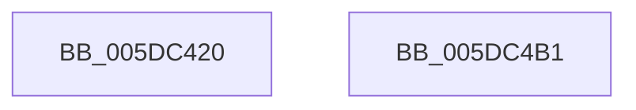

# PoSessionBuiltinPanelState

- RVA: `0x005DC420`–`0x005DC4B2` (길이 `146` bytes)
- VA: `0x00000001405DC420`
- 실행 섹션: `.text`
- PDB 이름 있음: `예`; PDB Function 태그: `아니요`
- unwind 정보 RVA: `0x000CD3C8`
- 디코드: `39`개 명령, `146/146` bytes 표시
- 미해석 바이트: `0` (있으면 어셈블리에 `.byte`로 보존)

> 이 문서는 커널 이미지의 기계어와 PDB 기호를 분석해 생성했습니다. 4번과 5번은 함수 원형과 자료형을 바이너리 사용 방식에서 추정한 C 해석이며 원본 소스 복구 결과는 아닙니다.

## 1. Dependencies

- 직접 호출 지점: **3**; 고유 호출 대상: **2**
- 직접 호출자로 확인된 함수: **1**
- RIP 상대 이미지 참조: **0**

### Outgoing calls
- `0x005DC442` → [PopBlockSessionSwitch](../../page/AC/PopBlockSessionSwitch_function_00ACE4C0.md) (function, `0x00ACE4C0`)
- `0x005DC493` → [PopInvokeWin32Callout](../../page/91/PopInvokeWin32Callout_function_009125F4.md) (function, `0x009125F4`)
- `0x005DC49E` → [PopBlockSessionSwitch](../../page/AC/PopBlockSessionSwitch_function_00ACE4C0.md) (function, `0x00ACE4C0`)

### Direct callers
- [TtmpCallSetBuiltinPanelState](../../page/77/TtmpCallSetBuiltinPanelState_function_0077600C.md) at `0x00776066`

### Static image references
- 디코드된 RIP-relative 메모리 참조가 없습니다.

## 2. Other-region calls and transfers

- 다른 실행 섹션으로 향하는 call: **3**
  - `0x005DC442` → [PopBlockSessionSwitch](../../page/AC/PopBlockSessionSwitch_function_00ACE4C0.md) (`.text` → `PAGE`)
  - `0x005DC493` → [PopInvokeWin32Callout](../../page/91/PopInvokeWin32Callout_function_009125F4.md) (`.text` → `PAGE`)
  - `0x005DC49E` → [PopBlockSessionSwitch](../../page/AC/PopBlockSessionSwitch_function_00ACE4C0.md) (`.text` → `PAGE`)
- 별도 외부 분기/꼬리 이동을 확인하지 못했습니다.

## 3. Assembly (complete function range)

```asm
005DC420  48 89 5C 24 20                  mov qword ptr [rsp + 0x20], rbx
005DC425  89 54 24 10                     mov dword ptr [rsp + 0x10], edx
005DC429  55                              push rbp
005DC42A  48 8B EC                        mov rbp, rsp
005DC42D  48 83 EC 60                     sub rsp, 0x60
005DC431  83 65 10 00                     and dword ptr [rbp + 0x10], 0
005DC435  48 8D 55 10                     lea rdx, [rbp + 0x10]
005DC439  8B D9                           mov ebx, ecx
005DC43B  33 C0                           xor eax, eax
005DC43D  B1 01                           mov cl, 1
005DC43F  89 45 C4                        mov dword ptr [rbp - 0x3c], eax
005DC442  E8 79 20 4F 00                  call 0x140ace4c0
005DC447  0F 57 C0                        xorps xmm0, xmm0
005DC44A  89 5D 20                        mov dword ptr [rbp + 0x20], ebx
005DC44D  33 C0                           xor eax, eax
005DC44F  4C 8D 4D 18                     lea r9, [rbp + 0x18]
005DC453  0F 11 45 D0                     movups xmmword ptr [rbp - 0x30], xmm0
005DC457  48 89 45 F0                     mov qword ptr [rbp - 0x10], rax
005DC45B  48 8D 55 C0                     lea rdx, [rbp - 0x40]
005DC45F  48 83 65 F0 00                  and qword ptr [rbp - 0x10], 0
005DC464  41 B8 01 00 00 00               mov r8d, 1
005DC46A  0F 11 45 E0                     movups xmmword ptr [rbp - 0x20], xmm0
005DC46E  83 65 E8 00                     and dword ptr [rbp - 0x18], 0
005DC472  88 45 D4                        mov byte ptr [rbp - 0x2c], al
005DC475  48 8D 45 20                     lea rax, [rbp + 0x20]
005DC479  41 8D 48 04                     lea ecx, [r8 + 4]
005DC47D  48 89 45 E0                     mov qword ptr [rbp - 0x20], rax
005DC481  0F 11 45 C0                     movups xmmword ptr [rbp - 0x40], xmm0
005DC485  C7 45 D0 07 00 00 00            mov dword ptr [rbp - 0x30], 7
005DC48C  C7 45 D8 04 00 00 00            mov dword ptr [rbp - 0x28], 4
005DC493  E8 5C 61 33 00                  call 0x1409125f4
005DC498  48 8D 55 10                     lea rdx, [rbp + 0x10]
005DC49C  33 C9                           xor ecx, ecx
005DC49E  E8 1D 20 4F 00                  call 0x140ace4c0
005DC4A3  48 8B 9C 24 88 00 00 00         mov rbx, qword ptr [rsp + 0x88]
005DC4AB  48 83 C4 60                     add rsp, 0x60
005DC4AF  5D                              pop rbp
005DC4B0  C3                              ret
005DC4B1  CC                              int3
```

## 4. C-style interpretation (structured pseudocode)

```c
__int64 __fastcall PoSessionBuiltinPanelState(int a1, int a2)
{
    __int64 result;
    __int64 v_rsp;
    unsigned __int64 v_stack_m18;
    unsigned int v_stack_m20;
    unsigned __int64 v_stack_m28;
    unsigned int v_stack_m30;
    unsigned __int8 v_stack_m34;
    unsigned __int64 v_stack_m38;
    unsigned int v_stack_m44;
    unsigned __int64 v_stack_m48;
    unsigned int v_stack_p10;
    unsigned int v_stack_p18;
    unsigned __int64 v_stack_p20;
    unsigned int v_stack_p8;

    v_stack_p20 = v_rbx;
    v_stack_p10 = a2;
    v_rsp = (v_rsp) - (96);
    result = 0;
    v_stack_m44 = 0;
    result = PopBlockSessionSwitch(1, v_stack_p8, a3, a4);
    v_stack_p18 = (unsigned int)((unsigned int)(a1));
    result = 0;
    v_stack_m38 = v_xmm0;
    v_stack_m18 = 0;
    v_stack_m28 = v_xmm0;
    v_stack_m34 = 0;
    v_stack_m28 = v_stack_p18;
    v_stack_m48 = v_xmm0;
    v_stack_m38 = 7;
    v_stack_m30 = 4;
    result = PopInvokeWin32Callout(1 + 4, v_stack_m48, 1, v_stack_p10);
    a1 = 0;
    result = PopBlockSessionSwitch(a1, v_stack_p8, 1, v_stack_p10);
    v_rsp = (v_rsp) + (96);
    return result;
}
```

## 5. (Beta) C Style

```c
int64_t PoSessionBuiltinPanelState(int32_t Arg1, int32_t Arg2)
{
    int64_t result;
    int64_t local_rsp;
    uint64_t v_stack_m18;
    uint32_t v_stack_m20;
    uint64_t v_stack_m28;
    uint32_t v_stack_m30;
    uint8_t v_stack_m34;
    uint64_t v_stack_m38;
    uint32_t v_stack_m44;
    uint64_t v_stack_m48;
    uint32_t v_stack_p10;
    uint32_t v_stack_p18;
    uint64_t v_stack_p20;
    uint32_t v_stack_p8;

    v_stack_p20 = local_rbx;
    v_stack_p10 = Arg2;
    local_rsp = (local_rsp) - (96);
    result = 0;
    v_stack_m44 = 0;
    result = PopBlockSessionSwitch(1, v_stack_p8, a3, a4);
    v_stack_p18 = (uint32_t)((uint32_t)(Arg1));
    result = 0;
    v_stack_m38 = v_xmm0;
    v_stack_m18 = 0;
    v_stack_m28 = v_xmm0;
    v_stack_m34 = 0;
    v_stack_m28 = v_stack_p18;
    v_stack_m48 = v_xmm0;
    v_stack_m38 = 7;
    v_stack_m30 = 4;
    result = PopInvokeWin32Callout(1 + 4, v_stack_m48, 1, v_stack_p10);
    Arg1 = 0;
    result = PopBlockSessionSwitch(Arg1, v_stack_p8, 1, v_stack_p10);
    local_rsp = (local_rsp) + (96);
    return result;
}
```

## 6. Execution-region graph

[열기: 2D/3D 그래프와 함수 탐색 컨트롤 패널](../../../control-panel.html?section=text&rva=0x005DC420&view=graph)

- 2D 그래프는 위에서 아래로 흐르고, 3D 그래프는 빈 공간을 드래그해 회전합니다. Shift+드래그는 이동, 휠은 확대·축소, 함수 노드 선택은 대상 보고서 이동입니다.

### Static fallback


