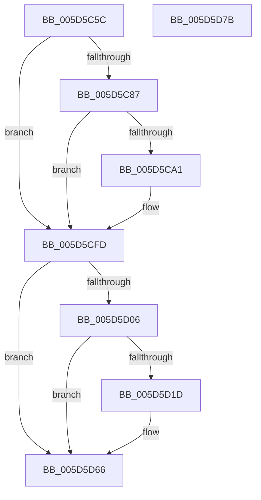

# PoTraceForceIdleReset

- RVA: `0x005D5C5C`–`0x005D5D7C` (길이 `288` bytes)
- VA: `0x00000001405D5C5C`
- 실행 섹션: `.text`
- PDB 이름 있음: `예`; PDB Function 태그: `아니요`
- unwind 정보 RVA: `0x000BF3A4`
- 디코드: `61`개 명령, `288/288` bytes 표시
- 미해석 바이트: `0` (있으면 어셈블리에 `.byte`로 보존)

> 이 문서는 커널 이미지의 기계어와 PDB 기호를 분석해 생성했습니다. 4번과 5번은 함수 원형과 자료형을 바이너리 사용 방식에서 추정한 C 해석이며 원본 소스 복구 결과는 아닙니다.

## 1. Dependencies

- 직접 호출 지점: **5**; 고유 호출 대상: **5**
- 직접 호출자로 확인된 함수: **3**
- RIP 상대 이미지 참조: **6**

### Outgoing calls
- `0x005D5C98` → [tlgKeywordOn](../42/tlgKeywordOn_function_0042EAA0.md) (function, `0x0042EAA0`)
- `0x005D5CF8` → [tlgWriteTransfer_EtwWriteTransfer](../42/tlgWriteTransfer_EtwWriteTransfer_function_004260E0.md) (function, `0x004260E0`)
- `0x005D5D14` → [EtwEventEnabled](../39/EtwEventEnabled_function_00392450.md) (function, `0x00392450`)
- `0x005D5D61` → [EtwWriteEx](../25/EtwWriteEx_function_0025F0D0.md) (function, `0x0025F0D0`)
- `0x005D5D6D` → [_security_check_cookie](../6A/_security_check_cookie_function_006AC640.md) (function, `0x006AC640`)

### Direct callers
- [sub_006D6552](../6D/Unknown_function_006D6552.md) at `0x006D65D3`
- [sub_006E638A](../6E/Unknown_function_006E638A.md) at `0x006E6407`
- [sub_006E650A](../6E/Unknown_function_006E650A.md) at `0x006E6587`

### Static image references
- `0x005D5C6D` → RVA `0x00E0A740` (`.data`; read)
- `0x005D5C7B` → RVA `0x00E07748` (`.data`; read)
- `0x005D5CAD` → RVA `0x0004966F` (`.rdata`; read)
- `0x005D5CFD` → RVA `0x00E67858` (`.data`; read)
- `0x005D5D06` → RVA `0x00F0B408` (`.data`; read)
- `0x005D5D0D` → RVA `0x00022C58` (`.rdata`; read)

## 2. Other-region calls and transfers

- 다른 실행 섹션으로 향하는 call: **0**
- 별도 외부 분기/꼬리 이동을 확인하지 못했습니다.

## 3. Assembly (complete function range)

```asm
005D5C5C  89 4C 24 08                     mov dword ptr [rsp + 8], ecx
005D5C60  55                              push rbp
005D5C61  48 8D 6C 24 A9                  lea rbp, [rsp - 0x57]
005D5C66  48 81 EC B0 00 00 00            sub rsp, 0xb0
005D5C6D  48 8B 05 CC 4A 83 00            mov rax, qword ptr [rip + 0x834acc]
005D5C74  48 33 C4                        xor rax, rsp
005D5C77  48 89 45 47                     mov qword ptr [rbp + 0x47], rax
005D5C7B  83 3D C6 1A 83 00 05            cmp dword ptr [rip + 0x831ac6], 5
005D5C82  44 8B C1                        mov r8d, ecx
005D5C85  76 76                           jbe 0x1405d5cfd
005D5C87  48 BA 00 00 00 00 00 40 00 00   movabs rdx, 0x400000000000
005D5C91  48 8D 0D B0 1A 83 00            lea rcx, [rip + 0x831ab0]
005D5C98  E8 03 8E E5 FF                  call 0x14042eaa0
005D5C9D  84 C0                           test al, al
005D5C9F  74 5C                           je 0x1405d5cfd
005D5CA1  83 65 33 00                     and dword ptr [rbp + 0x33], 0
005D5CA5  48 8D 45 E7                     lea rax, [rbp - 0x19]
005D5CA9  83 65 43 00                     and dword ptr [rbp + 0x43], 0
005D5CAD  48 8D 15 BB 39 A7 FF            lea rdx, [rip - 0x58c645]
005D5CB4  48 89 45 27                     mov qword ptr [rbp + 0x27], rax
005D5CB8  48 8D 0D 89 1A 83 00            lea rcx, [rip + 0x831a89]
005D5CBF  48 8D 45 EF                     lea rax, [rbp - 0x11]
005D5CC3  44 89 45 E7                     mov dword ptr [rbp - 0x19], r8d
005D5CC7  48 89 45 37                     mov qword ptr [rbp + 0x37], rax
005D5CCB  45 33 C9                        xor r9d, r9d
005D5CCE  48 8D 45 07                     lea rax, [rbp + 7]
005D5CD2  C7 45 2F 04 00 00 00            mov dword ptr [rbp + 0x2f], 4
005D5CD9  48 89 44 24 28                  mov qword ptr [rsp + 0x28], rax
005D5CDE  45 33 C0                        xor r8d, r8d
005D5CE1  C7 44 24 20 04 00 00 00         mov dword ptr [rsp + 0x20], 4
005D5CE9  48 C7 45 EF 00 00 00 01         mov qword ptr [rbp - 0x11], 0x1000000
005D5CF1  C7 45 3F 08 00 00 00            mov dword ptr [rbp + 0x3f], 8
005D5CF8  E8 E3 03 E5 FF                  call 0x1404260e0
005D5CFD  80 3D 54 1B 89 00 00            cmp byte ptr [rip + 0x891b54], 0
005D5D04  74 60                           je 0x1405d5d66
005D5D06  48 8B 0D FB 56 93 00            mov rcx, qword ptr [rip + 0x9356fb]
005D5D0D  48 8D 15 44 CF A4 FF            lea rdx, [rip - 0x5b30bc]
005D5D14  E8 37 C7 DB FF                  call 0x140392450
005D5D19  84 C0                           test al, al
005D5D1B  74 49                           je 0x1405d5d66
005D5D1D  83 65 03 00                     and dword ptr [rbp + 3], 0
005D5D21  48 8D 45 67                     lea rax, [rbp + 0x67]
005D5D25  48 8B 0D DC 56 93 00            mov rcx, qword ptr [rip + 0x9356dc]
005D5D2C  48 8D 15 25 CF A4 FF            lea rdx, [rip - 0x5b30db]
005D5D33  48 89 45 F7                     mov qword ptr [rbp - 9], rax
005D5D37  45 33 C9                        xor r9d, r9d
005D5D3A  48 8D 45 F7                     lea rax, [rbp - 9]
005D5D3E  C7 45 FF 04 00 00 00            mov dword ptr [rbp - 1], 4
005D5D45  48 89 44 24 38                  mov qword ptr [rsp + 0x38], rax
005D5D4A  45 33 C0                        xor r8d, r8d
005D5D4D  C7 44 24 30 01 00 00 00         mov dword ptr [rsp + 0x30], 1
005D5D55  48 83 64 24 28 00               and qword ptr [rsp + 0x28], 0
005D5D5B  48 83 64 24 20 00               and qword ptr [rsp + 0x20], 0
005D5D61  E8 6A 93 C8 FF                  call 0x14025f0d0
005D5D66  48 8B 4D 47                     mov rcx, qword ptr [rbp + 0x47]
005D5D6A  48 33 CC                        xor rcx, rsp
005D5D6D  E8 CE 68 0D 00                  call 0x1406ac640
005D5D72  48 81 C4 B0 00 00 00            add rsp, 0xb0
005D5D79  5D                              pop rbp
005D5D7A  C3                              ret
005D5D7B  CC                              int3
```

## 4. C-style interpretation (structured pseudocode)

```c
__int64 __fastcall PoTraceForceIdleReset(int a1, __int64 a2, __int64 a3, int a4)
{
    __int64 result;
    __int64 v_rsp;
    unsigned __int64 v_stack_m18;
    unsigned int v_stack_m1C;
    unsigned int v_stack_m20;
    unsigned __int64 v_stack_m28;
    unsigned int v_stack_m2C;
    unsigned int v_stack_m30;
    unsigned __int64 v_stack_m38;
    unsigned __int64 v_stack_m58;
    unsigned int v_stack_m5C;
    unsigned __int64 v_stack_m5F;
    unsigned int v_stack_m60;
    unsigned __int64 v_stack_m68;
    unsigned __int64 v_stack_m70;
    unsigned __int64 v_stack_m78;
    unsigned __int64 v_stack_m80;
    unsigned int v_stack_m88;
    unsigned __int64 v_stack_m90;
    unsigned int v_stack_m98;
    unsigned int v_stack_p8;

    v_stack_p8 = a1;
    v_rsp = (v_rsp) - (176);
    result = (*(unsigned __int64 *)(v_rip + 8604364)) ^ (v_rsp);
    v_stack_m18 = result;
    if ((*(unsigned int *)(v_rip + 8592070)) <= 5) goto loc_005D5CFD;
    result = tlgKeywordOn(v_rip + 8592048, a2, (unsigned int)(a1), a4);
    if ((unsigned __int8)(result) != 0) {
        result = v_stack_m78;
        a2 = v_rip - 5817925;
        v_stack_m38 = result;
        a1 = v_rip + 8592009;
        result = v_stack_m70;
        v_stack_m78 = (unsigned int)((unsigned int)(a1));
        v_stack_m28 = result;
        a4 = 0;
        result = v_stack_m58;
        v_stack_m30 = 4;
        v_stack_m90 = result;
        a3 = 0;
        v_stack_m98 = 4;
        v_stack_m70 = 0x1000000ULL;
        v_stack_m20 = 8;
        result = tlgWriteTransfer_EtwWriteTransfer(a1, a2, a3, a4);
    }
    if ((*(unsigned __int8 *)(v_rip + 8985428)) == 0) goto loc_005D5D66;
    result = EtwEventEnabled(*(unsigned __int64 *)(v_rip + 9656059), v_rip - 5976252, a3, a4);
    if ((unsigned __int8)(result) != 0) {
        result = v_stack_p8;
        a1 = *(unsigned __int64 *)(v_rip + 9656028);
        a2 = v_rip - 5976283;
        v_stack_m68 = result;
        a4 = 0;
        result = v_stack_m68;
        v_stack_m60 = 4;
        v_stack_m80 = result;
        a3 = 0;
        v_stack_m88 = 1;
        result = EtwWriteEx(a1, a2, a3, a4);
    }
    a1 = (v_stack_m18) ^ (v_rsp);
    result = _security_check_cookie(a1, a2, a3, a4);
    v_rsp = (v_rsp) + (176);
    return result;
}
```

## 5. (Beta) C Style

```c
int64_t PoTraceForceIdleReset(int32_t Arg1, int64_t Arg2, int64_t Arg3, int32_t Arg4)
{
    int64_t result;
    int64_t local_rsp;
    uint64_t v_stack_m18;
    uint32_t v_stack_m1C;
    uint32_t v_stack_m20;
    uint64_t v_stack_m28;
    uint32_t v_stack_m2C;
    uint32_t v_stack_m30;
    uint64_t v_stack_m38;
    uint64_t v_stack_m58;
    uint32_t v_stack_m5C;
    uint64_t v_stack_m5F;
    uint32_t v_stack_m60;
    uint64_t v_stack_m68;
    uint64_t v_stack_m70;
    uint64_t v_stack_m78;
    uint64_t v_stack_m80;
    uint32_t v_stack_m88;
    uint64_t v_stack_m90;
    uint32_t v_stack_m98;
    uint32_t v_stack_p8;

    v_stack_p8 = Arg1;
    local_rsp = (local_rsp) - (176);
    result = (*(uint64_t *)(v_rip + 0x834ACC)) ^ (local_rsp);
    v_stack_m18 = result;
    if ((*(uint32_t *)(v_rip + 0x831AC6)) <= 5) goto loc_005D5CFD;
    result = tlgKeywordOn(v_rip + 8592048, Arg2, (uint32_t)(Arg1), Arg4);
    if ((uint8_t)(result) != 0) {
        result = v_stack_m78;
        Arg2 = v_rip - 5817925;
        v_stack_m38 = result;
        Arg1 = v_rip + 8592009;
        result = v_stack_m70;
        v_stack_m78 = (uint32_t)((uint32_t)(Arg1));
        v_stack_m28 = result;
        Arg4 = 0;
        result = v_stack_m58;
        v_stack_m30 = 4;
        v_stack_m90 = result;
        Arg3 = 0;
        v_stack_m98 = 4;
        v_stack_m70 = 0x1000000ULL;
        v_stack_m20 = 8;
        result = tlgWriteTransfer_EtwWriteTransfer(Arg1, Arg2, Arg3, Arg4);
    }
    if ((*(uint8_t *)(v_rip + 0x891B54)) == 0) goto loc_005D5D66;
    result = EtwEventEnabled(*(uint64_t *)(v_rip + 0x9356FB), v_rip - 5976252, Arg3, Arg4);
    if ((uint8_t)(result) != 0) {
        result = v_stack_p8;
        Arg1 = *(uint64_t *)(v_rip + 0x9356DC);
        Arg2 = v_rip - 5976283;
        v_stack_m68 = result;
        Arg4 = 0;
        result = v_stack_m68;
        v_stack_m60 = 4;
        v_stack_m80 = result;
        Arg3 = 0;
        v_stack_m88 = 1;
        result = EtwWriteEx(Arg1, Arg2, Arg3, Arg4);
    }
    Arg1 = (v_stack_m18) ^ (local_rsp);
    result = _security_check_cookie(Arg1, Arg2, Arg3, Arg4);
    local_rsp = (local_rsp) + (176);
    return result;
}
```

## 6. Execution-region graph

[열기: 2D/3D 그래프와 함수 탐색 컨트롤 패널](../../../control-panel.html?section=text&rva=0x005D5C5C&view=graph)

- 2D 그래프는 위에서 아래로 흐르고, 3D 그래프는 빈 공간을 드래그해 회전합니다. Shift+드래그는 이동, 휠은 확대·축소, 함수 노드 선택은 대상 보고서 이동입니다.

### Static fallback


