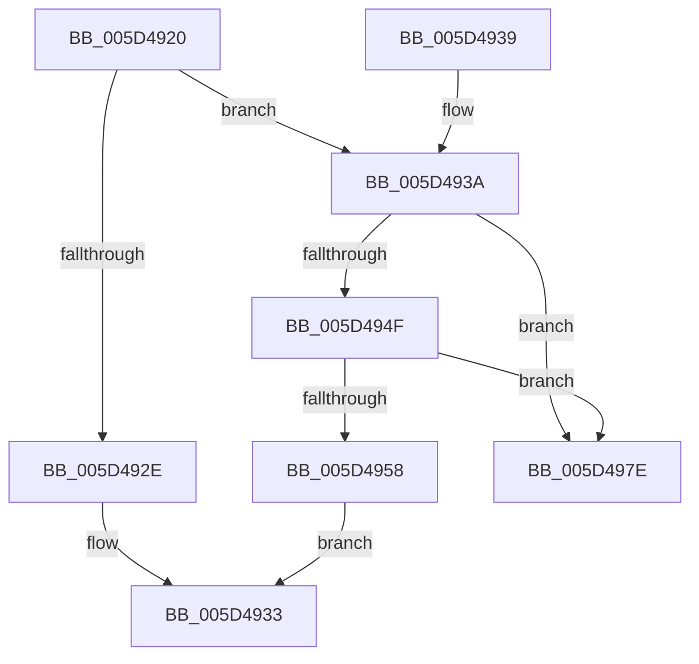

# PoUnregisterSstNotificationHandler

- RVA: `0x005D4920`–`0x005D4985` (길이 `101` bytes)
- VA: `0x00000001405D4920`
- 실행 섹션: `.text`
- PDB 이름 있음: `예`; PDB Function 태그: `아니요`
- unwind 정보 RVA: `0x00095A80`
- 디코드: `30`개 명령, `101/101` bytes 표시
- 미해석 바이트: `0` (있으면 어셈블리에 `.byte`로 보존)

> 이 문서는 커널 이미지의 기계어와 PDB 기호를 분석해 생성했습니다. 4번과 5번은 함수 원형과 자료형을 바이너리 사용 방식에서 추정한 C 해석이며 원본 소스 복구 결과는 아닙니다.

## 1. Dependencies

- 직접 호출 지점: **3**; 고유 호출 대상: **3**
- 직접 호출자로 확인된 함수: **0**
- RIP 상대 이미지 참조: **1**

### Outgoing calls
- `0x005D4941` → [KeAcquireSpinLockRaiseToDpc](../20/KeAcquireSpinLockRaiseToDpc_function_00208470.md) (function, `0x00208470`)
- `0x005D4968` → [KeReleaseSpinLock](../39/KeReleaseSpinLock_function_00392BA0.md) (function, `0x00392BA0`)
- `0x005D4975` → [ExFreePoolWithTag](../../poolcode/B8/ExFreePoolWithTag_function_00B82870.md) (function, `0x00B82870`)

### Direct callers
- 이 함수 시작 RVA로 연결되는 직접 call은 확인되지 않았습니다. 간접 호출은 완전히 역산할 수 없습니다.

### Static image references
- `0x005D493A` → RVA `0x00F0DF20` (`.data`; read)

## 2. Other-region calls and transfers

- 다른 실행 섹션으로 향하는 call: **1**
  - `0x005D4975` → [ExFreePoolWithTag](../../poolcode/B8/ExFreePoolWithTag_function_00B82870.md) (`.text` → `POOLCODE`)
- 별도 외부 분기/꼬리 이동을 확인하지 못했습니다.

## 3. Assembly (complete function range)

```asm
005D4920  40 53                           push rbx
005D4922  48 83 EC 20                     sub rsp, 0x20
005D4926  48 8B D9                        mov rbx, rcx
005D4929  48 85 C9                        test rcx, rcx
005D492C  75 0C                           jne 0x1405d493a
005D492E  B8 0D 00 00 C0                  mov eax, 0xc000000d
005D4933  48 83 C4 20                     add rsp, 0x20
005D4937  5B                              pop rbx
005D4938  C3                              ret
005D4939  CC                              int3
005D493A  48 8D 0D DF 95 93 00            lea rcx, [rip + 0x9395df]
005D4941  E8 2A 3B C3 FF                  call 0x140208470
005D4946  4C 8B 03                        mov r8, qword ptr [rbx]
005D4949  49 39 58 08                     cmp qword ptr [r8 + 8], rbx
005D494D  75 2F                           jne 0x1405d497e
005D494F  48 8B 53 08                     mov rdx, qword ptr [rbx + 8]
005D4953  48 39 1A                        cmp qword ptr [rdx], rbx
005D4956  75 26                           jne 0x1405d497e
005D4958  4C 89 02                        mov qword ptr [rdx], r8
005D495B  48 8D 0D BE 95 93 00            lea rcx, [rip + 0x9395be]
005D4962  49 89 50 08                     mov qword ptr [r8 + 8], rdx
005D4966  8A D0                           mov dl, al
005D4968  E8 33 E2 DB FF                  call 0x140392ba0
005D496D  BA 68 69 62 72                  mov edx, 0x72626968
005D4972  48 8B CB                        mov rcx, rbx
005D4975  E8 F6 DE 5A 00                  call 0x140b82870
005D497A  33 C0                           xor eax, eax
005D497C  EB B5                           jmp 0x1405d4933
005D497E  B9 03 00 00 00                  mov ecx, 3
005D4983  CD 29                           int 0x29
```

## 4. C-style interpretation (structured pseudocode)

```c
__int64 __fastcall PoUnregisterSstNotificationHandler(__int64 a1)
{
    __int64 result;
    __int64 v_rsp;

    v_rsp = (v_rsp) - (32);
    if (a1 != 0) goto loc_005D493A;
loc_005D4933:
    v_rsp = (v_rsp) + (32);
    return (unsigned int)(0xC000000DULL);
loc_005D493A:
    result = KeAcquireSpinLockRaiseToDpc(v_rip + 9672159, a2, a3, a4);
    if ((*(unsigned __int64 *)(*(unsigned __int64 *)(a1) + 8)) != a1) goto loc_005D497E;
    if ((*(unsigned __int64 *)(*(unsigned __int64 *)(a1 + 8))) != a1) goto loc_005D497E;
    *(unsigned __int64 *)(*(unsigned __int64 *)(a1 + 8)) = *(unsigned __int64 *)(a1);
    *(unsigned __int64 *)(*(unsigned __int64 *)(a1) + 8) = *(unsigned __int64 *)(a1 + 8);
    result = KeReleaseSpinLock(v_rip + 9672126, (unsigned __int8)(result), *(unsigned __int64 *)(a1), a4);
    result = ExFreePoolWithTag(a1, (unsigned int)(0x72626968ULL), *(unsigned __int64 *)(a1), a4);
    result = 0;
    goto loc_005D4933;
loc_005D497E:
    return result;
}
```

## 5. (Beta) C Style

```c
int64_t PoUnregisterSstNotificationHandler(void *Arg1)
{
    uint8_t *arg1 = (uint8_t *)Arg1;

    int64_t result;
    int64_t local_rsp;

    local_rsp = (local_rsp) - (32);
    if (Arg1 != NULL) goto loc_005D493A;
loc_005D4933:
    local_rsp = (local_rsp) + (32);
    return (uint32_t)(0xC000000DULL);
loc_005D493A:
    result = KeAcquireSpinLockRaiseToDpc(v_rip + 9672159, a2, a3, a4);
    if ((*(uint64_t *)(*(uint64_t *)(arg1) + 0x8)) != Arg1) goto loc_005D497E;
    if ((*(uint64_t *)(*(uint64_t *)(arg1 + 0x8))) != Arg1) goto loc_005D497E;
    *(uint64_t *)(*(uint64_t *)(arg1 + 0x8)) = *(uint64_t *)(arg1);
    *(uint64_t *)(*(uint64_t *)(arg1) + 0x8) = *(uint64_t *)(arg1 + 0x8);
    result = KeReleaseSpinLock(v_rip + 9672126, (uint8_t)(result), *(uint64_t *)(arg1), a4);
    result = ExFreePoolWithTag(Arg1, (uint32_t)(0x72626968ULL), *(uint64_t *)(arg1), a4);
    result = 0;
    goto loc_005D4933;
loc_005D497E:
    return result;
}
```

### 관측된 메모리 오프셋

구조체 형식이 확인되지 않은 접근은 인자 기준의 오프셋으로만 기록했습니다.

| 기준 인자 | 오프셋 표현 | 폭 (bit) | 접근 |
|---|---:|---:|---|
| `Arg1` | `+ 0x0` | `64` | `R` |
| `Arg1` | `+ 0x8` | `64` | `R` |

## 6. Execution-region graph

[열기: 2D/3D 그래프와 함수 탐색 컨트롤 패널](../../../control-panel.html?section=text&rva=0x005D4920&view=graph)

- 2D 그래프는 위에서 아래로 흐르고, 3D 그래프는 빈 공간을 드래그해 회전합니다. Shift+드래그는 이동, 휠은 확대·축소, 함수 노드 선택은 대상 보고서 이동입니다.

### Static fallback


