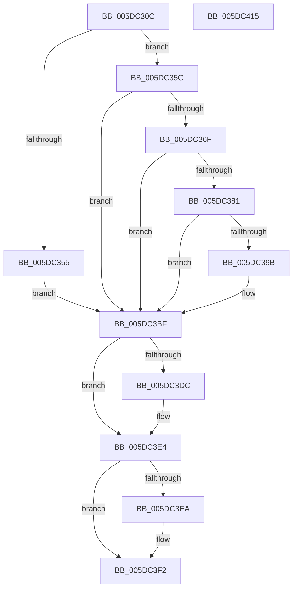

# PopAdaptivePersistSystemInitatedRebootState

- RVA: `0x005DC30C`–`0x005DC416` (길이 `266` bytes)
- VA: `0x00000001405DC30C`
- 실행 섹션: `.text`
- PDB 이름 있음: `예`; PDB Function 태그: `아니요`
- unwind 정보 RVA: `0x000CD384`
- 디코드: `74`개 명령, `266/266` bytes 표시
- 미해석 바이트: `0` (있으면 어셈블리에 `.byte`로 보존)

> 이 문서는 커널 이미지의 기계어와 PDB 기호를 분석해 생성했습니다. 4번과 5번은 함수 원형과 자료형을 바이너리 사용 방식에서 추정한 C 해석이며 원본 소스 복구 결과는 아닙니다.

## 1. Dependencies

- 직접 호출 지점: **8**; 고유 호출 대상: **8**
- 직접 호출자로 확인된 함수: **1**
- RIP 상대 이미지 참조: **3**

### Outgoing calls
- `0x005DC360` → [PopBcdOpen](../../page/A4/PopBcdOpen_function_00A412D4.md) (function, `0x00A412D4`)
- `0x005DC376` → [PopAdaptiveGetSystemInitiatedRebootTargetBootEntry](../../page/76/PopAdaptiveGetSystemInitiatedRebootTargetBootEntry_function_0076B69C.md) (function, `0x0076B69C`)
- `0x005DC38C` → [BcdOpenObject](../../page/91/BcdOpenObject_function_00916704.md) (function, `0x00916704`)
- `0x005DC3B8` → [BcdSetElementData](../../page/A3/BcdSetElementData_function_00A3E370.md) (function, `0x00A3E370`)
- `0x005DC3D1` → [PopDiagTraceAdaptiveBootOverridePrepared](../../page/76/PopDiagTraceAdaptiveBootOverridePrepared_function_00760470.md) (function, `0x00760470`)
- `0x005DC3DF` → [BcdCloseObject](../../page/A3/BcdCloseObject_function_00A3FB08.md) (function, `0x00A3FB08`)
- `0x005DC3ED` → [PopBcdClose](../../page/A3/PopBcdClose_function_00A3C674.md) (function, `0x00A3C674`)
- `0x005DC3FB` → [_security_check_cookie](../6A/_security_check_cookie_function_006AC640.md) (function, `0x006AC640`)

### Direct callers
- [PopGracefulShutdown](../../pagelk/B6/PopGracefulShutdown_function_00B6BEC8.md) at `0x00B6BEE0`

### Static image references
- `0x005DC323` → RVA `0x00E0A740` (`.data`; read)
- `0x005DC341` → RVA `0x00FD8208` (`PAGEDATA`; read)
- `0x005DC39B` → RVA `0x00FD8210` (`PAGEDATA`; read)

## 2. Other-region calls and transfers

- 다른 실행 섹션으로 향하는 call: **7**
  - `0x005DC360` → [PopBcdOpen](../../page/A4/PopBcdOpen_function_00A412D4.md) (`.text` → `PAGE`)
  - `0x005DC376` → [PopAdaptiveGetSystemInitiatedRebootTargetBootEntry](../../page/76/PopAdaptiveGetSystemInitiatedRebootTargetBootEntry_function_0076B69C.md) (`.text` → `PAGE`)
  - `0x005DC38C` → [BcdOpenObject](../../page/91/BcdOpenObject_function_00916704.md) (`.text` → `PAGE`)
  - `0x005DC3B8` → [BcdSetElementData](../../page/A3/BcdSetElementData_function_00A3E370.md) (`.text` → `PAGE`)
  - `0x005DC3D1` → [PopDiagTraceAdaptiveBootOverridePrepared](../../page/76/PopDiagTraceAdaptiveBootOverridePrepared_function_00760470.md) (`.text` → `PAGE`)
  - `0x005DC3DF` → [BcdCloseObject](../../page/A3/BcdCloseObject_function_00A3FB08.md) (`.text` → `PAGE`)
  - `0x005DC3ED` → [PopBcdClose](../../page/A3/PopBcdClose_function_00A3C674.md) (`.text` → `PAGE`)
- 별도 외부 분기/꼬리 이동을 확인하지 못했습니다.

## 3. Assembly (complete function range)

```asm
005DC30C  48 89 5C 24 08                  mov qword ptr [rsp + 8], rbx
005DC311  48 89 74 24 10                  mov qword ptr [rsp + 0x10], rsi
005DC316  48 89 7C 24 18                  mov qword ptr [rsp + 0x18], rdi
005DC31B  55                              push rbp
005DC31C  48 8B EC                        mov rbp, rsp
005DC31F  48 83 EC 50                     sub rsp, 0x50
005DC323  48 8B 05 16 E4 82 00            mov rax, qword ptr [rip + 0x82e416]
005DC32A  48 33 C4                        xor rax, rsp
005DC32D  48 89 45 F8                     mov qword ptr [rbp - 8], rax
005DC331  48 83 65 E0 00                  and qword ptr [rbp - 0x20], 0
005DC336  48 83 CF FF                     or rdi, 0xffffffffffffffff
005DC33A  48 0B F7                        or rsi, rdi
005DC33D  48 89 7D D8                     mov qword ptr [rbp - 0x28], rdi
005DC341  80 3D C0 BE 9F 00 00            cmp byte ptr [rip + 0x9fbec0], 0
005DC348  0F 57 C0                        xorps xmm0, xmm0
005DC34B  0F 11 45 E8                     movups xmmword ptr [rbp - 0x18], xmm0
005DC34F  48 89 75 D0                     mov qword ptr [rbp - 0x30], rsi
005DC353  75 07                           jne 0x1405dc35c
005DC355  BB 17 01 00 00                  mov ebx, 0x117
005DC35A  EB 63                           jmp 0x1405dc3bf
005DC35C  48 8D 4D D8                     lea rcx, [rbp - 0x28]
005DC360  E8 6F 4F 46 00                  call 0x140a412d4
005DC365  48 8B 7D D8                     mov rdi, qword ptr [rbp - 0x28]
005DC369  8B D8                           mov ebx, eax
005DC36B  85 C0                           test eax, eax
005DC36D  78 50                           js 0x1405dc3bf
005DC36F  48 8D 55 E8                     lea rdx, [rbp - 0x18]
005DC373  48 8B CF                        mov rcx, rdi
005DC376  E8 21 F3 18 00                  call 0x14076b69c
005DC37B  8B D8                           mov ebx, eax
005DC37D  85 C0                           test eax, eax
005DC37F  78 3E                           js 0x1405dc3bf
005DC381  4C 8D 45 D0                     lea r8, [rbp - 0x30]
005DC385  48 8B CF                        mov rcx, rdi
005DC388  48 8D 55 E8                     lea rdx, [rbp - 0x18]
005DC38C  E8 73 A3 33 00                  call 0x140916704
005DC391  48 8B 75 D0                     mov rsi, qword ptr [rbp - 0x30]
005DC395  8B D8                           mov ebx, eax
005DC397  85 C0                           test eax, eax
005DC399  78 24                           js 0x1405dc3bf
005DC39B  48 8B 05 6E BE 9F 00            mov rax, qword ptr [rip + 0x9fbe6e]
005DC3A2  4C 8D 45 E0                     lea r8, [rbp - 0x20]
005DC3A6  41 B9 08 00 00 00               mov r9d, 8
005DC3AC  48 89 45 E0                     mov qword ptr [rbp - 0x20], rax
005DC3B0  BA 5A 01 00 25                  mov edx, 0x2500015a
005DC3B5  48 8B CE                        mov rcx, rsi
005DC3B8  E8 B3 1F 46 00                  call 0x140a3e370
005DC3BD  8B D8                           mov ebx, eax
005DC3BF  48 8B 4D E0                     mov rcx, qword ptr [rbp - 0x20]
005DC3C3  44 8B C3                        mov r8d, ebx
005DC3C6  8A D1                           mov dl, cl
005DC3C8  83 E1 07                        and ecx, 7
005DC3CB  C0 EA 03                        shr dl, 3
005DC3CE  80 E2 01                        and dl, 1
005DC3D1  E8 9A 40 18 00                  call 0x140760470
005DC3D6  48 83 FE FF                     cmp rsi, -1
005DC3DA  74 08                           je 0x1405dc3e4
005DC3DC  48 8B CE                        mov rcx, rsi
005DC3DF  E8 24 37 46 00                  call 0x140a3fb08
005DC3E4  48 83 FF FF                     cmp rdi, -1
005DC3E8  74 08                           je 0x1405dc3f2
005DC3EA  48 8B CF                        mov rcx, rdi
005DC3ED  E8 82 02 46 00                  call 0x140a3c674
005DC3F2  8B C3                           mov eax, ebx
005DC3F4  48 8B 4D F8                     mov rcx, qword ptr [rbp - 8]
005DC3F8  48 33 CC                        xor rcx, rsp
005DC3FB  E8 40 02 0D 00                  call 0x1406ac640
005DC400  48 8B 5C 24 60                  mov rbx, qword ptr [rsp + 0x60]
005DC405  48 8B 74 24 68                  mov rsi, qword ptr [rsp + 0x68]
005DC40A  48 8B 7C 24 70                  mov rdi, qword ptr [rsp + 0x70]
005DC40F  48 83 C4 50                     add rsp, 0x50
005DC413  5D                              pop rbp
005DC414  C3                              ret
005DC415  CC                              int3
```

## 4. C-style interpretation (structured pseudocode)

```c
__int64 __fastcall PopAdaptivePersistSystemInitatedRebootState(void)
{
    __int64 result;
    __int64 v_rbx;
    __int64 v_rdi;
    __int64 v_rsi;
    __int64 v_rsp;
    unsigned __int64 v_stack_m10;
    unsigned __int64 v_stack_m20;
    unsigned __int64 v_stack_m28;
    unsigned __int64 v_stack_m30;
    unsigned __int64 v_stack_m38;
    unsigned __int64 v_stack_p10;
    unsigned __int64 v_stack_p18;
    unsigned __int64 v_stack_p8;

    v_stack_p8 = v_rbx;
    v_stack_p10 = v_rsi;
    v_stack_p18 = v_rdi;
    v_rsp = (v_rsp) - (80);
    result = (*(unsigned __int64 *)(v_rip + 8578070)) ^ (v_rsp);
    v_stack_m10 = result;
    v_rdi = (v_rdi) | (-1);
    v_rsi = (v_rsi) | (v_rdi);
    v_stack_m30 = v_rdi;
    v_stack_m20 = v_xmm0;
    v_stack_m38 = v_rsi;
    if ((*(unsigned __int8 *)(v_rip + 10469056)) != 0) goto loc_005DC35C;
    goto loc_005DC3BF;
loc_005DC35C:
    result = PopBcdOpen(v_stack_m30, a2, a3, a4);
    if (sign_flag) goto loc_005DC3BF;
    result = PopAdaptiveGetSystemInitiatedRebootTargetBootEntry(v_stack_m30, v_stack_m20, a3, a4);
    if (sign_flag) goto loc_005DC3BF;
    result = BcdOpenObject(v_stack_m30, v_stack_m20, v_stack_m38, a4);
    v_rbx = (unsigned int)((unsigned int)(result));
    if (!(sign_flag)) {
        result = *(unsigned __int64 *)(v_rip + 10468974);
        a3 = v_stack_m28;
        a4 = 8;
        v_stack_m28 = result;
        a2 = 0x2500015AULL;
        a1 = v_stack_m38;
        result = BcdSetElementData(a1, a2, a3, a4);
        v_rbx = (unsigned int)(result);
    }
    a1 = (unsigned int)((v_stack_m28) & (7));
    a2 = (unsigned __int8)(((unsigned __int8)(v_stack_m28)) >> (3));
    a2 = (unsigned __int8)((a2) & (1));
    result = PopDiagTraceAdaptiveBootOverridePrepared(a1, a2, (unsigned int)((unsigned int)(v_rbx)), a4);
    if (v_stack_m38 != -1) {
        a1 = v_stack_m38;
        result = BcdCloseObject(a1, a2, (unsigned int)((unsigned int)(v_rbx)), a4);
    }
    if (v_stack_m30 != -1) {
        a1 = v_stack_m30;
        result = PopBcdClose(a1, a2, (unsigned int)((unsigned int)(v_rbx)), a4);
    }
    a1 = (v_stack_m10) ^ (v_rsp);
    result = _security_check_cookie(a1, a2, (unsigned int)((unsigned int)(v_rbx)), a4);
    v_rsp = (v_rsp) + (80);
    return result;
}
```

## 5. (Beta) C Style

```c
void PopAdaptivePersistSystemInitatedRebootState(void)
{
    int64_t result;
    int64_t local_rbx;
    int64_t local_rdi;
    int64_t local_rsi;
    int64_t local_rsp;
    uint64_t v_stack_m10;
    uint64_t v_stack_m20;
    uint64_t v_stack_m28;
    uint64_t v_stack_m30;
    uint64_t v_stack_m38;
    uint64_t v_stack_p10;
    uint64_t v_stack_p18;
    uint64_t v_stack_p8;

    v_stack_p8 = local_rbx;
    v_stack_p10 = local_rsi;
    v_stack_p18 = local_rdi;
    local_rsp = (local_rsp) - (80);
    result = (*(uint64_t *)(v_rip + 0x82E416)) ^ (local_rsp);
    v_stack_m10 = result;
    local_rdi = (local_rdi) | (-1);
    local_rsi = (local_rsi) | (local_rdi);
    v_stack_m30 = local_rdi;
    v_stack_m20 = v_xmm0;
    v_stack_m38 = local_rsi;
    if ((*(uint8_t *)(v_rip + 0x9FBEC0)) != 0) goto loc_005DC35C;
    goto loc_005DC3BF;
loc_005DC35C:
    result = PopBcdOpen(v_stack_m30, a2, a3, a4);
    if (sign_flag) goto loc_005DC3BF;
    result = PopAdaptiveGetSystemInitiatedRebootTargetBootEntry(v_stack_m30, v_stack_m20, a3, a4);
    if (sign_flag) goto loc_005DC3BF;
    result = BcdOpenObject(v_stack_m30, v_stack_m20, v_stack_m38, a4);
    local_rbx = (uint32_t)((uint32_t)(result));
    if (!(sign_flag)) {
        result = *(uint64_t *)(v_rip + 0x9FBE6E);
        a3 = v_stack_m28;
        a4 = 8;
        v_stack_m28 = result;
        a2 = 0x2500015AULL;
        a1 = v_stack_m38;
        result = BcdSetElementData(a1, a2, a3, a4);
        local_rbx = (uint32_t)(result);
    }
    a1 = (uint32_t)((v_stack_m28) & (7));
    a2 = (uint8_t)(((uint8_t)(v_stack_m28)) >> (3));
    a2 = (uint8_t)((a2) & (1));
    result = PopDiagTraceAdaptiveBootOverridePrepared(a1, a2, (uint32_t)((uint32_t)(local_rbx)), a4);
    if (v_stack_m38 != -1) {
        a1 = v_stack_m38;
        result = BcdCloseObject(a1, a2, (uint32_t)((uint32_t)(local_rbx)), a4);
    }
    if (v_stack_m30 != -1) {
        a1 = v_stack_m30;
        result = PopBcdClose(a1, a2, (uint32_t)((uint32_t)(local_rbx)), a4);
    }
    a1 = (v_stack_m10) ^ (local_rsp);
    result = _security_check_cookie(a1, a2, (uint32_t)((uint32_t)(local_rbx)), a4);
    local_rsp = (local_rsp) + (80);
    return result;
}
```

## 6. Execution-region graph

[열기: 2D/3D 그래프와 함수 탐색 컨트롤 패널](../../../control-panel.html?section=text&rva=0x005DC30C&view=graph)

- 2D 그래프는 위에서 아래로 흐르고, 3D 그래프는 빈 공간을 드래그해 회전합니다. Shift+드래그는 이동, 휠은 확대·축소, 함수 노드 선택은 대상 보고서 이동입니다.

### Static fallback


