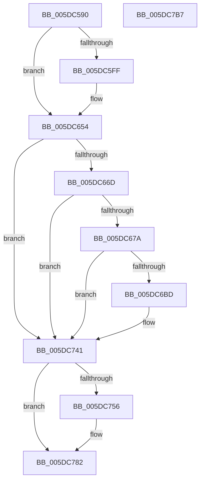

# PopAdaptiveStandbyActivatorCallback

- RVA: `0x005DC590`–`0x005DC7B8` (길이 `552` bytes)
- VA: `0x00000001405DC590`
- 실행 섹션: `.text`
- PDB 이름 있음: `예`; PDB Function 태그: `아니요`
- unwind 정보 RVA: `0x000CD58C`
- 디코드: `112`개 명령, `552/552` bytes 표시
- 미해석 바이트: `0` (있으면 어셈블리에 `.byte`로 보존)

> 이 문서는 커널 이미지의 기계어와 PDB 기호를 분석해 생성했습니다. 4번과 5번은 함수 원형과 자료형을 바이너리 사용 방식에서 추정한 C 해석이며 원본 소스 복구 결과는 아닙니다.

## 1. Dependencies

- 직접 호출 지점: **8**; 고유 호출 대상: **6**
- 직접 호출자로 확인된 함수: **0**
- RIP 상대 이미지 참조: **9**

### Outgoing calls
- `0x005DC5D2` → [EtwActivityIdControl](../41/EtwActivityIdControl_function_0041E720.md) (function, `0x0041E720`)
- `0x005DC64F` → [tlgWriteTransfer_EtwWriteTransfer](../42/tlgWriteTransfer_EtwWriteTransfer_function_004260E0.md) (function, `0x004260E0`)
- `0x005DC65B` → [PopAcquireRwLockExclusive](../43/PopAcquireRwLockExclusive_function_00430B44.md) (function, `0x00430B44`)
- `0x005DC6AB` → [Pdcv2ActivationClientRenewActivation](../../page/79/Pdcv2ActivationClientRenewActivation_function_0079B0F0.md) (function, `0x0079B0F0`)
- `0x005DC73C` → [tlgWriteTransfer_EtwWriteTransfer](../42/tlgWriteTransfer_EtwWriteTransfer_function_004260E0.md) (function, `0x004260E0`)
- `0x005DC748` → [PopReleaseRwLock](../2D/PopReleaseRwLock_function_002DFBBC.md) (function, `0x002DFBBC`)
- `0x005DC77D` → [tlgWriteTransfer_EtwWriteTransfer](../42/tlgWriteTransfer_EtwWriteTransfer_function_004260E0.md) (function, `0x004260E0`)
- `0x005DC79D` → [_security_check_cookie](../6A/_security_check_cookie_function_006AC640.md) (function, `0x006AC640`)

### Direct callers
- 이 함수 시작 RVA로 연결되는 직접 call은 확인되지 않았습니다. 간접 호출은 완전히 역산할 수 없습니다.

### Static image references
- `0x005DC5A7` → RVA `0x00E0A740` (`.data`; read)
- `0x005DC5F2` → RVA `0x00E082E8` (`.data`; read)
- `0x005DC613` → RVA `0x0004F9CB` (`.rdata`; read)
- `0x005DC654` → RVA `0x00F07E80` (`.data`; read)
- `0x005DC660` → RVA `0x00F07CC0` (`.data`; read)
- `0x005DC66D` → RVA `0x00F07CB8` (`.data`; read)
- `0x005DC67F` → RVA `0x006CC430` (` ?? ::FNODOBFM::`string'`; read)
- `0x005DC6C1` → RVA `0x0004FA13` (`.rdata`; read)
- `0x005DC767` → RVA `0x0004FA88` (`.rdata`; read)

## 2. Other-region calls and transfers

- 다른 실행 섹션으로 향하는 call: **1**
  - `0x005DC6AB` → [Pdcv2ActivationClientRenewActivation](../../page/79/Pdcv2ActivationClientRenewActivation_function_0079B0F0.md) (`.text` → `PAGE`)
- 별도 외부 분기/꼬리 이동을 확인하지 못했습니다.

## 3. Assembly (complete function range)

```asm
005DC590  48 89 5C 24 10                  mov qword ptr [rsp + 0x10], rbx
005DC595  48 89 7C 24 18                  mov qword ptr [rsp + 0x18], rdi
005DC59A  55                              push rbp
005DC59B  48 8D 6C 24 A9                  lea rbp, [rsp - 0x57]
005DC5A0  48 81 EC E0 00 00 00            sub rsp, 0xe0
005DC5A7  48 8B 05 92 E1 82 00            mov rax, qword ptr [rip + 0x82e192]
005DC5AE  48 33 C4                        xor rax, rsp
005DC5B1  48 89 45 4F                     mov qword ptr [rbp + 0x4f], rax
005DC5B5  83 65 A7 00                     and dword ptr [rbp - 0x59], 0
005DC5B9  33 C0                           xor eax, eax
005DC5BB  8B FA                           mov edi, edx
005DC5BD  48 89 45 C7                     mov qword ptr [rbp - 0x39], rax
005DC5C1  48 8B D9                        mov rbx, rcx
005DC5C4  48 8D 55 B7                     lea rdx, [rbp - 0x49]
005DC5C8  0F 57 C0                        xorps xmm0, xmm0
005DC5CB  8D 48 03                        lea ecx, [rax + 3]
005DC5CE  0F 11 45 B7                     movups xmmword ptr [rbp - 0x49], xmm0
005DC5D2  E8 49 21 E4 FF                  call 0x14041e720
005DC5D7  65 48 8B 04 25 88 01 00 00      mov rax, qword ptr gs:[0x188]
005DC5E0  48 8D 4D B7                     lea rcx, [rbp - 0x49]
005DC5E4  4C 8B 88 30 06 00 00            mov r9, qword ptr [rax + 0x630]
005DC5EB  48 89 88 30 06 00 00            mov qword ptr [rax + 0x630], rcx
005DC5F2  83 3D EF BC 82 00 05            cmp dword ptr [rip + 0x82bcef], 5
005DC5F9  4C 89 4D C7                     mov qword ptr [rbp - 0x39], r9
005DC5FD  76 55                           jbe 0x1405dc654
005DC5FF  83 65 03 00                     and dword ptr [rbp + 3], 0
005DC603  48 8D 45 AF                     lea rax, [rbp - 0x51]
005DC607  83 65 13 00                     and dword ptr [rbp + 0x13], 0
005DC60B  4C 8D 45 B7                     lea r8, [rbp - 0x49]
005DC60F  48 89 45 F7                     mov qword ptr [rbp - 9], rax
005DC613  48 8D 15 B1 33 A7 FF            lea rdx, [rip - 0x58cc4f]
005DC61A  48 8D 45 AB                     lea rax, [rbp - 0x55]
005DC61E  48 89 5D AF                     mov qword ptr [rbp - 0x51], rbx
005DC622  48 89 45 07                     mov qword ptr [rbp + 7], rax
005DC626  48 8D 0D BB BC 82 00            lea rcx, [rip + 0x82bcbb]
005DC62D  48 8D 45 D7                     lea rax, [rbp - 0x29]
005DC631  C7 45 FF 08 00 00 00            mov dword ptr [rbp - 1], 8
005DC638  48 89 44 24 28                  mov qword ptr [rsp + 0x28], rax
005DC63D  C7 44 24 20 04 00 00 00         mov dword ptr [rsp + 0x20], 4
005DC645  89 7D AB                        mov dword ptr [rbp - 0x55], edi
005DC648  C7 45 0F 04 00 00 00            mov dword ptr [rbp + 0xf], 4
005DC64F  E8 8C 9A E4 FF                  call 0x1404260e0
005DC654  48 8D 0D 25 B8 92 00            lea rcx, [rip + 0x92b825]
005DC65B  E8 E4 44 E5 FF                  call 0x140430b44
005DC660  48 3B 1D 59 B6 92 00            cmp rbx, qword ptr [rip + 0x92b659]
005DC667  0F 85 D4 00 00 00               jne 0x1405dc741
005DC66D  80 3D 44 B6 92 00 00            cmp byte ptr [rip + 0x92b644], 0
005DC674  0F 84 C7 00 00 00               je 0x1405dc741
005DC67A  48 83 65 2F 00                  and qword ptr [rbp + 0x2f], 0
005DC67F  48 8D 05 AA FD 0E 00            lea rax, [rip + 0xefdaa]
005DC686  0F 57 C0                        xorps xmm0, xmm0
005DC689  48 89 45 37                     mov qword ptr [rbp + 0x37], rax
005DC68D  4C 8D 45 A7                     lea r8, [rbp - 0x59]
005DC691  C7 45 27 01 00 00 00            mov dword ptr [rbp + 0x27], 1
005DC698  48 8D 55 27                     lea rdx, [rbp + 0x27]
005DC69C  C7 45 2B 2C 01 00 00            mov dword ptr [rbp + 0x2b], 0x12c
005DC6A3  48 8B CB                        mov rcx, rbx
005DC6A6  F3 0F 7F 45 3F                  movdqu xmmword ptr [rbp + 0x3f], xmm0
005DC6AB  E8 40 EA 1B 00                  call 0x14079b0f0
005DC6B0  83 3D 31 BC 82 00 05            cmp dword ptr [rip + 0x82bc31], 5
005DC6B7  0F 86 84 00 00 00               jbe 0x1405dc741
005DC6BD  83 65 03 00                     and dword ptr [rbp + 3], 0
005DC6C1  48 8D 15 4B 33 A7 FF            lea rdx, [rip - 0x58ccb5]
005DC6C8  83 65 13 00                     and dword ptr [rbp + 0x13], 0
005DC6CC  48 8D 0D 15 BC 82 00            lea rcx, [rip + 0x82bc15]
005DC6D3  83 65 23 00                     and dword ptr [rbp + 0x23], 0
005DC6D7  45 33 C9                        xor r9d, r9d
005DC6DA  89 45 AB                        mov dword ptr [rbp - 0x55], eax
005DC6DD  48 8D 45 AB                     lea rax, [rbp - 0x55]
005DC6E1  48 89 45 F7                     mov qword ptr [rbp - 9], rax
005DC6E5  8B 45 A7                        mov eax, dword ptr [rbp - 0x59]
005DC6E8  89 45 A7                        mov dword ptr [rbp - 0x59], eax
005DC6EB  48 8D 45 A7                     lea rax, [rbp - 0x59]
005DC6EF  48 89 45 07                     mov qword ptr [rbp + 7], rax
005DC6F3  48 8B 05 C6 B5 92 00            mov rax, qword ptr [rip + 0x92b5c6]
005DC6FA  48 89 45 AF                     mov qword ptr [rbp - 0x51], rax
005DC6FE  48 8D 45 AF                     lea rax, [rbp - 0x51]
005DC702  48 89 45 17                     mov qword ptr [rbp + 0x17], rax
005DC706  48 8D 45 D7                     lea rax, [rbp - 0x29]
005DC70A  C7 45 FF 04 00 00 00            mov dword ptr [rbp - 1], 4
005DC711  C7 45 0F 04 00 00 00            mov dword ptr [rbp + 0xf], 4
005DC718  C7 45 1F 08 00 00 00            mov dword ptr [rbp + 0x1f], 8
005DC71F  65 4C 8B 04 25 88 01 00 00      mov r8, qword ptr gs:[0x188]
005DC728  48 89 44 24 28                  mov qword ptr [rsp + 0x28], rax
005DC72D  C7 44 24 20 05 00 00 00         mov dword ptr [rsp + 0x20], 5
005DC735  4D 8B 80 30 06 00 00            mov r8, qword ptr [r8 + 0x630]
005DC73C  E8 9F 99 E4 FF                  call 0x1404260e0
005DC741  48 8D 0D 38 B7 92 00            lea rcx, [rip + 0x92b738]
005DC748  E8 6F 34 D0 FF                  call 0x1402dfbbc
005DC74D  83 3D 94 BB 82 00 05            cmp dword ptr [rip + 0x82bb94], 5
005DC754  76 2C                           jbe 0x1405dc782
005DC756  4C 8B 4D C7                     mov r9, qword ptr [rbp - 0x39]
005DC75A  48 8D 45 27                     lea rax, [rbp + 0x27]
005DC75E  48 89 44 24 28                  mov qword ptr [rsp + 0x28], rax
005DC763  4C 8D 45 B7                     lea r8, [rbp - 0x49]
005DC767  48 8D 15 1A 33 A7 FF            lea rdx, [rip - 0x58cce6]
005DC76E  C7 44 24 20 02 00 00 00         mov dword ptr [rsp + 0x20], 2
005DC776  48 8D 0D 6B BB 82 00            lea rcx, [rip + 0x82bb6b]
005DC77D  E8 5E 99 E4 FF                  call 0x1404260e0
005DC782  65 48 8B 0C 25 88 01 00 00      mov rcx, qword ptr gs:[0x188]
005DC78B  48 8B 45 C7                     mov rax, qword ptr [rbp - 0x39]
005DC78F  48 89 81 30 06 00 00            mov qword ptr [rcx + 0x630], rax
005DC796  48 8B 4D 4F                     mov rcx, qword ptr [rbp + 0x4f]
005DC79A  48 33 CC                        xor rcx, rsp
005DC79D  E8 9E FE 0C 00                  call 0x1406ac640
005DC7A2  4C 8D 9C 24 E0 00 00 00         lea r11, [rsp + 0xe0]
005DC7AA  49 8B 5B 18                     mov rbx, qword ptr [r11 + 0x18]
005DC7AE  49 8B 7B 20                     mov rdi, qword ptr [r11 + 0x20]
005DC7B2  49 8B E3                        mov rsp, r11
005DC7B5  5D                              pop rbp
005DC7B6  C3                              ret
005DC7B7  CC                              int3
```

## 4. C-style interpretation (structured pseudocode)

```c
__int64 __fastcall PopAdaptiveStandbyActivatorCallback(__int64 a1, int a2)
{
    __int64 result;
    __int64 v_rsp;
    unsigned __int64 v_stack_m10;
    unsigned __int64 v_stack_m20;
    unsigned __int64 v_stack_m28;
    unsigned __int64 v_stack_m30;
    unsigned int v_stack_m34;
    unsigned int v_stack_m38;
    unsigned int v_stack_m3C;
    unsigned int v_stack_m40;
    unsigned __int64 v_stack_m48;
    unsigned int v_stack_m4C;
    unsigned int v_stack_m50;
    unsigned __int64 v_stack_m58;
    unsigned int v_stack_m5C;
    unsigned __int64 v_stack_m5F;
    unsigned int v_stack_m60;
    unsigned __int64 v_stack_m68;
    unsigned __int64 v_stack_m8;
    unsigned __int64 v_stack_m88;
    unsigned __int64 v_stack_m98;
    unsigned __int64 v_stack_mA8;
    unsigned __int64 v_stack_mB0;
    unsigned __int64 v_stack_mB4;
    unsigned int v_stack_mB8;
    unsigned __int64 v_stack_mC0;
    unsigned int v_stack_mC8;
    unsigned __int64 v_stack_p10;
    unsigned __int64 v_stack_p18;

    v_stack_p10 = v_rbx;
    v_stack_p18 = v_rdi;
    v_rsp = (v_rsp) - (224);
    result = (*(unsigned __int64 *)(v_rip + 8577426)) ^ (v_rsp);
    v_stack_m10 = result;
    result = 0;
    v_stack_m98 = 0;
    v_stack_mA8 = v_xmm0;
    result = EtwActivityIdControl(result + 3, v_stack_mA8, a3, a4);
    *(unsigned __int64 *)(*(unsigned __int64 *)(gs_base + (0 + 392)) + 1584) = v_stack_mA8;
    v_stack_m98 = *(unsigned __int64 *)(*(unsigned __int64 *)(gs_base + (0 + 392)) + 1584);
    result = *(unsigned __int64 *)(gs_base + (0 + 392));
    if ((*(unsigned int *)(v_rip + 8568047)) >= = 5) {
        result = v_stack_mB0;
        a3 = v_stack_mA8;
        v_stack_m68 = result;
        a2 = v_rip - 5819471;
        result = v_stack_mB4;
        v_stack_mB0 = a1;
        v_stack_m58 = result;
        a1 = v_rip + 8567995;
        result = v_stack_m88;
        v_stack_m60 = 8;
        v_stack_mC0 = result;
        v_stack_mC8 = 4;
        v_stack_mB4 = (unsigned int)((unsigned int)(a2));
        v_stack_m50 = 4;
        result = tlgWriteTransfer_EtwWriteTransfer(a1, a2, a3, *(unsigned __int64 *)(*(unsigned __int64 *)(gs_base + (0 + 392)) + 1584));
    }
    result = PopAcquireRwLockExclusive(v_rip + 9615397, a2, a3, *(unsigned __int64 *)(*(unsigned __int64 *)(gs_base + (0 + 392)) + 1584));
    if (a1 != (*(unsigned __int64 *)(v_rip + 9614937))) goto loc_005DC741;
    if ((*(unsigned __int8 *)(v_rip + 9614916)) == 0) goto loc_005DC741;
    v_stack_m28 = v_rip + 982442;
    v_stack_m38 = 1;
    v_stack_m34 = 300;
    v_stack_m20 = v_xmm0;
    result = Pdcv2ActivationClientRenewActivation(a1, v_stack_m38, v_stack_mB8, *(unsigned __int64 *)(*(unsigned __int64 *)(gs_base + (0 + 392)) + 1584));
    if ((*(unsigned int *)(v_rip + 8567857)) >= = 5) {
        a2 = v_rip - 5819573;
        a1 = v_rip + 8567829;
        a4 = 0;
        v_stack_mB4 = (unsigned int)(result);
        result = v_stack_mB4;
        v_stack_m68 = result;
        result = v_stack_mB8;
        v_stack_mB8 = (unsigned int)(result);
        result = v_stack_mB8;
        v_stack_m58 = result;
        result = *(unsigned __int64 *)(v_rip + 9614790);
        v_stack_mB0 = result;
        result = v_stack_mB0;
        v_stack_m48 = result;
        result = v_stack_m88;
        v_stack_m60 = 4;
        v_stack_m50 = 4;
        v_stack_m40 = 8;
        a3 = *(unsigned __int64 *)(gs_base + (0 + 392));
        v_stack_mC0 = result;
        v_stack_mC8 = 5;
        a3 = *(unsigned __int64 *)(a3 + 1584);
        result = tlgWriteTransfer_EtwWriteTransfer(a1, a2, a3, a4);
    }
    result = PopReleaseRwLock(v_rip + 9615160, a2, a3, a4);
    if ((*(unsigned int *)(v_rip + 8567700)) >= = 5) {
        a4 = v_stack_m98;
        result = v_stack_m38;
        v_stack_mC0 = result;
        a3 = v_stack_mA8;
        a2 = v_rip - 5819622;
        v_stack_mC8 = 2;
        a1 = v_rip + 8567659;
        result = tlgWriteTransfer_EtwWriteTransfer(a1, a2, a3, a4);
    }
    *(unsigned __int64 *)(*(unsigned __int64 *)(gs_base + (0 + 392)) + 1584) = v_stack_m98;
    a1 = (v_stack_m10) ^ (v_rsp);
    result = _security_check_cookie(a1, a2, a3, a4);
    return result;
}
```

## 5. (Beta) C Style

```c
int64_t PopAdaptiveStandbyActivatorCallback(int64_t Arg1, int32_t Arg2)
{
    int64_t result;
    int64_t local_rsp;
    uint64_t v_stack_m10;
    uint64_t v_stack_m20;
    uint64_t v_stack_m28;
    uint64_t v_stack_m30;
    uint32_t v_stack_m34;
    uint32_t v_stack_m38;
    uint32_t v_stack_m3C;
    uint32_t v_stack_m40;
    uint64_t v_stack_m48;
    uint32_t v_stack_m4C;
    uint32_t v_stack_m50;
    uint64_t v_stack_m58;
    uint32_t v_stack_m5C;
    uint64_t v_stack_m5F;
    uint32_t v_stack_m60;
    uint64_t v_stack_m68;
    uint64_t v_stack_m8;
    uint64_t v_stack_m88;
    uint64_t v_stack_m98;
    uint64_t v_stack_mA8;
    uint64_t v_stack_mB0;
    uint64_t v_stack_mB4;
    uint32_t v_stack_mB8;
    uint64_t v_stack_mC0;
    uint32_t v_stack_mC8;
    uint64_t v_stack_p10;
    uint64_t v_stack_p18;

    v_stack_p10 = local_rbx;
    v_stack_p18 = local_rdi;
    local_rsp = (local_rsp) - (224);
    result = (*(uint64_t *)(v_rip + 0x82E192)) ^ (local_rsp);
    v_stack_m10 = result;
    result = 0;
    v_stack_m98 = 0;
    v_stack_mA8 = v_xmm0;
    result = EtwActivityIdControl(result + 3, v_stack_mA8, a3, a4);
    *(uint64_t *)(*(uint64_t *)(gs_base + (0 + 0x188)) + 0x630) = v_stack_mA8;
    v_stack_m98 = *(uint64_t *)(*(uint64_t *)(gs_base + (0 + 0x188)) + 0x630);
    result = *(uint64_t *)(gs_base + (0 + 0x188));
    if ((*(uint32_t *)(v_rip + 0x82BCEF)) >= = 5) {
        result = v_stack_mB0;
        a3 = v_stack_mA8;
        v_stack_m68 = result;
        Arg2 = v_rip - 5819471;
        result = v_stack_mB4;
        v_stack_mB0 = Arg1;
        v_stack_m58 = result;
        Arg1 = v_rip + 8567995;
        result = v_stack_m88;
        v_stack_m60 = 8;
        v_stack_mC0 = result;
        v_stack_mC8 = 4;
        v_stack_mB4 = (uint32_t)((uint32_t)(Arg2));
        v_stack_m50 = 4;
        result = tlgWriteTransfer_EtwWriteTransfer(Arg1, Arg2, a3, *(uint64_t *)(*(uint64_t *)(gs_base + (0 + 0x188)) + 0x630));
    }
    result = PopAcquireRwLockExclusive(v_rip + 9615397, Arg2, a3, *(uint64_t *)(*(uint64_t *)(gs_base + (0 + 0x188)) + 0x630));
    if (Arg1 != (*(uint64_t *)(v_rip + 0x92B659))) goto loc_005DC741;
    if ((*(uint8_t *)(v_rip + 0x92B644)) == 0) goto loc_005DC741;
    v_stack_m28 = v_rip + 982442;
    v_stack_m38 = 1;
    v_stack_m34 = 300;
    v_stack_m20 = v_xmm0;
    result = Pdcv2ActivationClientRenewActivation(Arg1, v_stack_m38, v_stack_mB8, *(uint64_t *)(*(uint64_t *)(gs_base + (0 + 0x188)) + 0x630));
    if ((*(uint32_t *)(v_rip + 0x82BC31)) >= = 5) {
        Arg2 = v_rip - 5819573;
        Arg1 = v_rip + 8567829;
        a4 = 0;
        v_stack_mB4 = (uint32_t)(result);
        result = v_stack_mB4;
        v_stack_m68 = result;
        result = v_stack_mB8;
        v_stack_mB8 = (uint32_t)(result);
        result = v_stack_mB8;
        v_stack_m58 = result;
        result = *(uint64_t *)(v_rip + 0x92B5C6);
        v_stack_mB0 = result;
        result = v_stack_mB0;
        v_stack_m48 = result;
        result = v_stack_m88;
        v_stack_m60 = 4;
        v_stack_m50 = 4;
        v_stack_m40 = 8;
        a3 = *(uint64_t *)(gs_base + (0 + 0x188));
        v_stack_mC0 = result;
        v_stack_mC8 = 5;
        a3 = *(uint64_t *)(a3 + 0x630);
        result = tlgWriteTransfer_EtwWriteTransfer(Arg1, Arg2, a3, a4);
    }
    result = PopReleaseRwLock(v_rip + 9615160, Arg2, a3, a4);
    if ((*(uint32_t *)(v_rip + 0x82BB94)) >= = 5) {
        a4 = v_stack_m98;
        result = v_stack_m38;
        v_stack_mC0 = result;
        a3 = v_stack_mA8;
        Arg2 = v_rip - 5819622;
        v_stack_mC8 = 2;
        Arg1 = v_rip + 8567659;
        result = tlgWriteTransfer_EtwWriteTransfer(Arg1, Arg2, a3, a4);
    }
    *(uint64_t *)(*(uint64_t *)(gs_base + (0 + 0x188)) + 0x630) = v_stack_m98;
    Arg1 = (v_stack_m10) ^ (local_rsp);
    result = _security_check_cookie(Arg1, Arg2, a3, a4);
    return result;
}
```

## 6. Execution-region graph

[열기: 2D/3D 그래프와 함수 탐색 컨트롤 패널](../../../control-panel.html?section=text&rva=0x005DC590&view=graph)

- 2D 그래프는 위에서 아래로 흐르고, 3D 그래프는 빈 공간을 드래그해 회전합니다. Shift+드래그는 이동, 휠은 확대·축소, 함수 노드 선택은 대상 보고서 이동입니다.

### Static fallback


