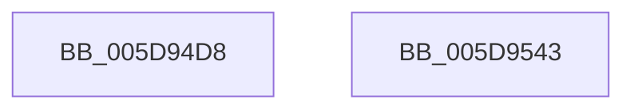

# PopBatterySetChargeLimitControl

- RVA: `0x005D94D8`–`0x005D9544` (길이 `108` bytes)
- VA: `0x00000001405D94D8`
- 실행 섹션: `.text`
- PDB 이름 있음: `예`; PDB Function 태그: `아니요`
- unwind 정보 RVA: `0x000606C0`
- 디코드: `27`개 명령, `108/108` bytes 표시
- 미해석 바이트: `0` (있으면 어셈블리에 `.byte`로 보존)

> 이 문서는 커널 이미지의 기계어와 PDB 기호를 분석해 생성했습니다. 4번과 5번은 함수 원형과 자료형을 바이너리 사용 방식에서 추정한 C 해석이며 원본 소스 복구 결과는 아닙니다.

## 1. Dependencies

- 직접 호출 지점: **3**; 고유 호출 대상: **3**
- 직접 호출자로 확인된 함수: **1**
- RIP 상대 이미지 참조: **1**

### Outgoing calls
- `0x005D951E` → [PopPrepareIoctl](../../page/A7/PopPrepareIoctl_function_00A74A98.md) (function, `0x00A74A98`)
- `0x005D952B` → [IoSynchronousCallDriver](../48/IoSynchronousCallDriver_function_00484050.md) (function, `0x00484050`)
- `0x005D9538` → [_security_check_cookie](../6A/_security_check_cookie_function_006AC640.md) (function, `0x006AC640`)

### Direct callers
- [PopBatteryWorker](../../page/AE/PopBatteryWorker_function_00AE1650.md) at `0x00AE1A3D`

### Static image references
- `0x005D94DE` → RVA `0x00E0A740` (`.data`; read)

## 2. Other-region calls and transfers

- 다른 실행 섹션으로 향하는 call: **1**
  - `0x005D951E` → [PopPrepareIoctl](../../page/A7/PopPrepareIoctl_function_00A74A98.md) (`.text` → `PAGE`)
- 별도 외부 분기/꼬리 이동을 확인하지 못했습니다.

## 3. Assembly (complete function range)

```asm
005D94D8  40 53                           push rbx
005D94DA  48 83 EC 50                     sub rsp, 0x50
005D94DE  48 8B 05 5B 12 83 00            mov rax, qword ptr [rip + 0x83125b]
005D94E5  48 33 C4                        xor rax, rsp
005D94E8  48 89 44 24 40                  mov qword ptr [rsp + 0x40], rax
005D94ED  8B 41 6C                        mov eax, dword ptr [rcx + 0x6c]
005D94F0  4C 8D 4C 24 30                  lea r9, [rsp + 0x30]
005D94F5  83 64 24 28 00                  and dword ptr [rsp + 0x28], 0
005D94FA  48 8B D9                        mov rbx, rcx
005D94FD  48 8B 49 38                     mov rcx, qword ptr [rcx + 0x38]
005D9501  89 54 24 34                     mov dword ptr [rsp + 0x34], edx
005D9505  BA 7C 40 29 00                  mov edx, 0x29407c
005D950A  44 89 44 24 38                  mov dword ptr [rsp + 0x38], r8d
005D950F  45 33 C0                        xor r8d, r8d
005D9512  89 44 24 30                     mov dword ptr [rsp + 0x30], eax
005D9516  C7 44 24 20 0C 00 00 00         mov dword ptr [rsp + 0x20], 0xc
005D951E  E8 75 B5 49 00                  call 0x140a74a98
005D9523  48 8B 53 38                     mov rdx, qword ptr [rbx + 0x38]
005D9527  48 8B 4B 30                     mov rcx, qword ptr [rbx + 0x30]
005D952B  E8 20 AB EA FF                  call 0x140484050
005D9530  48 8B 4C 24 40                  mov rcx, qword ptr [rsp + 0x40]
005D9535  48 33 CC                        xor rcx, rsp
005D9538  E8 03 31 0D 00                  call 0x1406ac640
005D953D  48 83 C4 50                     add rsp, 0x50
005D9541  5B                              pop rbx
005D9542  C3                              ret
005D9543  CC                              int3
```

## 4. C-style interpretation (structured pseudocode)

```c
__int64 __fastcall PopBatterySetChargeLimitControl(__int64 a1, int a2, int a3)
{
    __int64 result;
    __int64 v_rsp;
    unsigned __int64 v_stack_m18;
    unsigned int v_stack_m20;
    unsigned int v_stack_m24;
    unsigned __int64 v_stack_m28;
    unsigned int v_stack_m30;
    unsigned int v_stack_m38;

    v_rsp = (v_rsp) - (80);
    result = (*(unsigned __int64 *)(v_rip + 8589915)) ^ (v_rsp);
    v_stack_m18 = result;
    v_stack_m24 = a2;
    v_stack_m20 = a3;
    a3 = 0;
    v_stack_m28 = (unsigned int)((unsigned int)(*(unsigned int *)(a1 + 108)));
    v_stack_m38 = 12;
    result = PopPrepareIoctl(*(unsigned __int64 *)(a1 + 56), (unsigned int)(0x29407CULL), a3, v_stack_m28);
    result = IoSynchronousCallDriver(*(unsigned __int64 *)(a1 + 48), *(unsigned __int64 *)(a1 + 56), a3, v_stack_m28);
    a1 = (v_stack_m18) ^ (v_rsp);
    result = _security_check_cookie(a1, *(unsigned __int64 *)(a1 + 56), a3, v_stack_m28);
    v_rsp = (v_rsp) + (80);
    return result;
}
```

## 5. (Beta) C Style

```c
int64_t PopBatterySetChargeLimitControl(void *Arg1, int32_t Arg2, int32_t Arg3)
{
    uint8_t *arg1 = (uint8_t *)Arg1;

    int64_t result;
    int64_t local_rsp;
    uint64_t v_stack_m18;
    uint32_t v_stack_m20;
    uint32_t v_stack_m24;
    uint64_t v_stack_m28;
    uint32_t v_stack_m30;
    uint32_t v_stack_m38;

    local_rsp = (local_rsp) - (80);
    result = (*(uint64_t *)(v_rip + 0x83125B)) ^ (local_rsp);
    v_stack_m18 = result;
    v_stack_m24 = Arg2;
    v_stack_m20 = Arg3;
    Arg3 = 0;
    v_stack_m28 = (uint32_t)((uint32_t)(*(uint32_t *)(arg1 + 0x6C)));
    v_stack_m38 = 12;
    result = PopPrepareIoctl(*(uint64_t *)(arg1 + 0x38), (uint32_t)(0x29407CULL), Arg3, v_stack_m28);
    result = IoSynchronousCallDriver(*(uint64_t *)(arg1 + 0x30), *(uint64_t *)(arg1 + 0x38), Arg3, v_stack_m28);
    Arg1 = (v_stack_m18) ^ (local_rsp);
    result = _security_check_cookie(Arg1, *(uint64_t *)(arg1 + 0x38), Arg3, v_stack_m28);
    local_rsp = (local_rsp) + (80);
    return result;
}
```

### 관측된 메모리 오프셋

구조체 형식이 확인되지 않은 접근은 인자 기준의 오프셋으로만 기록했습니다.

| 기준 인자 | 오프셋 표현 | 폭 (bit) | 접근 |
|---|---:|---:|---|
| `Arg1` | `+ 0x30` | `64` | `R` |
| `Arg1` | `+ 0x38` | `64` | `R` |
| `Arg1` | `+ 0x6C` | `32` | `R` |

## 6. Execution-region graph

[열기: 2D/3D 그래프와 함수 탐색 컨트롤 패널](../../../control-panel.html?section=text&rva=0x005D94D8&view=graph)

- 2D 그래프는 위에서 아래로 흐르고, 3D 그래프는 빈 공간을 드래그해 회전합니다. Shift+드래그는 이동, 휠은 확대·축소, 함수 노드 선택은 대상 보고서 이동입니다.

### Static fallback


