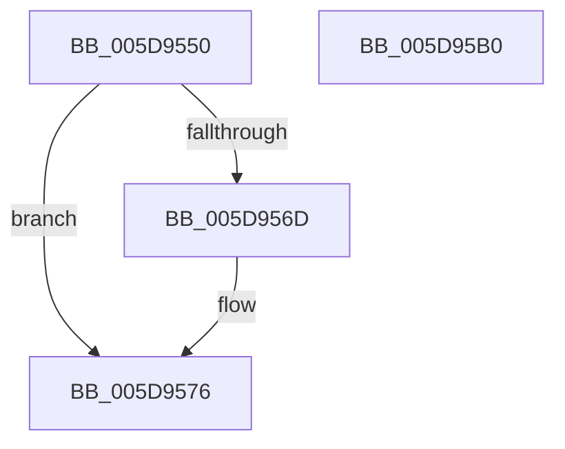

# PopBatteryWakeDpc

- RVA: `0x005D9550`–`0x005D95B1` (길이 `97` bytes)
- VA: `0x00000001405D9550`
- 실행 섹션: `.text`
- PDB 이름 있음: `예`; PDB Function 태그: `아니요`
- unwind 정보 RVA: `0x0005CAAC`
- 디코드: `25`개 명령, `97/97` bytes 표시
- 미해석 바이트: `0` (있으면 어셈블리에 `.byte`로 보존)

> 이 문서는 커널 이미지의 기계어와 PDB 기호를 분석해 생성했습니다. 4번과 5번은 함수 원형과 자료형을 바이너리 사용 방식에서 추정한 C 해석이며 원본 소스 복구 결과는 아닙니다.

## 1. Dependencies

- 직접 호출 지점: **3**; 고유 호출 대상: **3**
- 직접 호출자로 확인된 함수: **0**
- RIP 상대 이미지 참조: **6**

### Outgoing calls
- `0x005D9582` → [KeSetEvent](../33/KeSetEvent_function_0033F310.md) (function, `0x0033F310`)
- `0x005D958F` → [PopBatteryQueueWork](../4A/PopBatteryQueueWork_function_004AE3DC.md) (function, `0x004AE3DC`)
- `0x005D95A0` → [ExQueueWorkItem](../2F/ExQueueWorkItem_function_002F9520.md) (function, `0x002F9520`)

### Direct callers
- 이 함수 시작 RVA로 연결되는 직접 call은 확인되지 않았습니다. 간접 호출은 완전히 역산할 수 없습니다.

### Static image references
- `0x005D955C` → RVA `0x00E678A9` (`.data`; read)
- `0x005D9562` → RVA `0x00F0C180` (`.data`; write)
- `0x005D956D` → RVA `0x00E678A9` (`.data`; write)
- `0x005D9579` → RVA `0x00F0C148` (`.data`; read)
- `0x005D9587` → RVA `0x00F0C0C0` (`.data`; read/write)
- `0x005D9599` → RVA `0x00F0C160` (`.data`; read)

## 2. Other-region calls and transfers

- 다른 실행 섹션으로 향하는 call: **0**
- 별도 외부 분기/꼬리 이동을 확인하지 못했습니다.

## 3. Assembly (complete function range)

```asm
005D9550  48 89 5C 24 08                  mov qword ptr [rsp + 8], rbx
005D9555  57                              push rdi
005D9556  48 83 EC 20                     sub rsp, 0x20
005D955A  33 DB                           xor ebx, ebx
005D955C  38 1D 47 E3 88 00               cmp byte ptr [rip + 0x88e347], bl
005D9562  88 1D 18 2C 93 00               mov byte ptr [rip + 0x932c18], bl
005D9568  8D 7B 01                        lea edi, [rbx + 1]
005D956B  74 09                           je 0x1405d9576
005D956D  88 1D 36 E3 88 00               mov byte ptr [rip + 0x88e336], bl
005D9573  8D 7B 11                        lea edi, [rbx + 0x11]
005D9576  45 33 C0                        xor r8d, r8d
005D9579  48 8D 0D C8 2B 93 00            lea rcx, [rip + 0x932bc8]
005D9580  33 D2                           xor edx, edx
005D9582  E8 89 5D D6 FF                  call 0x14033f310
005D9587  87 1D 33 2B 93 00               xchg dword ptr [rip + 0x932b33], ebx
005D958D  8B CF                           mov ecx, edi
005D958F  E8 48 4E ED FF                  call 0x1404ae3dc
005D9594  BA 01 00 00 00                  mov edx, 1
005D9599  48 8D 0D C0 2B 93 00            lea rcx, [rip + 0x932bc0]
005D95A0  E8 7B FF D1 FF                  call 0x1402f9520
005D95A5  48 8B 5C 24 30                  mov rbx, qword ptr [rsp + 0x30]
005D95AA  48 83 C4 20                     add rsp, 0x20
005D95AE  5F                              pop rdi
005D95AF  C3                              ret
005D95B0  CC                              int3
```

## 4. C-style interpretation (structured pseudocode)

```c
__int64 __fastcall PopBatteryWakeDpc(__int64 a1, int a2, int a3)
{
    __int64 result;
    __int64 v_rbx;
    __int64 v_rdi;
    __int64 v_rsp;
    unsigned __int64 v_stack_p8;

    v_stack_p8 = v_rbx;
    v_rsp = (v_rsp) - (32);
    v_rbx = 0;
    *(unsigned __int8 *)(v_rip + 9645080) = 0;
    v_rdi = v_rbx + 1;
    if ((*(unsigned __int8 *)(v_rip + 8971079)) != 0) {
        *(unsigned __int8 *)(v_rip + 8971062) = 0;
        v_rdi = v_rbx + 17;
    }
    a3 = 0;
    a2 = 0;
    result = KeSetEvent(v_rip + 9645000, a2, a3, a4);
    result = PopBatteryQueueWork((unsigned int)((unsigned int)(v_rdi)), a2, a3, a4);
    result = ExQueueWorkItem(v_rip + 9644992, 1, a3, a4);
    v_rsp = (v_rsp) + (32);
    return result;
}
```

## 5. (Beta) C Style

```c
int64_t PopBatteryWakeDpc(int64_t Arg1, int32_t Arg2, int32_t Arg3)
{
    int64_t result;
    int64_t local_rbx;
    int64_t local_rdi;
    int64_t local_rsp;
    uint64_t v_stack_p8;

    v_stack_p8 = local_rbx;
    local_rsp = (local_rsp) - (32);
    local_rbx = 0;
    *(uint8_t *)(v_rip + 0x932C18) = 0;
    local_rdi = local_rbx + 1;
    if ((*(uint8_t *)(v_rip + 0x88E347)) != 0) {
        *(uint8_t *)(v_rip + 0x88E336) = 0;
        local_rdi = local_rbx + 17;
    }
    Arg3 = 0;
    Arg2 = 0;
    result = KeSetEvent(v_rip + 9645000, Arg2, Arg3, a4);
    result = PopBatteryQueueWork((uint32_t)((uint32_t)(local_rdi)), Arg2, Arg3, a4);
    result = ExQueueWorkItem(v_rip + 9644992, 1, Arg3, a4);
    local_rsp = (local_rsp) + (32);
    return result;
}
```

## 6. Execution-region graph

[열기: 2D/3D 그래프와 함수 탐색 컨트롤 패널](../../../control-panel.html?section=text&rva=0x005D9550&view=graph)

- 2D 그래프는 위에서 아래로 흐르고, 3D 그래프는 빈 공간을 드래그해 회전합니다. Shift+드래그는 이동, 휠은 확대·축소, 함수 노드 선택은 대상 보고서 이동입니다.

### Static fallback


