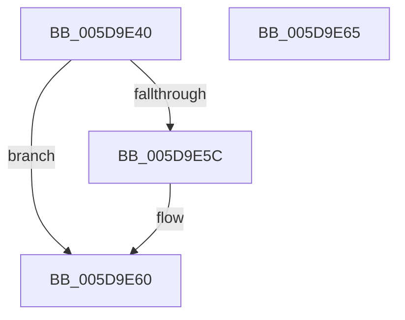

# PopBlackBoxBugcheckCallback

- RVA: `0x005D9E40`–`0x005D9E66` (길이 `38` bytes)
- VA: `0x00000001405D9E40`
- 실행 섹션: `.text`
- PDB 이름 있음: `예`; PDB Function 태그: `아니요`
- unwind 정보 RVA: `0x000DB714`
- 디코드: `12`개 명령, `38/38` bytes 표시
- 미해석 바이트: `0` (있으면 어셈블리에 `.byte`로 보존)

> 이 문서는 커널 이미지의 기계어와 PDB 기호를 분석해 생성했습니다. 4번과 5번은 함수 원형과 자료형을 바이너리 사용 방식에서 추정한 C 해석이며 원본 소스 복구 결과는 아닙니다.

## 1. Dependencies

- 직접 호출 지점: **0**; 고유 호출 대상: **0**
- 직접 호출자로 확인된 함수: **0**
- RIP 상대 이미지 참조: **0**

### Outgoing calls
- 직접 디코드된 call 명령이 없습니다.

### Direct callers
- 이 함수 시작 RVA로 연결되는 직접 call은 확인되지 않았습니다. 간접 호출은 완전히 역산할 수 없습니다.

### Static image references
- 디코드된 RIP-relative 메모리 참조가 없습니다.

## 2. Other-region calls and transfers

- 다른 실행 섹션으로 향하는 call: **0**
- 별도 외부 분기/꼬리 이동을 확인하지 못했습니다.

## 3. Assembly (complete function range)

```asm
005D9E40  48 8B 42 E8                     mov rax, qword ptr [rdx - 0x18]
005D9E44  0F 10 00                        movups xmm0, xmmword ptr [rax]
005D9E47  F3 41 0F 7F 40 10               movdqu xmmword ptr [r8 + 0x10], xmm0
005D9E4D  8B 42 40                        mov eax, dword ptr [rdx + 0x40]
005D9E50  41 89 40 28                     mov dword ptr [r8 + 0x28], eax
005D9E54  33 C0                           xor eax, eax
005D9E56  48 39 42 40                     cmp qword ptr [rdx + 0x40], rax
005D9E5A  76 04                           jbe 0x1405d9e60
005D9E5C  48 8B 42 38                     mov rax, qword ptr [rdx + 0x38]
005D9E60  49 89 40 20                     mov qword ptr [r8 + 0x20], rax
005D9E64  C3                              ret
005D9E65  CC                              int3
```

## 4. C-style interpretation (structured pseudocode)

```c
__int64 __fastcall PopBlackBoxBugcheckCallback(__int64 a1, __int64 a2, __int64 a3)
{
    __int64 result;

    *(unsigned __int64 *)(a3 + 16) = v_xmm0;
    *(unsigned int *)(a3 + 40) = (unsigned int)((unsigned int)(*(unsigned int *)(a2 + 64)));
    result = 0;
    if ((*(unsigned __int64 *)(a2 + 64)) >= = 0) {
        result = *(unsigned __int64 *)(a2 + 56);
    }
    *(unsigned __int64 *)(a3 + 32) = result;
    return result;
}
```

## 5. (Beta) C Style

```c
int64_t PopBlackBoxBugcheckCallback(int64_t Arg1, void *Arg2, void *Arg3)
{
    uint8_t *arg2 = (uint8_t *)Arg2;
    uint8_t *arg3 = (uint8_t *)Arg3;

    int64_t result;

    *(uint64_t *)(arg3 + 0x10) = v_xmm0;
    *(uint32_t *)(arg3 + 0x28) = (uint32_t)((uint32_t)(*(uint32_t *)(arg2 + 0x40)));
    result = 0;
    if ((*(uint64_t *)(arg2 + 0x40)) >= = 0) {
        result = *(uint64_t *)(arg2 + 0x38);
    }
    *(uint64_t *)(arg3 + 0x20) = result;
    return result;
}
```

### 관측된 메모리 오프셋

구조체 형식이 확인되지 않은 접근은 인자 기준의 오프셋으로만 기록했습니다.

| 기준 인자 | 오프셋 표현 | 폭 (bit) | 접근 |
|---|---:|---:|---|
| `Arg2` | `- 0x18` | `64` | `R` |
| `Arg2` | `+ 0x38` | `64` | `R` |
| `Arg2` | `+ 0x40` | `32` | `R` |
| `Arg2` | `+ 0x40` | `64` | `R` |
| `Arg3` | `+ 0x10` | `128` | `W` |
| `Arg3` | `+ 0x20` | `64` | `W` |
| `Arg3` | `+ 0x28` | `32` | `W` |

## 6. Execution-region graph

[열기: 2D/3D 그래프와 함수 탐색 컨트롤 패널](../../../control-panel.html?section=text&rva=0x005D9E40&view=graph)

- 2D 그래프는 위에서 아래로 흐르고, 3D 그래프는 빈 공간을 드래그해 회전합니다. Shift+드래그는 이동, 휠은 확대·축소, 함수 노드 선택은 대상 보고서 이동입니다.

### Static fallback


