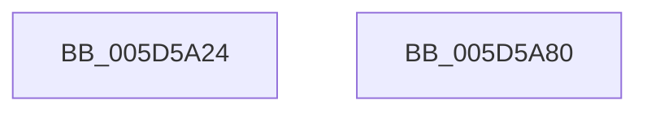

# PopCheckPowerSourceAfterRtcWakeInitialize

- RVA: `0x005D5A24`–`0x005D5A81` (길이 `93` bytes)
- VA: `0x00000001405D5A24`
- 실행 섹션: `.text`
- PDB 이름 있음: `예`; PDB Function 태그: `아니요`
- unwind 정보 RVA: `0x0005D2F4`
- 디코드: `17`개 명령, `93/93` bytes 표시
- 미해석 바이트: `0` (있으면 어셈블리에 `.byte`로 보존)

> 이 문서는 커널 이미지의 기계어와 PDB 기호를 분석해 생성했습니다. 4번과 5번은 함수 원형과 자료형을 바이너리 사용 방식에서 추정한 C 해석이며 원본 소스 복구 결과는 아닙니다.

## 1. Dependencies

- 직접 호출 지점: **1**; 고유 호출 대상: **1**
- 직접 호출자로 확인된 함수: **1**
- RIP 상대 이미지 참조: **9**

### Outgoing calls
- `0x005D5A46` → [PopInitializeTimer](../../page/75/PopInitializeTimer_function_00754078.md) (function, `0x00754078`)

### Direct callers
- [PoInitSystem](../../init/C7/PoInitSystem_function_00C72358.md) at `0x00C72D4B`

### Static image references
- `0x005D5A2E` → RVA `0x00B70AB0` (`PopCheckPowerSourceAfterRtcWakeTimerWorker`; read)
- `0x005D5A38` → RVA `0x005D5AE0` (`PopCheckPowerSourceAfterRtcWakeTimerCallback`; read)
- `0x005D5A3F` → RVA `0x00F0B720` (`.data`; read)
- `0x005D5A4B` → RVA `0x00F0B6E0` (`.data`; read/write)
- `0x005D5A53` → RVA `0x00F0B6E8` (`.data`; read)
- `0x005D5A5A` → RVA `0x00F0B6F0` (`.data`; write)
- `0x005D5A61` → RVA `0x00F0B6E8` (`.data`; write)
- `0x005D5A6A` → RVA `0x00F0B6E2` (`.data`; write)
- `0x005D5A71` → RVA `0x00F0B6E4` (`.data`; write)

## 2. Other-region calls and transfers

- 다른 실행 섹션으로 향하는 call: **1**
  - `0x005D5A46` → [PopInitializeTimer](../../page/75/PopInitializeTimer_function_00754078.md) (`.text` → `PAGE`)
- 별도 외부 분기/꼬리 이동을 확인하지 못했습니다.

## 3. Assembly (complete function range)

```asm
005D5A24  48 83 EC 38                     sub rsp, 0x38
005D5A28  48 83 64 24 20 00               and qword ptr [rsp + 0x20], 0
005D5A2E  4C 8D 0D 7B B0 59 00            lea r9, [rip + 0x59b07b]
005D5A35  45 33 C0                        xor r8d, r8d
005D5A38  48 8D 15 A1 00 00 00            lea rdx, [rip + 0xa1]
005D5A3F  48 8D 0D DA 5C 93 00            lea rcx, [rip + 0x935cda]
005D5A46  E8 2D E6 17 00                  call 0x140754078
005D5A4B  66 83 25 8D 5C 93 00 00         and word ptr [rip + 0x935c8d], 0
005D5A53  48 8D 05 8E 5C 93 00            lea rax, [rip + 0x935c8e]
005D5A5A  48 89 05 8F 5C 93 00            mov qword ptr [rip + 0x935c8f], rax
005D5A61  48 89 05 80 5C 93 00            mov qword ptr [rip + 0x935c80], rax
005D5A68  33 C0                           xor eax, eax
005D5A6A  C6 05 71 5C 93 00 06            mov byte ptr [rip + 0x935c71], 6
005D5A71  C7 05 69 5C 93 00 01 00 00 00   mov dword ptr [rip + 0x935c69], 1
005D5A7B  48 83 C4 38                     add rsp, 0x38
005D5A7F  C3                              ret
005D5A80  CC                              int3
```

## 4. C-style interpretation (structured pseudocode)

```c
__int64 __fastcall PopCheckPowerSourceAfterRtcWakeInitialize(__int64 a1, __int64 a2, int a3)
{
    __int64 result;
    __int64 v_rsp;
    unsigned __int64 v_stack_m18;

    v_rsp = (v_rsp) - (56);
    a3 = 0;
    result = PopInitializeTimer(v_rip + 9657562, v_rip + 161, a3, v_rip + 5877883);
    *(unsigned __int64 *)(v_rip + 9657487) = v_rip + 9657486;
    *(unsigned __int64 *)(v_rip + 9657472) = v_rip + 9657486;
    result = 0;
    *(unsigned __int8 *)(v_rip + 9657457) = 6;
    *(unsigned int *)(v_rip + 9657449) = 1;
    v_rsp = (v_rsp) + (56);
    return result;
}
```

## 5. (Beta) C Style

```c
int64_t PopCheckPowerSourceAfterRtcWakeInitialize(int64_t Arg1, int64_t Arg2, int32_t Arg3)
{
    int64_t result;
    int64_t local_rsp;
    uint64_t v_stack_m18;

    local_rsp = (local_rsp) - (56);
    Arg3 = 0;
    result = PopInitializeTimer(v_rip + 9657562, v_rip + 161, Arg3, v_rip + 5877883);
    *(uint64_t *)(v_rip + 0x935C8F) = v_rip + 9657486;
    *(uint64_t *)(v_rip + 0x935C80) = v_rip + 9657486;
    result = 0;
    *(uint8_t *)(v_rip + 0x935C71) = 6;
    *(uint32_t *)(v_rip + 0x935C69) = 1;
    local_rsp = (local_rsp) + (56);
    return result;
}
```

## 6. Execution-region graph

[열기: 2D/3D 그래프와 함수 탐색 컨트롤 패널](../../../control-panel.html?section=text&rva=0x005D5A24&view=graph)

- 2D 그래프는 위에서 아래로 흐르고, 3D 그래프는 빈 공간을 드래그해 회전합니다. Shift+드래그는 이동, 휠은 확대·축소, 함수 노드 선택은 대상 보고서 이동입니다.

### Static fallback


