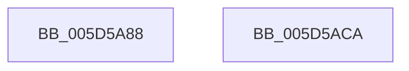

# PopCheckPowerSourceAfterRtcWakeSet

- RVA: `0x005D5A88`–`0x005D5ACB` (길이 `67` bytes)
- VA: `0x00000001405D5A88`
- 실행 섹션: `.text`
- PDB 이름 있음: `예`; PDB Function 태그: `아니요`
- unwind 정보 RVA: `0x0005D2F4`
- 디코드: `14`개 명령, `67/67` bytes 표시
- 미해석 바이트: `0` (있으면 어셈블리에 `.byte`로 보존)

> 이 문서는 커널 이미지의 기계어와 PDB 기호를 분석해 생성했습니다. 4번과 5번은 함수 원형과 자료형을 바이너리 사용 방식에서 추정한 C 해석이며 원본 소스 복구 결과는 아닙니다.

## 1. Dependencies

- 직접 호출 지점: **2**; 고유 호출 대상: **2**
- 직접 호출자로 확인된 함수: **1**
- RIP 상대 이미지 참조: **3**

### Outgoing calls
- `0x005D5A93` → [KeResetEvent](../24/KeResetEvent_function_00248350.md) (function, `0x00248350`)
- `0x005D5AC0` → [KeSetTimer2](../3A/KeSetTimer2_function_003A08E0.md) (function, `0x003A08E0`)

### Direct callers
- [PopTransitionSystemPowerStateEx](../../pagelk/B7/PopTransitionSystemPowerStateEx_function_00B7E8C0.md) at `0x00B7FABA`

### Static image references
- `0x005D5A8C` → RVA `0x00F0B6E0` (`.data`; read)
- `0x005D5A98` → RVA `0x00E0B55C` (`.data`; read)
- `0x005D5AA9` → RVA `0x00F0B720` (`.data`; read)

## 2. Other-region calls and transfers

- 다른 실행 섹션으로 향하는 call: **0**
- 별도 외부 분기/꼬리 이동을 확인하지 못했습니다.

## 3. Assembly (complete function range)

```asm
005D5A88  48 83 EC 38                     sub rsp, 0x38
005D5A8C  48 8D 0D 4D 5C 93 00            lea rcx, [rip + 0x935c4d]
005D5A93  E8 B8 28 C7 FF                  call 0x140248350
005D5A98  8B 05 BE 5A 83 00               mov eax, dword ptr [rip + 0x835abe]
005D5A9E  4C 8D 4C 24 20                  lea r9, [rsp + 0x20]
005D5AA3  48 83 64 24 20 00               and qword ptr [rsp + 0x20], 0
005D5AA9  48 8D 0D 70 5C 93 00            lea rcx, [rip + 0x935c70]
005D5AB0  48 83 4C 24 28 FF               or qword ptr [rsp + 0x28], 0xffffffffffffffff
005D5AB6  45 33 C0                        xor r8d, r8d
005D5AB9  48 69 D0 80 69 67 FF            imul rdx, rax, -0x989680
005D5AC0  E8 1B AE DC FF                  call 0x1403a08e0
005D5AC5  48 83 C4 38                     add rsp, 0x38
005D5AC9  C3                              ret
005D5ACA  CC                              int3
```

## 4. C-style interpretation (structured pseudocode)

```c
__int64 __fastcall PopCheckPowerSourceAfterRtcWakeSet(__int64 a1, __int64 a2, int a3)
{
    __int64 result;
    __int64 v_rsp;
    unsigned __int64 v_stack_m10;
    unsigned __int64 v_stack_m18;

    v_rsp = (v_rsp) - (56);
    result = KeResetEvent(v_rip + 9657421, a2, a3, a4);
    a3 = 0;
    a2 = (a2) * ((unsigned int)(*(unsigned int *)(v_rip + 8608446)));
    result = KeSetTimer2(v_rip + 9657456, a2, a3, v_stack_m18);
    v_rsp = (v_rsp) + (56);
    return result;
}
```

## 5. (Beta) C Style

```c
int64_t PopCheckPowerSourceAfterRtcWakeSet(int64_t Arg1, int64_t Arg2, int32_t Arg3)
{
    int64_t result;
    int64_t local_rsp;
    uint64_t v_stack_m10;
    uint64_t v_stack_m18;

    local_rsp = (local_rsp) - (56);
    result = KeResetEvent(v_rip + 9657421, Arg2, Arg3, a4);
    Arg3 = 0;
    Arg2 = (Arg2) * ((uint32_t)(*(uint32_t *)(v_rip + 0x835ABE)));
    result = KeSetTimer2(v_rip + 9657456, Arg2, Arg3, v_stack_m18);
    local_rsp = (local_rsp) + (56);
    return result;
}
```

## 6. Execution-region graph

[열기: 2D/3D 그래프와 함수 탐색 컨트롤 패널](../../../control-panel.html?section=text&rva=0x005D5A88&view=graph)

- 2D 그래프는 위에서 아래로 흐르고, 3D 그래프는 빈 공간을 드래그해 회전합니다. Shift+드래그는 이동, 휠은 확대·축소, 함수 노드 선택은 대상 보고서 이동입니다.

### Static fallback


