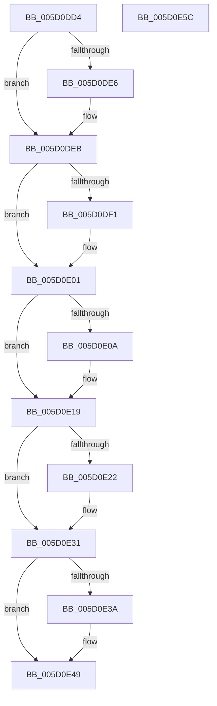

# PopCleanPowerLimitExtension

- RVA: `0x005D0DD4`–`0x005D0E5D` (길이 `137` bytes)
- VA: `0x00000001405D0DD4`
- 실행 섹션: `.text`
- PDB 이름 있음: `예`; PDB Function 태그: `아니요`
- unwind 정보 RVA: `0x0005CF00`
- 디코드: `37`개 명령, `137/137` bytes 표시
- 미해석 바이트: `0` (있으면 어셈블리에 `.byte`로 보존)

> 이 문서는 커널 이미지의 기계어와 PDB 기호를 분석해 생성했습니다. 4번과 5번은 함수 원형과 자료형을 바이너리 사용 방식에서 추정한 C 해석이며 원본 소스 복구 결과는 아닙니다.

## 1. Dependencies

- 직접 호출 지점: **6**; 고유 호출 대상: **3**
- 직접 호출자로 확인된 함수: **2**
- RIP 상대 이미지 참조: **0**

### Outgoing calls
- `0x005D0DE6` → [IoUnregisterPlugPlayNotificationEx](../../page/A6/IoUnregisterPlugPlayNotificationEx_function_00A64CF0.md) (function, `0x00A64CF0`)
- `0x005D0DFC` → [guard_dispatch_icall](../6B/guard_dispatch_icall_function_006BAAD0.md) (function, `0x006BAAD0`)
- `0x005D0E0F` → [ExFreePoolWithTag](../../poolcode/B8/ExFreePoolWithTag_function_00B82870.md) (function, `0x00B82870`)
- `0x005D0E27` → [ExFreePoolWithTag](../../poolcode/B8/ExFreePoolWithTag_function_00B82870.md) (function, `0x00B82870`)
- `0x005D0E3F` → [ExFreePoolWithTag](../../poolcode/B8/ExFreePoolWithTag_function_00B82870.md) (function, `0x00B82870`)
- `0x005D0E51` → [ExFreePoolWithTag](../../poolcode/B8/ExFreePoolWithTag_function_00B82870.md) (function, `0x00B82870`)

### Direct callers
- [PopAssociatePowerLimitRequest](../../page/75/PopAssociatePowerLimitRequest_function_00755EC8.md) at `0x0075611F`
- [PopFreePowerLimitRequest](../../page/75/PopFreePowerLimitRequest_function_00756494.md) at `0x0075664F`

### Static image references
- 디코드된 RIP-relative 메모리 참조가 없습니다.

## 2. Other-region calls and transfers

- 다른 실행 섹션으로 향하는 call: **5**
  - `0x005D0DE6` → [IoUnregisterPlugPlayNotificationEx](../../page/A6/IoUnregisterPlugPlayNotificationEx_function_00A64CF0.md) (`.text` → `PAGE`)
  - `0x005D0E0F` → [ExFreePoolWithTag](../../poolcode/B8/ExFreePoolWithTag_function_00B82870.md) (`.text` → `POOLCODE`)
  - `0x005D0E27` → [ExFreePoolWithTag](../../poolcode/B8/ExFreePoolWithTag_function_00B82870.md) (`.text` → `POOLCODE`)
  - `0x005D0E3F` → [ExFreePoolWithTag](../../poolcode/B8/ExFreePoolWithTag_function_00B82870.md) (`.text` → `POOLCODE`)
  - `0x005D0E51` → [ExFreePoolWithTag](../../poolcode/B8/ExFreePoolWithTag_function_00B82870.md) (`.text` → `POOLCODE`)
- 별도 외부 분기/꼬리 이동을 확인하지 못했습니다.

## 3. Assembly (complete function range)

```asm
005D0DD4  40 53                           push rbx
005D0DD6  48 83 EC 20                     sub rsp, 0x20
005D0DDA  48 8B D9                        mov rbx, rcx
005D0DDD  48 8B 49 40                     mov rcx, qword ptr [rcx + 0x40]
005D0DE1  48 85 C9                        test rcx, rcx
005D0DE4  74 05                           je 0x1405d0deb
005D0DE6  E8 05 3F 49 00                  call 0x140a64cf0
005D0DEB  80 7B 30 00                     cmp byte ptr [rbx + 0x30], 0
005D0DEF  74 10                           je 0x1405d0e01
005D0DF1  48 8B 83 88 00 00 00            mov rax, qword ptr [rbx + 0x88]
005D0DF8  48 8B 4B 78                     mov rcx, qword ptr [rbx + 0x78]
005D0DFC  E8 CF 9C 0E 00                  call 0x1406baad0
005D0E01  48 8B 4B 50                     mov rcx, qword ptr [rbx + 0x50]
005D0E05  48 85 C9                        test rcx, rcx
005D0E08  74 0F                           je 0x1405d0e19
005D0E0A  BA 50 50 6C 6D                  mov edx, 0x6d6c5050
005D0E0F  E8 5C 1A 5B 00                  call 0x140b82870
005D0E14  48 83 63 50 00                  and qword ptr [rbx + 0x50], 0
005D0E19  48 8B 4B 58                     mov rcx, qword ptr [rbx + 0x58]
005D0E1D  48 85 C9                        test rcx, rcx
005D0E20  74 0F                           je 0x1405d0e31
005D0E22  BA 50 50 6C 6D                  mov edx, 0x6d6c5050
005D0E27  E8 44 1A 5B 00                  call 0x140b82870
005D0E2C  48 83 63 58 00                  and qword ptr [rbx + 0x58], 0
005D0E31  48 8B 4B 68                     mov rcx, qword ptr [rbx + 0x68]
005D0E35  48 85 C9                        test rcx, rcx
005D0E38  74 0F                           je 0x1405d0e49
005D0E3A  BA 50 50 6C 6D                  mov edx, 0x6d6c5050
005D0E3F  E8 2C 1A 5B 00                  call 0x140b82870
005D0E44  48 83 63 68 00                  and qword ptr [rbx + 0x68], 0
005D0E49  BA 50 50 6C 6D                  mov edx, 0x6d6c5050
005D0E4E  48 8B CB                        mov rcx, rbx
005D0E51  E8 1A 1A 5B 00                  call 0x140b82870
005D0E56  48 83 C4 20                     add rsp, 0x20
005D0E5A  5B                              pop rbx
005D0E5B  C3                              ret
005D0E5C  CC                              int3
```

## 4. C-style interpretation (structured pseudocode)

```c
__int64 __fastcall PopCleanPowerLimitExtension(__int64 a1)
{
    __int64 result;
    __int64 v_rsp;

    v_rsp = (v_rsp) - (32);
    if (*(unsigned __int64 *)(a1 + 64) != 0) {
        result = IoUnregisterPlugPlayNotificationEx(*(unsigned __int64 *)(a1 + 64), a2, a3, a4);
    }
    if ((*(unsigned __int8 *)(a1 + 48)) != 0) {
        result = *(unsigned __int64 *)(a1 + 136);
        a1 = *(unsigned __int64 *)(a1 + 120);
        result = guard_dispatch_icall(a1, a2, a3, a4);
    }
    if (*(unsigned __int64 *)(a1 + 80) != 0) {
        a2 = 0x6D6C5050ULL;
        result = ExFreePoolWithTag(*(unsigned __int64 *)(a1 + 80), a2, a3, a4);
    }
    if (*(unsigned __int64 *)(a1 + 88) != 0) {
        a2 = 0x6D6C5050ULL;
        result = ExFreePoolWithTag(*(unsigned __int64 *)(a1 + 88), a2, a3, a4);
    }
    if (*(unsigned __int64 *)(a1 + 104) != 0) {
        a2 = 0x6D6C5050ULL;
        result = ExFreePoolWithTag(*(unsigned __int64 *)(a1 + 104), a2, a3, a4);
    }
    result = ExFreePoolWithTag(a1, (unsigned int)(0x6D6C5050ULL), a3, a4);
    v_rsp = (v_rsp) + (32);
    return result;
}
```

## 5. (Beta) C Style

```c
int64_t PopCleanPowerLimitExtension(void *Arg1)
{
    uint8_t *arg1 = (uint8_t *)Arg1;

    int64_t result;
    int64_t local_rsp;

    local_rsp = (local_rsp) - (32);
    if (*(uint64_t *)(arg1 + 0x40) != 0) {
        result = IoUnregisterPlugPlayNotificationEx(*(uint64_t *)(arg1 + 0x40), a2, a3, a4);
    }
    if ((*(uint8_t *)(arg1 + 0x30)) != 0) {
        result = *(uint64_t *)(arg1 + 0x88);
        Arg1 = *(uint64_t *)(arg1 + 0x78);
        result = guard_dispatch_icall(Arg1, a2, a3, a4);
    }
    if (*(uint64_t *)(arg1 + 0x50) != 0) {
        a2 = 0x6D6C5050ULL;
        result = ExFreePoolWithTag(*(uint64_t *)(arg1 + 0x50), a2, a3, a4);
    }
    if (*(uint64_t *)(arg1 + 0x58) != 0) {
        a2 = 0x6D6C5050ULL;
        result = ExFreePoolWithTag(*(uint64_t *)(arg1 + 0x58), a2, a3, a4);
    }
    if (*(uint64_t *)(arg1 + 0x68) != 0) {
        a2 = 0x6D6C5050ULL;
        result = ExFreePoolWithTag(*(uint64_t *)(arg1 + 0x68), a2, a3, a4);
    }
    result = ExFreePoolWithTag(Arg1, (uint32_t)(0x6D6C5050ULL), a3, a4);
    local_rsp = (local_rsp) + (32);
    return result;
}
```

### 관측된 메모리 오프셋

구조체 형식이 확인되지 않은 접근은 인자 기준의 오프셋으로만 기록했습니다.

| 기준 인자 | 오프셋 표현 | 폭 (bit) | 접근 |
|---|---:|---:|---|
| `Arg1` | `+ 0x30` | `8` | `R` |
| `Arg1` | `+ 0x40` | `64` | `R` |
| `Arg1` | `+ 0x50` | `64` | `R` |
| `Arg1` | `+ 0x50` | `64` | `R/W` |
| `Arg1` | `+ 0x58` | `64` | `R` |
| `Arg1` | `+ 0x58` | `64` | `R/W` |
| `Arg1` | `+ 0x68` | `64` | `R` |
| `Arg1` | `+ 0x68` | `64` | `R/W` |
| `Arg1` | `+ 0x78` | `64` | `R` |
| `Arg1` | `+ 0x88` | `64` | `R` |

## 6. Execution-region graph

[열기: 2D/3D 그래프와 함수 탐색 컨트롤 패널](../../../control-panel.html?section=text&rva=0x005D0DD4&view=graph)

- 2D 그래프는 위에서 아래로 흐르고, 3D 그래프는 빈 공간을 드래그해 회전합니다. Shift+드래그는 이동, 휠은 확대·축소, 함수 노드 선택은 대상 보고서 이동입니다.

### Static fallback


