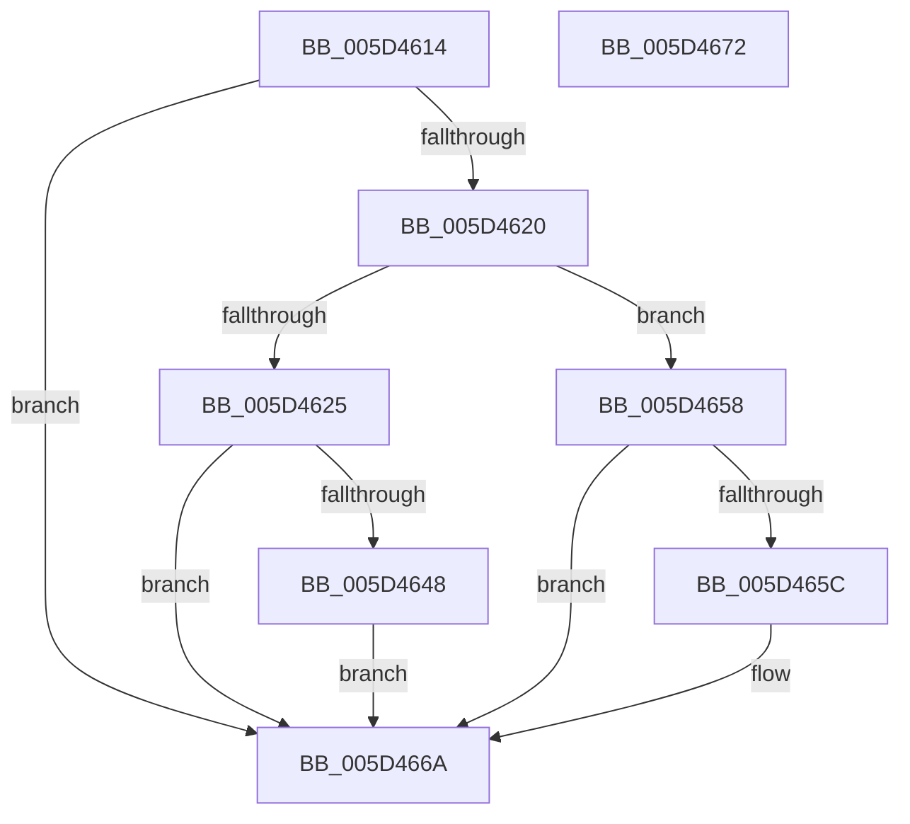

# PopCoalescingCheck

- RVA: `0x005D4614`–`0x005D4673` (길이 `95` bytes)
- VA: `0x00000001405D4614`
- 실행 섹션: `.text`
- PDB 이름 있음: `예`; PDB Function 태그: `아니요`
- unwind 정보 RVA: `0x0005CF00`
- 디코드: `29`개 명령, `95/95` bytes 표시
- 미해석 바이트: `0` (있으면 어셈블리에 `.byte`로 보존)

> 이 문서는 커널 이미지의 기계어와 PDB 기호를 분석해 생성했습니다. 4번과 5번은 함수 원형과 자료형을 바이너리 사용 방식에서 추정한 C 해석이며 원본 소스 복구 결과는 아닙니다.

## 1. Dependencies

- 직접 호출 지점: **2**; 고유 호출 대상: **2**
- 직접 호출자로 확인된 함수: **1**
- RIP 상대 이미지 참조: **2**

### Outgoing calls
- `0x005D464C` → [PopGetPolicyWorker](../48/PopGetPolicyWorker_function_00482D24.md) (function, `0x00482D24`)
- `0x005D4651` → [PopCheckForWork](../48/PopCheckForWork_function_00482CAC.md) (function, `0x00482CAC`)

### Direct callers
- [PopScanIdleList](../49/PopScanIdleList_function_00497F04.md) at `0x0049805F`

### Static image references
- `0x005D4625` → RVA `0x00E0B548` (`.data`; read)
- `0x005D463C` → RVA `0x00F0E060` (`.data`; read)

## 2. Other-region calls and transfers

- 다른 실행 섹션으로 향하는 call: **0**
- 별도 외부 분기/꼬리 이동을 확인하지 못했습니다.

## 3. Assembly (complete function range)

```asm
005D4614  40 53                           push rbx
005D4616  48 83 EC 20                     sub rsp, 0x20
005D461A  8B DA                           mov ebx, edx
005D461C  85 C9                           test ecx, ecx
005D461E  74 4A                           je 0x1405d466a
005D4620  45 85 C0                        test r8d, r8d
005D4623  75 33                           jne 0x1405d4658
005D4625  8B 05 1D 6F 83 00               mov eax, dword ptr [rip + 0x836f1d]
005D462B  48 69 C8 80 96 98 00            imul rcx, rax, 0x989680
005D4632  48 A1 08 00 00 00 80 F7 FF FF   movabs rax, qword ptr [0xfffff78000000008]
005D463C  48 2B 05 1D 9A 93 00            sub rax, qword ptr [rip + 0x939a1d]
005D4643  48 3B C1                        cmp rax, rcx
005D4646  72 22                           jb 0x1405d466a
005D4648  41 8D 48 20                     lea ecx, [r8 + 0x20]
005D464C  E8 D3 E6 EA FF                  call 0x140482d24
005D4651  E8 56 E6 EA FF                  call 0x140482cac
005D4656  EB 12                           jmp 0x1405d466a
005D4658  3B D1                           cmp edx, ecx
005D465A  76 0E                           jbe 0x1405d466a
005D465C  B8 D3 4D 62 10                  mov eax, 0x10624dd3
005D4661  F7 E1                           mul ecx
005D4663  8B DA                           mov ebx, edx
005D4665  C1 EB 06                        shr ebx, 6
005D4668  FF C3                           inc ebx
005D466A  8B C3                           mov eax, ebx
005D466C  48 83 C4 20                     add rsp, 0x20
005D4670  5B                              pop rbx
005D4671  C3                              ret
005D4672  CC                              int3
```

## 4. C-style interpretation (structured pseudocode)

```c
__int64 __fastcall PopCoalescingCheck(int a1, int a2, __int64 a3)
{
    __int64 result;
    __int64 v_rbx;
    __int64 v_rsp;

    v_rsp = (v_rsp) - (32);
    if (a1 == 0) goto loc_005D466A;
    if ((unsigned int)(a3) != 0) goto loc_005D4658;
    a1 = (a1) * ((unsigned int)(*(unsigned int *)(v_rip + 8613661)));
    result = ((unsigned int)(*(unsigned int *)(v_rip + 8613661))) - (*(unsigned __int64 *)(v_rip + 9673245));
    if (result < a1) goto loc_005D466A;
    result = PopGetPolicyWorker(a3 + 32, a2, a3, a4);
    result = PopCheckForWork(a3 + 32, a2, a3, a4);
    goto loc_005D466A;
loc_005D4658:
    v_rbx = (unsigned int)(a2);
    if (a2 >= = ((unsigned int)(a3 + 32))) {
        result = 0x10624DD3ULL;
        v_rbx = a2;
        v_rbx = (unsigned int)((v_rbx) >> (6));
        v_rbx = (unsigned int)((v_rbx) + 1);
    }
    v_rsp = (v_rsp) + (32);
    return (unsigned int)((unsigned int)(v_rbx));
}
```

## 5. (Beta) C Style

```c
int64_t PopCoalescingCheck(int32_t Arg1, int32_t Arg2, int64_t Arg3)
{
    int64_t result;
    int64_t local_rbx;
    int64_t local_rsp;

    local_rsp = (local_rsp) - (32);
    if (Arg1 == 0) goto loc_005D466A;
    if ((uint32_t)(Arg3) != 0) goto loc_005D4658;
    Arg1 = (Arg1) * ((uint32_t)(*(uint32_t *)(v_rip + 0x836F1D)));
    result = ((uint32_t)(*(uint32_t *)(v_rip + 0x836F1D))) - (*(uint64_t *)(v_rip + 0x939A1D));
    if (result < Arg1) goto loc_005D466A;
    result = PopGetPolicyWorker(Arg3 + 32, Arg2, Arg3, a4);
    result = PopCheckForWork(Arg3 + 32, Arg2, Arg3, a4);
    goto loc_005D466A;
loc_005D4658:
    local_rbx = (uint32_t)(Arg2);
    if (Arg2 >= = ((uint32_t)(Arg3 + 32))) {
        result = 0x10624DD3ULL;
        local_rbx = Arg2;
        local_rbx = (uint32_t)((local_rbx) >> (6));
        local_rbx = (uint32_t)((local_rbx) + 1);
    }
    local_rsp = (local_rsp) + (32);
    return (uint32_t)((uint32_t)(local_rbx));
}
```

## 6. Execution-region graph

[열기: 2D/3D 그래프와 함수 탐색 컨트롤 패널](../../../control-panel.html?section=text&rva=0x005D4614&view=graph)

- 2D 그래프는 위에서 아래로 흐르고, 3D 그래프는 빈 공간을 드래그해 회전합니다. Shift+드래그는 이동, 휠은 확대·축소, 함수 노드 선택은 대상 보고서 이동입니다.

### Static fallback


