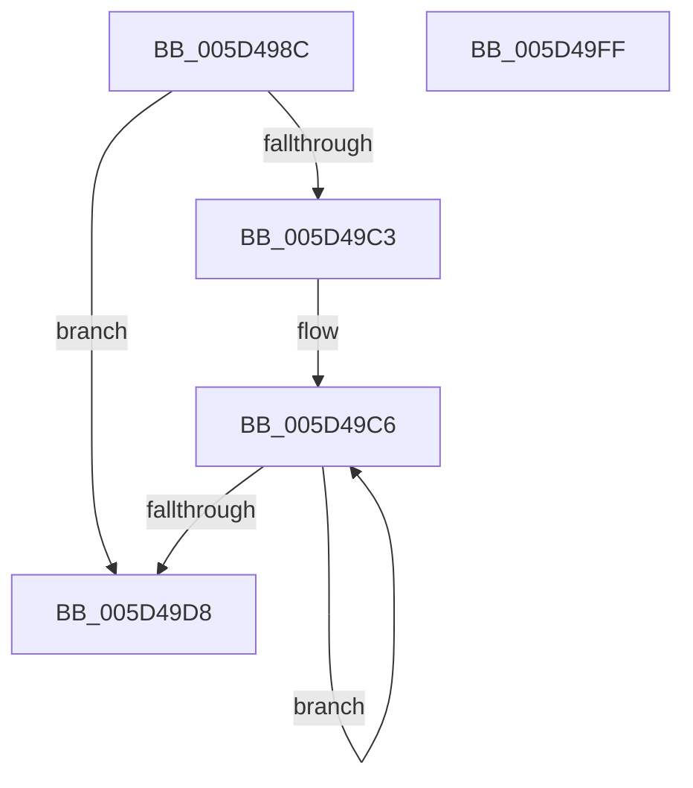

# PopDereferenceWakeInfos

- RVA: `0x005D498C`–`0x005D4A00` (길이 `116` bytes)
- VA: `0x00000001405D498C`
- 실행 섹션: `.text`
- PDB 이름 있음: `예`; PDB Function 태그: `아니요`
- unwind 정보 RVA: `0x000718AC`
- 디코드: `33`개 명령, `116/116` bytes 표시
- 미해석 바이트: `0` (있으면 어셈블리에 `.byte`로 보존)

> 이 문서는 커널 이미지의 기계어와 PDB 기호를 분석해 생성했습니다. 4번과 5번은 함수 원형과 자료형을 바이너리 사용 방식에서 추정한 C 해석이며 원본 소스 복구 결과는 아닙니다.

## 1. Dependencies

- 직접 호출 지점: **4**; 고유 호출 대상: **4**
- 직접 호출자로 확인된 함수: **1**
- RIP 상대 이미지 참조: **1**

### Outgoing calls
- `0x005D49BA` → [KeAcquireInStackQueuedSpinLock](../27/KeAcquireInStackQueuedSpinLock_function_002757A0.md) (function, `0x002757A0`)
- `0x005D49C9` → [PopWakeInfoDereference](../4C/PopWakeInfoDereference_function_004C74AC.md) (function, `0x004C74AC`)
- `0x005D49DD` → [KeReleaseInStackQueuedSpinLock](../34/KeReleaseInStackQueuedSpinLock_function_00342CE0.md) (function, `0x00342CE0`)
- `0x005D49EA` → [ExFreePoolWithTag](../../poolcode/B8/ExFreePoolWithTag_function_00B82870.md) (function, `0x00B82870`)

### Direct callers
- [PopGetWakeSource](../../page/AB/PopGetWakeSource_function_00ABDB68.md) at `0x00ABDD1F`

### Static image references
- `0x005D49A4` → RVA `0x00F0DEA8` (`.data`; read)

## 2. Other-region calls and transfers

- 다른 실행 섹션으로 향하는 call: **1**
  - `0x005D49EA` → [ExFreePoolWithTag](../../poolcode/B8/ExFreePoolWithTag_function_00B82870.md) (`.text` → `POOLCODE`)
- 별도 외부 분기/꼬리 이동을 확인하지 못했습니다.

## 3. Assembly (complete function range)

```asm
005D498C  4C 8B DC                        mov r11, rsp
005D498F  49 89 5B 08                     mov qword ptr [r11 + 8], rbx
005D4993  49 89 73 10                     mov qword ptr [r11 + 0x10], rsi
005D4997  57                              push rdi
005D4998  48 83 EC 40                     sub rsp, 0x40
005D499C  0F 57 C0                        xorps xmm0, xmm0
005D499F  8B F9                           mov edi, ecx
005D49A1  48 8B F2                        mov rsi, rdx
005D49A4  48 8D 0D FD 94 93 00            lea rcx, [rip + 0x9394fd]
005D49AB  33 C0                           xor eax, eax
005D49AD  49 8D 53 D8                     lea rdx, [r11 - 0x28]
005D49B1  0F 11 44 24 20                  movups xmmword ptr [rsp + 0x20], xmm0
005D49B6  49 89 43 E8                     mov qword ptr [r11 - 0x18], rax
005D49BA  E8 E1 0D CA FF                  call 0x1402757a0
005D49BF  85 FF                           test edi, edi
005D49C1  74 15                           je 0x1405d49d8
005D49C3  48 8B DE                        mov rbx, rsi
005D49C6  48 8B 0B                        mov rcx, qword ptr [rbx]
005D49C9  E8 DE 2A EF FF                  call 0x1404c74ac
005D49CE  48 8D 5B 08                     lea rbx, [rbx + 8]
005D49D2  48 83 EF 01                     sub rdi, 1
005D49D6  75 EE                           jne 0x1405d49c6
005D49D8  48 8D 4C 24 20                  lea rcx, [rsp + 0x20]
005D49DD  E8 FE E2 D6 FF                  call 0x140342ce0
005D49E2  BA 4D 65 6D 20                  mov edx, 0x206d654d
005D49E7  48 8B CE                        mov rcx, rsi
005D49EA  E8 81 DE 5A 00                  call 0x140b82870
005D49EF  48 8B 5C 24 50                  mov rbx, qword ptr [rsp + 0x50]
005D49F4  48 8B 74 24 58                  mov rsi, qword ptr [rsp + 0x58]
005D49F9  48 83 C4 40                     add rsp, 0x40
005D49FD  5F                              pop rdi
005D49FE  C3                              ret
005D49FF  CC                              int3
```

## 4. C-style interpretation (structured pseudocode)

```c
__int64 __fastcall PopDereferenceWakeInfos(int a1, __int64 a2)
{
    __int64 result;
    __int64 v_rdi;
    __int64 v_rsp;
    unsigned __int64 v_stack_m28;
    unsigned __int64 v_stack_p10;
    unsigned __int64 v_stack_p8;

    *(unsigned __int64 *)(v_rsp + 8) = v_rbx;
    *(unsigned __int64 *)(v_rsp + 16) = v_rsi;
    v_rsp = (v_rsp) - (64);
    result = 0;
    v_stack_m28 = v_xmm0;
    *(unsigned __int64 *)(v_rsp - 24) = 0;
    result = KeAcquireInStackQueuedSpinLock(v_rip + 9671933, v_rsp - 40, a3, a4);
    if ((unsigned int)((unsigned int)(a1)) == 0) goto loc_005D49D8;
loc_005D49C6:
    result = PopWakeInfoDereference(*(unsigned __int64 *)(a2), v_rsp - 40, a3, a4);
    v_rdi = ((unsigned int)(a1)) - (1);
    if (condition_is_not_equal) goto loc_005D49C6;
loc_005D49D8:
    result = KeReleaseInStackQueuedSpinLock(v_stack_m28, v_rsp - 40, a3, a4);
    result = ExFreePoolWithTag(a2, (unsigned int)(0x206D654DULL), a3, a4);
    v_rsp = (v_rsp) + (64);
    return result;
}
```

## 5. (Beta) C Style

```c
int64_t PopDereferenceWakeInfos(int32_t Arg1, void *Arg2)
{
    uint8_t *arg2 = (uint8_t *)Arg2;

    int64_t result;
    int64_t local_rdi;
    int64_t local_rsp;
    uint64_t v_stack_m28;
    uint64_t v_stack_p10;
    uint64_t v_stack_p8;

    *(uint64_t *)(local_rsp + 0x8) = local_rbx;
    *(uint64_t *)(local_rsp + 0x10) = local_rsi;
    local_rsp = (local_rsp) - (64);
    result = 0;
    v_stack_m28 = v_xmm0;
    *(uint64_t *)(local_rsp - 0x18) = 0;
    result = KeAcquireInStackQueuedSpinLock(v_rip + 9671933, local_rsp - 40, a3, a4);
    if ((uint32_t)((uint32_t)(Arg1)) == 0) goto loc_005D49D8;
loc_005D49C6:
    result = PopWakeInfoDereference(*(uint64_t *)(arg2), local_rsp - 40, a3, a4);
    local_rdi = ((uint32_t)(Arg1)) - (1);
    if (condition_is_not_equal) goto loc_005D49C6;
loc_005D49D8:
    result = KeReleaseInStackQueuedSpinLock(v_stack_m28, local_rsp - 40, a3, a4);
    result = ExFreePoolWithTag(Arg2, (uint32_t)(0x206D654DULL), a3, a4);
    local_rsp = (local_rsp) + (64);
    return result;
}
```

### 관측된 메모리 오프셋

구조체 형식이 확인되지 않은 접근은 인자 기준의 오프셋으로만 기록했습니다.

| 기준 인자 | 오프셋 표현 | 폭 (bit) | 접근 |
|---|---:|---:|---|
| `Arg2` | `+ 0x0` | `64` | `R` |
| `Arg2` | `+ 0x8` | `64` | `R` |

## 6. Execution-region graph

[열기: 2D/3D 그래프와 함수 탐색 컨트롤 패널](../../../control-panel.html?section=text&rva=0x005D498C&view=graph)

- 2D 그래프는 위에서 아래로 흐르고, 3D 그래프는 빈 공간을 드래그해 회전합니다. Shift+드래그는 이동, 휠은 확대·축소, 함수 노드 선택은 대상 보고서 이동입니다.

### Static fallback


