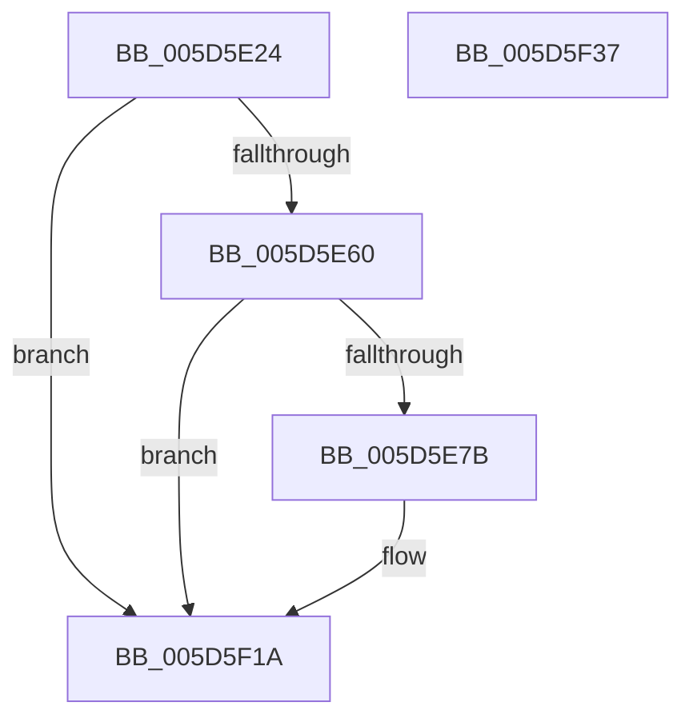

# PopDiagTraceCsDeepSleepWatchdog

- RVA: `0x005D5E24`–`0x005D5F38` (길이 `276` bytes)
- VA: `0x00000001405D5E24`
- 실행 섹션: `.text`
- PDB 이름 있음: `예`; PDB Function 태그: `아니요`
- unwind 정보 RVA: `0x000BE3A0`
- 디코드: `65`개 명령, `276/276` bytes 표시
- 미해석 바이트: `0` (있으면 어셈블리에 `.byte`로 보존)

> 이 문서는 커널 이미지의 기계어와 PDB 기호를 분석해 생성했습니다. 4번과 5번은 함수 원형과 자료형을 바이너리 사용 방식에서 추정한 C 해석이며 원본 소스 복구 결과는 아닙니다.

## 1. Dependencies

- 직접 호출 지점: **3**; 고유 호출 대상: **3**
- 직접 호출자로 확인된 함수: **1**
- RIP 상대 이미지 참조: **4**

### Outgoing calls
- `0x005D5E6E` → [EtwEventEnabled](../39/EtwEventEnabled_function_00392450.md) (function, `0x00392450`)
- `0x005D5F15` → [EtwWriteEx](../25/EtwWriteEx_function_0025F0D0.md) (function, `0x0025F0D0`)
- `0x005D5F21` → [_security_check_cookie](../6A/_security_check_cookie_function_006AC640.md) (function, `0x006AC640`)

### Direct callers
- [PopDeepSleepWatchdogTakeAction](../../page/77/PopDeepSleepWatchdogTakeAction_function_007731F8.md) at `0x0077323F`

### Static image references
- `0x005D5E41` → RVA `0x00E0A740` (`.data`; read)
- `0x005D5E4F` → RVA `0x00E67858` (`.data`; read)
- `0x005D5E60` → RVA `0x00F0B408` (`.data`; read)
- `0x005D5E67` → RVA `0x00021F08` (`.rdata`; read)

## 2. Other-region calls and transfers

- 다른 실행 섹션으로 향하는 call: **0**
- 별도 외부 분기/꼬리 이동을 확인하지 못했습니다.

## 3. Assembly (complete function range)

```asm
005D5E24  48 8B C4                        mov rax, rsp
005D5E27  48 89 58 20                     mov qword ptr [rax + 0x20], rbx
005D5E2B  44 89 40 18                     mov dword ptr [rax + 0x18], r8d
005D5E2F  89 50 10                        mov dword ptr [rax + 0x10], edx
005D5E32  89 48 08                        mov dword ptr [rax + 8], ecx
005D5E35  55                              push rbp
005D5E36  48 8D 68 B1                     lea rbp, [rax - 0x4f]
005D5E3A  48 81 EC C0 00 00 00            sub rsp, 0xc0
005D5E41  48 8B 05 F8 48 83 00            mov rax, qword ptr [rip + 0x8348f8]
005D5E48  48 33 C4                        xor rax, rsp
005D5E4B  48 89 45 37                     mov qword ptr [rbp + 0x37], rax
005D5E4F  80 3D 02 1A 89 00 00            cmp byte ptr [rip + 0x891a02], 0
005D5E56  41 0F B6 D9                     movzx ebx, r9b
005D5E5A  0F 84 BA 00 00 00               je 0x1405d5f1a
005D5E60  48 8B 0D A1 55 93 00            mov rcx, qword ptr [rip + 0x9355a1]
005D5E67  48 8D 15 9A C0 A4 FF            lea rdx, [rip - 0x5b3f66]
005D5E6E  E8 DD C5 DB FF                  call 0x140392450
005D5E73  84 C0                           test al, al
005D5E75  0F 84 9F 00 00 00               je 0x1405d5f1a
005D5E7B  83 65 E3 00                     and dword ptr [rbp - 0x1d], 0
005D5E7F  48 8D 45 57                     lea rax, [rbp + 0x57]
005D5E83  83 65 F3 00                     and dword ptr [rbp - 0xd], 0
005D5E87  48 8D 15 7A C0 A4 FF            lea rdx, [rip - 0x5b3f86]
005D5E8E  83 65 03 00                     and dword ptr [rbp + 3], 0
005D5E92  B9 04 00 00 00                  mov ecx, 4
005D5E97  83 65 13 00                     and dword ptr [rbp + 0x13], 0
005D5E9B  45 33 C9                        xor r9d, r9d
005D5E9E  83 65 23 00                     and dword ptr [rbp + 0x23], 0
005D5EA2  45 33 C0                        xor r8d, r8d
005D5EA5  83 65 33 00                     and dword ptr [rbp + 0x33], 0
005D5EA9  48 89 45 D7                     mov qword ptr [rbp - 0x29], rax
005D5EAD  48 8D 45 5F                     lea rax, [rbp + 0x5f]
005D5EB1  48 89 45 E7                     mov qword ptr [rbp - 0x19], rax
005D5EB5  48 8D 45 67                     lea rax, [rbp + 0x67]
005D5EB9  48 89 45 F7                     mov qword ptr [rbp - 9], rax
005D5EBD  48 8D 45 C7                     lea rax, [rbp - 0x39]
005D5EC1  48 89 45 07                     mov qword ptr [rbp + 7], rax
005D5EC5  48 8D 45 77                     lea rax, [rbp + 0x77]
005D5EC9  48 89 45 17                     mov qword ptr [rbp + 0x17], rax
005D5ECD  0F B6 45 7F                     movzx eax, byte ptr [rbp + 0x7f]
005D5ED1  89 45 CB                        mov dword ptr [rbp - 0x35], eax
005D5ED4  48 8D 45 CB                     lea rax, [rbp - 0x35]
005D5ED8  48 89 45 27                     mov qword ptr [rbp + 0x27], rax
005D5EDC  48 8D 45 D7                     lea rax, [rbp - 0x29]
005D5EE0  48 89 44 24 38                  mov qword ptr [rsp + 0x38], rax
005D5EE5  C7 44 24 30 06 00 00 00         mov dword ptr [rsp + 0x30], 6
005D5EED  48 83 64 24 28 00               and qword ptr [rsp + 0x28], 0
005D5EF3  48 83 64 24 20 00               and qword ptr [rsp + 0x20], 0
005D5EF9  89 4D DF                        mov dword ptr [rbp - 0x21], ecx
005D5EFC  89 4D EF                        mov dword ptr [rbp - 0x11], ecx
005D5EFF  89 4D FF                        mov dword ptr [rbp - 1], ecx
005D5F02  89 4D 0F                        mov dword ptr [rbp + 0xf], ecx
005D5F05  89 4D 1F                        mov dword ptr [rbp + 0x1f], ecx
005D5F08  89 4D 2F                        mov dword ptr [rbp + 0x2f], ecx
005D5F0B  48 8B 0D F6 54 93 00            mov rcx, qword ptr [rip + 0x9354f6]
005D5F12  89 5D C7                        mov dword ptr [rbp - 0x39], ebx
005D5F15  E8 B6 91 C8 FF                  call 0x14025f0d0
005D5F1A  48 8B 4D 37                     mov rcx, qword ptr [rbp + 0x37]
005D5F1E  48 33 CC                        xor rcx, rsp
005D5F21  E8 1A 67 0D 00                  call 0x1406ac640
005D5F26  48 8B 9C 24 E8 00 00 00         mov rbx, qword ptr [rsp + 0xe8]
005D5F2E  48 81 C4 C0 00 00 00            add rsp, 0xc0
005D5F35  5D                              pop rbp
005D5F36  C3                              ret
005D5F37  CC                              int3
```

## 4. C-style interpretation (structured pseudocode)

```c
__int64 __fastcall PopDiagTraceCsDeepSleepWatchdog(int a1, int a2, int a3, int a4)
{
    __int64 result;
    __int64 v_rsp;
    unsigned __int64 v_stack_m90;
    unsigned int v_stack_m98;
    unsigned __int64 v_stack_mA0;
    unsigned __int64 v_stack_mA8;
    unsigned __int64 v_stack_p20;

    *(unsigned __int64 *)(v_rsp + 32) = v_rbx;
    *(unsigned int *)(v_rsp + 24) = a3;
    *(unsigned int *)(v_rsp + 16) = a2;
    *(unsigned int *)(v_rsp + 8) = a1;
    v_rsp = (v_rsp) - (192);
    result = (*(unsigned __int64 *)(v_rip + 8603896)) ^ (v_rsp);
    *(unsigned __int64 *)(v_rsp - 79 + 55) = result;
    if ((*(unsigned __int8 *)(v_rip + 8985090)) == 0) goto loc_005D5F1A;
    result = EtwEventEnabled(*(unsigned __int64 *)(v_rip + 9655713), v_rip - 5980006, a3, a4);
    if ((unsigned __int8)(result) != 0) {
        result = v_rsp - 79 + 87;
        a2 = v_rip - 5980038;
        a1 = 4;
        a4 = 0;
        a3 = 0;
        *(unsigned __int64 *)(v_rsp - 79 - 41) = result;
        result = v_rsp - 79 + 95;
        *(unsigned __int64 *)(v_rsp - 79 - 25) = result;
        result = v_rsp - 79 + 103;
        *(unsigned __int64 *)(v_rsp - 79 - 9) = result;
        result = v_rsp - 79 - 57;
        *(unsigned __int64 *)(v_rsp - 79 + 7) = result;
        result = v_rsp - 79 + 119;
        *(unsigned __int64 *)(v_rsp - 79 + 23) = result;
        result = *(unsigned __int8 *)(v_rsp - 79 + 127);
        *(unsigned int *)(v_rsp - 79 - 53) = (unsigned int)(result);
        result = v_rsp - 79 - 53;
        *(unsigned __int64 *)(v_rsp - 79 + 39) = result;
        result = v_rsp - 79 - 41;
        v_stack_m90 = result;
        v_stack_m98 = 6;
        *(unsigned int *)(v_rsp - 79 - 33) = a1;
        *(unsigned int *)(v_rsp - 79 - 17) = a1;
        *(unsigned int *)(v_rsp - 79 - 1) = a1;
        *(unsigned int *)(v_rsp - 79 + 15) = a1;
        *(unsigned int *)(v_rsp - 79 + 31) = a1;
        *(unsigned int *)(v_rsp - 79 + 47) = a1;
        a1 = *(unsigned __int64 *)(v_rip + 9655542);
        *(unsigned int *)(v_rsp - 79 - 57) = (unsigned int)((unsigned __int8)(a4));
        result = EtwWriteEx(a1, a2, a3, a4);
    }
    a1 = (*(unsigned __int64 *)(v_rsp - 79 + 55)) ^ (v_rsp);
    result = _security_check_cookie(a1, a2, a3, a4);
    v_rsp = (v_rsp) + (192);
    return result;
}
```

## 5. (Beta) C Style

```c
int64_t PopDiagTraceCsDeepSleepWatchdog(int32_t Arg1, int32_t Arg2, int32_t Arg3, int32_t Arg4)
{
    int64_t result;
    int64_t local_rsp;
    uint64_t v_stack_m90;
    uint32_t v_stack_m98;
    uint64_t v_stack_mA0;
    uint64_t v_stack_mA8;
    uint64_t v_stack_p20;

    *(uint64_t *)(local_rsp + 0x20) = local_rbx;
    *(uint32_t *)(local_rsp + 0x18) = Arg3;
    *(uint32_t *)(local_rsp + 0x10) = Arg2;
    *(uint32_t *)(local_rsp + 0x8) = Arg1;
    local_rsp = (local_rsp) - (192);
    result = (*(uint64_t *)(v_rip + 0x8348F8)) ^ (local_rsp);
    *(uint64_t *)(local_rsp - 0x4F + 0x37) = result;
    if ((*(uint8_t *)(v_rip + 0x891A02)) == 0) goto loc_005D5F1A;
    result = EtwEventEnabled(*(uint64_t *)(v_rip + 0x9355A1), v_rip - 5980006, Arg3, Arg4);
    if ((uint8_t)(result) != 0) {
        result = local_rsp - 79 + 87;
        Arg2 = v_rip - 5980038;
        Arg1 = 4;
        Arg4 = 0;
        Arg3 = 0;
        *(uint64_t *)(local_rsp - 0x4F - 0x29) = result;
        result = local_rsp - 79 + 95;
        *(uint64_t *)(local_rsp - 0x4F - 0x19) = result;
        result = local_rsp - 79 + 103;
        *(uint64_t *)(local_rsp - 0x4F - 0x9) = result;
        result = local_rsp - 79 - 57;
        *(uint64_t *)(local_rsp - 0x4F + 0x7) = result;
        result = local_rsp - 79 + 119;
        *(uint64_t *)(local_rsp - 0x4F + 0x17) = result;
        result = *(uint8_t *)(local_rsp - 0x4F + 0x7F);
        *(uint32_t *)(local_rsp - 0x4F - 0x35) = (uint32_t)(result);
        result = local_rsp - 79 - 53;
        *(uint64_t *)(local_rsp - 0x4F + 0x27) = result;
        result = local_rsp - 79 - 41;
        v_stack_m90 = result;
        v_stack_m98 = 6;
        *(uint32_t *)(local_rsp - 0x4F - 0x21) = Arg1;
        *(uint32_t *)(local_rsp - 0x4F - 0x11) = Arg1;
        *(uint32_t *)(local_rsp - 0x4F - 0x1) = Arg1;
        *(uint32_t *)(local_rsp - 0x4F + 0xF) = Arg1;
        *(uint32_t *)(local_rsp - 0x4F + 0x1F) = Arg1;
        *(uint32_t *)(local_rsp - 0x4F + 0x2F) = Arg1;
        Arg1 = *(uint64_t *)(v_rip + 0x9354F6);
        *(uint32_t *)(local_rsp - 0x4F - 0x39) = (uint32_t)((uint8_t)(Arg4));
        result = EtwWriteEx(Arg1, Arg2, Arg3, Arg4);
    }
    Arg1 = (*(uint64_t *)(local_rsp - 0x4F + 0x37)) ^ (local_rsp);
    result = _security_check_cookie(Arg1, Arg2, Arg3, Arg4);
    local_rsp = (local_rsp) + (192);
    return result;
}
```

## 6. Execution-region graph

[열기: 2D/3D 그래프와 함수 탐색 컨트롤 패널](../../../control-panel.html?section=text&rva=0x005D5E24&view=graph)

- 2D 그래프는 위에서 아래로 흐르고, 3D 그래프는 빈 공간을 드래그해 회전합니다. Shift+드래그는 이동, 휠은 확대·축소, 함수 노드 선택은 대상 보고서 이동입니다.

### Static fallback


