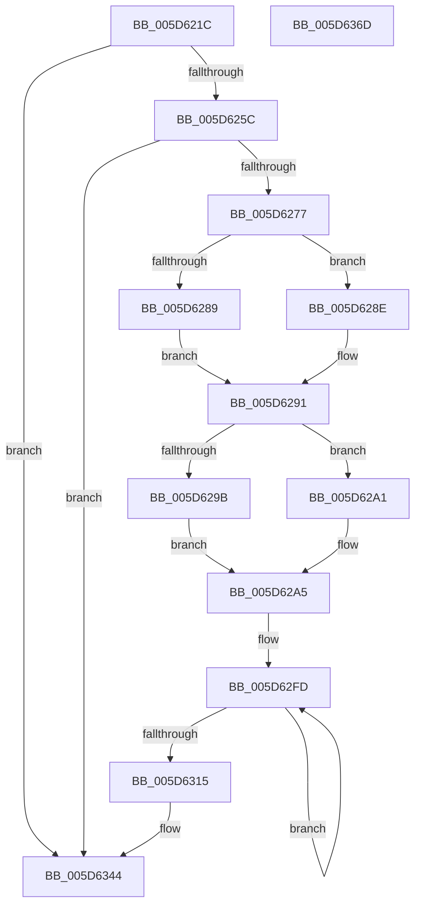

# PopDiagTraceCsDripsWatchdogPerfTrack

- RVA: `0x005D621C`–`0x005D636E` (길이 `338` bytes)
- VA: `0x00000001405D621C`
- 실행 섹션: `.text`
- PDB 이름 있음: `예`; PDB Function 태그: `아니요`
- unwind 정보 RVA: `0x00068468`
- 디코드: `79`개 명령, `338/338` bytes 표시
- 미해석 바이트: `0` (있으면 어셈블리에 `.byte`로 보존)

> 이 문서는 커널 이미지의 기계어와 PDB 기호를 분석해 생성했습니다. 4번과 5번은 함수 원형과 자료형을 바이너리 사용 방식에서 추정한 C 해석이며 원본 소스 복구 결과는 아닙니다.

## 1. Dependencies

- 직접 호출 지점: **3**; 고유 호출 대상: **3**
- 직접 호출자로 확인된 함수: **1**
- RIP 상대 이미지 참조: **4**

### Outgoing calls
- `0x005D626A` → [EtwEventEnabled](../39/EtwEventEnabled_function_00392450.md) (function, `0x00392450`)
- `0x005D633F` → [EtwWriteEx](../25/EtwWriteEx_function_0025F0D0.md) (function, `0x0025F0D0`)
- `0x005D634F` → [_security_check_cookie](../6A/_security_check_cookie_function_006AC640.md) (function, `0x006AC640`)

### Direct callers
- [PopDripsWatchdogTakeAction](../../page/77/PopDripsWatchdogTakeAction_function_007732D0.md) at `0x00773492`

### Static image references
- `0x005D6233` → RVA `0x00E0A740` (`.data`; read)
- `0x005D6245` → RVA `0x00E67858` (`.data`; read)
- `0x005D625C` → RVA `0x00F0B408` (`.data`; read)
- `0x005D6263` → RVA `0x00023450` (`.rdata`; read)

## 2. Other-region calls and transfers

- 다른 실행 섹션으로 향하는 call: **0**
- 별도 외부 분기/꼬리 이동을 확인하지 못했습니다.

## 3. Assembly (complete function range)

```asm
005D621C  48 89 5C 24 08                  mov qword ptr [rsp + 8], rbx
005D6221  48 89 6C 24 10                  mov qword ptr [rsp + 0x10], rbp
005D6226  48 89 74 24 18                  mov qword ptr [rsp + 0x18], rsi
005D622B  57                              push rdi
005D622C  48 81 EC A0 00 00 00            sub rsp, 0xa0
005D6233  48 8B 05 06 45 83 00            mov rax, qword ptr [rip + 0x834506]
005D623A  48 33 C4                        xor rax, rsp
005D623D  48 89 84 24 90 00 00 00         mov qword ptr [rsp + 0x90], rax
005D6245  80 3D 0C 16 89 00 00            cmp byte ptr [rip + 0x89160c], 0
005D624C  41 8B D9                        mov ebx, r9d
005D624F  41 8B F8                        mov edi, r8d
005D6252  8B F2                           mov esi, edx
005D6254  8B E9                           mov ebp, ecx
005D6256  0F 84 E8 00 00 00               je 0x1405d6344
005D625C  48 8B 0D A5 51 93 00            mov rcx, qword ptr [rip + 0x9351a5]
005D6263  48 8D 15 E6 D1 A4 FF            lea rdx, [rip - 0x5b2e1a]
005D626A  E8 E1 C1 DB FF                  call 0x140392450
005D626F  84 C0                           test al, al
005D6271  0F 84 CD 00 00 00               je 0x1405d6344
005D6277  33 D2                           xor edx, edx
005D6279  89 6C 24 40                     mov dword ptr [rsp + 0x40], ebp
005D627D  89 74 24 44                     mov dword ptr [rsp + 0x44], esi
005D6281  89 7C 24 48                     mov dword ptr [rsp + 0x48], edi
005D6285  85 DB                           test ebx, ebx
005D6287  75 05                           jne 0x1405d628e
005D6289  83 E2 FE                        and edx, 0xfffffffe
005D628C  EB 03                           jmp 0x1405d6291
005D628E  83 CA 01                        or edx, 1
005D6291  80 BC 24 D8 00 00 00 00         cmp byte ptr [rsp + 0xd8], 0
005D6299  75 06                           jne 0x1405d62a1
005D629B  0F BA F2 09                     btr edx, 9
005D629F  EB 04                           jmp 0x1405d62a5
005D62A1  0F BA EA 09                     bts edx, 9
005D62A5  8B 84 24 E0 00 00 00            mov eax, dword ptr [rsp + 0xe0]
005D62AC  B9 FF FF 00 00                  mov ecx, 0xffff
005D62B1  39 8C 24 D0 00 00 00            cmp dword ptr [rsp + 0xd0], ecx
005D62B8  41 B9 04 00 00 00               mov r9d, 4
005D62BE  45 8B C1                        mov r8d, r9d
005D62C1  0F 46 8C 24 D0 00 00 00         cmovbe ecx, dword ptr [rsp + 0xd0]
005D62C9  25 00 01 00 00                  and eax, 0x100
005D62CE  C1 E1 0E                        shl ecx, 0xe
005D62D1  81 E2 01 FE FF FF               and edx, 0xfffffe01
005D62D7  0B C8                           or ecx, eax
005D62D9  0F B6 84 24 E0 00 00 00         movzx eax, byte ptr [rsp + 0xe0]
005D62E1  03 C0                           add eax, eax
005D62E3  C1 E1 02                        shl ecx, 2
005D62E6  0B C2                           or eax, edx
005D62E8  25 FF 03 00 00                  and eax, 0x3ff
005D62ED  0B C8                           or ecx, eax
005D62EF  48 8D 44 24 5C                  lea rax, [rsp + 0x5c]
005D62F4  89 4C 24 4C                     mov dword ptr [rsp + 0x4c], ecx
005D62F8  48 8D 4C 24 40                  lea rcx, [rsp + 0x40]
005D62FD  83 20 00                        and dword ptr [rax], 0
005D6300  48 89 48 F4                     mov qword ptr [rax - 0xc], rcx
005D6304  49 03 C9                        add rcx, r9
005D6307  44 89 48 FC                     mov dword ptr [rax - 4], r9d
005D630B  48 8D 40 10                     lea rax, [rax + 0x10]
005D630F  49 83 E8 01                     sub r8, 1
005D6313  75 E8                           jne 0x1405d62fd
005D6315  48 8B 0D EC 50 93 00            mov rcx, qword ptr [rip + 0x9350ec]
005D631C  48 8D 44 24 50                  lea rax, [rsp + 0x50]
005D6321  48 89 44 24 38                  mov qword ptr [rsp + 0x38], rax
005D6326  48 8D 15 23 D1 A4 FF            lea rdx, [rip - 0x5b2edd]
005D632D  44 89 4C 24 30                  mov dword ptr [rsp + 0x30], r9d
005D6332  45 33 C9                        xor r9d, r9d
005D6335  4C 21 44 24 28                  and qword ptr [rsp + 0x28], r8
005D633A  4C 21 44 24 20                  and qword ptr [rsp + 0x20], r8
005D633F  E8 8C 8D C8 FF                  call 0x14025f0d0
005D6344  48 8B 8C 24 90 00 00 00         mov rcx, qword ptr [rsp + 0x90]
005D634C  48 33 CC                        xor rcx, rsp
005D634F  E8 EC 62 0D 00                  call 0x1406ac640
005D6354  4C 8D 9C 24 A0 00 00 00         lea r11, [rsp + 0xa0]
005D635C  49 8B 5B 10                     mov rbx, qword ptr [r11 + 0x10]
005D6360  49 8B 6B 18                     mov rbp, qword ptr [r11 + 0x18]
005D6364  49 8B 73 20                     mov rsi, qword ptr [r11 + 0x20]
005D6368  49 8B E3                        mov rsp, r11
005D636B  5F                              pop rdi
005D636C  C3                              ret
005D636D  CC                              int3
```

## 4. C-style interpretation (structured pseudocode)

```c
__int64 __fastcall PopDiagTraceCsDripsWatchdogPerfTrack(int a1, int a2, int a3, int a4, unsigned int a5, unsigned __int8 a6, unsigned __int8 a7)
{
    __int64 result;
    __int64 v_rsp;
    unsigned __int64 v_stack_m18;
    unsigned __int64 v_stack_m4C;
    unsigned __int64 v_stack_m58;
    unsigned int v_stack_m5C;
    unsigned int v_stack_m60;
    unsigned int v_stack_m64;
    unsigned int v_stack_m68;
    unsigned __int64 v_stack_m70;
    unsigned int v_stack_m78;
    unsigned __int64 v_stack_m8;
    unsigned __int64 v_stack_m80;
    unsigned __int64 v_stack_m88;
    unsigned __int64 v_stack_p10;
    unsigned __int64 v_stack_p18;
    unsigned __int64 v_stack_p8;

    v_stack_p8 = v_rbx;
    v_stack_p10 = v_rbp;
    v_stack_p18 = v_rsi;
    v_rsp = (v_rsp) - (160);
    result = (*(unsigned __int64 *)(v_rip + 8602886)) ^ (v_rsp);
    v_stack_m18 = result;
    if ((*(unsigned __int8 *)(v_rip + 8984076)) == 0) goto loc_005D6344;
    result = EtwEventEnabled(*(unsigned __int64 *)(v_rip + 9654693), v_rip - 5975578, a3, a4);
    if ((unsigned __int8)(result) == 0) goto loc_005D6344;
    a2 = 0;
    v_stack_m68 = (unsigned int)((unsigned int)(a1));
    v_stack_m64 = (unsigned int)((unsigned int)(a2));
    v_stack_m60 = (unsigned int)((unsigned int)(a3));
    if ((unsigned int)((unsigned int)(a4)) != 0) goto loc_005D628E;
    a2 = (unsigned int)((a2) & (0xFFFFFFFEULL));
    goto loc_005D6291;
loc_005D628E:
    a2 = (unsigned int)((a2) | (1));
loc_005D6291:
    if (a6 != 0) goto loc_005D62A1;
    goto loc_005D62A5;
loc_005D62A1:
loc_005D62A5:
    a1 = (unsigned int)(0xFFFFULL);
    if (a5 <= ((unsigned int)((unsigned int)(0xFFFFULL)))) { a1 = a5; }
    result = (unsigned int)(((unsigned int)(a7)) & (256));
    a1 = (unsigned int)((a1) << (14));
    a2 = (unsigned int)((a2) & (0xFFFFFE01ULL));
    a1 = (unsigned int)((a1) | ((unsigned int)(result)));
    result = (unsigned int)((a7) + (a7));
    a1 = (unsigned int)((a1) << (2));
    result = (unsigned int)((result) | (a2));
    result = (unsigned int)((result) & (0x3FFULL));
    a1 = (unsigned int)((a1) | ((unsigned int)(result)));
    v_stack_m5C = a1;
loc_005D62FD:
    *(unsigned __int64 *)(v_stack_m4C - 12) = v_stack_m68;
    a1 = (v_stack_m68) + (4);
    *(unsigned int *)(v_stack_m4C - 4) = 4;
    a3 = (4) - (1);
    if (condition_is_not_equal) goto loc_005D62FD;
    v_stack_m70 = v_stack_m58;
    v_stack_m78 = 4;
    a4 = 0;
    result = EtwWriteEx(*(unsigned __int64 *)(v_rip + 9654508), v_rip - 5975773, a3, a4);
loc_005D6344:
    a1 = (v_stack_m18) ^ (v_rsp);
    result = _security_check_cookie(a1, v_rip - 5975773, a3, a4);
    return result;
}
```

## 5. (Beta) C Style

```c
int64_t PopDiagTraceCsDripsWatchdogPerfTrack(int32_t Arg1, int32_t Arg2, int32_t Arg3, int32_t Arg4, uint32_t Arg5, uint8_t Arg6, uint8_t Arg7)
{
    int64_t result;
    int64_t local_rsp;
    uint64_t v_stack_m18;
    uint64_t v_stack_m4C;
    uint64_t v_stack_m58;
    uint32_t v_stack_m5C;
    uint32_t v_stack_m60;
    uint32_t v_stack_m64;
    uint32_t v_stack_m68;
    uint64_t v_stack_m70;
    uint32_t v_stack_m78;
    uint64_t v_stack_m8;
    uint64_t v_stack_m80;
    uint64_t v_stack_m88;
    uint64_t v_stack_p10;
    uint64_t v_stack_p18;
    uint64_t v_stack_p8;

    v_stack_p8 = local_rbx;
    v_stack_p10 = local_rbp;
    v_stack_p18 = local_rsi;
    local_rsp = (local_rsp) - (160);
    result = (*(uint64_t *)(v_rip + 0x834506)) ^ (local_rsp);
    v_stack_m18 = result;
    if ((*(uint8_t *)(v_rip + 0x89160C)) == 0) goto loc_005D6344;
    result = EtwEventEnabled(*(uint64_t *)(v_rip + 0x9351A5), v_rip - 5975578, Arg3, Arg4);
    if ((uint8_t)(result) == 0) goto loc_005D6344;
    Arg2 = 0;
    v_stack_m68 = (uint32_t)((uint32_t)(Arg1));
    v_stack_m64 = (uint32_t)((uint32_t)(Arg2));
    v_stack_m60 = (uint32_t)((uint32_t)(Arg3));
    if ((uint32_t)((uint32_t)(Arg4)) != 0) goto loc_005D628E;
    Arg2 = (uint32_t)((Arg2) & (0xFFFFFFFEULL));
    goto loc_005D6291;
loc_005D628E:
    Arg2 = (uint32_t)((Arg2) | (1));
loc_005D6291:
    if (Arg6 != 0) goto loc_005D62A1;
    goto loc_005D62A5;
loc_005D62A1:
loc_005D62A5:
    Arg1 = (uint32_t)(0xFFFFULL);
    if (Arg5 <= ((uint32_t)((uint32_t)(0xFFFFULL)))) { Arg1 = Arg5; }
    result = (uint32_t)(((uint32_t)(Arg7)) & (256));
    Arg1 = (uint32_t)((Arg1) << (14));
    Arg2 = (uint32_t)((Arg2) & (0xFFFFFE01ULL));
    Arg1 = (uint32_t)((Arg1) | ((uint32_t)(result)));
    result = (uint32_t)((Arg7) + (Arg7));
    Arg1 = (uint32_t)((Arg1) << (2));
    result = (uint32_t)((result) | (Arg2));
    result = (uint32_t)((result) & (0x3FFULL));
    Arg1 = (uint32_t)((Arg1) | ((uint32_t)(result)));
    v_stack_m5C = Arg1;
loc_005D62FD:
    *(uint64_t *)(v_stack_m4C - 0xC) = v_stack_m68;
    Arg1 = (v_stack_m68) + (4);
    *(uint32_t *)(v_stack_m4C - 0x4) = 4;
    Arg3 = (4) - (1);
    if (condition_is_not_equal) goto loc_005D62FD;
    v_stack_m70 = v_stack_m58;
    v_stack_m78 = 4;
    Arg4 = 0;
    result = EtwWriteEx(*(uint64_t *)(v_rip + 0x9350EC), v_rip - 5975773, Arg3, Arg4);
loc_005D6344:
    Arg1 = (v_stack_m18) ^ (local_rsp);
    result = _security_check_cookie(Arg1, v_rip - 5975773, Arg3, Arg4);
    return result;
}
```

## 6. Execution-region graph

[열기: 2D/3D 그래프와 함수 탐색 컨트롤 패널](../../../control-panel.html?section=text&rva=0x005D621C&view=graph)

- 2D 그래프는 위에서 아래로 흐르고, 3D 그래프는 빈 공간을 드래그해 회전합니다. Shift+드래그는 이동, 휠은 확대·축소, 함수 노드 선택은 대상 보고서 이동입니다.

### Static fallback


