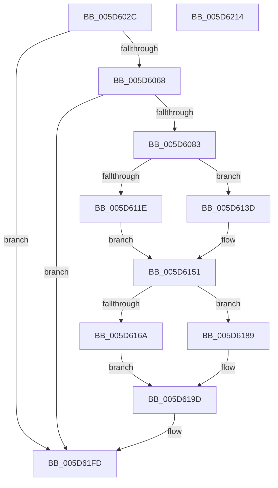

# PopDiagTraceCsDripsWatchdog

- RVA: `0x005D602C`–`0x005D6215` (길이 `489` bytes)
- VA: `0x00000001405D602C`
- 실행 섹션: `.text`
- PDB 이름 있음: `예`; PDB Function 태그: `아니요`
- unwind 정보 RVA: `0x000CC848`
- 디코드: `108`개 명령, `489/489` bytes 표시
- 미해석 바이트: `0` (있으면 어셈블리에 `.byte`로 보존)

> 이 문서는 커널 이미지의 기계어와 PDB 기호를 분석해 생성했습니다. 4번과 5번은 함수 원형과 자료형을 바이너리 사용 방식에서 추정한 C 해석이며 원본 소스 복구 결과는 아닙니다.

## 1. Dependencies

- 직접 호출 지점: **3**; 고유 호출 대상: **3**
- 직접 호출자로 확인된 함수: **1**
- RIP 상대 이미지 참조: **4**

### Outgoing calls
- `0x005D6076` → [EtwEventEnabled](../39/EtwEventEnabled_function_00392450.md) (function, `0x00392450`)
- `0x005D61F8` → [EtwWriteEx](../25/EtwWriteEx_function_0025F0D0.md) (function, `0x0025F0D0`)
- `0x005D6204` → [_security_check_cookie](../6A/_security_check_cookie_function_006AC640.md) (function, `0x006AC640`)

### Direct callers
- [PopDripsWatchdogTakeAction](../../page/77/PopDripsWatchdogTakeAction_function_007732D0.md) at `0x00773383`
- [PopDripsWatchdogTakeAction](../../page/77/PopDripsWatchdogTakeAction_function_007732D0.md) at `0x007733D6`
- [PopDripsWatchdogTakeAction](../../page/77/PopDripsWatchdogTakeAction_function_007732D0.md) at `0x00773455`

### Static image references
- `0x005D6047` → RVA `0x00E0A740` (`.data`; read)
- `0x005D605B` → RVA `0x00E67858` (`.data`; read)
- `0x005D6068` → RVA `0x00F0B408` (`.data`; read)
- `0x005D606F` → RVA `0x00022070` (`.rdata`; read)

## 2. Other-region calls and transfers

- 다른 실행 섹션으로 향하는 call: **0**
- 별도 외부 분기/꼬리 이동을 확인하지 못했습니다.

## 3. Assembly (complete function range)

```asm
005D602C  48 8B C4                        mov rax, rsp
005D602F  44 89 40 18                     mov dword ptr [rax + 0x18], r8d
005D6033  89 50 10                        mov dword ptr [rax + 0x10], edx
005D6036  89 48 08                        mov dword ptr [rax + 8], ecx
005D6039  55                              push rbp
005D603A  53                              push rbx
005D603B  57                              push rdi
005D603C  48 8D 68 B8                     lea rbp, [rax - 0x48]
005D6040  48 81 EC 30 01 00 00            sub rsp, 0x130
005D6047  48 8B 05 F2 46 83 00            mov rax, qword ptr [rip + 0x8346f2]
005D604E  48 33 C4                        xor rax, rsp
005D6051  48 89 45 20                     mov qword ptr [rbp + 0x20], rax
005D6055  33 FF                           xor edi, edi
005D6057  41 0F B6 D9                     movzx ebx, r9b
005D605B  40 38 3D F6 17 89 00            cmp byte ptr [rip + 0x8917f6], dil
005D6062  0F 84 95 01 00 00               je 0x1405d61fd
005D6068  48 8B 0D 99 53 93 00            mov rcx, qword ptr [rip + 0x935399]
005D606F  48 8D 15 FA BF A4 FF            lea rdx, [rip - 0x5b4006]
005D6076  E8 D5 C3 DB FF                  call 0x140392450
005D607B  84 C0                           test al, al
005D607D  0F 84 7A 01 00 00               je 0x1405d61fd
005D6083  0F B6 45 78                     movzx eax, byte ptr [rbp + 0x78]
005D6087  89 44 24 4C                     mov dword ptr [rsp + 0x4c], eax
005D608B  48 8D 45 50                     lea rax, [rbp + 0x50]
005D608F  48 89 44 24 50                  mov qword ptr [rsp + 0x50], rax
005D6094  48 8D 45 58                     lea rax, [rbp + 0x58]
005D6098  48 89 44 24 60                  mov qword ptr [rsp + 0x60], rax
005D609D  48 8D 45 60                     lea rax, [rbp + 0x60]
005D60A1  48 89 44 24 70                  mov qword ptr [rsp + 0x70], rax
005D60A6  48 8D 44 24 48                  lea rax, [rsp + 0x48]
005D60AB  48 89 45 80                     mov qword ptr [rbp - 0x80], rax
005D60AF  48 8D 45 70                     lea rax, [rbp + 0x70]
005D60B3  48 89 45 90                     mov qword ptr [rbp - 0x70], rax
005D60B7  48 8D 44 24 4C                  lea rax, [rsp + 0x4c]
005D60BC  48 89 45 A0                     mov qword ptr [rbp - 0x60], rax
005D60C0  48 8D 85 80 00 00 00            lea rax, [rbp + 0x80]
005D60C7  48 89 45 B0                     mov qword ptr [rbp - 0x50], rax
005D60CB  48 8B 85 88 00 00 00            mov rax, qword ptr [rbp + 0x88]
005D60D2  89 5C 24 48                     mov dword ptr [rsp + 0x48], ebx
005D60D6  48 C7 44 24 58 04 00 00 00      mov qword ptr [rsp + 0x58], 4
005D60DF  48 C7 44 24 68 04 00 00 00      mov qword ptr [rsp + 0x68], 4
005D60E8  48 C7 44 24 78 04 00 00 00      mov qword ptr [rsp + 0x78], 4
005D60F1  48 C7 45 88 04 00 00 00         mov qword ptr [rbp - 0x78], 4
005D60F9  48 C7 45 98 04 00 00 00         mov qword ptr [rbp - 0x68], 4
005D6101  48 C7 45 A8 04 00 00 00         mov qword ptr [rbp - 0x58], 4
005D6109  48 C7 45 B8 04 00 00 00         mov qword ptr [rbp - 0x48], 4
005D6111  48 C7 45 C8 02 00 00 00         mov qword ptr [rbp - 0x38], 2
005D6119  48 85 C0                        test rax, rax
005D611C  74 1F                           je 0x1405d613d
005D611E  0F B7 10                        movzx edx, word ptr [rax]
005D6121  48 8D 4C 24 40                  lea rcx, [rsp + 0x40]
005D6126  48 8B 40 08                     mov rax, qword ptr [rax + 8]
005D612A  89 55 D8                        mov dword ptr [rbp - 0x28], edx
005D612D  48 89 45 D0                     mov qword ptr [rbp - 0x30], rax
005D6131  66 D1 EA                        shr dx, 1
005D6134  48 89 4D C0                     mov qword ptr [rbp - 0x40], rcx
005D6138  89 7D DC                        mov dword ptr [rbp - 0x24], edi
005D613B  EB 14                           jmp 0x1405d6151
005D613D  48 8D 44 24 40                  lea rax, [rsp + 0x40]
005D6142  48 89 7D D0                     mov qword ptr [rbp - 0x30], rdi
005D6146  48 89 45 C0                     mov qword ptr [rbp - 0x40], rax
005D614A  0F B7 D7                        movzx edx, di
005D614D  48 89 7D D8                     mov qword ptr [rbp - 0x28], rdi
005D6151  48 8B 85 90 00 00 00            mov rax, qword ptr [rbp + 0x90]
005D6158  66 89 54 24 40                  mov word ptr [rsp + 0x40], dx
005D615D  48 C7 45 E8 02 00 00 00         mov qword ptr [rbp - 0x18], 2
005D6165  48 85 C0                        test rax, rax
005D6168  74 1F                           je 0x1405d6189
005D616A  0F B7 10                        movzx edx, word ptr [rax]
005D616D  4C 8D 44 24 44                  lea r8, [rsp + 0x44]
005D6172  48 8B 40 08                     mov rax, qword ptr [rax + 8]
005D6176  89 55 F8                        mov dword ptr [rbp - 8], edx
005D6179  48 89 45 F0                     mov qword ptr [rbp - 0x10], rax
005D617D  66 D1 EA                        shr dx, 1
005D6180  4C 89 45 E0                     mov qword ptr [rbp - 0x20], r8
005D6184  89 7D FC                        mov dword ptr [rbp - 4], edi
005D6187  EB 14                           jmp 0x1405d619d
005D6189  48 8D 44 24 44                  lea rax, [rsp + 0x44]
005D618E  48 89 7D F0                     mov qword ptr [rbp - 0x10], rdi
005D6192  48 89 45 E0                     mov qword ptr [rbp - 0x20], rax
005D6196  0F B7 D7                        movzx edx, di
005D6199  48 89 7D F8                     mov qword ptr [rbp - 8], rdi
005D619D  48 8B 0D 64 52 93 00            mov rcx, qword ptr [rip + 0x935264]
005D61A4  48 8D 85 98 00 00 00            lea rax, [rbp + 0x98]
005D61AB  48 89 45 00                     mov qword ptr [rbp], rax
005D61AF  45 33 C9                        xor r9d, r9d
005D61B2  48 8D 85 A0 00 00 00            lea rax, [rbp + 0xa0]
005D61B9  66 89 54 24 44                  mov word ptr [rsp + 0x44], dx
005D61BE  48 89 45 10                     mov qword ptr [rbp + 0x10], rax
005D61C2  48 8D 15 A7 BE A4 FF            lea rdx, [rip - 0x5b4159]
005D61C9  48 8D 44 24 50                  lea rax, [rsp + 0x50]
005D61CE  48 C7 45 08 04 00 00 00         mov qword ptr [rbp + 8], 4
005D61D6  48 89 44 24 38                  mov qword ptr [rsp + 0x38], rax
005D61DB  45 33 C0                        xor r8d, r8d
005D61DE  C7 44 24 30 0D 00 00 00         mov dword ptr [rsp + 0x30], 0xd
005D61E6  48 89 7C 24 28                  mov qword ptr [rsp + 0x28], rdi
005D61EB  48 89 7C 24 20                  mov qword ptr [rsp + 0x20], rdi
005D61F0  48 C7 45 18 04 00 00 00         mov qword ptr [rbp + 0x18], 4
005D61F8  E8 D3 8E C8 FF                  call 0x14025f0d0
005D61FD  48 8B 4D 20                     mov rcx, qword ptr [rbp + 0x20]
005D6201  48 33 CC                        xor rcx, rsp
005D6204  E8 37 64 0D 00                  call 0x1406ac640
005D6209  48 81 C4 30 01 00 00            add rsp, 0x130
005D6210  5F                              pop rdi
005D6211  5B                              pop rbx
005D6212  5D                              pop rbp
005D6213  C3                              ret
005D6214  CC                              int3
```

## 4. C-style interpretation (structured pseudocode)

```c
__int64 __fastcall PopDiagTraceCsDripsWatchdog(int a1, int a2, int a3, int a4)
{
    __int64 result;
    __int64 v_rdi;
    __int64 v_rsp;
    unsigned __int64 v_stack_m100;
    unsigned __int64 v_stack_m104;
    unsigned __int64 v_stack_m108;
    unsigned __int64 v_stack_m110;
    unsigned int v_stack_m118;
    unsigned __int64 v_stack_m120;
    unsigned __int64 v_stack_m128;
    unsigned __int64 v_stack_mD0;
    unsigned __int64 v_stack_mD8;
    unsigned __int64 v_stack_mE0;
    unsigned __int64 v_stack_mE8;
    unsigned __int64 v_stack_mF0;
    unsigned __int64 v_stack_mF8;
    unsigned int v_stack_mFC;

    *(unsigned int *)(v_rsp + 24) = a3;
    *(unsigned int *)(v_rsp + 16) = a2;
    *(unsigned int *)(v_rsp + 8) = a1;
    v_rsp = (v_rsp) - (304);
    result = (*(unsigned __int64 *)(v_rip + 8603378)) ^ (v_rsp);
    *(unsigned __int64 *)(v_rsp - 72 + 32) = result;
    v_rdi = 0;
    if ((*(unsigned __int8 *)(v_rip + 8984566)) == 0) goto loc_005D61FD;
    result = EtwEventEnabled(*(unsigned __int64 *)(v_rip + 9655193), v_rip - 5980166, a3, a4);
    if ((unsigned __int8)(result) == 0) goto loc_005D61FD;
    v_stack_mFC = (unsigned int)(*(unsigned __int8 *)(v_rsp - 72 + 120));
    v_stack_mF8 = v_rsp - 72 + 80;
    v_stack_mE8 = v_rsp - 72 + 88;
    v_stack_mD8 = v_rsp - 72 + 96;
    *(unsigned __int64 *)(v_rsp - 72 - 128) = v_stack_m100;
    *(unsigned __int64 *)(v_rsp - 72 - 112) = v_rsp - 72 + 112;
    *(unsigned __int64 *)(v_rsp - 72 - 96) = v_stack_mFC;
    *(unsigned __int64 *)(v_rsp - 72 - 80) = v_rsp - 72 + 128;
    v_stack_m100 = (unsigned int)((unsigned __int8)(a4));
    v_stack_mF0 = 4;
    v_stack_mE0 = 4;
    v_stack_mD0 = 4;
    *(unsigned __int64 *)(v_rsp - 72 - 120) = 4;
    *(unsigned __int64 *)(v_rsp - 72 - 104) = 4;
    *(unsigned __int64 *)(v_rsp - 72 - 88) = 4;
    *(unsigned __int64 *)(v_rsp - 72 - 72) = 4;
    *(unsigned __int64 *)(v_rsp - 72 - 56) = 2;
    if (*(unsigned __int64 *)(v_rsp - 72 + 136) == 0) goto loc_005D613D;
    *(unsigned int *)(v_rsp - 72 - 40) = (unsigned int)(*(unsigned __int16 *)(*(unsigned __int64 *)(v_rsp - 72 + 136)));
    *(unsigned __int64 *)(v_rsp - 72 - 48) = *(unsigned __int64 *)(*(unsigned __int64 *)(v_rsp - 72 + 136) + 8);
    a2 = (unsigned __int16)((*(unsigned __int16 *)(*(unsigned __int64 *)(v_rsp - 72 + 136))) >> (1));
    *(unsigned __int64 *)(v_rsp - 72 - 64) = v_stack_m108;
    *(unsigned int *)(v_rsp - 72 - 36) = 0;
    goto loc_005D6151;
loc_005D613D:
    *(unsigned __int64 *)(v_rsp - 72 - 48) = 0;
    *(unsigned __int64 *)(v_rsp - 72 - 64) = v_stack_m108;
    *(unsigned __int64 *)(v_rsp - 72 - 40) = 0;
loc_005D6151:
    v_stack_m108 = 0;
    *(unsigned __int64 *)(v_rsp - 72 - 24) = 2;
    if (*(unsigned __int64 *)(v_rsp - 72 + 144) == 0) goto loc_005D6189;
    *(unsigned int *)(v_rsp - 72 - 8) = (unsigned int)(*(unsigned __int16 *)(*(unsigned __int64 *)(v_rsp - 72 + 144)));
    *(unsigned __int64 *)(v_rsp - 72 - 16) = *(unsigned __int64 *)(*(unsigned __int64 *)(v_rsp - 72 + 144) + 8);
    a2 = (unsigned __int16)((*(unsigned __int16 *)(*(unsigned __int64 *)(v_rsp - 72 + 144))) >> (1));
    *(unsigned __int64 *)(v_rsp - 72 - 32) = v_stack_m104;
    *(unsigned int *)(v_rsp - 72 - 4) = 0;
    goto loc_005D619D;
loc_005D6189:
    *(unsigned __int64 *)(v_rsp - 72 - 16) = 0;
    *(unsigned __int64 *)(v_rsp - 72 - 32) = v_stack_m104;
    *(unsigned __int64 *)(v_rsp - 72 - 8) = 0;
loc_005D619D:
    *(unsigned __int64 *)(v_rsp - 72) = v_rsp - 72 + 152;
    a4 = 0;
    v_stack_m104 = 0;
    *(unsigned __int64 *)(v_rsp - 72 + 16) = v_rsp - 72 + 160;
    *(unsigned __int64 *)(v_rsp - 72 + 8) = 4;
    v_stack_m110 = v_stack_mF8;
    a3 = 0;
    v_stack_m118 = 13;
    v_stack_m120 = 0;
    v_stack_m128 = 0;
    *(unsigned __int64 *)(v_rsp - 72 + 24) = 4;
    result = EtwWriteEx(*(unsigned __int64 *)(v_rip + 9654884), v_rip - 5980505, a3, a4);
loc_005D61FD:
    a1 = (*(unsigned __int64 *)(v_rsp - 72 + 32)) ^ (v_rsp);
    result = _security_check_cookie(a1, v_rip - 5980505, a3, a4);
    v_rsp = (v_rsp) + (304);
    return result;
}
```

## 5. (Beta) C Style

```c
int64_t PopDiagTraceCsDripsWatchdog(int32_t Arg1, int32_t Arg2, int32_t Arg3, int32_t Arg4)
{
    int64_t result;
    int64_t local_rdi;
    int64_t local_rsp;
    uint64_t v_stack_m100;
    uint64_t v_stack_m104;
    uint64_t v_stack_m108;
    uint64_t v_stack_m110;
    uint32_t v_stack_m118;
    uint64_t v_stack_m120;
    uint64_t v_stack_m128;
    uint64_t v_stack_mD0;
    uint64_t v_stack_mD8;
    uint64_t v_stack_mE0;
    uint64_t v_stack_mE8;
    uint64_t v_stack_mF0;
    uint64_t v_stack_mF8;
    uint32_t v_stack_mFC;

    *(uint32_t *)(local_rsp + 0x18) = Arg3;
    *(uint32_t *)(local_rsp + 0x10) = Arg2;
    *(uint32_t *)(local_rsp + 0x8) = Arg1;
    local_rsp = (local_rsp) - (304);
    result = (*(uint64_t *)(v_rip + 0x8346F2)) ^ (local_rsp);
    *(uint64_t *)(local_rsp - 0x48 + 0x20) = result;
    local_rdi = 0;
    if ((*(uint8_t *)(v_rip + 0x8917F6)) == 0) goto loc_005D61FD;
    result = EtwEventEnabled(*(uint64_t *)(v_rip + 0x935399), v_rip - 5980166, Arg3, Arg4);
    if ((uint8_t)(result) == 0) goto loc_005D61FD;
    v_stack_mFC = (uint32_t)(*(uint8_t *)(local_rsp - 0x48 + 0x78));
    v_stack_mF8 = local_rsp - 72 + 80;
    v_stack_mE8 = local_rsp - 72 + 88;
    v_stack_mD8 = local_rsp - 72 + 96;
    *(uint64_t *)(local_rsp - 0x48 - 0x80) = v_stack_m100;
    *(uint64_t *)(local_rsp - 0x48 - 0x70) = local_rsp - 72 + 112;
    *(uint64_t *)(local_rsp - 0x48 - 0x60) = v_stack_mFC;
    *(uint64_t *)(local_rsp - 0x48 - 0x50) = local_rsp - 72 + 128;
    v_stack_m100 = (uint32_t)((uint8_t)(Arg4));
    v_stack_mF0 = 4;
    v_stack_mE0 = 4;
    v_stack_mD0 = 4;
    *(uint64_t *)(local_rsp - 0x48 - 0x78) = 4;
    *(uint64_t *)(local_rsp - 0x48 - 0x68) = 4;
    *(uint64_t *)(local_rsp - 0x48 - 0x58) = 4;
    *(uint64_t *)(local_rsp - 0x48 - 0x48) = 4;
    *(uint64_t *)(local_rsp - 0x48 - 0x38) = 2;
    if (*(uint64_t *)(local_rsp - 0x48 + 0x88) == 0) goto loc_005D613D;
    *(uint32_t *)(local_rsp - 0x48 - 0x28) = (uint32_t)(*(uint16_t *)(*(uint64_t *)(local_rsp - 0x48 + 0x88)));
    *(uint64_t *)(local_rsp - 0x48 - 0x30) = *(uint64_t *)(*(uint64_t *)(local_rsp - 0x48 + 0x88) + 0x8);
    Arg2 = (uint16_t)((*(uint16_t *)(*(uint64_t *)(local_rsp - 0x48 + 0x88))) >> (1));
    *(uint64_t *)(local_rsp - 0x48 - 0x40) = v_stack_m108;
    *(uint32_t *)(local_rsp - 0x48 - 0x24) = 0;
    goto loc_005D6151;
loc_005D613D:
    *(uint64_t *)(local_rsp - 0x48 - 0x30) = 0;
    *(uint64_t *)(local_rsp - 0x48 - 0x40) = v_stack_m108;
    *(uint64_t *)(local_rsp - 0x48 - 0x28) = 0;
loc_005D6151:
    v_stack_m108 = 0;
    *(uint64_t *)(local_rsp - 0x48 - 0x18) = 2;
    if (*(uint64_t *)(local_rsp - 0x48 + 0x90) == 0) goto loc_005D6189;
    *(uint32_t *)(local_rsp - 0x48 - 0x8) = (uint32_t)(*(uint16_t *)(*(uint64_t *)(local_rsp - 0x48 + 0x90)));
    *(uint64_t *)(local_rsp - 0x48 - 0x10) = *(uint64_t *)(*(uint64_t *)(local_rsp - 0x48 + 0x90) + 0x8);
    Arg2 = (uint16_t)((*(uint16_t *)(*(uint64_t *)(local_rsp - 0x48 + 0x90))) >> (1));
    *(uint64_t *)(local_rsp - 0x48 - 0x20) = v_stack_m104;
    *(uint32_t *)(local_rsp - 0x48 - 0x4) = 0;
    goto loc_005D619D;
loc_005D6189:
    *(uint64_t *)(local_rsp - 0x48 - 0x10) = 0;
    *(uint64_t *)(local_rsp - 0x48 - 0x20) = v_stack_m104;
    *(uint64_t *)(local_rsp - 0x48 - 0x8) = 0;
loc_005D619D:
    *(uint64_t *)(local_rsp - 0x48) = local_rsp - 72 + 152;
    Arg4 = 0;
    v_stack_m104 = 0;
    *(uint64_t *)(local_rsp - 0x48 + 0x10) = local_rsp - 72 + 160;
    *(uint64_t *)(local_rsp - 0x48 + 0x8) = 4;
    v_stack_m110 = v_stack_mF8;
    Arg3 = 0;
    v_stack_m118 = 13;
    v_stack_m120 = 0;
    v_stack_m128 = 0;
    *(uint64_t *)(local_rsp - 0x48 + 0x18) = 4;
    result = EtwWriteEx(*(uint64_t *)(v_rip + 0x935264), v_rip - 5980505, Arg3, Arg4);
loc_005D61FD:
    Arg1 = (*(uint64_t *)(local_rsp - 0x48 + 0x20)) ^ (local_rsp);
    result = _security_check_cookie(Arg1, v_rip - 5980505, Arg3, Arg4);
    local_rsp = (local_rsp) + (304);
    return result;
}
```

## 6. Execution-region graph

[열기: 2D/3D 그래프와 함수 탐색 컨트롤 패널](../../../control-panel.html?section=text&rva=0x005D602C&view=graph)

- 2D 그래프는 위에서 아래로 흐르고, 3D 그래프는 빈 공간을 드래그해 회전합니다. Shift+드래그는 이동, 휠은 확대·축소, 함수 노드 선택은 대상 보고서 이동입니다.

### Static fallback


