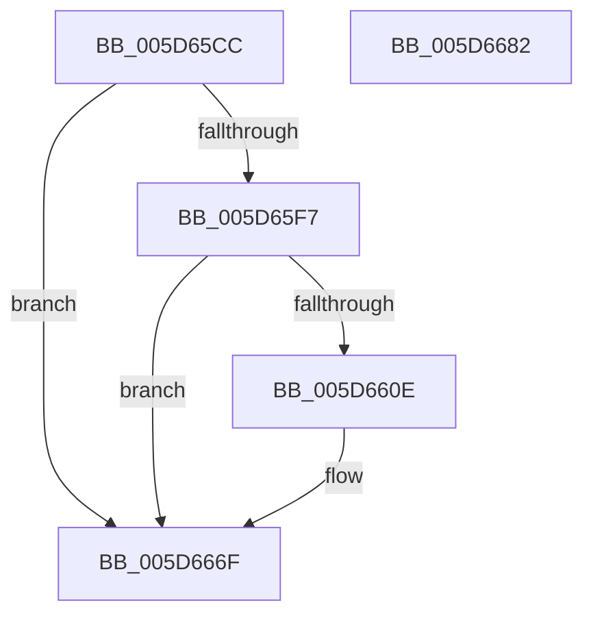

# PopDiagTraceEsState

- RVA: `0x005D65CC`–`0x005D6683` (길이 `183` bytes)
- VA: `0x00000001405D65CC`
- 실행 섹션: `.text`
- PDB 이름 있음: `예`; PDB Function 태그: `아니요`
- unwind 정보 RVA: `0x0009DFE8`
- 디코드: `41`개 명령, `183/183` bytes 표시
- 미해석 바이트: `0` (있으면 어셈블리에 `.byte`로 보존)

> 이 문서는 커널 이미지의 기계어와 PDB 기호를 분석해 생성했습니다. 4번과 5번은 함수 원형과 자료형을 바이너리 사용 방식에서 추정한 C 해석이며 원본 소스 복구 결과는 아닙니다.

## 1. Dependencies

- 직접 호출 지점: **3**; 고유 호출 대상: **3**
- 직접 호출자로 확인된 함수: **1**
- RIP 상대 이미지 참조: **5**

### Outgoing calls
- `0x005D6605` → [EtwEventEnabled](../39/EtwEventEnabled_function_00392450.md) (function, `0x00392450`)
- `0x005D666A` → [EtwWriteEx](../25/EtwWriteEx_function_0025F0D0.md) (function, `0x0025F0D0`)
- `0x005D6677` → [_security_check_cookie](../6A/_security_check_cookie_function_006AC640.md) (function, `0x006AC640`)

### Direct callers
- [PopEsUpdateState](PopEsUpdateState_function_005DA018.md) at `0x005DA112`

### Static image references
- `0x005D65D2` → RVA `0x00E0A740` (`.data`; read)
- `0x005D65E1` → RVA `0x00E67858` (`.data`; read)
- `0x005D65EB` → RVA `0x00E67A08` (`.data`; read)
- `0x005D65F7` → RVA `0x00F0B408` (`.data`; read)
- `0x005D65FE` → RVA `0x00022698` (`.rdata`; read)

## 2. Other-region calls and transfers

- 다른 실행 섹션으로 향하는 call: **0**
- 별도 외부 분기/꼬리 이동을 확인하지 못했습니다.

## 3. Assembly (complete function range)

```asm
005D65CC  40 53                           push rbx
005D65CE  48 83 EC 70                     sub rsp, 0x70
005D65D2  48 8B 05 67 41 83 00            mov rax, qword ptr [rip + 0x834167]
005D65D9  48 33 C4                        xor rax, rsp
005D65DC  48 89 44 24 68                  mov qword ptr [rsp + 0x68], rax
005D65E1  80 3D 70 12 89 00 00            cmp byte ptr [rip + 0x891270], 0
005D65E8  48 8B D9                        mov rbx, rcx
005D65EB  8B 05 17 14 89 00               mov eax, dword ptr [rip + 0x891417]
005D65F1  89 44 24 40                     mov dword ptr [rsp + 0x40], eax
005D65F5  74 78                           je 0x1405d666f
005D65F7  48 8B 0D 0A 4E 93 00            mov rcx, qword ptr [rip + 0x934e0a]
005D65FE  48 8D 15 93 C0 A4 FF            lea rdx, [rip - 0x5b3f6d]
005D6605  E8 46 BE DB FF                  call 0x140392450
005D660A  84 C0                           test al, al
005D660C  74 61                           je 0x1405d666f
005D660E  83 64 24 54 00                  and dword ptr [rsp + 0x54], 0
005D6613  48 8D 43 04                     lea rax, [rbx + 4]
005D6617  83 64 24 64 00                  and dword ptr [rsp + 0x64], 0
005D661C  48 8D 15 75 C0 A4 FF            lea rdx, [rip - 0x5b3f8b]
005D6623  48 89 44 24 48                  mov qword ptr [rsp + 0x48], rax
005D6628  B9 04 00 00 00                  mov ecx, 4
005D662D  48 8D 44 24 40                  lea rax, [rsp + 0x40]
005D6632  89 4C 24 50                     mov dword ptr [rsp + 0x50], ecx
005D6636  48 89 44 24 58                  mov qword ptr [rsp + 0x58], rax
005D663B  45 33 C9                        xor r9d, r9d
005D663E  48 8D 44 24 48                  lea rax, [rsp + 0x48]
005D6643  89 4C 24 60                     mov dword ptr [rsp + 0x60], ecx
005D6647  48 8B 0D BA 4D 93 00            mov rcx, qword ptr [rip + 0x934dba]
005D664E  45 33 C0                        xor r8d, r8d
005D6651  48 89 44 24 38                  mov qword ptr [rsp + 0x38], rax
005D6656  C7 44 24 30 02 00 00 00         mov dword ptr [rsp + 0x30], 2
005D665E  48 83 64 24 28 00               and qword ptr [rsp + 0x28], 0
005D6664  48 83 64 24 20 00               and qword ptr [rsp + 0x20], 0
005D666A  E8 61 8A C8 FF                  call 0x14025f0d0
005D666F  48 8B 4C 24 68                  mov rcx, qword ptr [rsp + 0x68]
005D6674  48 33 CC                        xor rcx, rsp
005D6677  E8 C4 5F 0D 00                  call 0x1406ac640
005D667C  48 83 C4 70                     add rsp, 0x70
005D6680  5B                              pop rbx
005D6681  C3                              ret
005D6682  CC                              int3
```

## 4. C-style interpretation (structured pseudocode)

```c
__int64 __fastcall PopDiagTraceEsState(__int64 a1, __int64 a2, int a3, int a4)
{
    __int64 result;
    __int64 v_rsp;
    unsigned __int64 v_stack_m10;
    unsigned int v_stack_m14;
    unsigned int v_stack_m18;
    unsigned __int64 v_stack_m20;
    unsigned int v_stack_m24;
    unsigned int v_stack_m28;
    unsigned __int64 v_stack_m30;
    unsigned int v_stack_m38;
    unsigned __int64 v_stack_m40;
    unsigned int v_stack_m48;
    unsigned __int64 v_stack_m50;
    unsigned __int64 v_stack_m58;

    v_rsp = (v_rsp) - (112);
    result = (*(unsigned __int64 *)(v_rip + 8601959)) ^ (v_rsp);
    v_stack_m10 = result;
    v_stack_m38 = (unsigned int)((unsigned int)(*(unsigned int *)(v_rip + 8983575)));
    if ((*(unsigned __int8 *)(v_rip + 8983152)) == 0) goto loc_005D666F;
    result = EtwEventEnabled(*(unsigned __int64 *)(v_rip + 9653770), v_rip - 5980013, a3, a4);
    if ((unsigned __int8)(result) != 0) {
        result = a1 + 4;
        a2 = v_rip - 5980043;
        v_stack_m30 = result;
        a1 = 4;
        result = v_stack_m38;
        v_stack_m28 = (unsigned int)(a1);
        v_stack_m20 = result;
        a4 = 0;
        result = v_stack_m30;
        v_stack_m18 = (unsigned int)(a1);
        a1 = *(unsigned __int64 *)(v_rip + 9653690);
        a3 = 0;
        v_stack_m40 = result;
        v_stack_m48 = 2;
        result = EtwWriteEx(a1, a2, a3, a4);
    }
    a1 = (v_stack_m10) ^ (v_rsp);
    result = _security_check_cookie(a1, a2, a3, a4);
    v_rsp = (v_rsp) + (112);
    return result;
}
```

## 5. (Beta) C Style

```c
int64_t PopDiagTraceEsState(void *Arg1, int64_t Arg2, int32_t Arg3, int32_t Arg4)
{
    uint8_t *arg1 = (uint8_t *)Arg1;

    int64_t result;
    int64_t local_rsp;
    uint64_t v_stack_m10;
    uint32_t v_stack_m14;
    uint32_t v_stack_m18;
    uint64_t v_stack_m20;
    uint32_t v_stack_m24;
    uint32_t v_stack_m28;
    uint64_t v_stack_m30;
    uint32_t v_stack_m38;
    uint64_t v_stack_m40;
    uint32_t v_stack_m48;
    uint64_t v_stack_m50;
    uint64_t v_stack_m58;

    local_rsp = (local_rsp) - (112);
    result = (*(uint64_t *)(v_rip + 0x834167)) ^ (local_rsp);
    v_stack_m10 = result;
    v_stack_m38 = (uint32_t)((uint32_t)(*(uint32_t *)(v_rip + 0x891417)));
    if ((*(uint8_t *)(v_rip + 0x891270)) == 0) goto loc_005D666F;
    result = EtwEventEnabled(*(uint64_t *)(v_rip + 0x934E0A), v_rip - 5980013, Arg3, Arg4);
    if ((uint8_t)(result) != 0) {
        result = Arg1 + 4;
        Arg2 = v_rip - 5980043;
        v_stack_m30 = result;
        Arg1 = 4;
        result = v_stack_m38;
        v_stack_m28 = (uint32_t)(Arg1);
        v_stack_m20 = result;
        Arg4 = 0;
        result = v_stack_m30;
        v_stack_m18 = (uint32_t)(Arg1);
        Arg1 = *(uint64_t *)(v_rip + 0x934DBA);
        Arg3 = 0;
        v_stack_m40 = result;
        v_stack_m48 = 2;
        result = EtwWriteEx(Arg1, Arg2, Arg3, Arg4);
    }
    Arg1 = (v_stack_m10) ^ (local_rsp);
    result = _security_check_cookie(Arg1, Arg2, Arg3, Arg4);
    local_rsp = (local_rsp) + (112);
    return result;
}
```

### 관측된 메모리 오프셋

구조체 형식이 확인되지 않은 접근은 인자 기준의 오프셋으로만 기록했습니다.

| 기준 인자 | 오프셋 표현 | 폭 (bit) | 접근 |
|---|---:|---:|---|
| `Arg1` | `+ 0x4` | `64` | `R` |

## 6. Execution-region graph

[열기: 2D/3D 그래프와 함수 탐색 컨트롤 패널](../../../control-panel.html?section=text&rva=0x005D65CC&view=graph)

- 2D 그래프는 위에서 아래로 흐르고, 3D 그래프는 빈 공간을 드래그해 회전합니다. Shift+드래그는 이동, 휠은 확대·축소, 함수 노드 선택은 대상 보고서 이동입니다.

### Static fallback


