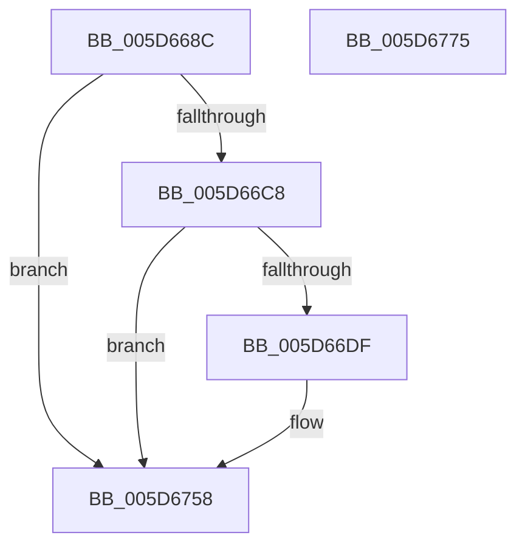

# PopDiagTraceFxComponentIdleConstraints

- RVA: `0x005D668C`–`0x005D6776` (길이 `234` bytes)
- VA: `0x00000001405D668C`
- 실행 섹션: `.text`
- PDB 이름 있음: `예`; PDB Function 태그: `아니요`
- unwind 정보 RVA: `0x000CCB54`
- 디코드: `55`개 명령, `234/234` bytes 표시
- 미해석 바이트: `0` (있으면 어셈블리에 `.byte`로 보존)

> 이 문서는 커널 이미지의 기계어와 PDB 기호를 분석해 생성했습니다. 4번과 5번은 함수 원형과 자료형을 바이너리 사용 방식에서 추정한 C 해석이며 원본 소스 복구 결과는 아닙니다.

## 1. Dependencies

- 직접 호출 지점: **3**; 고유 호출 대상: **3**
- 직접 호출자로 확인된 함수: **1**
- RIP 상대 이미지 참조: **4**

### Outgoing calls
- `0x005D66D6` → [EtwEventEnabled](../39/EtwEventEnabled_function_00392450.md) (function, `0x00392450`)
- `0x005D6753` → [EtwWriteEx](../25/EtwWriteEx_function_0025F0D0.md) (function, `0x0025F0D0`)
- `0x005D675F` → [_security_check_cookie](../6A/_security_check_cookie_function_006AC640.md) (function, `0x006AC640`)

### Direct callers
- [PopPluginRequestComponentIdleConstraints](PopPluginRequestComponentIdleConstraints_function_005D3C98.md) at `0x005D3D14`

### Static image references
- `0x005D66AA` → RVA `0x00E0A740` (`.data`; read)
- `0x005D66B8` → RVA `0x00E67858` (`.data`; read)
- `0x005D66C8` → RVA `0x00F0B408` (`.data`; read)
- `0x005D66CF` → RVA `0x00021370` (`.rdata`; read)

## 2. Other-region calls and transfers

- 다른 실행 섹션으로 향하는 call: **0**
- 별도 외부 분기/꼬리 이동을 확인하지 못했습니다.

## 3. Assembly (complete function range)

```asm
005D668C  48 8B C4                        mov rax, rsp
005D668F  48 89 58 18                     mov qword ptr [rax + 0x18], rbx
005D6693  44 89 48 20                     mov dword ptr [rax + 0x20], r9d
005D6697  89 50 10                        mov dword ptr [rax + 0x10], edx
005D669A  48 89 48 08                     mov qword ptr [rax + 8], rcx
005D669E  55                              push rbp
005D669F  48 8D 68 A1                     lea rbp, [rax - 0x5f]
005D66A3  48 81 EC 90 00 00 00            sub rsp, 0x90
005D66AA  48 8B 05 8F 40 83 00            mov rax, qword ptr [rip + 0x83408f]
005D66B1  48 33 C4                        xor rax, rsp
005D66B4  48 89 45 47                     mov qword ptr [rbp + 0x47], rax
005D66B8  80 3D 99 11 89 00 00            cmp byte ptr [rip + 0x891199], 0
005D66BF  49 8B D8                        mov rbx, r8
005D66C2  0F 84 90 00 00 00               je 0x1405d6758
005D66C8  48 8B 0D 39 4D 93 00            mov rcx, qword ptr [rip + 0x934d39]
005D66CF  48 8D 15 9A AC A4 FF            lea rdx, [rip - 0x5b5366]
005D66D6  E8 75 BD DB FF                  call 0x140392450
005D66DB  84 C0                           test al, al
005D66DD  74 79                           je 0x1405d6758
005D66DF  83 65 13 00                     and dword ptr [rbp + 0x13], 0
005D66E3  48 8D 45 67                     lea rax, [rbp + 0x67]
005D66E7  83 65 23 00                     and dword ptr [rbp + 0x23], 0
005D66EB  48 8D 15 7E AC A4 FF            lea rdx, [rip - 0x5b5382]
005D66F2  83 65 33 00                     and dword ptr [rbp + 0x33], 0
005D66F6  B9 04 00 00 00                  mov ecx, 4
005D66FB  83 65 43 00                     and dword ptr [rbp + 0x43], 0
005D66FF  45 33 C9                        xor r9d, r9d
005D6702  48 89 45 07                     mov qword ptr [rbp + 7], rax
005D6706  45 33 C0                        xor r8d, r8d
005D6709  48 8D 45 6F                     lea rax, [rbp + 0x6f]
005D670D  89 4D 1F                        mov dword ptr [rbp + 0x1f], ecx
005D6710  48 89 45 17                     mov qword ptr [rbp + 0x17], rax
005D6714  48 8D 45 7F                     lea rax, [rbp + 0x7f]
005D6718  48 89 45 27                     mov qword ptr [rbp + 0x27], rax
005D671C  8B 45 7F                        mov eax, dword ptr [rbp + 0x7f]
005D671F  C1 E0 02                        shl eax, 2
005D6722  89 45 3F                        mov dword ptr [rbp + 0x3f], eax
005D6725  48 8D 45 07                     lea rax, [rbp + 7]
005D6729  48 89 44 24 38                  mov qword ptr [rsp + 0x38], rax
005D672E  89 4C 24 30                     mov dword ptr [rsp + 0x30], ecx
005D6732  48 83 64 24 28 00               and qword ptr [rsp + 0x28], 0
005D6738  48 83 64 24 20 00               and qword ptr [rsp + 0x20], 0
005D673E  89 4D 2F                        mov dword ptr [rbp + 0x2f], ecx
005D6741  48 8B 0D C0 4C 93 00            mov rcx, qword ptr [rip + 0x934cc0]
005D6748  C7 45 0F 08 00 00 00            mov dword ptr [rbp + 0xf], 8
005D674F  48 89 5D 37                     mov qword ptr [rbp + 0x37], rbx
005D6753  E8 78 89 C8 FF                  call 0x14025f0d0
005D6758  48 8B 4D 47                     mov rcx, qword ptr [rbp + 0x47]
005D675C  48 33 CC                        xor rcx, rsp
005D675F  E8 DC 5E 0D 00                  call 0x1406ac640
005D6764  48 8B 9C 24 B0 00 00 00         mov rbx, qword ptr [rsp + 0xb0]
005D676C  48 81 C4 90 00 00 00            add rsp, 0x90
005D6773  5D                              pop rbp
005D6774  C3                              ret
005D6775  CC                              int3
```

## 4. C-style interpretation (structured pseudocode)

```c
__int64 __fastcall PopDiagTraceFxComponentIdleConstraints(__int64 a1, int a2, __int64 a3, int a4)
{
    __int64 result;
    __int64 v_rsp;
    unsigned __int64 v_stack_m60;
    unsigned int v_stack_m68;
    unsigned __int64 v_stack_m70;
    unsigned __int64 v_stack_m78;
    unsigned __int64 v_stack_p18;

    *(unsigned __int64 *)(v_rsp + 24) = v_rbx;
    *(unsigned int *)(v_rsp + 32) = a4;
    *(unsigned int *)(v_rsp + 16) = a2;
    *(unsigned __int64 *)(v_rsp + 8) = a1;
    v_rsp = (v_rsp) - (144);
    result = (*(unsigned __int64 *)(v_rip + 8601743)) ^ (v_rsp);
    *(unsigned __int64 *)(v_rsp - 95 + 71) = result;
    if ((*(unsigned __int8 *)(v_rip + 8982937)) == 0) goto loc_005D6758;
    result = EtwEventEnabled(*(unsigned __int64 *)(v_rip + 9653561), v_rip - 5985126, a3, a4);
    if ((unsigned __int8)(result) != 0) {
        result = v_rsp - 95 + 103;
        a2 = v_rip - 5985154;
        a1 = 4;
        a4 = 0;
        *(unsigned __int64 *)(v_rsp - 95 + 7) = result;
        a3 = 0;
        result = v_rsp - 95 + 111;
        *(unsigned int *)(v_rsp - 95 + 31) = (unsigned int)(a1);
        *(unsigned __int64 *)(v_rsp - 95 + 23) = result;
        result = v_rsp - 95 + 127;
        *(unsigned __int64 *)(v_rsp - 95 + 39) = result;
        result = *(unsigned int *)(v_rsp - 95 + 127);
        result = (unsigned int)((result) << (2));
        *(unsigned int *)(v_rsp - 95 + 63) = (unsigned int)(result);
        result = v_rsp - 95 + 7;
        v_stack_m60 = result;
        v_stack_m68 = (unsigned int)(a1);
        *(unsigned int *)(v_rsp - 95 + 47) = (unsigned int)(a1);
        a1 = *(unsigned __int64 *)(v_rip + 9653440);
        *(unsigned int *)(v_rsp - 95 + 15) = 8;
        *(unsigned __int64 *)(v_rsp - 95 + 55) = 0;
        result = EtwWriteEx(a1, a2, a3, a4);
    }
    a1 = (*(unsigned __int64 *)(v_rsp - 95 + 71)) ^ (v_rsp);
    result = _security_check_cookie(a1, a2, a3, a4);
    v_rsp = (v_rsp) + (144);
    return result;
}
```

## 5. (Beta) C Style

```c
int64_t PopDiagTraceFxComponentIdleConstraints(int64_t Arg1, int32_t Arg2, int64_t Arg3, int32_t Arg4)
{
    int64_t result;
    int64_t local_rsp;
    uint64_t v_stack_m60;
    uint32_t v_stack_m68;
    uint64_t v_stack_m70;
    uint64_t v_stack_m78;
    uint64_t v_stack_p18;

    *(uint64_t *)(local_rsp + 0x18) = local_rbx;
    *(uint32_t *)(local_rsp + 0x20) = Arg4;
    *(uint32_t *)(local_rsp + 0x10) = Arg2;
    *(uint64_t *)(local_rsp + 0x8) = Arg1;
    local_rsp = (local_rsp) - (144);
    result = (*(uint64_t *)(v_rip + 0x83408F)) ^ (local_rsp);
    *(uint64_t *)(local_rsp - 0x5F + 0x47) = result;
    if ((*(uint8_t *)(v_rip + 0x891199)) == 0) goto loc_005D6758;
    result = EtwEventEnabled(*(uint64_t *)(v_rip + 0x934D39), v_rip - 5985126, Arg3, Arg4);
    if ((uint8_t)(result) != 0) {
        result = local_rsp - 95 + 103;
        Arg2 = v_rip - 5985154;
        Arg1 = 4;
        Arg4 = 0;
        *(uint64_t *)(local_rsp - 0x5F + 0x7) = result;
        Arg3 = 0;
        result = local_rsp - 95 + 111;
        *(uint32_t *)(local_rsp - 0x5F + 0x1F) = (uint32_t)(Arg1);
        *(uint64_t *)(local_rsp - 0x5F + 0x17) = result;
        result = local_rsp - 95 + 127;
        *(uint64_t *)(local_rsp - 0x5F + 0x27) = result;
        result = *(uint32_t *)(local_rsp - 0x5F + 0x7F);
        result = (uint32_t)((result) << (2));
        *(uint32_t *)(local_rsp - 0x5F + 0x3F) = (uint32_t)(result);
        result = local_rsp - 95 + 7;
        v_stack_m60 = result;
        v_stack_m68 = (uint32_t)(Arg1);
        *(uint32_t *)(local_rsp - 0x5F + 0x2F) = (uint32_t)(Arg1);
        Arg1 = *(uint64_t *)(v_rip + 0x934CC0);
        *(uint32_t *)(local_rsp - 0x5F + 0xF) = 8;
        *(uint64_t *)(local_rsp - 0x5F + 0x37) = 0;
        result = EtwWriteEx(Arg1, Arg2, Arg3, Arg4);
    }
    Arg1 = (*(uint64_t *)(local_rsp - 0x5F + 0x47)) ^ (local_rsp);
    result = _security_check_cookie(Arg1, Arg2, Arg3, Arg4);
    local_rsp = (local_rsp) + (144);
    return result;
}
```

## 6. Execution-region graph

[열기: 2D/3D 그래프와 함수 탐색 컨트롤 패널](../../../control-panel.html?section=text&rva=0x005D668C&view=graph)

- 2D 그래프는 위에서 아래로 흐르고, 3D 그래프는 빈 공간을 드래그해 회전합니다. Shift+드래그는 이동, 휠은 확대·축소, 함수 노드 선택은 대상 보고서 이동입니다.

### Static fallback


