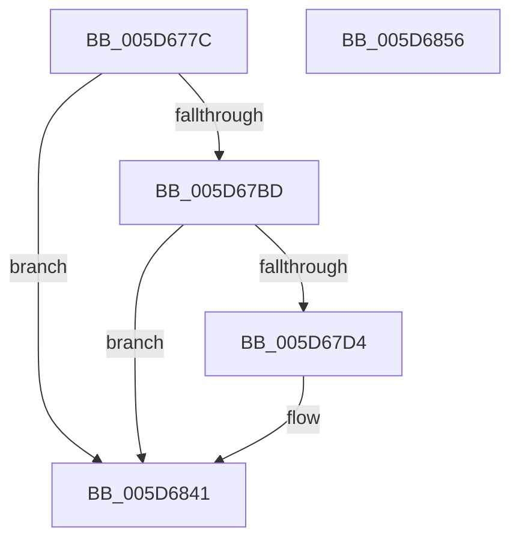

# PopDiagTraceFxComponentResidency

- RVA: `0x005D677C`–`0x005D6857` (길이 `219` bytes)
- VA: `0x00000001405D677C`
- 실행 섹션: `.text`
- PDB 이름 있음: `예`; PDB Function 태그: `아니요`
- unwind 정보 RVA: `0x000AB270`
- 디코드: `49`개 명령, `219/219` bytes 표시
- 미해석 바이트: `0` (있으면 어셈블리에 `.byte`로 보존)

> 이 문서는 커널 이미지의 기계어와 PDB 기호를 분석해 생성했습니다. 4번과 5번은 함수 원형과 자료형을 바이너리 사용 방식에서 추정한 C 해석이며 원본 소스 복구 결과는 아닙니다.

## 1. Dependencies

- 직접 호출 지점: **4**; 고유 호출 대상: **4**
- 직접 호출자로 확인된 함수: **1**
- RIP 상대 이미지 참조: **4**

### Outgoing calls
- `0x005D67AB` → [PopFxAddLogEntry](../39/PopFxAddLogEntry_function_00390B94.md) (function, `0x00390B94`)
- `0x005D67CB` → [EtwEventEnabled](../39/EtwEventEnabled_function_00392450.md) (function, `0x00392450`)
- `0x005D683C` → [EtwWriteEx](../25/EtwWriteEx_function_0025F0D0.md) (function, `0x0025F0D0`)
- `0x005D6848` → [_security_check_cookie](../6A/_security_check_cookie_function_006AC640.md) (function, `0x006AC640`)

### Direct callers
- [PoFxSetComponentResidency](PoFxSetComponentResidency_function_005D2100.md) at `0x005D211B`

### Static image references
- `0x005D6790` → RVA `0x00E0A740` (`.data`; read)
- `0x005D67B0` → RVA `0x00E67858` (`.data`; read)
- `0x005D67BD` → RVA `0x00F0B408` (`.data`; read)
- `0x005D67C4` → RVA `0x00020EB8` (`.rdata`; read)

## 2. Other-region calls and transfers

- 다른 실행 섹션으로 향하는 call: **0**
- 별도 외부 분기/꼬리 이동을 확인하지 못했습니다.

## 3. Assembly (complete function range)

```asm
005D677C  4C 89 44 24 18                  mov qword ptr [rsp + 0x18], r8
005D6781  89 54 24 10                     mov dword ptr [rsp + 0x10], edx
005D6785  55                              push rbp
005D6786  48 8B EC                        mov rbp, rsp
005D6789  48 81 EC 80 00 00 00            sub rsp, 0x80
005D6790  48 8B 05 A9 3F 83 00            mov rax, qword ptr [rip + 0x833fa9]
005D6797  48 33 C4                        xor rax, rsp
005D679A  48 89 45 F8                     mov qword ptr [rbp - 8], rax
005D679E  4D 8B C8                        mov r9, r8
005D67A1  48 89 4D C0                     mov qword ptr [rbp - 0x40], rcx
005D67A5  41 B8 0A 00 00 00               mov r8d, 0xa
005D67AB  E8 E4 A3 DB FF                  call 0x140390b94
005D67B0  80 3D A1 10 89 00 00            cmp byte ptr [rip + 0x8910a1], 0
005D67B7  0F 84 84 00 00 00               je 0x1405d6841
005D67BD  48 8B 0D 44 4C 93 00            mov rcx, qword ptr [rip + 0x934c44]
005D67C4  48 8D 15 ED A6 A4 FF            lea rdx, [rip - 0x5b5913]
005D67CB  E8 80 BC DB FF                  call 0x140392450
005D67D0  84 C0                           test al, al
005D67D2  74 6D                           je 0x1405d6841
005D67D4  83 65 D4 00                     and dword ptr [rbp - 0x2c], 0
005D67D8  48 8D 45 C0                     lea rax, [rbp - 0x40]
005D67DC  83 65 E4 00                     and dword ptr [rbp - 0x1c], 0
005D67E0  48 8D 15 D1 A6 A4 FF            lea rdx, [rip - 0x5b592f]
005D67E7  83 65 F4 00                     and dword ptr [rbp - 0xc], 0
005D67EB  B9 08 00 00 00                  mov ecx, 8
005D67F0  48 89 45 C8                     mov qword ptr [rbp - 0x38], rax
005D67F4  45 33 C0                        xor r8d, r8d
005D67F7  48 8D 45 18                     lea rax, [rbp + 0x18]
005D67FB  89 4D D0                        mov dword ptr [rbp - 0x30], ecx
005D67FE  48 89 45 D8                     mov qword ptr [rbp - 0x28], rax
005D6802  48 8D 45 20                     lea rax, [rbp + 0x20]
005D6806  48 89 45 E8                     mov qword ptr [rbp - 0x18], rax
005D680A  44 8D 49 F9                     lea r9d, [rcx - 7]
005D680E  48 8D 45 C8                     lea rax, [rbp - 0x38]
005D6812  89 4D F0                        mov dword ptr [rbp - 0x10], ecx
005D6815  48 8B 0D EC 4B 93 00            mov rcx, qword ptr [rip + 0x934bec]
005D681C  48 89 44 24 38                  mov qword ptr [rsp + 0x38], rax
005D6821  C7 44 24 30 03 00 00 00         mov dword ptr [rsp + 0x30], 3
005D6829  48 83 64 24 28 00               and qword ptr [rsp + 0x28], 0
005D682F  48 83 64 24 20 00               and qword ptr [rsp + 0x20], 0
005D6835  C7 45 E0 04 00 00 00            mov dword ptr [rbp - 0x20], 4
005D683C  E8 8F 88 C8 FF                  call 0x14025f0d0
005D6841  48 8B 4D F8                     mov rcx, qword ptr [rbp - 8]
005D6845  48 33 CC                        xor rcx, rsp
005D6848  E8 F3 5D 0D 00                  call 0x1406ac640
005D684D  48 81 C4 80 00 00 00            add rsp, 0x80
005D6854  5D                              pop rbp
005D6855  C3                              ret
005D6856  CC                              int3
```

## 4. C-style interpretation (structured pseudocode)

```c
__int64 __fastcall PopDiagTraceFxComponentResidency(__int64 a1, int a2, __int64 a3)
{
    __int64 result;
    __int64 v_rsp;
    unsigned __int64 v_stack_m10;
    unsigned int v_stack_m14;
    unsigned int v_stack_m18;
    unsigned __int64 v_stack_m20;
    unsigned int v_stack_m24;
    unsigned int v_stack_m28;
    unsigned __int64 v_stack_m30;
    unsigned int v_stack_m34;
    unsigned int v_stack_m38;
    unsigned __int64 v_stack_m40;
    unsigned __int64 v_stack_m48;
    unsigned __int64 v_stack_m50;
    unsigned int v_stack_m58;
    unsigned __int64 v_stack_m60;
    unsigned __int64 v_stack_m68;
    unsigned int v_stack_p10;
    unsigned __int64 v_stack_p18;

    v_stack_p18 = a3;
    v_stack_p10 = a2;
    v_rsp = (v_rsp) - (128);
    result = (*(unsigned __int64 *)(v_rip + 8601513)) ^ (v_rsp);
    v_stack_m10 = result;
    v_stack_m48 = a1;
    result = PopFxAddLogEntry(a1, a2, 10, a3);
    if ((*(unsigned __int8 *)(v_rip + 8982689)) == 0) goto loc_005D6841;
    result = EtwEventEnabled(*(unsigned __int64 *)(v_rip + 9653316), v_rip - 5986579, 10, a3);
    if ((unsigned __int8)(result) != 0) {
        result = v_stack_m48;
        a2 = v_rip - 5986607;
        a1 = 8;
        v_stack_m40 = result;
        a3 = 0;
        result = v_stack_p10;
        v_stack_m38 = (unsigned int)(a1);
        v_stack_m30 = result;
        result = v_stack_p18;
        v_stack_m20 = result;
        a4 = a1 - 7;
        result = v_stack_m40;
        v_stack_m18 = (unsigned int)(a1);
        a1 = *(unsigned __int64 *)(v_rip + 9653228);
        v_stack_m50 = result;
        v_stack_m58 = 3;
        v_stack_m28 = 4;
        result = EtwWriteEx(a1, a2, a3, a4);
    }
    a1 = (v_stack_m10) ^ (v_rsp);
    result = _security_check_cookie(a1, a2, a3, a4);
    v_rsp = (v_rsp) + (128);
    return result;
}
```

## 5. (Beta) C Style

```c
int64_t PopDiagTraceFxComponentResidency(int64_t Arg1, int32_t Arg2, int64_t Arg3)
{
    int64_t result;
    int64_t local_rsp;
    uint64_t v_stack_m10;
    uint32_t v_stack_m14;
    uint32_t v_stack_m18;
    uint64_t v_stack_m20;
    uint32_t v_stack_m24;
    uint32_t v_stack_m28;
    uint64_t v_stack_m30;
    uint32_t v_stack_m34;
    uint32_t v_stack_m38;
    uint64_t v_stack_m40;
    uint64_t v_stack_m48;
    uint64_t v_stack_m50;
    uint32_t v_stack_m58;
    uint64_t v_stack_m60;
    uint64_t v_stack_m68;
    uint32_t v_stack_p10;
    uint64_t v_stack_p18;

    v_stack_p18 = Arg3;
    v_stack_p10 = Arg2;
    local_rsp = (local_rsp) - (128);
    result = (*(uint64_t *)(v_rip + 0x833FA9)) ^ (local_rsp);
    v_stack_m10 = result;
    v_stack_m48 = Arg1;
    result = PopFxAddLogEntry(Arg1, Arg2, 10, Arg3);
    if ((*(uint8_t *)(v_rip + 0x8910A1)) == 0) goto loc_005D6841;
    result = EtwEventEnabled(*(uint64_t *)(v_rip + 0x934C44), v_rip - 5986579, 10, Arg3);
    if ((uint8_t)(result) != 0) {
        result = v_stack_m48;
        Arg2 = v_rip - 5986607;
        Arg1 = 8;
        v_stack_m40 = result;
        Arg3 = 0;
        result = v_stack_p10;
        v_stack_m38 = (uint32_t)(Arg1);
        v_stack_m30 = result;
        result = v_stack_p18;
        v_stack_m20 = result;
        a4 = Arg1 - 7;
        result = v_stack_m40;
        v_stack_m18 = (uint32_t)(Arg1);
        Arg1 = *(uint64_t *)(v_rip + 0x934BEC);
        v_stack_m50 = result;
        v_stack_m58 = 3;
        v_stack_m28 = 4;
        result = EtwWriteEx(Arg1, Arg2, Arg3, a4);
    }
    Arg1 = (v_stack_m10) ^ (local_rsp);
    result = _security_check_cookie(Arg1, Arg2, Arg3, a4);
    local_rsp = (local_rsp) + (128);
    return result;
}
```

## 6. Execution-region graph

[열기: 2D/3D 그래프와 함수 탐색 컨트롤 패널](../../../control-panel.html?section=text&rva=0x005D677C&view=graph)

- 2D 그래프는 위에서 아래로 흐르고, 3D 그래프는 빈 공간을 드래그해 회전합니다. Shift+드래그는 이동, 휠은 확대·축소, 함수 노드 선택은 대상 보고서 이동입니다.

### Static fallback


