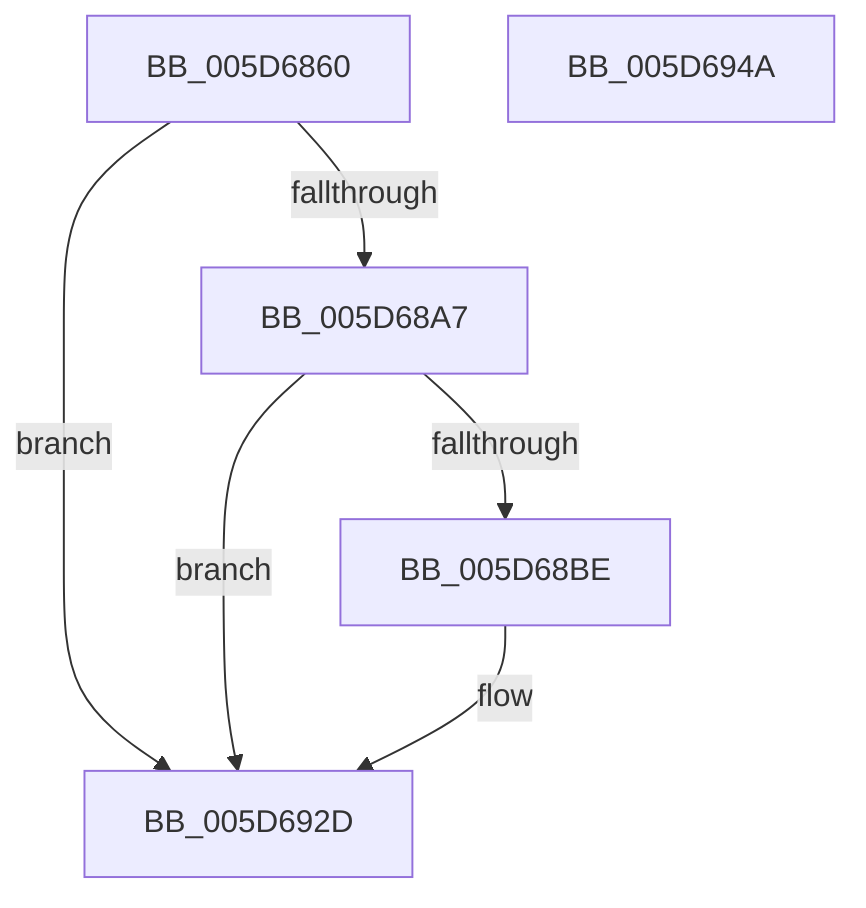

# PopDiagTraceFxComponentWake

- RVA: `0x005D6860`–`0x005D694B` (길이 `235` bytes)
- VA: `0x00000001405D6860`
- 실행 섹션: `.text`
- PDB 이름 있음: `예`; PDB Function 태그: `아니요`
- unwind 정보 RVA: `0x000CCB1C`
- 디코드: `52`개 명령, `235/235` bytes 표시
- 미해석 바이트: `0` (있으면 어셈블리에 `.byte`로 보존)

> 이 문서는 커널 이미지의 기계어와 PDB 기호를 분석해 생성했습니다. 4번과 5번은 함수 원형과 자료형을 바이너리 사용 방식에서 추정한 C 해석이며 원본 소스 복구 결과는 아닙니다.

## 1. Dependencies

- 직접 호출 지점: **4**; 고유 호출 대상: **4**
- 직접 호출자로 확인된 함수: **1**
- RIP 상대 이미지 참조: **4**

### Outgoing calls
- `0x005D6895` → [PopFxAddLogEntry](../39/PopFxAddLogEntry_function_00390B94.md) (function, `0x00390B94`)
- `0x005D68B5` → [EtwEventEnabled](../39/EtwEventEnabled_function_00392450.md) (function, `0x00392450`)
- `0x005D6928` → [EtwWriteEx](../25/EtwWriteEx_function_0025F0D0.md) (function, `0x0025F0D0`)
- `0x005D6934` → [_security_check_cookie](../6A/_security_check_cookie_function_006AC640.md) (function, `0x006AC640`)

### Direct callers
- [PoFxSetComponentWake](PoFxSetComponentWake_function_005D2150.md) at `0x005D216B`

### Static image references
- `0x005D6876` → RVA `0x00E0A740` (`.data`; read)
- `0x005D689A` → RVA `0x00E67858` (`.data`; read)
- `0x005D68A7` → RVA `0x00F0B408` (`.data`; read)
- `0x005D68AE` → RVA `0x00022A90` (`.rdata`; read)

## 2. Other-region calls and transfers

- 다른 실행 섹션으로 향하는 call: **0**
- 별도 외부 분기/꼬리 이동을 확인하지 못했습니다.

## 3. Assembly (complete function range)

```asm
005D6860  48 89 5C 24 18                  mov qword ptr [rsp + 0x18], rbx
005D6865  89 54 24 10                     mov dword ptr [rsp + 0x10], edx
005D6869  55                              push rbp
005D686A  48 8D 6C 24 A9                  lea rbp, [rsp - 0x57]
005D686F  48 81 EC 90 00 00 00            sub rsp, 0x90
005D6876  48 8B 05 C3 3E 83 00            mov rax, qword ptr [rip + 0x833ec3]
005D687D  48 33 C4                        xor rax, rsp
005D6880  48 89 45 47                     mov qword ptr [rbp + 0x47], rax
005D6884  41 0F B6 D8                     movzx ebx, r8b
005D6888  41 B8 0B 00 00 00               mov r8d, 0xb
005D688E  44 8B CB                        mov r9d, ebx
005D6891  48 89 4D 0F                     mov qword ptr [rbp + 0xf], rcx
005D6895  E8 FA A2 DB FF                  call 0x140390b94
005D689A  80 3D B7 0F 89 00 00            cmp byte ptr [rip + 0x890fb7], 0
005D68A1  0F 84 86 00 00 00               je 0x1405d692d
005D68A7  48 8B 0D 5A 4B 93 00            mov rcx, qword ptr [rip + 0x934b5a]
005D68AE  48 8D 15 DB C1 A4 FF            lea rdx, [rip - 0x5b3e25]
005D68B5  E8 96 BB DB FF                  call 0x140392450
005D68BA  84 C0                           test al, al
005D68BC  74 6F                           je 0x1405d692d
005D68BE  83 65 23 00                     and dword ptr [rbp + 0x23], 0
005D68C2  48 8D 45 0F                     lea rax, [rbp + 0xf]
005D68C6  83 65 33 00                     and dword ptr [rbp + 0x33], 0
005D68CA  48 8D 15 BF C1 A4 FF            lea rdx, [rip - 0x5b3e41]
005D68D1  83 65 43 00                     and dword ptr [rbp + 0x43], 0
005D68D5  B9 04 00 00 00                  mov ecx, 4
005D68DA  48 89 45 17                     mov qword ptr [rbp + 0x17], rax
005D68DE  45 33 C9                        xor r9d, r9d
005D68E1  48 8D 45 6F                     lea rax, [rbp + 0x6f]
005D68E5  89 4D 2F                        mov dword ptr [rbp + 0x2f], ecx
005D68E8  48 89 45 27                     mov qword ptr [rbp + 0x27], rax
005D68EC  45 33 C0                        xor r8d, r8d
005D68EF  48 8D 45 07                     lea rax, [rbp + 7]
005D68F3  89 4D 3F                        mov dword ptr [rbp + 0x3f], ecx
005D68F6  48 8B 0D 0B 4B 93 00            mov rcx, qword ptr [rip + 0x934b0b]
005D68FD  48 89 45 37                     mov qword ptr [rbp + 0x37], rax
005D6901  48 8D 45 17                     lea rax, [rbp + 0x17]
005D6905  48 89 44 24 38                  mov qword ptr [rsp + 0x38], rax
005D690A  C7 44 24 30 03 00 00 00         mov dword ptr [rsp + 0x30], 3
005D6912  48 83 64 24 28 00               and qword ptr [rsp + 0x28], 0
005D6918  48 83 64 24 20 00               and qword ptr [rsp + 0x20], 0
005D691E  89 5D 07                        mov dword ptr [rbp + 7], ebx
005D6921  C7 45 1F 08 00 00 00            mov dword ptr [rbp + 0x1f], 8
005D6928  E8 A3 87 C8 FF                  call 0x14025f0d0
005D692D  48 8B 4D 47                     mov rcx, qword ptr [rbp + 0x47]
005D6931  48 33 CC                        xor rcx, rsp
005D6934  E8 07 5D 0D 00                  call 0x1406ac640
005D6939  48 8B 9C 24 B0 00 00 00         mov rbx, qword ptr [rsp + 0xb0]
005D6941  48 81 C4 90 00 00 00            add rsp, 0x90
005D6948  5D                              pop rbp
005D6949  C3                              ret
005D694A  CC                              int3
```

## 4. C-style interpretation (structured pseudocode)

```c
__int64 __fastcall PopDiagTraceFxComponentWake(__int64 a1, int a2, unsigned __int8 a3)
{
    __int64 result;
    __int64 v_rsp;
    unsigned __int64 v_stack_m18;
    unsigned int v_stack_m1C;
    unsigned int v_stack_m20;
    unsigned __int64 v_stack_m28;
    unsigned int v_stack_m2C;
    unsigned int v_stack_m30;
    unsigned __int64 v_stack_m38;
    unsigned int v_stack_m3C;
    unsigned int v_stack_m40;
    unsigned __int64 v_stack_m48;
    unsigned __int64 v_stack_m50;
    unsigned __int64 v_stack_m58;
    unsigned __int64 v_stack_m5F;
    unsigned __int64 v_stack_m60;
    unsigned int v_stack_m68;
    unsigned __int64 v_stack_m70;
    unsigned __int64 v_stack_m78;
    unsigned int v_stack_p10;
    unsigned __int64 v_stack_p18;

    v_stack_p18 = v_rbx;
    v_stack_p10 = a2;
    v_rsp = (v_rsp) - (144);
    result = (*(unsigned __int64 *)(v_rip + 8601283)) ^ (v_rsp);
    v_stack_m18 = result;
    v_stack_m50 = a1;
    result = PopFxAddLogEntry(a1, a2, 11, (unsigned int)(a3));
    if ((*(unsigned __int8 *)(v_rip + 8982455)) == 0) goto loc_005D692D;
    result = EtwEventEnabled(*(unsigned __int64 *)(v_rip + 9653082), v_rip - 5979685, 11, (unsigned int)(a3));
    if ((unsigned __int8)(result) != 0) {
        result = v_stack_m50;
        a2 = v_rip - 5979713;
        a1 = 4;
        v_stack_m48 = result;
        a4 = 0;
        result = v_stack_p10;
        v_stack_m30 = (unsigned int)(a1);
        v_stack_m38 = result;
        a3 = 0;
        result = v_stack_m58;
        v_stack_m20 = (unsigned int)(a1);
        a1 = *(unsigned __int64 *)(v_rip + 9653003);
        v_stack_m28 = result;
        result = v_stack_m48;
        v_stack_m60 = result;
        v_stack_m68 = 3;
        v_stack_m58 = 0;
        v_stack_m40 = 8;
        result = EtwWriteEx(a1, a2, a3, a4);
    }
    a1 = (v_stack_m18) ^ (v_rsp);
    result = _security_check_cookie(a1, a2, a3, a4);
    v_rsp = (v_rsp) + (144);
    return result;
}
```

## 5. (Beta) C Style

```c
int64_t PopDiagTraceFxComponentWake(int64_t Arg1, int32_t Arg2, uint8_t Arg3)
{
    int64_t result;
    int64_t local_rsp;
    uint64_t v_stack_m18;
    uint32_t v_stack_m1C;
    uint32_t v_stack_m20;
    uint64_t v_stack_m28;
    uint32_t v_stack_m2C;
    uint32_t v_stack_m30;
    uint64_t v_stack_m38;
    uint32_t v_stack_m3C;
    uint32_t v_stack_m40;
    uint64_t v_stack_m48;
    uint64_t v_stack_m50;
    uint64_t v_stack_m58;
    uint64_t v_stack_m5F;
    uint64_t v_stack_m60;
    uint32_t v_stack_m68;
    uint64_t v_stack_m70;
    uint64_t v_stack_m78;
    uint32_t v_stack_p10;
    uint64_t v_stack_p18;

    v_stack_p18 = local_rbx;
    v_stack_p10 = Arg2;
    local_rsp = (local_rsp) - (144);
    result = (*(uint64_t *)(v_rip + 0x833EC3)) ^ (local_rsp);
    v_stack_m18 = result;
    v_stack_m50 = Arg1;
    result = PopFxAddLogEntry(Arg1, Arg2, 11, (uint32_t)(Arg3));
    if ((*(uint8_t *)(v_rip + 0x890FB7)) == 0) goto loc_005D692D;
    result = EtwEventEnabled(*(uint64_t *)(v_rip + 0x934B5A), v_rip - 5979685, 11, (uint32_t)(Arg3));
    if ((uint8_t)(result) != 0) {
        result = v_stack_m50;
        Arg2 = v_rip - 5979713;
        Arg1 = 4;
        v_stack_m48 = result;
        a4 = 0;
        result = v_stack_p10;
        v_stack_m30 = (uint32_t)(Arg1);
        v_stack_m38 = result;
        Arg3 = 0;
        result = v_stack_m58;
        v_stack_m20 = (uint32_t)(Arg1);
        Arg1 = *(uint64_t *)(v_rip + 0x934B0B);
        v_stack_m28 = result;
        result = v_stack_m48;
        v_stack_m60 = result;
        v_stack_m68 = 3;
        v_stack_m58 = 0;
        v_stack_m40 = 8;
        result = EtwWriteEx(Arg1, Arg2, Arg3, a4);
    }
    Arg1 = (v_stack_m18) ^ (local_rsp);
    result = _security_check_cookie(Arg1, Arg2, Arg3, a4);
    local_rsp = (local_rsp) + (144);
    return result;
}
```

## 6. Execution-region graph

[열기: 2D/3D 그래프와 함수 탐색 컨트롤 패널](../../../control-panel.html?section=text&rva=0x005D6860&view=graph)

- 2D 그래프는 위에서 아래로 흐르고, 3D 그래프는 빈 공간을 드래그해 회전합니다. Shift+드래그는 이동, 휠은 확대·축소, 함수 노드 선택은 대상 보고서 이동입니다.

### Static fallback


