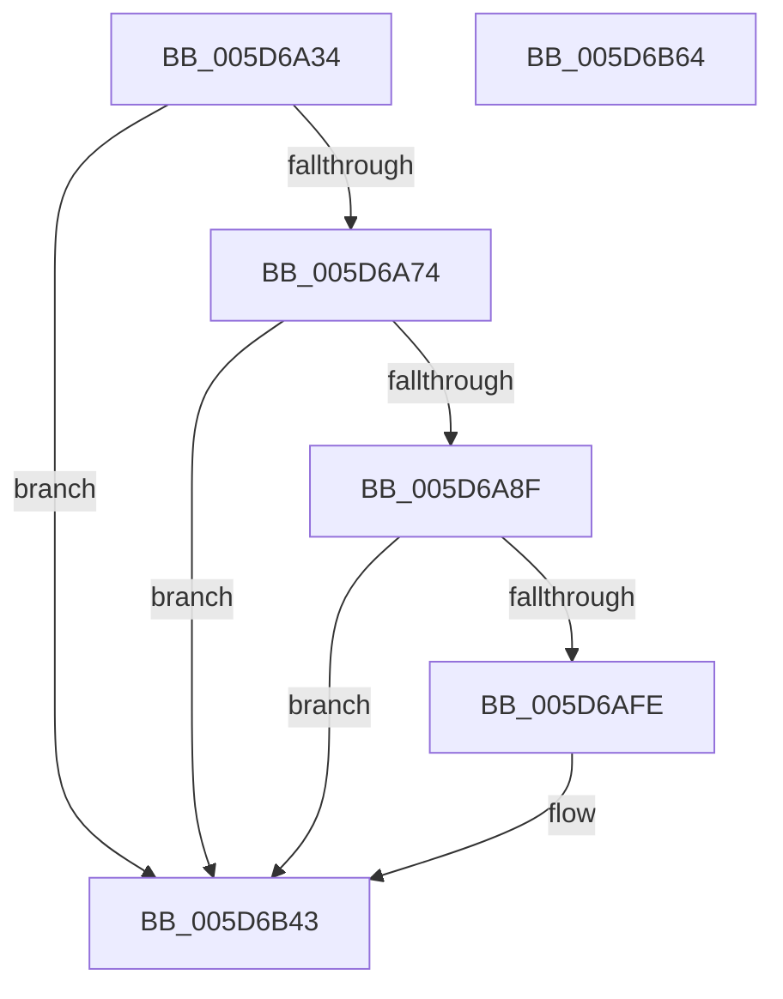

# PopDiagTraceFxPerfNominalChange

- RVA: `0x005D6A34`–`0x005D6B65` (길이 `305` bytes)
- VA: `0x00000001405D6A34`
- 실행 섹션: `.text`
- PDB 이름 있음: `예`; PDB Function 태그: `아니요`
- unwind 정보 RVA: `0x000CCAFC`
- 디코드: `73`개 명령, `305/305` bytes 표시
- 미해석 바이트: `0` (있으면 어셈블리에 `.byte`로 보존)

> 이 문서는 커널 이미지의 기계어와 PDB 기호를 분석해 생성했습니다. 4번과 5번은 함수 원형과 자료형을 바이너리 사용 방식에서 추정한 C 해석이며 원본 소스 복구 결과는 아닙니다.

## 1. Dependencies

- 직접 호출 지점: **3**; 고유 호출 대상: **3**
- 직접 호출자로 확인된 함수: **1**
- RIP 상대 이미지 참조: **4**

### Outgoing calls
- `0x005D6A82` → [EtwEventEnabled](../39/EtwEventEnabled_function_00392450.md) (function, `0x00392450`)
- `0x005D6B3E` → [EtwWriteEx](../25/EtwWriteEx_function_0025F0D0.md) (function, `0x0025F0D0`)
- `0x005D6B4A` → [_security_check_cookie](../6A/_security_check_cookie_function_006AC640.md) (function, `0x006AC640`)

### Direct callers
- [PopFxUpdateComponentPerfStateNominalChange](PopFxUpdateComponentPerfStateNominalChange_function_005D3790.md) at `0x005D3852`

### Static image references
- `0x005D6A53` → RVA `0x00E0A740` (`.data`; read)
- `0x005D6A61` → RVA `0x00E67858` (`.data`; read)
- `0x005D6A74` → RVA `0x00F0B408` (`.data`; read)
- `0x005D6A7B` → RVA `0x00021928` (`.rdata`; read)

## 2. Other-region calls and transfers

- 다른 실행 섹션으로 향하는 call: **0**
- 별도 외부 분기/꼬리 이동을 확인하지 못했습니다.

## 3. Assembly (complete function range)

```asm
005D6A34  48 8B C4                        mov rax, rsp
005D6A37  48 89 58 08                     mov qword ptr [rax + 8], rbx
005D6A3B  48 89 78 10                     mov qword ptr [rax + 0x10], rdi
005D6A3F  44 89 48 20                     mov dword ptr [rax + 0x20], r9d
005D6A43  44 89 40 18                     mov dword ptr [rax + 0x18], r8d
005D6A47  55                              push rbp
005D6A48  48 8D 68 A9                     lea rbp, [rax - 0x57]
005D6A4C  48 81 EC C0 00 00 00            sub rsp, 0xc0
005D6A53  48 8B 05 E6 3C 83 00            mov rax, qword ptr [rip + 0x833ce6]
005D6A5A  48 33 C4                        xor rax, rsp
005D6A5D  48 89 45 3F                     mov qword ptr [rbp + 0x3f], rax
005D6A61  80 3D F0 0D 89 00 00            cmp byte ptr [rip + 0x890df0], 0
005D6A68  48 8B F9                        mov rdi, rcx
005D6A6B  0F B6 DA                        movzx ebx, dl
005D6A6E  0F 84 CF 00 00 00               je 0x1405d6b43
005D6A74  48 8B 0D 8D 49 93 00            mov rcx, qword ptr [rip + 0x93498d]
005D6A7B  48 8D 15 A6 AE A4 FF            lea rdx, [rip - 0x5b515a]
005D6A82  E8 C9 B9 DB FF                  call 0x140392450
005D6A87  84 C0                           test al, al
005D6A89  0F 84 B4 00 00 00               je 0x1405d6b43
005D6A8F  48 8B 0F                        mov rcx, qword ptr [rdi]
005D6A92  48 8B 41 50                     mov rax, qword ptr [rcx + 0x50]
005D6A96  83 65 EB 00                     and dword ptr [rbp - 0x15], 0
005D6A9A  48 83 C0 30                     add rax, 0x30
005D6A9E  83 65 FB 00                     and dword ptr [rbp - 5], 0
005D6AA2  83 65 0B 00                     and dword ptr [rbp + 0xb], 0
005D6AA6  83 65 1B 00                     and dword ptr [rbp + 0x1b], 0
005D6AAA  83 65 2B 00                     and dword ptr [rbp + 0x2b], 0
005D6AAE  48 89 45 DF                     mov qword ptr [rbp - 0x21], rax
005D6AB2  48 8D 41 10                     lea rax, [rcx + 0x10]
005D6AB6  B9 04 00 00 00                  mov ecx, 4
005D6ABB  48 89 45 EF                     mov qword ptr [rbp - 0x11], rax
005D6ABF  48 8D 45 CF                     lea rax, [rbp - 0x31]
005D6AC3  89 4D F7                        mov dword ptr [rbp - 9], ecx
005D6AC6  48 89 45 FF                     mov qword ptr [rbp - 1], rax
005D6ACA  48 8D 45 6F                     lea rax, [rbp + 0x6f]
005D6ACE  48 89 45 0F                     mov qword ptr [rbp + 0xf], rax
005D6AD2  48 8D 45 77                     lea rax, [rbp + 0x77]
005D6AD6  89 4D 07                        mov dword ptr [rbp + 7], ecx
005D6AD9  89 4D 17                        mov dword ptr [rbp + 0x17], ecx
005D6ADC  89 4D 27                        mov dword ptr [rbp + 0x27], ecx
005D6ADF  8B 4D 77                        mov ecx, dword ptr [rbp + 0x77]
005D6AE2  48 89 45 1F                     mov qword ptr [rbp + 0x1f], rax
005D6AE6  B8 FF FF FF FF                  mov eax, 0xffffffff
005D6AEB  48 C1 E1 04                     shl rcx, 4
005D6AEF  C7 45 E7 08 00 00 00            mov dword ptr [rbp - 0x19], 8
005D6AF6  89 5D CF                        mov dword ptr [rbp - 0x31], ebx
005D6AF9  48 3B C8                        cmp rcx, rax
005D6AFC  77 45                           ja 0x1405d6b43
005D6AFE  48 8B 45 7F                     mov rax, qword ptr [rbp + 0x7f]
005D6B02  48 8D 15 1F AE A4 FF            lea rdx, [rip - 0x5b51e1]
005D6B09  83 65 3B 00                     and dword ptr [rbp + 0x3b], 0
005D6B0D  45 33 C9                        xor r9d, r9d
005D6B10  48 89 45 2F                     mov qword ptr [rbp + 0x2f], rax
005D6B14  45 33 C0                        xor r8d, r8d
005D6B17  48 8D 45 DF                     lea rax, [rbp - 0x21]
005D6B1B  89 4D 37                        mov dword ptr [rbp + 0x37], ecx
005D6B1E  48 8B 0D E3 48 93 00            mov rcx, qword ptr [rip + 0x9348e3]
005D6B25  48 89 44 24 38                  mov qword ptr [rsp + 0x38], rax
005D6B2A  C7 44 24 30 06 00 00 00         mov dword ptr [rsp + 0x30], 6
005D6B32  48 83 64 24 28 00               and qword ptr [rsp + 0x28], 0
005D6B38  48 83 64 24 20 00               and qword ptr [rsp + 0x20], 0
005D6B3E  E8 8D 85 C8 FF                  call 0x14025f0d0
005D6B43  48 8B 4D 3F                     mov rcx, qword ptr [rbp + 0x3f]
005D6B47  48 33 CC                        xor rcx, rsp
005D6B4A  E8 F1 5A 0D 00                  call 0x1406ac640
005D6B4F  4C 8D 9C 24 C0 00 00 00         lea r11, [rsp + 0xc0]
005D6B57  49 8B 5B 10                     mov rbx, qword ptr [r11 + 0x10]
005D6B5B  49 8B 7B 18                     mov rdi, qword ptr [r11 + 0x18]
005D6B5F  49 8B E3                        mov rsp, r11
005D6B62  5D                              pop rbp
005D6B63  C3                              ret
005D6B64  CC                              int3
```

## 4. C-style interpretation (structured pseudocode)

```c
__int64 __fastcall PopDiagTraceFxPerfNominalChange(__int64 a1, unsigned __int8 a2, int a3, int a4)
{
    __int64 result;
    __int64 v_rsp;
    unsigned __int64 v_stack_m8;
    unsigned __int64 v_stack_m90;
    unsigned int v_stack_m98;
    unsigned __int64 v_stack_mA0;
    unsigned __int64 v_stack_mA8;

    *(unsigned __int64 *)(v_rsp + 8) = v_rbx;
    *(unsigned __int64 *)(v_rsp + 16) = v_rdi;
    *(unsigned int *)(v_rsp + 32) = a4;
    *(unsigned int *)(v_rsp + 24) = a3;
    v_rsp = (v_rsp) - (192);
    result = (*(unsigned __int64 *)(v_rip + 8600806)) ^ (v_rsp);
    *(unsigned __int64 *)(v_rsp - 87 + 63) = result;
    if ((*(unsigned __int8 *)(v_rip + 8982000)) == 0) goto loc_005D6B43;
    result = EtwEventEnabled(*(unsigned __int64 *)(v_rip + 9652621), v_rip - 5984602, a3, a4);
    if ((unsigned __int8)(result) == 0) goto loc_005D6B43;
    result = (*(unsigned __int64 *)(*(unsigned __int64 *)(a1) + 80)) + (48);
    *(unsigned __int64 *)(v_rsp - 87 - 33) = result;
    *(unsigned __int64 *)(v_rsp - 87 - 17) = *(unsigned __int64 *)(a1) + 16;
    *(unsigned int *)(v_rsp - 87 - 9) = 4;
    *(unsigned __int64 *)(v_rsp - 87 - 1) = v_rsp - 87 - 49;
    *(unsigned __int64 *)(v_rsp - 87 + 15) = v_rsp - 87 + 111;
    *(unsigned int *)(v_rsp - 87 + 7) = 4;
    *(unsigned int *)(v_rsp - 87 + 23) = 4;
    *(unsigned int *)(v_rsp - 87 + 39) = 4;
    *(unsigned __int64 *)(v_rsp - 87 + 31) = v_rsp - 87 + 119;
    a1 = ((unsigned int)(*(unsigned int *)(v_rsp - 87 + 119))) << (4);
    *(unsigned int *)(v_rsp - 87 - 25) = 8;
    *(unsigned int *)(v_rsp - 87 - 49) = a2;
    result = (unsigned int)(0xFFFFFFFFULL);
    if (a1 <= ((unsigned int)(0xFFFFFFFFULL))) {
        result = *(unsigned __int64 *)(v_rsp - 87 + 127);
        a2 = v_rip - 5984737;
        a4 = 0;
        *(unsigned __int64 *)(v_rsp - 87 + 47) = result;
        a3 = 0;
        result = v_rsp - 87 - 33;
        *(unsigned int *)(v_rsp - 87 + 55) = (unsigned int)(a1);
        a1 = *(unsigned __int64 *)(v_rip + 9652451);
        v_stack_m90 = result;
        v_stack_m98 = 6;
        result = EtwWriteEx(a1, a2, a3, a4);
    }
    a1 = (*(unsigned __int64 *)(v_rsp - 87 + 63)) ^ (v_rsp);
    result = _security_check_cookie(a1, a2, a3, a4);
    return result;
}
```

## 5. (Beta) C Style

```c
int64_t PopDiagTraceFxPerfNominalChange(void *Arg1, uint8_t Arg2, int32_t Arg3, int32_t Arg4)
{
    uint8_t *arg1 = (uint8_t *)Arg1;

    int64_t result;
    int64_t local_rsp;
    uint64_t v_stack_m8;
    uint64_t v_stack_m90;
    uint32_t v_stack_m98;
    uint64_t v_stack_mA0;
    uint64_t v_stack_mA8;

    *(uint64_t *)(local_rsp + 0x8) = local_rbx;
    *(uint64_t *)(local_rsp + 0x10) = local_rdi;
    *(uint32_t *)(local_rsp + 0x20) = Arg4;
    *(uint32_t *)(local_rsp + 0x18) = Arg3;
    local_rsp = (local_rsp) - (192);
    result = (*(uint64_t *)(v_rip + 0x833CE6)) ^ (local_rsp);
    *(uint64_t *)(local_rsp - 0x57 + 0x3F) = result;
    if ((*(uint8_t *)(v_rip + 0x890DF0)) == 0) goto loc_005D6B43;
    result = EtwEventEnabled(*(uint64_t *)(v_rip + 0x93498D), v_rip - 5984602, Arg3, Arg4);
    if ((uint8_t)(result) == 0) goto loc_005D6B43;
    result = (*(uint64_t *)(*(uint64_t *)(arg1) + 0x50)) + (48);
    *(uint64_t *)(local_rsp - 0x57 - 0x21) = result;
    *(uint64_t *)(local_rsp - 0x57 - 0x11) = *(uint64_t *)(arg1) + 16;
    *(uint32_t *)(local_rsp - 0x57 - 0x9) = 4;
    *(uint64_t *)(local_rsp - 0x57 - 0x1) = local_rsp - 87 - 49;
    *(uint64_t *)(local_rsp - 0x57 + 0xF) = local_rsp - 87 + 111;
    *(uint32_t *)(local_rsp - 0x57 + 0x7) = 4;
    *(uint32_t *)(local_rsp - 0x57 + 0x17) = 4;
    *(uint32_t *)(local_rsp - 0x57 + 0x27) = 4;
    *(uint64_t *)(local_rsp - 0x57 + 0x1F) = local_rsp - 87 + 119;
    Arg1 = ((uint32_t)(*(uint32_t *)(local_rsp - 0x57 + 0x77))) << (4);
    *(uint32_t *)(local_rsp - 0x57 - 0x19) = 8;
    *(uint32_t *)(local_rsp - 0x57 - 0x31) = Arg2;
    result = (uint32_t)(0xFFFFFFFFULL);
    if (Arg1 <= ((uint32_t)(0xFFFFFFFFULL))) {
        result = *(uint64_t *)(local_rsp - 0x57 + 0x7F);
        Arg2 = v_rip - 5984737;
        Arg4 = 0;
        *(uint64_t *)(local_rsp - 0x57 + 0x2F) = result;
        Arg3 = 0;
        result = local_rsp - 87 - 33;
        *(uint32_t *)(local_rsp - 0x57 + 0x37) = (uint32_t)(Arg1);
        Arg1 = *(uint64_t *)(v_rip + 0x9348E3);
        v_stack_m90 = result;
        v_stack_m98 = 6;
        result = EtwWriteEx(Arg1, Arg2, Arg3, Arg4);
    }
    Arg1 = (*(uint64_t *)(local_rsp - 0x57 + 0x3F)) ^ (local_rsp);
    result = _security_check_cookie(Arg1, Arg2, Arg3, Arg4);
    return result;
}
```

### 관측된 메모리 오프셋

구조체 형식이 확인되지 않은 접근은 인자 기준의 오프셋으로만 기록했습니다.

| 기준 인자 | 오프셋 표현 | 폭 (bit) | 접근 |
|---|---:|---:|---|
| `Arg1` | `+ 0x0` | `64` | `R` |

## 6. Execution-region graph

[열기: 2D/3D 그래프와 함수 탐색 컨트롤 패널](../../../control-panel.html?section=text&rva=0x005D6A34&view=graph)

- 2D 그래프는 위에서 아래로 흐르고, 3D 그래프는 빈 공간을 드래그해 회전합니다. Shift+드래그는 이동, 휠은 확대·축소, 함수 노드 선택은 대상 보고서 이동입니다.

### Static fallback


