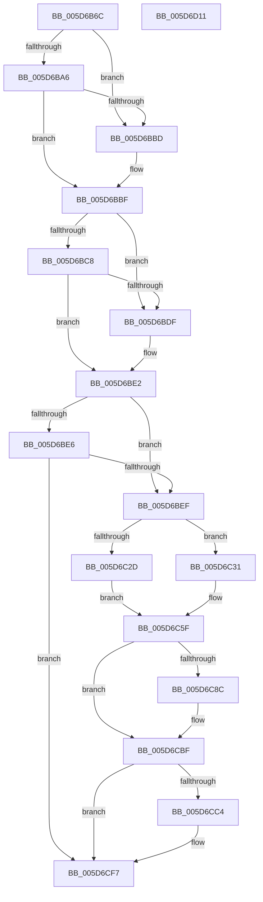

# PopDiagTraceIllegalProcessorThrottle

- RVA: `0x005D6B6C`–`0x005D6D12` (길이 `422` bytes)
- VA: `0x00000001405D6B6C`
- 실행 섹션: `.text`
- PDB 이름 있음: `예`; PDB Function 태그: `아니요`
- unwind 정보 RVA: `0x000CCADC`
- 디코드: `107`개 명령, `422/422` bytes 표시
- 미해석 바이트: `0` (있으면 어셈블리에 `.byte`로 보존)

> 이 문서는 커널 이미지의 기계어와 PDB 기호를 분석해 생성했습니다. 4번과 5번은 함수 원형과 자료형을 바이너리 사용 방식에서 추정한 C 해석이며 원본 소스 복구 결과는 아닙니다.

## 1. Dependencies

- 직접 호출 지점: **5**; 고유 호출 대상: **3**
- 직접 호출자로 확인된 함수: **1**
- RIP 상대 이미지 참조: **7**

### Outgoing calls
- `0x005D6BB4` → [EtwEventEnabled](../39/EtwEventEnabled_function_00392450.md) (function, `0x00392450`)
- `0x005D6BD6` → [EtwEventEnabled](../39/EtwEventEnabled_function_00392450.md) (function, `0x00392450`)
- `0x005D6CBA` → [EtwWriteEx](../25/EtwWriteEx_function_0025F0D0.md) (function, `0x0025F0D0`)
- `0x005D6CF2` → [EtwWriteEx](../25/EtwWriteEx_function_0025F0D0.md) (function, `0x0025F0D0`)
- `0x005D6CFE` → [_security_check_cookie](../6A/_security_check_cookie_function_006AC640.md) (function, `0x006AC640`)

### Direct callers
- [sub_006F0D76](../6F/Unknown_function_006F0D76.md) at `0x006F0D8A`

### Static image references
- `0x005D6B87` → RVA `0x00E0A740` (`.data`; read)
- `0x005D6B95` → RVA `0x00E67858` (`.data`; read)
- `0x005D6BA6` → RVA `0x00F0B408` (`.data`; read)
- `0x005D6BAD` → RVA `0x000221F8` (`.rdata`; read)
- `0x005D6BCF` → RVA `0x000230B0` (`.rdata`; read)
- `0x005D6C37` → RVA `0x00FC6AA0` (`ALMOSTRO`; read)
- `0x005D6C6F` → RVA `0x00E0B3EC` (`.data`; read)

## 2. Other-region calls and transfers

- 다른 실행 섹션으로 향하는 call: **0**
- 별도 외부 분기/꼬리 이동을 확인하지 못했습니다.

## 3. Assembly (complete function range)

```asm
005D6B6C  48 89 54 24 10                  mov qword ptr [rsp + 0x10], rdx
005D6B71  89 4C 24 08                     mov dword ptr [rsp + 8], ecx
005D6B75  55                              push rbp
005D6B76  53                              push rbx
005D6B77  56                              push rsi
005D6B78  57                              push rdi
005D6B79  41 57                           push r15
005D6B7B  48 8D 6C 24 C9                  lea rbp, [rsp - 0x37]
005D6B80  48 81 EC A0 00 00 00            sub rsp, 0xa0
005D6B87  48 8B 05 B2 3B 83 00            mov rax, qword ptr [rip + 0x833bb2]
005D6B8E  48 33 C4                        xor rax, rsp
005D6B91  48 89 45 27                     mov qword ptr [rbp + 0x27], rax
005D6B95  80 3D BC 0C 89 00 00            cmp byte ptr [rip + 0x890cbc], 0
005D6B9C  B3 01                           mov bl, 1
005D6B9E  40 8A FB                        mov dil, bl
005D6BA1  49 8B F0                        mov rsi, r8
005D6BA4  74 17                           je 0x1405d6bbd
005D6BA6  48 8B 0D 5B 48 93 00            mov rcx, qword ptr [rip + 0x93485b]
005D6BAD  48 8D 15 44 B6 A4 FF            lea rdx, [rip - 0x5b49bc]
005D6BB4  E8 97 B8 DB FF                  call 0x140392450
005D6BB9  84 C0                           test al, al
005D6BBB  75 02                           jne 0x1405d6bbf
005D6BBD  32 DB                           xor bl, bl
005D6BBF  80 3D 92 0C 89 00 00            cmp byte ptr [rip + 0x890c92], 0
005D6BC6  74 17                           je 0x1405d6bdf
005D6BC8  48 8B 0D 39 48 93 00            mov rcx, qword ptr [rip + 0x934839]
005D6BCF  48 8D 15 DA C4 A4 FF            lea rdx, [rip - 0x5b3b26]
005D6BD6  E8 75 B8 DB FF                  call 0x140392450
005D6BDB  84 C0                           test al, al
005D6BDD  75 03                           jne 0x1405d6be2
005D6BDF  40 32 FF                        xor dil, dil
005D6BE2  84 DB                           test bl, bl
005D6BE4  75 09                           jne 0x1405d6bef
005D6BE6  40 84 FF                        test dil, dil
005D6BE9  0F 84 08 01 00 00               je 0x1405d6cf7
005D6BEF  83 65 F3 00                     and dword ptr [rbp - 0xd], 0
005D6BF3  48 8D 45 67                     lea rax, [rbp + 0x67]
005D6BF7  83 65 03 00                     and dword ptr [rbp + 3], 0
005D6BFB  48 B9 20 03 00 00 80 F7 FF FF   movabs rcx, 0xfffff78000000320
005D6C05  48 89 45 E7                     mov qword ptr [rbp - 0x19], rax
005D6C09  41 BF 04 00 00 00               mov r15d, 4
005D6C0F  48 8D 45 6F                     lea rax, [rbp + 0x6f]
005D6C13  44 89 7D EF                     mov dword ptr [rbp - 0x11], r15d
005D6C17  48 89 45 F7                     mov qword ptr [rbp - 9], rax
005D6C1B  C7 45 FF 08 00 00 00            mov dword ptr [rbp - 1], 8
005D6C22  48 8B 09                        mov rcx, qword ptr [rcx]
005D6C25  48 8B 06                        mov rax, qword ptr [rsi]
005D6C28  48 85 C0                        test rax, rax
005D6C2B  75 04                           jne 0x1405d6c31
005D6C2D  33 D2                           xor edx, edx
005D6C2F  EB 2E                           jmp 0x1405d6c5f
005D6C31  4C 8B C1                        mov r8, rcx
005D6C34  4C 2B C0                        sub r8, rax
005D6C37  8B 05 63 FE 9E 00               mov eax, dword ptr [rip + 0x9efe63]
005D6C3D  4C 0F AF C0                     imul r8, rax
005D6C41  48 B8 BD 42 7A E5 D5 94 BF D6   movabs rax, 0xd6bf94d5e57a42bd
005D6C4B  49 F7 E8                        imul r8
005D6C4E  49 03 D0                        add rdx, r8
005D6C51  48 C1 FA 17                     sar rdx, 0x17
005D6C55  48 8B C2                        mov rax, rdx
005D6C58  48 C1 E8 3F                     shr rax, 0x3f
005D6C5C  48 03 D0                        add rdx, rax
005D6C5F  83 65 13 00                     and dword ptr [rbp + 0x13], 0
005D6C63  48 8D 45 D7                     lea rax, [rbp - 0x29]
005D6C67  83 65 23 00                     and dword ptr [rbp + 0x23], 0
005D6C6B  48 89 45 07                     mov qword ptr [rbp + 7], rax
005D6C6F  48 8D 05 76 47 83 00            lea rax, [rip + 0x834776]
005D6C76  48 89 45 17                     mov qword ptr [rbp + 0x17], rax
005D6C7A  89 55 D7                        mov dword ptr [rbp - 0x29], edx
005D6C7D  48 89 0E                        mov qword ptr [rsi], rcx
005D6C80  44 89 7D 0F                     mov dword ptr [rbp + 0xf], r15d
005D6C84  44 89 7D 1F                     mov dword ptr [rbp + 0x1f], r15d
005D6C88  84 DB                           test bl, bl
005D6C8A  74 33                           je 0x1405d6cbf
005D6C8C  48 8B 0D 75 47 93 00            mov rcx, qword ptr [rip + 0x934775]
005D6C93  48 8D 45 E7                     lea rax, [rbp - 0x19]
005D6C97  48 89 44 24 38                  mov qword ptr [rsp + 0x38], rax
005D6C9C  48 8D 15 55 B5 A4 FF            lea rdx, [rip - 0x5b4aab]
005D6CA3  44 89 7C 24 30                  mov dword ptr [rsp + 0x30], r15d
005D6CA8  45 33 C9                        xor r9d, r9d
005D6CAB  48 83 64 24 28 00               and qword ptr [rsp + 0x28], 0
005D6CB1  45 33 C0                        xor r8d, r8d
005D6CB4  48 83 64 24 20 00               and qword ptr [rsp + 0x20], 0
005D6CBA  E8 11 84 C8 FF                  call 0x14025f0d0
005D6CBF  40 84 FF                        test dil, dil
005D6CC2  74 33                           je 0x1405d6cf7
005D6CC4  48 8B 0D 3D 47 93 00            mov rcx, qword ptr [rip + 0x93473d]
005D6CCB  48 8D 45 E7                     lea rax, [rbp - 0x19]
005D6CCF  48 89 44 24 38                  mov qword ptr [rsp + 0x38], rax
005D6CD4  48 8D 15 D5 C3 A4 FF            lea rdx, [rip - 0x5b3c2b]
005D6CDB  44 89 7C 24 30                  mov dword ptr [rsp + 0x30], r15d
005D6CE0  45 33 C9                        xor r9d, r9d
005D6CE3  48 83 64 24 28 00               and qword ptr [rsp + 0x28], 0
005D6CE9  45 33 C0                        xor r8d, r8d
005D6CEC  48 83 64 24 20 00               and qword ptr [rsp + 0x20], 0
005D6CF2  E8 D9 83 C8 FF                  call 0x14025f0d0
005D6CF7  48 8B 4D 27                     mov rcx, qword ptr [rbp + 0x27]
005D6CFB  48 33 CC                        xor rcx, rsp
005D6CFE  E8 3D 59 0D 00                  call 0x1406ac640
005D6D03  48 81 C4 A0 00 00 00            add rsp, 0xa0
005D6D0A  41 5F                           pop r15
005D6D0C  5F                              pop rdi
005D6D0D  5E                              pop rsi
005D6D0E  5B                              pop rbx
005D6D0F  5D                              pop rbp
005D6D10  C3                              ret
005D6D11  CC                              int3
```

## 4. C-style interpretation (structured pseudocode)

```c
__int64 __fastcall PopDiagTraceIllegalProcessorThrottle(int a1, __int64 a2, __int64 a3, int a4)
{
    __int64 result;
    __int64 v_rbx;
    __int64 v_rdi;
    __int64 v_rsp;
    unsigned __int64 v_stack_m38;
    unsigned int v_stack_m3C;
    unsigned int v_stack_m40;
    unsigned __int64 v_stack_m48;
    unsigned int v_stack_m4C;
    unsigned int v_stack_m50;
    unsigned __int64 v_stack_m58;
    unsigned int v_stack_m5C;
    unsigned __int64 v_stack_m5F;
    unsigned int v_stack_m60;
    unsigned __int64 v_stack_m68;
    unsigned int v_stack_m6C;
    unsigned int v_stack_m70;
    unsigned __int64 v_stack_m78;
    unsigned __int64 v_stack_m88;
    unsigned __int64 v_stack_m90;
    unsigned int v_stack_m98;
    unsigned __int64 v_stack_mA0;
    unsigned __int64 v_stack_mA8;
    unsigned __int64 v_stack_p10;
    unsigned int v_stack_p8;

    v_stack_p10 = a2;
    v_stack_p8 = a1;
    v_rsp = (v_rsp) - (160);
    result = (*(unsigned __int64 *)(v_rip + 8600498)) ^ (v_rsp);
    v_stack_m38 = result;
    if ((*(unsigned __int8 *)(v_rip + 8981692)) == 0) goto loc_005D6BBD;
    result = EtwEventEnabled(*(unsigned __int64 *)(v_rip + 9652315), v_rip - 5982652, a3, a4);
    v_rbx = 1;
    if ((unsigned __int8)(result) == 0) {
        v_rbx = 0;
    }
    if ((*(unsigned __int8 *)(v_rip + 8981650)) == 0) goto loc_005D6BDF;
    result = EtwEventEnabled(*(unsigned __int64 *)(v_rip + 9652281), v_rip - 5978918, a3, a4);
    v_rdi = 1;
    if ((unsigned __int8)(result) == 0) {
        v_rdi = 0;
    }
    if (0 != 0) goto loc_005D6BEF;
    if (0 == 0) goto loc_005D6CF7;
loc_005D6BEF:
    v_stack_m78 = v_stack_p8;
    v_stack_m70 = 4;
    v_stack_m68 = v_stack_p10;
    v_stack_m60 = 8;
    if (*(unsigned __int64 *)(a3) != 0) goto loc_005D6C31;
    a2 = 0;
    goto loc_005D6C5F;
loc_005D6C31:
    a3 = (*(unsigned __int64 *)(*(unsigned __int64 *)(v_rip + 9652281))) - (*(unsigned __int64 *)(a3));
    a3 = (a3) * ((unsigned int)(*(unsigned int *)(v_rip + 10419811)));
    a2 = (a2) + (a3);
    a2 = (a2) >> (23);
    result = (a2) >> (63);
    a2 = (a2) + (result);
loc_005D6C5F:
    v_stack_m58 = v_stack_m88;
    v_stack_m48 = v_rip + 8603510;
    v_stack_m88 = (unsigned int)(a2);
    *(unsigned __int64 *)(a3) = *(unsigned __int64 *)(*(unsigned __int64 *)(v_rip + 9652281));
    v_stack_m50 = 4;
    v_stack_m40 = 4;
    result = v_rip + 8603510;
    if (0 != 0) {
        a1 = *(unsigned __int64 *)(v_rip + 9652085);
        result = v_stack_m78;
        v_stack_m90 = result;
        a2 = v_rip - 5982891;
        v_stack_m98 = 4;
        a4 = 0;
        a3 = 0;
        result = EtwWriteEx(a1, a2, a3, a4);
    }
    if (0 != 0) {
        a1 = *(unsigned __int64 *)(v_rip + 9652029);
        result = v_stack_m78;
        v_stack_m90 = result;
        a2 = v_rip - 5979179;
        v_stack_m98 = 4;
        a4 = 0;
        a3 = 0;
        result = EtwWriteEx(a1, a2, a3, a4);
    }
    a1 = (v_stack_m38) ^ (v_rsp);
    result = _security_check_cookie(a1, a2, a3, a4);
    v_rsp = (v_rsp) + (160);
    return result;
}
```

## 5. (Beta) C Style

```c
int64_t PopDiagTraceIllegalProcessorThrottle(int32_t Arg1, int64_t Arg2, void *Arg3, int32_t Arg4)
{
    uint8_t *arg3 = (uint8_t *)Arg3;

    int64_t result;
    int64_t local_rbx;
    int64_t local_rdi;
    int64_t local_rsp;
    uint64_t v_stack_m38;
    uint32_t v_stack_m3C;
    uint32_t v_stack_m40;
    uint64_t v_stack_m48;
    uint32_t v_stack_m4C;
    uint32_t v_stack_m50;
    uint64_t v_stack_m58;
    uint32_t v_stack_m5C;
    uint64_t v_stack_m5F;
    uint32_t v_stack_m60;
    uint64_t v_stack_m68;
    uint32_t v_stack_m6C;
    uint32_t v_stack_m70;
    uint64_t v_stack_m78;
    uint64_t v_stack_m88;
    uint64_t v_stack_m90;
    uint32_t v_stack_m98;
    uint64_t v_stack_mA0;
    uint64_t v_stack_mA8;
    uint64_t v_stack_p10;
    uint32_t v_stack_p8;

    v_stack_p10 = Arg2;
    v_stack_p8 = Arg1;
    local_rsp = (local_rsp) - (160);
    result = (*(uint64_t *)(v_rip + 0x833BB2)) ^ (local_rsp);
    v_stack_m38 = result;
    if ((*(uint8_t *)(v_rip + 0x890CBC)) == 0) goto loc_005D6BBD;
    result = EtwEventEnabled(*(uint64_t *)(v_rip + 0x93485B), v_rip - 5982652, Arg3, Arg4);
    local_rbx = 1;
    if ((uint8_t)(result) == 0) {
        local_rbx = 0;
    }
    if ((*(uint8_t *)(v_rip + 0x890C92)) == 0) goto loc_005D6BDF;
    result = EtwEventEnabled(*(uint64_t *)(v_rip + 0x934839), v_rip - 5978918, Arg3, Arg4);
    local_rdi = 1;
    if ((uint8_t)(result) == 0) {
        local_rdi = 0;
    }
    if (0 != 0) goto loc_005D6BEF;
    if (0 == 0) goto loc_005D6CF7;
loc_005D6BEF:
    v_stack_m78 = v_stack_p8;
    v_stack_m70 = 4;
    v_stack_m68 = v_stack_p10;
    v_stack_m60 = 8;
    if (*(uint64_t *)(arg3) != 0) goto loc_005D6C31;
    Arg2 = 0;
    goto loc_005D6C5F;
loc_005D6C31:
    Arg3 = (*(uint64_t *)(*(uint64_t *)(v_rip + 0x934839))) - (*(uint64_t *)(arg3));
    Arg3 = (Arg3) * ((uint32_t)(*(uint32_t *)(v_rip + 0x9EFE63)));
    Arg2 = (Arg2) + (Arg3);
    Arg2 = (Arg2) >> (23);
    result = (Arg2) >> (63);
    Arg2 = (Arg2) + (result);
loc_005D6C5F:
    v_stack_m58 = v_stack_m88;
    v_stack_m48 = v_rip + 8603510;
    v_stack_m88 = (uint32_t)(Arg2);
    *(uint64_t *)(arg3) = *(uint64_t *)(*(uint64_t *)(v_rip + 0x934839));
    v_stack_m50 = 4;
    v_stack_m40 = 4;
    result = v_rip + 8603510;
    if (0 != 0) {
        Arg1 = *(uint64_t *)(v_rip + 0x934775);
        result = v_stack_m78;
        v_stack_m90 = result;
        Arg2 = v_rip - 5982891;
        v_stack_m98 = 4;
        Arg4 = 0;
        Arg3 = 0;
        result = EtwWriteEx(Arg1, Arg2, Arg3, Arg4);
    }
    if (0 != 0) {
        Arg1 = *(uint64_t *)(v_rip + 0x93473D);
        result = v_stack_m78;
        v_stack_m90 = result;
        Arg2 = v_rip - 5979179;
        v_stack_m98 = 4;
        Arg4 = 0;
        Arg3 = 0;
        result = EtwWriteEx(Arg1, Arg2, Arg3, Arg4);
    }
    Arg1 = (v_stack_m38) ^ (local_rsp);
    result = _security_check_cookie(Arg1, Arg2, Arg3, Arg4);
    local_rsp = (local_rsp) + (160);
    return result;
}
```

### 관측된 메모리 오프셋

구조체 형식이 확인되지 않은 접근은 인자 기준의 오프셋으로만 기록했습니다.

| 기준 인자 | 오프셋 표현 | 폭 (bit) | 접근 |
|---|---:|---:|---|
| `Arg3` | `+ 0x0` | `64` | `R` |
| `Arg3` | `+ 0x0` | `64` | `W` |

## 6. Execution-region graph

[열기: 2D/3D 그래프와 함수 탐색 컨트롤 패널](../../../control-panel.html?section=text&rva=0x005D6B6C&view=graph)

- 2D 그래프는 위에서 아래로 흐르고, 3D 그래프는 빈 공간을 드래그해 회전합니다. Shift+드래그는 이동, 휠은 확대·축소, 함수 노드 선택은 대상 보고서 이동입니다.

### Static fallback


