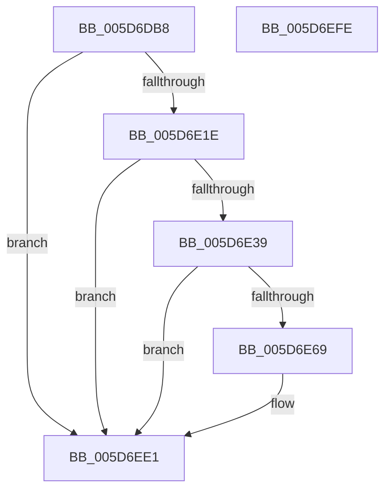

# PopDiagTraceProcessorThrottleDurationPerfTrack

- RVA: `0x005D6DB8`–`0x005D6EFF` (길이 `327` bytes)
- VA: `0x00000001405D6DB8`
- 실행 섹션: `.text`
- PDB 이름 있음: `예`; PDB Function 태그: `아니요`
- unwind 정보 RVA: `0x000CCAC0`
- 디코드: `71`개 명령, `327/327` bytes 표시
- 미해석 바이트: `0` (있으면 어셈블리에 `.byte`로 보존)

> 이 문서는 커널 이미지의 기계어와 PDB 기호를 분석해 생성했습니다. 4번과 5번은 함수 원형과 자료형을 바이너리 사용 방식에서 추정한 C 해석이며 원본 소스 복구 결과는 아닙니다.

## 1. Dependencies

- 직접 호출 지점: **4**; 고유 호출 대상: **4**
- 직접 호출자로 확인된 함수: **1**
- RIP 상대 이미지 참조: **9**

### Outgoing calls
- `0x005D6E2C` → [EtwEventEnabled](../39/EtwEventEnabled_function_00392450.md) (function, `0x00392450`)
- `0x005D6E60` → [RtlStringCchPrintfExW](../42/RtlStringCchPrintfExW_function_0042B390.md) (function, `0x0042B390`)
- `0x005D6EDC` → [EtwWriteEx](../25/EtwWriteEx_function_0025F0D0.md) (function, `0x0025F0D0`)
- `0x005D6EE8` → [_security_check_cookie](../6A/_security_check_cookie_function_006AC640.md) (function, `0x006AC640`)

### Direct callers
- [PpmRegisterPerfCap](../42/PpmRegisterPerfCap_function_0042B0D0.md) at `0x0042B24B`

### Static image references
- `0x005D6DCE` → RVA `0x00E0A740` (`.data`; read)
- `0x005D6DDC` → RVA `0x006CC110` (` ?? ::FNODOBFM::`string'`; read)
- `0x005D6DEA` → RVA `0x00E67858` (`.data`; read)
- `0x005D6DF1` → RVA `0x006CC120` (`.text`; read)
- `0x005D6DF8` → RVA `0x006CC138` (`.text`; read)
- `0x005D6E07` → RVA `0x006CC130` (`.text`; read)
- `0x005D6E1E` → RVA `0x00F0B408` (`.data`; read)
- `0x005D6E25` → RVA `0x00022CC8` (`.rdata`; read)
- `0x005D6E3D` → RVA `0x006CC140` (` ?? ::FNODOBFM::`string'`; read)

## 2. Other-region calls and transfers

- 다른 실행 섹션으로 향하는 call: **0**
- 별도 외부 분기/꼬리 이동을 확인하지 못했습니다.

## 3. Assembly (complete function range)

```asm
005D6DB8  48 89 5C 24 18                  mov qword ptr [rsp + 0x18], rbx
005D6DBD  89 4C 24 08                     mov dword ptr [rsp + 8], ecx
005D6DC1  55                              push rbp
005D6DC2  48 8D 6C 24 A9                  lea rbp, [rsp - 0x57]
005D6DC7  48 81 EC C0 00 00 00            sub rsp, 0xc0
005D6DCE  48 8B 05 6B 39 83 00            mov rax, qword ptr [rip + 0x83396b]
005D6DD5  48 33 C4                        xor rax, rsp
005D6DD8  48 89 45 47                     mov qword ptr [rbp + 0x47], rax
005D6DDC  0F 10 05 2D 53 0F 00            movups xmm0, xmmword ptr [rip + 0xf532d]
005D6DE3  48 83 65 DF 00                  and qword ptr [rbp - 0x21], 0
005D6DE8  8B DA                           mov ebx, edx
005D6DEA  80 3D 67 0A 89 00 00            cmp byte ptr [rip + 0x890a67], 0
005D6DF1  0F 10 0D 28 53 0F 00            movups xmm1, xmmword ptr [rip + 0xf5328]
005D6DF8  0F B7 05 39 53 0F 00            movzx eax, word ptr [rip + 0xf5339]
005D6DFF  0F 11 45 17                     movups xmmword ptr [rbp + 0x17], xmm0
005D6E03  66 89 45 3F                     mov word ptr [rbp + 0x3f], ax
005D6E07  F2 0F 10 05 21 53 0F 00         movsd xmm0, qword ptr [rip + 0xf5321]
005D6E0F  F2 0F 11 45 37                  movsd qword ptr [rbp + 0x37], xmm0
005D6E14  0F 11 4D 27                     movups xmmword ptr [rbp + 0x27], xmm1
005D6E18  0F 84 C3 00 00 00               je 0x1405d6ee1
005D6E1E  48 8B 0D E3 45 93 00            mov rcx, qword ptr [rip + 0x9345e3]
005D6E25  48 8D 15 9C BE A4 FF            lea rdx, [rip - 0x5b4164]
005D6E2C  E8 1F B6 DB FF                  call 0x140392450
005D6E31  84 C0                           test al, al
005D6E33  0F 84 A8 00 00 00               je 0x1405d6ee1
005D6E39  89 5C 24 30                     mov dword ptr [rsp + 0x30], ebx
005D6E3D  48 8D 05 FC 52 0F 00            lea rax, [rip + 0xf52fc]
005D6E44  45 33 C0                        xor r8d, r8d
005D6E47  48 89 44 24 28                  mov qword ptr [rsp + 0x28], rax
005D6E4C  48 83 64 24 20 00               and qword ptr [rsp + 0x20], 0
005D6E52  4C 8D 4D DF                     lea r9, [rbp - 0x21]
005D6E56  48 8D 4D 17                     lea rcx, [rbp + 0x17]
005D6E5A  41 8D 58 15                     lea ebx, [r8 + 0x15]
005D6E5E  8B D3                           mov edx, ebx
005D6E60  E8 2B 45 E5 FF                  call 0x14042b390
005D6E65  85 C0                           test eax, eax
005D6E67  78 78                           js 0x1405d6ee1
005D6E69  66 2B 5D DF                     sub bx, word ptr [rbp - 0x21]
005D6E6D  48 8D 4D 67                     lea rcx, [rbp + 0x67]
005D6E71  83 65 F3 00                     and dword ptr [rbp - 0xd], 0
005D6E75  48 8D 15 4C BE A4 FF            lea rdx, [rip - 0x5b41b4]
005D6E7C  83 65 03 00                     and dword ptr [rbp + 3], 0
005D6E80  45 33 C9                        xor r9d, r9d
005D6E83  83 65 13 00                     and dword ptr [rbp + 0x13], 0
005D6E87  45 33 C0                        xor r8d, r8d
005D6E8A  48 89 4D E7                     mov qword ptr [rbp - 0x19], rcx
005D6E8E  48 8D 4D D7                     lea rcx, [rbp - 0x29]
005D6E92  0F B7 C3                        movzx eax, bx
005D6E95  66 89 45 D7                     mov word ptr [rbp - 0x29], ax
005D6E99  03 C0                           add eax, eax
005D6E9B  48 89 4D F7                     mov qword ptr [rbp - 9], rcx
005D6E9F  48 8D 4D 17                     lea rcx, [rbp + 0x17]
005D6EA3  89 45 0F                        mov dword ptr [rbp + 0xf], eax
005D6EA6  48 8D 45 E7                     lea rax, [rbp - 0x19]
005D6EAA  48 89 44 24 38                  mov qword ptr [rsp + 0x38], rax
005D6EAF  C7 44 24 30 03 00 00 00         mov dword ptr [rsp + 0x30], 3
005D6EB7  48 83 64 24 28 00               and qword ptr [rsp + 0x28], 0
005D6EBD  48 83 64 24 20 00               and qword ptr [rsp + 0x20], 0
005D6EC3  48 89 4D 07                     mov qword ptr [rbp + 7], rcx
005D6EC7  48 8B 0D 3A 45 93 00            mov rcx, qword ptr [rip + 0x93453a]
005D6ECE  C7 45 EF 04 00 00 00            mov dword ptr [rbp - 0x11], 4
005D6ED5  C7 45 FF 02 00 00 00            mov dword ptr [rbp - 1], 2
005D6EDC  E8 EF 81 C8 FF                  call 0x14025f0d0
005D6EE1  48 8B 4D 47                     mov rcx, qword ptr [rbp + 0x47]
005D6EE5  48 33 CC                        xor rcx, rsp
005D6EE8  E8 53 57 0D 00                  call 0x1406ac640
005D6EED  48 8B 9C 24 E0 00 00 00         mov rbx, qword ptr [rsp + 0xe0]
005D6EF5  48 81 C4 C0 00 00 00            add rsp, 0xc0
005D6EFC  5D                              pop rbp
005D6EFD  C3                              ret
005D6EFE  CC                              int3
```

## 4. C-style interpretation (structured pseudocode)

```c
__int64 __fastcall PopDiagTraceProcessorThrottleDurationPerfTrack(int a1, int a2, int a3)
{
    __int64 result;
    __int64 v_rbx;
    __int64 v_rsp;
    unsigned __int64 v_stack_m18;
    unsigned __int16 v_stack_m20;
    unsigned __int64 v_stack_m28;
    unsigned __int64 v_stack_m38;
    unsigned __int64 v_stack_m48;
    unsigned int v_stack_m4C;
    unsigned int v_stack_m50;
    unsigned __int64 v_stack_m58;
    unsigned int v_stack_m5C;
    unsigned __int64 v_stack_m5F;
    unsigned int v_stack_m60;
    unsigned __int64 v_stack_m68;
    unsigned int v_stack_m6C;
    unsigned int v_stack_m70;
    unsigned __int64 v_stack_m78;
    unsigned __int64 v_stack_m80;
    unsigned __int64 v_stack_m88;
    unsigned __int64 v_stack_m90;
    unsigned int v_stack_m98;
    unsigned __int64 v_stack_mA0;
    unsigned __int64 v_stack_mA8;
    unsigned __int64 v_stack_p18;
    unsigned int v_stack_p8;

    v_stack_p18 = v_rbx;
    v_stack_p8 = a1;
    v_rsp = (v_rsp) - (192);
    result = (*(unsigned __int64 *)(v_rip + 8599915)) ^ (v_rsp);
    v_stack_m18 = result;
    v_stack_m48 = v_xmm0;
    v_stack_m20 = (unsigned __int16)(*(unsigned __int16 *)(v_rip + 1004345));
    v_stack_m28 = v_xmm0;
    v_stack_m38 = v_xmm1;
    if ((*(unsigned __int8 *)(v_rip + 8981095)) == 0) goto loc_005D6EE1;
    result = EtwEventEnabled(*(unsigned __int64 *)(v_rip + 9651683), v_rip - 5980516, a3, a4);
    if ((unsigned __int8)(result) == 0) goto loc_005D6EE1;
    v_stack_m98 = (unsigned int)((unsigned int)(a2));
    a3 = 0;
    v_stack_mA0 = v_rip + 1004284;
    result = RtlStringCchPrintfExW(v_stack_m48, (unsigned int)((unsigned int)(a3 + 21)), a3, v_stack_m80);
    v_rbx = a3 + 21;
    if (!(sign_flag)) {
        v_rbx = (unsigned __int16)((a3 + 21) - (v_stack_m80));
        a1 = v_stack_p8;
        a2 = v_rip - 5980596;
        a4 = 0;
        a3 = 0;
        v_stack_m78 = a1;
        a1 = v_stack_m88;
        result = (unsigned __int16)(v_rbx);
        v_stack_m88 = (unsigned __int16)(result);
        result = (unsigned int)((result) + ((unsigned int)(result)));
        v_stack_m68 = a1;
        a1 = v_stack_m48;
        v_stack_m50 = (unsigned int)(result);
        result = v_stack_m78;
        v_stack_m90 = result;
        v_stack_m98 = 3;
        v_stack_m58 = a1;
        a1 = *(unsigned __int64 *)(v_rip + 9651514);
        v_stack_m70 = 4;
        v_stack_m60 = 2;
        result = EtwWriteEx(a1, a2, a3, a4);
    }
    a1 = (v_stack_m18) ^ (v_rsp);
    result = _security_check_cookie(a1, a2, a3, a4);
    v_rsp = (v_rsp) + (192);
    return result;
}
```

## 5. (Beta) C Style

```c
int64_t PopDiagTraceProcessorThrottleDurationPerfTrack(int32_t Arg1, int32_t Arg2, int32_t Arg3)
{
    int64_t result;
    int64_t local_rbx;
    int64_t local_rsp;
    uint64_t v_stack_m18;
    uint16_t v_stack_m20;
    uint64_t v_stack_m28;
    uint64_t v_stack_m38;
    uint64_t v_stack_m48;
    uint32_t v_stack_m4C;
    uint32_t v_stack_m50;
    uint64_t v_stack_m58;
    uint32_t v_stack_m5C;
    uint64_t v_stack_m5F;
    uint32_t v_stack_m60;
    uint64_t v_stack_m68;
    uint32_t v_stack_m6C;
    uint32_t v_stack_m70;
    uint64_t v_stack_m78;
    uint64_t v_stack_m80;
    uint64_t v_stack_m88;
    uint64_t v_stack_m90;
    uint32_t v_stack_m98;
    uint64_t v_stack_mA0;
    uint64_t v_stack_mA8;
    uint64_t v_stack_p18;
    uint32_t v_stack_p8;

    v_stack_p18 = local_rbx;
    v_stack_p8 = Arg1;
    local_rsp = (local_rsp) - (192);
    result = (*(uint64_t *)(v_rip + 0x83396B)) ^ (local_rsp);
    v_stack_m18 = result;
    v_stack_m48 = v_xmm0;
    v_stack_m20 = (uint16_t)(*(uint16_t *)(v_rip + 0xF5339));
    v_stack_m28 = v_xmm0;
    v_stack_m38 = v_xmm1;
    if ((*(uint8_t *)(v_rip + 0x890A67)) == 0) goto loc_005D6EE1;
    result = EtwEventEnabled(*(uint64_t *)(v_rip + 0x9345E3), v_rip - 5980516, Arg3, a4);
    if ((uint8_t)(result) == 0) goto loc_005D6EE1;
    v_stack_m98 = (uint32_t)((uint32_t)(Arg2));
    Arg3 = 0;
    v_stack_mA0 = v_rip + 1004284;
    result = RtlStringCchPrintfExW(v_stack_m48, (uint32_t)((uint32_t)(Arg3 + 21)), Arg3, v_stack_m80);
    local_rbx = Arg3 + 21;
    if (!(sign_flag)) {
        local_rbx = (uint16_t)((Arg3 + 21) - (v_stack_m80));
        Arg1 = v_stack_p8;
        Arg2 = v_rip - 5980596;
        a4 = 0;
        Arg3 = 0;
        v_stack_m78 = Arg1;
        Arg1 = v_stack_m88;
        result = (uint16_t)(local_rbx);
        v_stack_m88 = (uint16_t)(result);
        result = (uint32_t)((result) + ((uint32_t)(result)));
        v_stack_m68 = Arg1;
        Arg1 = v_stack_m48;
        v_stack_m50 = (uint32_t)(result);
        result = v_stack_m78;
        v_stack_m90 = result;
        v_stack_m98 = 3;
        v_stack_m58 = Arg1;
        Arg1 = *(uint64_t *)(v_rip + 0x93453A);
        v_stack_m70 = 4;
        v_stack_m60 = 2;
        result = EtwWriteEx(Arg1, Arg2, Arg3, a4);
    }
    Arg1 = (v_stack_m18) ^ (local_rsp);
    result = _security_check_cookie(Arg1, Arg2, Arg3, a4);
    local_rsp = (local_rsp) + (192);
    return result;
}
```

## 6. Execution-region graph

[열기: 2D/3D 그래프와 함수 탐색 컨트롤 패널](../../../control-panel.html?section=text&rva=0x005D6DB8&view=graph)

- 2D 그래프는 위에서 아래로 흐르고, 3D 그래프는 빈 공간을 드래그해 회전합니다. Shift+드래그는 이동, 휠은 확대·축소, 함수 노드 선택은 대상 보고서 이동입니다.

### Static fallback


