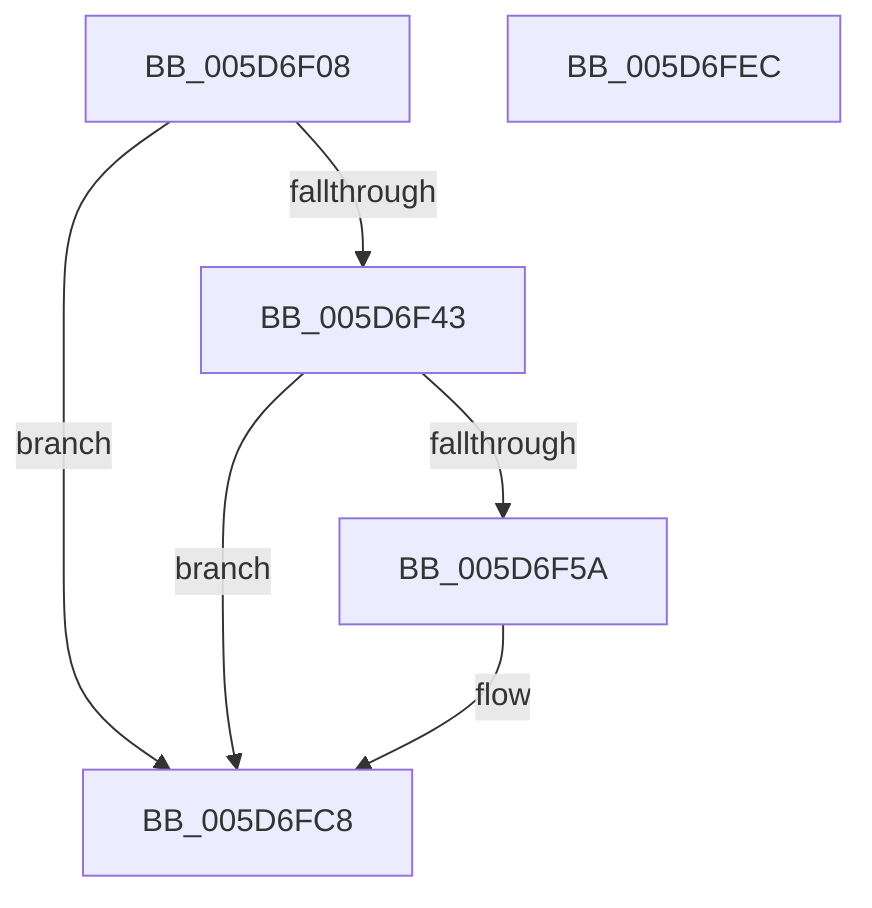

# PopDiagTraceShutdownAction

- RVA: `0x005D6F08`–`0x005D6FED` (길이 `229` bytes)
- VA: `0x00000001405D6F08`
- 실행 섹션: `.text`
- PDB 이름 있음: `예`; PDB Function 태그: `아니요`
- unwind 정보 RVA: `0x000CCA74`
- 디코드: `58`개 명령, `229/229` bytes 표시
- 미해석 바이트: `0` (있으면 어셈블리에 `.byte`로 보존)

> 이 문서는 커널 이미지의 기계어와 PDB 기호를 분석해 생성했습니다. 4번과 5번은 함수 원형과 자료형을 바이너리 사용 방식에서 추정한 C 해석이며 원본 소스 복구 결과는 아닙니다.

## 1. Dependencies

- 직접 호출 지점: **4**; 고유 호출 대상: **4**
- 직접 호출자로 확인된 함수: **1**
- RIP 상대 이미지 참조: **4**

### Outgoing calls
- `0x005D6F51` → [EtwEventEnabled](../39/EtwEventEnabled_function_00392450.md) (function, `0x00392450`)
- `0x005D6FC3` → [EtwWriteEx](../25/EtwWriteEx_function_0025F0D0.md) (function, `0x0025F0D0`)
- `0x005D6FD0` → [SshSessionManagerTraceShutdownAction](../../page/77/SshSessionManagerTraceShutdownAction_function_0077422C.md) (function, `0x0077422C`)
- `0x005D6FDC` → [_security_check_cookie](../6A/_security_check_cookie_function_006AC640.md) (function, `0x006AC640`)

### Direct callers
- [PopExecutePowerAction](../../page/75/PopExecutePowerAction_function_0075E6B4.md) at `0x0075E846`

### Static image references
- `0x005D6F18` → RVA `0x00E0A740` (`.data`; read)
- `0x005D6F33` → RVA `0x00E67858` (`.data`; read)
- `0x005D6F43` → RVA `0x00F0B408` (`.data`; read)
- `0x005D6F4A` → RVA `0x00022F30` (`.rdata`; read)

## 2. Other-region calls and transfers

- 다른 실행 섹션으로 향하는 call: **1**
  - `0x005D6FD0` → [SshSessionManagerTraceShutdownAction](../../page/77/SshSessionManagerTraceShutdownAction_function_0077422C.md) (`.text` → `PAGE`)
- 별도 외부 분기/꼬리 이동을 확인하지 못했습니다.

## 3. Assembly (complete function range)

```asm
005D6F08  40 55                           push rbp
005D6F0A  53                              push rbx
005D6F0B  57                              push rdi
005D6F0C  48 8D 6C 24 B9                  lea rbp, [rsp - 0x47]
005D6F11  48 81 EC A0 00 00 00            sub rsp, 0xa0
005D6F18  48 8B 05 21 38 83 00            mov rax, qword ptr [rip + 0x833821]
005D6F1F  48 33 C4                        xor rax, rsp
005D6F22  48 89 45 37                     mov qword ptr [rbp + 0x37], rax
005D6F26  83 65 E7 00                     and dword ptr [rbp - 0x19], 0
005D6F2A  41 8B F8                        mov edi, r8d
005D6F2D  83 65 EB 00                     and dword ptr [rbp - 0x15], 0
005D6F31  8B D9                           mov ebx, ecx
005D6F33  80 3D 1E 09 89 00 00            cmp byte ptr [rip + 0x89091e], 0
005D6F3A  89 55 F7                        mov dword ptr [rbp - 9], edx
005D6F3D  0F 84 85 00 00 00               je 0x1405d6fc8
005D6F43  48 8B 0D BE 44 93 00            mov rcx, qword ptr [rip + 0x9344be]
005D6F4A  48 8D 15 DF BF A4 FF            lea rdx, [rip - 0x5b4021]
005D6F51  E8 FA B4 DB FF                  call 0x140392450
005D6F56  84 C0                           test al, al
005D6F58  74 6E                           je 0x1405d6fc8
005D6F5A  83 65 13 00                     and dword ptr [rbp + 0x13], 0
005D6F5E  48 8D 45 E7                     lea rax, [rbp - 0x19]
005D6F62  83 65 23 00                     and dword ptr [rbp + 0x23], 0
005D6F66  48 8D 15 C3 BF A4 FF            lea rdx, [rip - 0x5b403d]
005D6F6D  83 65 33 00                     and dword ptr [rbp + 0x33], 0
005D6F71  B9 04 00 00 00                  mov ecx, 4
005D6F76  48 89 45 07                     mov qword ptr [rbp + 7], rax
005D6F7A  45 33 C9                        xor r9d, r9d
005D6F7D  48 8D 45 F7                     lea rax, [rbp - 9]
005D6F81  89 4D 0F                        mov dword ptr [rbp + 0xf], ecx
005D6F84  48 89 45 17                     mov qword ptr [rbp + 0x17], rax
005D6F88  45 33 C0                        xor r8d, r8d
005D6F8B  48 8D 45 EB                     lea rax, [rbp - 0x15]
005D6F8F  89 4D 1F                        mov dword ptr [rbp + 0x1f], ecx
005D6F92  48 89 45 27                     mov qword ptr [rbp + 0x27], rax
005D6F96  48 8D 45 07                     lea rax, [rbp + 7]
005D6F9A  48 89 44 24 38                  mov qword ptr [rsp + 0x38], rax
005D6F9F  C7 44 24 30 03 00 00 00         mov dword ptr [rsp + 0x30], 3
005D6FA7  48 83 64 24 28 00               and qword ptr [rsp + 0x28], 0
005D6FAD  48 83 64 24 20 00               and qword ptr [rsp + 0x20], 0
005D6FB3  89 4D 2F                        mov dword ptr [rbp + 0x2f], ecx
005D6FB6  48 8B 0D 4B 44 93 00            mov rcx, qword ptr [rip + 0x93444b]
005D6FBD  89 5D E7                        mov dword ptr [rbp - 0x19], ebx
005D6FC0  89 7D EB                        mov dword ptr [rbp - 0x15], edi
005D6FC3  E8 08 81 C8 FF                  call 0x14025f0d0
005D6FC8  8B 55 F7                        mov edx, dword ptr [rbp - 9]
005D6FCB  44 8B C7                        mov r8d, edi
005D6FCE  8B CB                           mov ecx, ebx
005D6FD0  E8 57 D2 19 00                  call 0x14077422c
005D6FD5  48 8B 4D 37                     mov rcx, qword ptr [rbp + 0x37]
005D6FD9  48 33 CC                        xor rcx, rsp
005D6FDC  E8 5F 56 0D 00                  call 0x1406ac640
005D6FE1  48 81 C4 A0 00 00 00            add rsp, 0xa0
005D6FE8  5F                              pop rdi
005D6FE9  5B                              pop rbx
005D6FEA  5D                              pop rbp
005D6FEB  C3                              ret
005D6FEC  CC                              int3
```

## 4. C-style interpretation (structured pseudocode)

```c
__int64 __fastcall PopDiagTraceShutdownAction(int a1, int a2, int a3, int a4)
{
    __int64 result;
    __int64 v_rsp;
    unsigned __int64 v_stack_m28;
    unsigned int v_stack_m2C;
    unsigned int v_stack_m30;
    unsigned __int64 v_stack_m38;
    unsigned int v_stack_m3C;
    unsigned int v_stack_m40;
    unsigned __int64 v_stack_m48;
    unsigned int v_stack_m4C;
    unsigned int v_stack_m50;
    unsigned __int64 v_stack_m58;
    unsigned __int64 v_stack_m5F;
    unsigned int v_stack_m68;
    unsigned int v_stack_m74;
    unsigned int v_stack_m78;
    unsigned __int64 v_stack_m80;
    unsigned int v_stack_m88;
    unsigned __int64 v_stack_m90;
    unsigned __int64 v_stack_m98;

    v_rsp = (v_rsp) - (160);
    result = (*(unsigned __int64 *)(v_rip + 8599585)) ^ (v_rsp);
    v_stack_m28 = result;
    v_stack_m68 = a2;
    if ((*(unsigned __int8 *)(v_rip + 8980766)) == 0) goto loc_005D6FC8;
    result = EtwEventEnabled(*(unsigned __int64 *)(v_rip + 9651390), v_rip - 5980193, a3, a4);
    if ((unsigned __int8)(result) != 0) {
        result = v_stack_m78;
        a2 = v_rip - 5980221;
        a1 = 4;
        v_stack_m58 = result;
        a4 = 0;
        result = v_stack_m68;
        v_stack_m50 = a1;
        v_stack_m48 = result;
        a3 = 0;
        result = v_stack_m74;
        v_stack_m40 = a1;
        v_stack_m38 = result;
        result = v_stack_m58;
        v_stack_m80 = result;
        v_stack_m88 = 3;
        v_stack_m30 = a1;
        a1 = *(unsigned __int64 *)(v_rip + 9651275);
        v_stack_m78 = (unsigned int)((unsigned int)(a1));
        v_stack_m74 = (unsigned int)((unsigned int)(a3));
        result = EtwWriteEx(a1, a2, a3, a4);
    }
    result = SshSessionManagerTraceShutdownAction((unsigned int)((unsigned int)((unsigned int)(a1))), (unsigned int)(v_stack_m68), (unsigned int)((unsigned int)((unsigned int)(a3))), a4);
    a1 = (v_stack_m28) ^ (v_rsp);
    result = _security_check_cookie(a1, (unsigned int)(v_stack_m68), (unsigned int)((unsigned int)((unsigned int)(a3))), a4);
    v_rsp = (v_rsp) + (160);
    return result;
}
```

## 5. (Beta) C Style

```c
int64_t PopDiagTraceShutdownAction(int32_t Arg1, int32_t Arg2, int32_t Arg3, int32_t Arg4)
{
    int64_t result;
    int64_t local_rsp;
    uint64_t v_stack_m28;
    uint32_t v_stack_m2C;
    uint32_t v_stack_m30;
    uint64_t v_stack_m38;
    uint32_t v_stack_m3C;
    uint32_t v_stack_m40;
    uint64_t v_stack_m48;
    uint32_t v_stack_m4C;
    uint32_t v_stack_m50;
    uint64_t v_stack_m58;
    uint64_t v_stack_m5F;
    uint32_t v_stack_m68;
    uint32_t v_stack_m74;
    uint32_t v_stack_m78;
    uint64_t v_stack_m80;
    uint32_t v_stack_m88;
    uint64_t v_stack_m90;
    uint64_t v_stack_m98;

    local_rsp = (local_rsp) - (160);
    result = (*(uint64_t *)(v_rip + 0x833821)) ^ (local_rsp);
    v_stack_m28 = result;
    v_stack_m68 = Arg2;
    if ((*(uint8_t *)(v_rip + 0x89091E)) == 0) goto loc_005D6FC8;
    result = EtwEventEnabled(*(uint64_t *)(v_rip + 0x9344BE), v_rip - 5980193, Arg3, Arg4);
    if ((uint8_t)(result) != 0) {
        result = v_stack_m78;
        Arg2 = v_rip - 5980221;
        Arg1 = 4;
        v_stack_m58 = result;
        Arg4 = 0;
        result = v_stack_m68;
        v_stack_m50 = Arg1;
        v_stack_m48 = result;
        Arg3 = 0;
        result = v_stack_m74;
        v_stack_m40 = Arg1;
        v_stack_m38 = result;
        result = v_stack_m58;
        v_stack_m80 = result;
        v_stack_m88 = 3;
        v_stack_m30 = Arg1;
        Arg1 = *(uint64_t *)(v_rip + 0x93444B);
        v_stack_m78 = (uint32_t)((uint32_t)(Arg1));
        v_stack_m74 = (uint32_t)((uint32_t)(Arg3));
        result = EtwWriteEx(Arg1, Arg2, Arg3, Arg4);
    }
    result = SshSessionManagerTraceShutdownAction((uint32_t)((uint32_t)((uint32_t)(Arg1))), (uint32_t)(v_stack_m68), (uint32_t)((uint32_t)((uint32_t)(Arg3))), Arg4);
    Arg1 = (v_stack_m28) ^ (local_rsp);
    result = _security_check_cookie(Arg1, (uint32_t)(v_stack_m68), (uint32_t)((uint32_t)((uint32_t)(Arg3))), Arg4);
    local_rsp = (local_rsp) + (160);
    return result;
}
```

## 6. Execution-region graph

[열기: 2D/3D 그래프와 함수 탐색 컨트롤 패널](../../../control-panel.html?section=text&rva=0x005D6F08&view=graph)

- 2D 그래프는 위에서 아래로 흐르고, 3D 그래프는 빈 공간을 드래그해 회전합니다. Shift+드래그는 이동, 휠은 확대·축소, 함수 노드 선택은 대상 보고서 이동입니다.

### Static fallback


