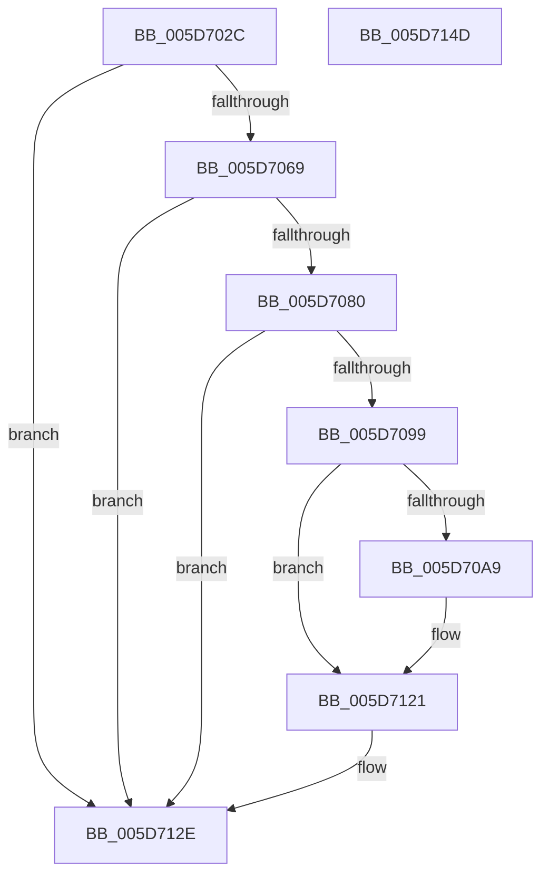

# PopDiagTraceThermalStateChange

- RVA: `0x005D702C`–`0x005D714E` (길이 `290` bytes)
- VA: `0x00000001405D702C`
- 실행 섹션: `.text`
- PDB 이름 있음: `예`; PDB Function 태그: `아니요`
- unwind 정보 RVA: `0x000CC7A8`
- 디코드: `69`개 명령, `290/290` bytes 표시
- 미해석 바이트: `0` (있으면 어셈블리에 `.byte`로 보존)

> 이 문서는 커널 이미지의 기계어와 PDB 기호를 분석해 생성했습니다. 4번과 5번은 함수 원형과 자료형을 바이너리 사용 방식에서 추정한 C 해석이며 원본 소스 복구 결과는 아닙니다.

## 1. Dependencies

- 직접 호출 지점: **5**; 고유 호출 대상: **5**
- 직접 호출자로 확인된 함수: **3**
- RIP 상대 이미지 참조: **3**

### Outgoing calls
- `0x005D7073` → [EtwEventEnabled](../39/EtwEventEnabled_function_00392450.md) (function, `0x00392450`)
- `0x005D7088` → [IoGetDeviceAttachmentBaseRefWithTag](../27/IoGetDeviceAttachmentBaseRefWithTag_function_00272788.md) (function, `0x00272788`)
- `0x005D711C` → [EtwWriteEx](../25/EtwWriteEx_function_0025F0D0.md) (function, `0x0025F0D0`)
- `0x005D7129` → [ObfDereferenceObjectWithTag](../2F/ObfDereferenceObjectWithTag_function_002F78E0.md) (function, `0x002F78E0`)
- `0x005D7135` → [_security_check_cookie](../6A/_security_check_cookie_function_006AC640.md) (function, `0x006AC640`)

### Direct callers
- [PopDiagTraceThermalOverthrottleState](PopDiagTraceThermalOverthrottleState_function_005D6FF4.md) at `0x005D6FFF`
- [PopDiagTraceThermalStandbyState](PopDiagTraceThermalStandbyState_function_005D7010.md) at `0x005D701B`
- [sub_006F9E40](../6F/Unknown_function_006F9E40.md) at `0x006F9ECD`

### Static image references
- `0x005D7042` → RVA `0x00E0A740` (`.data`; read)
- `0x005D7055` → RVA `0x00E67858` (`.data`; read)
- `0x005D7069` → RVA `0x00F0B408` (`.data`; read)

## 2. Other-region calls and transfers

- 다른 실행 섹션으로 향하는 call: **0**
- 별도 외부 분기/꼬리 이동을 확인하지 못했습니다.

## 3. Assembly (complete function range)

```asm
005D702C  48 89 5C 24 20                  mov qword ptr [rsp + 0x20], rbx
005D7031  89 54 24 10                     mov dword ptr [rsp + 0x10], edx
005D7035  55                              push rbp
005D7036  56                              push rsi
005D7037  57                              push rdi
005D7038  48 8B EC                        mov rbp, rsp
005D703B  48 81 EC 80 00 00 00            sub rsp, 0x80
005D7042  48 8B 05 F7 36 83 00            mov rax, qword ptr [rip + 0x8336f7]
005D7049  48 33 C4                        xor rax, rsp
005D704C  48 89 45 F8                     mov qword ptr [rbp - 8], rax
005D7050  33 F6                           xor esi, esi
005D7052  49 8B F8                        mov rdi, r8
005D7055  40 38 35 FC 07 89 00            cmp byte ptr [rip + 0x8907fc], sil
005D705C  48 8B D9                        mov rbx, rcx
005D705F  66 89 75 C0                     mov word ptr [rbp - 0x40], si
005D7063  0F 84 C5 00 00 00               je 0x1405d712e
005D7069  48 8B 0D 98 43 93 00            mov rcx, qword ptr [rip + 0x934398]
005D7070  49 8B D0                        mov rdx, r8
005D7073  E8 D8 B3 DB FF                  call 0x140392450
005D7078  84 C0                           test al, al
005D707A  0F 84 AE 00 00 00               je 0x1405d712e
005D7080  BA 50 6F 44 67                  mov edx, 0x67446f50
005D7085  48 8B CB                        mov rcx, rbx
005D7088  E8 FB B6 C9 FF                  call 0x140272788
005D708D  48 8B D8                        mov rbx, rax
005D7090  48 85 C0                        test rax, rax
005D7093  0F 84 95 00 00 00               je 0x1405d712e
005D7099  48 8B 88 38 01 00 00            mov rcx, qword ptr [rax + 0x138]
005D70A0  48 8B 41 28                     mov rax, qword ptr [rcx + 0x28]
005D70A4  48 85 C0                        test rax, rax
005D70A7  74 78                           je 0x1405d7121
005D70A9  0F B7 88 80 00 00 00            movzx ecx, word ptr [rax + 0x80]
005D70B0  45 33 C9                        xor r9d, r9d
005D70B3  66 D1 E9                        shr cx, 1
005D70B6  48 8B D7                        mov rdx, rdi
005D70B9  44 0F B7 C1                     movzx r8d, cx
005D70BD  48 8D 4D C0                     lea rcx, [rbp - 0x40]
005D70C1  66 44 89 45 C0                  mov word ptr [rbp - 0x40], r8w
005D70C6  45 03 C0                        add r8d, r8d
005D70C9  48 89 4D C8                     mov qword ptr [rbp - 0x38], rcx
005D70CD  48 8B 0D 34 43 93 00            mov rcx, qword ptr [rip + 0x934334]
005D70D4  48 C7 45 D0 02 00 00 00         mov qword ptr [rbp - 0x30], 2
005D70DC  48 8B 80 88 00 00 00            mov rax, qword ptr [rax + 0x88]
005D70E3  48 89 45 D8                     mov qword ptr [rbp - 0x28], rax
005D70E7  48 8D 45 28                     lea rax, [rbp + 0x28]
005D70EB  48 89 45 E8                     mov qword ptr [rbp - 0x18], rax
005D70EF  48 8D 45 C8                     lea rax, [rbp - 0x38]
005D70F3  48 89 44 24 38                  mov qword ptr [rsp + 0x38], rax
005D70F8  C7 44 24 30 03 00 00 00         mov dword ptr [rsp + 0x30], 3
005D7100  44 89 45 E0                     mov dword ptr [rbp - 0x20], r8d
005D7104  45 33 C0                        xor r8d, r8d
005D7107  48 89 74 24 28                  mov qword ptr [rsp + 0x28], rsi
005D710C  48 89 74 24 20                  mov qword ptr [rsp + 0x20], rsi
005D7111  89 75 E4                        mov dword ptr [rbp - 0x1c], esi
005D7114  48 C7 45 F0 04 00 00 00         mov qword ptr [rbp - 0x10], 4
005D711C  E8 AF 7F C8 FF                  call 0x14025f0d0
005D7121  BA 50 6F 44 67                  mov edx, 0x67446f50
005D7126  48 8B CB                        mov rcx, rbx
005D7129  E8 B2 07 D2 FF                  call 0x1402f78e0
005D712E  48 8B 4D F8                     mov rcx, qword ptr [rbp - 8]
005D7132  48 33 CC                        xor rcx, rsp
005D7135  E8 06 55 0D 00                  call 0x1406ac640
005D713A  48 8B 9C 24 B8 00 00 00         mov rbx, qword ptr [rsp + 0xb8]
005D7142  48 81 C4 80 00 00 00            add rsp, 0x80
005D7149  5F                              pop rdi
005D714A  5E                              pop rsi
005D714B  5D                              pop rbp
005D714C  C3                              ret
005D714D  CC                              int3
```

## 4. C-style interpretation (structured pseudocode)

```c
__int64 __fastcall PopDiagTraceThermalStateChange(__int64 a1, int a2, __int64 a3, int a4)
{
    __int64 result;
    __int64 v_rsi;
    __int64 v_rsp;
    unsigned __int64 v_stack_m20;
    unsigned __int64 v_stack_m28;
    unsigned __int64 v_stack_m30;
    unsigned int v_stack_m34;
    unsigned int v_stack_m38;
    unsigned __int64 v_stack_m40;
    unsigned __int64 v_stack_m48;
    unsigned __int64 v_stack_m50;
    unsigned __int16 v_stack_m58;
    unsigned __int64 v_stack_m60;
    unsigned int v_stack_m68;
    unsigned __int64 v_stack_m70;
    unsigned __int64 v_stack_m78;
    unsigned int v_stack_p10;
    unsigned __int64 v_stack_p20;

    v_stack_p20 = v_rbx;
    v_stack_p10 = a2;
    v_rsp = (v_rsp) - (128);
    result = (*(unsigned __int64 *)(v_rip + 8599287)) ^ (v_rsp);
    v_stack_m20 = result;
    v_rsi = 0;
    v_stack_m58 = 0;
    if ((*(unsigned __int8 *)(v_rip + 8980476)) == 0) goto loc_005D712E;
    result = EtwEventEnabled(*(unsigned __int64 *)(v_rip + 9651096), a3, a3, a4);
    if ((unsigned __int8)(result) == 0) goto loc_005D712E;
    result = IoGetDeviceAttachmentBaseRefWithTag(a1, (unsigned int)(0x67446F50ULL), a3, a4);
    if (result == 0) goto loc_005D712E;
    result = *(unsigned __int64 *)(*(unsigned __int64 *)(result + 312) + 40);
    if (*(unsigned __int64 *)(*(unsigned __int64 *)(result + 312) + 40) != 0) {
        a1 = *(unsigned __int16 *)(*(unsigned __int64 *)(*(unsigned __int64 *)(result + 312) + 40) + 128);
        a4 = 0;
        a1 = (unsigned __int16)((a1) >> (1));
        a2 = a3;
        a3 = (unsigned __int16)(a1);
        a1 = v_stack_m58;
        v_stack_m58 = (unsigned __int16)(a3);
        a3 = (unsigned int)((a3) + ((unsigned int)(a3)));
        v_stack_m50 = a1;
        a1 = *(unsigned __int64 *)(v_rip + 9650996);
        v_stack_m48 = 2;
        result = *(unsigned __int64 *)(*(unsigned __int64 *)(*(unsigned __int64 *)(result + 312) + 40) + 136);
        v_stack_m40 = result;
        result = v_stack_p10;
        v_stack_m30 = result;
        result = v_stack_m50;
        v_stack_m60 = result;
        v_stack_m68 = 3;
        v_stack_m38 = (unsigned int)(a3);
        a3 = 0;
        v_stack_m70 = 0;
        v_stack_m78 = 0;
        v_stack_m34 = 0;
        v_stack_m28 = 4;
        result = EtwWriteEx(a1, a2, a3, a4);
    }
    result = ObfDereferenceObjectWithTag(result, (unsigned int)(0x67446F50ULL), a3, a4);
loc_005D712E:
    a1 = (v_stack_m20) ^ (v_rsp);
    result = _security_check_cookie(a1, (unsigned int)(0x67446F50ULL), a3, a4);
    v_rsp = (v_rsp) + (128);
    return result;
}
```

## 5. (Beta) C Style

```c
int64_t PopDiagTraceThermalStateChange(int64_t Arg1, int32_t Arg2, int64_t Arg3, int32_t Arg4)
{
    int64_t result;
    int64_t local_rsi;
    int64_t local_rsp;
    uint64_t v_stack_m20;
    uint64_t v_stack_m28;
    uint64_t v_stack_m30;
    uint32_t v_stack_m34;
    uint32_t v_stack_m38;
    uint64_t v_stack_m40;
    uint64_t v_stack_m48;
    uint64_t v_stack_m50;
    uint16_t v_stack_m58;
    uint64_t v_stack_m60;
    uint32_t v_stack_m68;
    uint64_t v_stack_m70;
    uint64_t v_stack_m78;
    uint32_t v_stack_p10;
    uint64_t v_stack_p20;

    v_stack_p20 = local_rbx;
    v_stack_p10 = Arg2;
    local_rsp = (local_rsp) - (128);
    result = (*(uint64_t *)(v_rip + 0x8336F7)) ^ (local_rsp);
    v_stack_m20 = result;
    local_rsi = 0;
    v_stack_m58 = 0;
    if ((*(uint8_t *)(v_rip + 0x8907FC)) == 0) goto loc_005D712E;
    result = EtwEventEnabled(*(uint64_t *)(v_rip + 0x934398), Arg3, Arg3, Arg4);
    if ((uint8_t)(result) == 0) goto loc_005D712E;
    result = IoGetDeviceAttachmentBaseRefWithTag(Arg1, (uint32_t)(0x67446F50ULL), Arg3, Arg4);
    if (result == 0) goto loc_005D712E;
    result = *(uint64_t *)(*(uint64_t *)(result + 0x138) + 0x28);
    if (*(uint64_t *)(*(uint64_t *)(result + 0x138) + 0x28) != 0) {
        Arg1 = *(uint16_t *)(*(uint64_t *)(*(uint64_t *)(result + 0x138) + 0x28) + 0x80);
        Arg4 = 0;
        Arg1 = (uint16_t)((Arg1) >> (1));
        Arg2 = Arg3;
        Arg3 = (uint16_t)(Arg1);
        Arg1 = v_stack_m58;
        v_stack_m58 = (uint16_t)(Arg3);
        Arg3 = (uint32_t)((Arg3) + ((uint32_t)(Arg3)));
        v_stack_m50 = Arg1;
        Arg1 = *(uint64_t *)(v_rip + 0x934334);
        v_stack_m48 = 2;
        result = *(uint64_t *)(*(uint64_t *)(*(uint64_t *)(result + 0x138) + 0x28) + 0x88);
        v_stack_m40 = result;
        result = v_stack_p10;
        v_stack_m30 = result;
        result = v_stack_m50;
        v_stack_m60 = result;
        v_stack_m68 = 3;
        v_stack_m38 = (uint32_t)(Arg3);
        Arg3 = 0;
        v_stack_m70 = 0;
        v_stack_m78 = 0;
        v_stack_m34 = 0;
        v_stack_m28 = 4;
        result = EtwWriteEx(Arg1, Arg2, Arg3, Arg4);
    }
    result = ObfDereferenceObjectWithTag(result, (uint32_t)(0x67446F50ULL), Arg3, Arg4);
loc_005D712E:
    Arg1 = (v_stack_m20) ^ (local_rsp);
    result = _security_check_cookie(Arg1, (uint32_t)(0x67446F50ULL), Arg3, Arg4);
    local_rsp = (local_rsp) + (128);
    return result;
}
```

## 6. Execution-region graph

[열기: 2D/3D 그래프와 함수 탐색 컨트롤 패널](../../../control-panel.html?section=text&rva=0x005D702C&view=graph)

- 2D 그래프는 위에서 아래로 흐르고, 3D 그래프는 빈 공간을 드래그해 회전합니다. Shift+드래그는 이동, 휠은 확대·축소, 함수 노드 선택은 대상 보고서 이동입니다.

### Static fallback


