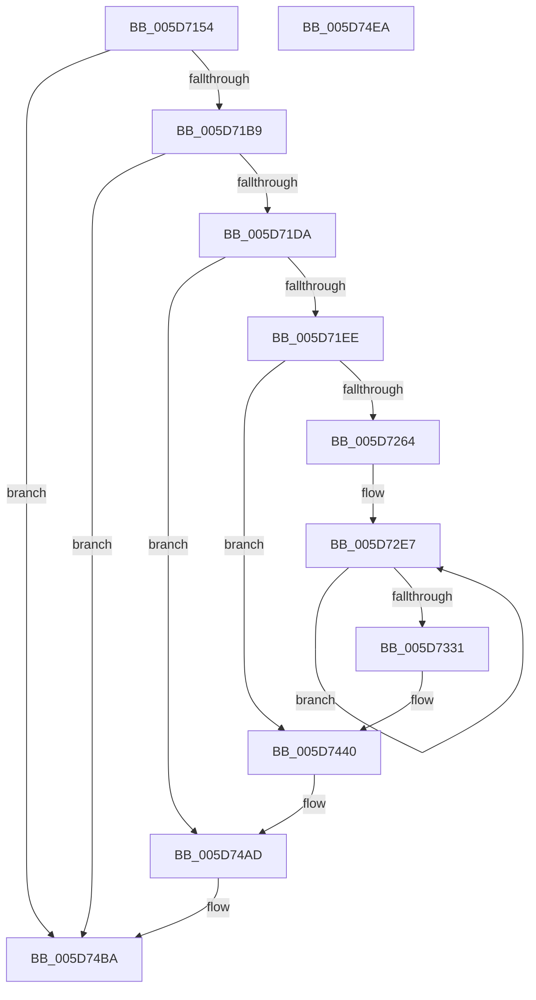

# PopDiagTraceThermalZoneEnumeration

- RVA: `0x005D7154`–`0x005D74EB` (길이 `919` bytes)
- VA: `0x00000001405D7154`
- 실행 섹션: `.text`
- PDB 이름 있음: `예`; PDB Function 태그: `아니요`
- unwind 정보 RVA: `0x000CC980`
- 디코드: `213`개 명령, `919/919` bytes 표시
- 미해석 바이트: `0` (있으면 어셈블리에 `.byte`로 보존)

> 이 문서는 커널 이미지의 기계어와 PDB 기호를 분석해 생성했습니다. 4번과 5번은 함수 원형과 자료형을 바이너리 사용 방식에서 추정한 C 해석이며 원본 소스 복구 결과는 아닙니다.

## 1. Dependencies

- 직접 호출 지점: **6**; 고유 호출 대상: **6**
- 직접 호출자로 확인된 함수: **3**
- RIP 상대 이미지 참조: **4**

### Outgoing calls
- `0x005D71C9` → [IoGetDeviceAttachmentBaseRefWithTag](../27/IoGetDeviceAttachmentBaseRefWithTag_function_00272788.md) (function, `0x00272788`)
- `0x005D7255` → [EtwEventEnabled](../39/EtwEventEnabled_function_00392450.md) (function, `0x00392450`)
- `0x005D743B` → [EtwWriteEx](../25/EtwWriteEx_function_0025F0D0.md) (function, `0x0025F0D0`)
- `0x005D74A4` → [PopSqmThermalZoneEnumeration](../../page/77/PopSqmThermalZoneEnumeration_function_00772884.md) (function, `0x00772884`)
- `0x005D74B5` → [ObfDereferenceObjectWithTag](../2F/ObfDereferenceObjectWithTag_function_002F78E0.md) (function, `0x002F78E0`)
- `0x005D74C4` → [_security_check_cookie](../6A/_security_check_cookie_function_006AC640.md) (function, `0x006AC640`)

### Direct callers
- [PopThermalWorker](../../page/A4/PopThermalWorker_function_00A4E200.md) at `0x00A4E57C`
- [sub_00B3BE18](../../page/B3/Unknown_function_00B3BE18.md) at `0x00B3BEAF`
- [PopDiagInitialize](../../init/C3/PopDiagInitialize_function_00C3F2C0.md) at `0x00C3F401`

### Static image references
- `0x005D717A` → RVA `0x00E0A740` (`.data`; read)
- `0x005D7191` → RVA `0x00E67858` (`.data`; read)
- `0x005D7235` → RVA `0x00F0B408` (`.data`; read)
- `0x005D724A` → RVA `0x00020DF8` (`.rdata`; read)

## 2. Other-region calls and transfers

- 다른 실행 섹션으로 향하는 call: **1**
  - `0x005D74A4` → [PopSqmThermalZoneEnumeration](../../page/77/PopSqmThermalZoneEnumeration_function_00772884.md) (`.text` → `PAGE`)
- 별도 외부 분기/꼬리 이동을 확인하지 못했습니다.

## 3. Assembly (complete function range)

```asm
005D7154  48 8B C4                        mov rax, rsp
005D7157  48 89 58 10                     mov qword ptr [rax + 0x10], rbx
005D715B  48 89 70 18                     mov qword ptr [rax + 0x18], rsi
005D715F  48 89 78 20                     mov qword ptr [rax + 0x20], rdi
005D7163  55                              push rbp
005D7164  41 54                           push r12
005D7166  41 55                           push r13
005D7168  41 56                           push r14
005D716A  41 57                           push r15
005D716C  48 8D A8 A8 FE FF FF            lea rbp, [rax - 0x158]
005D7173  48 81 EC 30 02 00 00            sub rsp, 0x230
005D717A  48 8B 05 BF 35 83 00            mov rax, qword ptr [rip + 0x8335bf]
005D7181  48 33 C4                        xor rax, rsp
005D7184  48 89 85 28 01 00 00            mov qword ptr [rbp + 0x128], rax
005D718B  45 33 F6                        xor r14d, r14d
005D718E  48 8B F9                        mov rdi, rcx
005D7191  44 38 35 C0 06 89 00            cmp byte ptr [rip + 0x8906c0], r14b
005D7198  44 89 74 24 6C                  mov dword ptr [rsp + 0x6c], r14d
005D719D  66 44 89 74 24 64               mov word ptr [rsp + 0x64], r14w
005D71A3  66 44 89 74 24 60               mov word ptr [rsp + 0x60], r14w
005D71A9  44 89 74 24 70                  mov dword ptr [rsp + 0x70], r14d
005D71AE  44 89 74 24 68                  mov dword ptr [rsp + 0x68], r14d
005D71B3  0F 84 01 03 00 00               je 0x1405d74ba
005D71B9  4C 8D A9 10 04 00 00            lea r13, [rcx + 0x410]
005D71C0  BA 50 6F 44 67                  mov edx, 0x67446f50
005D71C5  48 8B 49 30                     mov rcx, qword ptr [rcx + 0x30]
005D71C9  E8 BA B5 C9 FF                  call 0x140272788
005D71CE  48 8B F0                        mov rsi, rax
005D71D1  48 85 C0                        test rax, rax
005D71D4  0F 84 E0 02 00 00               je 0x1405d74ba
005D71DA  48 8B 88 38 01 00 00            mov rcx, qword ptr [rax + 0x138]
005D71E1  48 8B 41 28                     mov rax, qword ptr [rcx + 0x28]
005D71E5  48 85 C0                        test rax, rax
005D71E8  0F 84 BF 02 00 00               je 0x1405d74ad
005D71EE  4C 8D B0 80 00 00 00            lea r14, [rax + 0x80]
005D71F5  41 0F B7 0E                     movzx ecx, word ptr [r14]
005D71F9  4C 8D A7 88 00 00 00            lea r12, [rdi + 0x88]
005D7200  66 D1 E9                        shr cx, 1
005D7203  66 89 4C 24 60                  mov word ptr [rsp + 0x60], cx
005D7208  B9 CD CC CC CC                  mov ecx, 0xcccccccd
005D720D  8B C1                           mov eax, ecx
005D720F  F7 A7 84 00 00 00               mul dword ptr [rdi + 0x84]
005D7215  8B C1                           mov eax, ecx
005D7217  C1 EA 03                        shr edx, 3
005D721A  89 54 24 70                     mov dword ptr [rsp + 0x70], edx
005D721E  F7 A7 8C 00 00 00               mul dword ptr [rdi + 0x8c]
005D7224  8B C1                           mov eax, ecx
005D7226  C1 EA 03                        shr edx, 3
005D7229  89 54 24 6C                     mov dword ptr [rsp + 0x6c], edx
005D722D  F7 A7 BC 00 00 00               mul dword ptr [rdi + 0xbc]
005D7233  8B C1                           mov eax, ecx
005D7235  48 8B 0D CC 41 93 00            mov rcx, qword ptr [rip + 0x9341cc]
005D723C  C1 EA 03                        shr edx, 3
005D723F  89 54 24 68                     mov dword ptr [rsp + 0x68], edx
005D7243  41 F7 24 24                     mul dword ptr [r12]
005D7247  44 8B FA                        mov r15d, edx
005D724A  48 8D 15 A7 9B A4 FF            lea rdx, [rip - 0x5b6459]
005D7251  41 C1 EF 03                     shr r15d, 3
005D7255  E8 F6 B1 DB FF                  call 0x140392450
005D725A  33 C9                           xor ecx, ecx
005D725C  84 C0                           test al, al
005D725E  0F 84 DC 01 00 00               je 0x1405d7440
005D7264  48 8D 44 24 60                  lea rax, [rsp + 0x60]
005D7269  48 C7 45 88 02 00 00 00         mov qword ptr [rbp - 0x78], 2
005D7271  48 89 45 80                     mov qword ptr [rbp - 0x80], rax
005D7275  4C 8D 5F 70                     lea r11, [rdi + 0x70]
005D7279  49 8B 46 08                     mov rax, qword ptr [r14 + 8]
005D727D  44 8D 41 06                     lea r8d, [rcx + 6]
005D7281  48 89 45 90                     mov qword ptr [rbp - 0x70], rax
005D7285  4C 8D 95 00 01 00 00            lea r10, [rbp + 0x100]
005D728C  0F B7 44 24 60                  movzx eax, word ptr [rsp + 0x60]
005D7291  44 8B C9                        mov r9d, ecx
005D7294  03 C0                           add eax, eax
005D7296  89 4D 9C                        mov dword ptr [rbp - 0x64], ecx
005D7299  89 45 98                        mov dword ptr [rbp - 0x68], eax
005D729C  48 8D 44 24 70                  lea rax, [rsp + 0x70]
005D72A1  48 89 45 A0                     mov qword ptr [rbp - 0x60], rax
005D72A5  48 8D 47 74                     lea rax, [rdi + 0x74]
005D72A9  48 89 45 B0                     mov qword ptr [rbp - 0x50], rax
005D72AD  48 8D 47 78                     lea rax, [rdi + 0x78]
005D72B1  48 89 45 C0                     mov qword ptr [rbp - 0x40], rax
005D72B5  48 8D 47 7C                     lea rax, [rdi + 0x7c]
005D72B9  48 89 45 D0                     mov qword ptr [rbp - 0x30], rax
005D72BD  48 8D 85 00 01 00 00            lea rax, [rbp + 0x100]
005D72C4  4C 2B D8                        sub r11, rax
005D72C7  48 C7 45 A8 04 00 00 00         mov qword ptr [rbp - 0x58], 4
005D72CF  48 C7 45 B8 04 00 00 00         mov qword ptr [rbp - 0x48], 4
005D72D7  48 C7 45 C8 04 00 00 00         mov qword ptr [rbp - 0x38], 4
005D72DF  48 C7 45 D8 04 00 00 00         mov qword ptr [rbp - 0x28], 4
005D72E7  B8 CD CC CC CC                  mov eax, 0xcccccccd
005D72EC  48 8D 8D 00 01 00 00            lea rcx, [rbp + 0x100]
005D72F3  43 F7 64 13 24                  mul dword ptr [r11 + r10 + 0x24]
005D72F8  41 8B C1                        mov eax, r9d
005D72FB  41 FF C1                        inc r9d
005D72FE  C1 EA 03                        shr edx, 3
005D7301  41 89 12                        mov dword ptr [r10], edx
005D7304  41 8B D0                        mov edx, r8d
005D7307  41 FF C0                        inc r8d
005D730A  48 03 D2                        add rdx, rdx
005D730D  48 8D 0C 81                     lea rcx, [rcx + rax*4]
005D7311  83 64 D5 8C 00                  and dword ptr [rbp + rdx*8 - 0x74], 0
005D7316  48 89 4C D5 80                  mov qword ptr [rbp + rdx*8 - 0x80], rcx
005D731B  C7 44 D5 88 04 00 00 00         mov dword ptr [rbp + rdx*8 - 0x78], 4
005D7323  BA 04 00 00 00                  mov edx, 4
005D7328  4C 03 D2                        add r10, rdx
005D732B  41 83 F9 0A                     cmp r9d, 0xa
005D732F  72 B6                           jb 0x1405d72e7
005D7331  41 8B C0                        mov eax, r8d
005D7334  44 8D 52 FD                     lea r10d, [rdx - 3]
005D7338  48 03 C0                        add rax, rax
005D733B  48 8D 4C 24 6C                  lea rcx, [rsp + 0x6c]
005D7340  45 03 C2                        add r8d, r10d
005D7343  45 33 C9                        xor r9d, r9d
005D7346  48 89 4C C5 80                  mov qword ptr [rbp + rax*8 - 0x80], rcx
005D734B  48 8D 4C 24 68                  lea rcx, [rsp + 0x68]
005D7350  48 89 54 C5 88                  mov qword ptr [rbp + rax*8 - 0x78], rdx
005D7355  41 8B C0                        mov eax, r8d
005D7358  45 03 C2                        add r8d, r10d
005D735B  48 03 C0                        add rax, rax
005D735E  48 89 4C C5 80                  mov qword ptr [rbp + rax*8 - 0x80], rcx
005D7363  48 89 54 C5 88                  mov qword ptr [rbp + rax*8 - 0x78], rdx
005D7368  48 8D 87 C0 00 00 00            lea rax, [rdi + 0xc0]
005D736F  41 8B C8                        mov ecx, r8d
005D7372  45 03 C2                        add r8d, r10d
005D7375  48 03 C9                        add rcx, rcx
005D7378  48 89 44 CD 80                  mov qword ptr [rbp + rcx*8 - 0x80], rax
005D737D  48 89 54 CD 88                  mov qword ptr [rbp + rcx*8 - 0x78], rdx
005D7382  41 8B C0                        mov eax, r8d
005D7385  45 03 C2                        add r8d, r10d
005D7388  48 03 C0                        add rax, rax
005D738B  41 8B C8                        mov ecx, r8d
005D738E  48 03 C9                        add rcx, rcx
005D7391  45 03 C2                        add r8d, r10d
005D7394  48 89 54 C5 88                  mov qword ptr [rbp + rax*8 - 0x78], rdx
005D7399  4C 89 64 C5 80                  mov qword ptr [rbp + rax*8 - 0x80], r12
005D739E  48 8D 87 C4 00 00 00            lea rax, [rdi + 0xc4]
005D73A5  48 89 44 CD 80                  mov qword ptr [rbp + rcx*8 - 0x80], rax
005D73AA  48 89 54 CD 88                  mov qword ptr [rbp + rcx*8 - 0x78], rdx
005D73AF  48 8D 4C 24 64                  lea rcx, [rsp + 0x64]
005D73B4  41 0F B7 55 00                  movzx edx, word ptr [r13]
005D73B9  0F B7 C2                        movzx eax, dx
005D73BC  66 D1 E8                        shr ax, 1
005D73BF  66 89 44 24 64                  mov word ptr [rsp + 0x64], ax
005D73C4  41 8B C0                        mov eax, r8d
005D73C7  45 03 C2                        add r8d, r10d
005D73CA  48 03 C0                        add rax, rax
005D73CD  48 89 4C C5 80                  mov qword ptr [rbp + rax*8 - 0x80], rcx
005D73D2  48 C7 44 C5 88 02 00 00 00      mov qword ptr [rbp + rax*8 - 0x78], 2
005D73DB  49 8B 45 08                     mov rax, qword ptr [r13 + 8]
005D73DF  41 8B C8                        mov ecx, r8d
005D73E2  48 03 C9                        add rcx, rcx
005D73E5  48 89 44 CD 80                  mov qword ptr [rbp + rcx*8 - 0x80], rax
005D73EA  48 8D 87 C8 00 00 00            lea rax, [rdi + 0xc8]
005D73F1  89 54 CD 88                     mov dword ptr [rbp + rcx*8 - 0x78], edx
005D73F5  48 8D 15 FC 99 A4 FF            lea rdx, [rip - 0x5b6604]
005D73FC  44 89 4C CD 8C                  mov dword ptr [rbp + rcx*8 - 0x74], r9d
005D7401  41 8D 48 01                     lea ecx, [r8 + 1]
005D7405  48 03 C9                        add rcx, rcx
005D7408  45 33 C0                        xor r8d, r8d
005D740B  48 89 44 CD 80                  mov qword ptr [rbp + rcx*8 - 0x80], rax
005D7410  48 8D 45 80                     lea rax, [rbp - 0x80]
005D7414  48 89 44 24 38                  mov qword ptr [rsp + 0x38], rax
005D7419  C7 44 24 30 18 00 00 00         mov dword ptr [rsp + 0x30], 0x18
005D7421  48 C7 44 CD 88 04 00 00 00      mov qword ptr [rbp + rcx*8 - 0x78], 4
005D742A  48 8B 0D D7 3F 93 00            mov rcx, qword ptr [rip + 0x933fd7]
005D7431  4C 89 4C 24 28                  mov qword ptr [rsp + 0x28], r9
005D7436  4C 89 4C 24 20                  mov qword ptr [rsp + 0x20], r9
005D743B  E8 90 7C C8 FF                  call 0x14025f0d0
005D7440  44 8B 4F 74                     mov r9d, dword ptr [rdi + 0x74]
005D7444  B9 CD CC CC CC                  mov ecx, 0xcccccccd
005D7449  8B C1                           mov eax, ecx
005D744B  F7 A7 98 00 00 00               mul dword ptr [rdi + 0x98]
005D7451  8B C1                           mov eax, ecx
005D7453  49 8B CE                        mov rcx, r14
005D7456  44 8B C2                        mov r8d, edx
005D7459  F7 A7 94 00 00 00               mul dword ptr [rdi + 0x94]
005D745F  8B 87 C8 00 00 00               mov eax, dword ptr [rdi + 0xc8]
005D7465  89 44 24 58                     mov dword ptr [rsp + 0x58], eax
005D7469  8B 44 24 68                     mov eax, dword ptr [rsp + 0x68]
005D746D  44 89 7C 24 50                  mov dword ptr [rsp + 0x50], r15d
005D7472  89 44 24 48                     mov dword ptr [rsp + 0x48], eax
005D7476  8B 44 24 6C                     mov eax, dword ptr [rsp + 0x6c]
005D747A  89 44 24 40                     mov dword ptr [rsp + 0x40], eax
005D747E  8B 47 7C                        mov eax, dword ptr [rdi + 0x7c]
005D7481  41 C1 E8 03                     shr r8d, 3
005D7485  44 89 44 24 38                  mov dword ptr [rsp + 0x38], r8d
005D748A  44 8B 44 24 70                  mov r8d, dword ptr [rsp + 0x70]
005D748F  C1 EA 03                        shr edx, 3
005D7492  89 54 24 30                     mov dword ptr [rsp + 0x30], edx
005D7496  49 8B D5                        mov rdx, r13
005D7499  89 44 24 28                     mov dword ptr [rsp + 0x28], eax
005D749D  8B 47 78                        mov eax, dword ptr [rdi + 0x78]
005D74A0  89 44 24 20                     mov dword ptr [rsp + 0x20], eax
005D74A4  E8 DB B3 19 00                  call 0x140772884
005D74A9  80 4F 41 10                     or byte ptr [rdi + 0x41], 0x10
005D74AD  BA 50 6F 44 67                  mov edx, 0x67446f50
005D74B2  48 8B CE                        mov rcx, rsi
005D74B5  E8 26 04 D2 FF                  call 0x1402f78e0
005D74BA  48 8B 8D 28 01 00 00            mov rcx, qword ptr [rbp + 0x128]
005D74C1  48 33 CC                        xor rcx, rsp
005D74C4  E8 77 51 0D 00                  call 0x1406ac640
005D74C9  4C 8D 9C 24 30 02 00 00         lea r11, [rsp + 0x230]
005D74D1  49 8B 5B 38                     mov rbx, qword ptr [r11 + 0x38]
005D74D5  49 8B 73 40                     mov rsi, qword ptr [r11 + 0x40]
005D74D9  49 8B 7B 48                     mov rdi, qword ptr [r11 + 0x48]
005D74DD  49 8B E3                        mov rsp, r11
005D74E0  41 5F                           pop r15
005D74E2  41 5E                           pop r14
005D74E4  41 5D                           pop r13
005D74E6  41 5C                           pop r12
005D74E8  5D                              pop rbp
005D74E9  C3                              ret
005D74EA  CC                              int3
```

## 4. C-style interpretation (structured pseudocode)

```c
__int64 __fastcall PopDiagTraceThermalZoneEnumeration(__int64 a1)
{
    __int64 result;
    __int64 v_r10;
    __int64 v_r11;
    __int64 v_r14;
    __int64 v_r15;
    __int64 v_rsp;
    unsigned int v_stack_m1E8;
    unsigned int v_stack_m1EC;
    unsigned int v_stack_m1F0;
    unsigned __int16 v_stack_m1F4;
    unsigned __int16 v_stack_m1F8;
    unsigned int v_stack_m200;
    unsigned int v_stack_m208;
    unsigned int v_stack_m210;
    unsigned int v_stack_m218;
    unsigned __int64 v_stack_m220;
    unsigned int v_stack_m228;
    unsigned __int64 v_stack_m230;
    unsigned __int64 v_stack_m238;
    unsigned __int64 v_stack_m28;

    *(unsigned __int64 *)(v_rsp + 16) = v_rbx;
    *(unsigned __int64 *)(v_rsp + 24) = v_rsi;
    *(unsigned __int64 *)(v_rsp + 32) = v_rdi;
    v_rsp = (v_rsp) - (560);
    result = (*(unsigned __int64 *)(v_rip + 8598975)) ^ (v_rsp);
    *(unsigned __int64 *)(v_rsp - 344 + 296) = result;
    v_r14 = 0;
    v_stack_m1EC = 0;
    v_stack_m1F4 = 0;
    v_stack_m1F8 = 0;
    v_stack_m1E8 = 0;
    v_stack_m1F0 = 0;
    if ((*(unsigned __int8 *)(v_rip + 8980160)) == 0) goto loc_005D74BA;
    result = IoGetDeviceAttachmentBaseRefWithTag(*(unsigned __int64 *)(a1 + 48), (unsigned int)(0x67446F50ULL), a3, a4);
    if (result == 0) goto loc_005D74BA;
    if (*(unsigned __int64 *)(*(unsigned __int64 *)(result + 312) + 40) == 0) goto loc_005D74AD;
    a1 = (unsigned __int16)((*(unsigned __int16 *)(*(unsigned __int64 *)(*(unsigned __int64 *)(result + 312) + 40) + 128)) >> (1));
    v_stack_m1F8 = (unsigned __int16)(a1);
    a2 = (unsigned int)(((unsigned int)(0x67446F50ULL)) >> (3));
    v_stack_m1E8 = (unsigned int)(a2);
    a2 = (unsigned int)((a2) >> (3));
    v_stack_m1EC = (unsigned int)(a2);
    a2 = (unsigned int)((a2) >> (3));
    v_stack_m1F0 = (unsigned int)(a2);
    v_r15 = (unsigned int)(((unsigned int)((unsigned int)(a2))) >> (3));
    result = EtwEventEnabled(*(unsigned __int64 *)(v_rip + 9650636), v_rip - 5989465, a3, a4);
    a1 = 0;
    if ((unsigned __int8)(result) == 0) goto loc_005D7440;
    *(unsigned __int64 *)(v_rsp - 344 - 120) = 2;
    *(unsigned __int64 *)(v_rsp - 344 - 128) = v_stack_m1F8;
    *(unsigned __int64 *)(v_rsp - 344 - 112) = *(unsigned __int64 *)(*(unsigned __int64 *)(*(unsigned __int64 *)(result + 312) + 40) + 128 + 8);
    result = (unsigned int)((v_stack_m1F8) + ((unsigned int)(v_stack_m1F8)));
    *(unsigned int *)(v_rsp - 344 - 100) = 0;
    *(unsigned int *)(v_rsp - 344 - 104) = (unsigned int)(result);
    *(unsigned __int64 *)(v_rsp - 344 - 96) = v_stack_m1E8;
    *(unsigned __int64 *)(v_rsp - 344 - 80) = a1 + 116;
    *(unsigned __int64 *)(v_rsp - 344 - 64) = a1 + 120;
    *(unsigned __int64 *)(v_rsp - 344 - 48) = a1 + 124;
    v_r11 = (a1 + 112) - (v_rsp - 344 + 256);
    *(unsigned __int64 *)(v_rsp - 344 - 88) = 4;
    *(unsigned __int64 *)(v_rsp - 344 - 72) = 4;
    *(unsigned __int64 *)(v_rsp - 344 - 56) = 4;
    *(unsigned __int64 *)(v_rsp - 344 - 40) = 4;
loc_005D72E7:
    a4 = (unsigned int)((0) + 1);
    a2 = (unsigned int)((v_rip - 5989465) >> (3));
    *(unsigned int *)(v_rsp - 344 + 256) = (unsigned int)(a2);
    a3 = (unsigned int)((a1 + 6) + 1);
    a2 = ((unsigned int)((unsigned int)(a1 + 6))) + ((unsigned int)((unsigned int)(a1 + 6)));
    *(unsigned __int64 *)(v_rsp - 344 + a2 * 8 - 128) = v_rsp - 344 + 256 + 0 * 4;
    *(unsigned int *)(v_rsp - 344 + a2 * 8 - 120) = 4;
    v_r10 = (v_rsp - 344 + 256) + (4);
    if (((unsigned int)(a4)) < 10) goto loc_005D72E7;
    result = ((unsigned int)((unsigned int)(a3))) + ((unsigned int)((unsigned int)(a3)));
    a3 = (unsigned int)((a3) + ((unsigned int)(4 - 3)));
    a4 = 0;
    *(unsigned __int64 *)(v_rsp - 344 + result * 8 - 128) = v_stack_m1EC;
    *(unsigned __int64 *)(v_rsp - 344 + result * 8 - 120) = 4;
    a3 = (unsigned int)((a3) + ((unsigned int)(4 - 3)));
    result = ((unsigned int)((unsigned int)(a3))) + ((unsigned int)((unsigned int)(a3)));
    *(unsigned __int64 *)(v_rsp - 344 + result * 8 - 128) = v_stack_m1F0;
    *(unsigned __int64 *)(v_rsp - 344 + result * 8 - 120) = 4;
    a3 = (unsigned int)((a3) + ((unsigned int)(4 - 3)));
    a1 = ((unsigned int)((unsigned int)(a3))) + ((unsigned int)((unsigned int)(a3)));
    *(unsigned __int64 *)(v_rsp - 344 + a1 * 8 - 128) = a1 + 192;
    *(unsigned __int64 *)(v_rsp - 344 + a1 * 8 - 120) = 4;
    a3 = (unsigned int)((a3) + ((unsigned int)(4 - 3)));
    result = ((unsigned int)((unsigned int)(a3))) + ((unsigned int)((unsigned int)(a3)));
    a1 = ((unsigned int)((unsigned int)(a3))) + ((unsigned int)((unsigned int)(a3)));
    a3 = (unsigned int)((a3) + ((unsigned int)(4 - 3)));
    *(unsigned __int64 *)(v_rsp - 344 + result * 8 - 120) = 4;
    *(unsigned __int64 *)(v_rsp - 344 + result * 8 - 128) = a1 + 136;
    *(unsigned __int64 *)(v_rsp - 344 + a1 * 8 - 128) = a1 + 196;
    *(unsigned __int64 *)(v_rsp - 344 + a1 * 8 - 120) = 4;
    result = (unsigned __int16)(((unsigned __int16)(*(unsigned __int16 *)(a1 + 1040))) >> (1));
    v_stack_m1F4 = (unsigned __int16)(result);
    a3 = (unsigned int)((a3) + ((unsigned int)(4 - 3)));
    result = ((unsigned int)((unsigned int)(a3))) + ((unsigned int)((unsigned int)(a3)));
    *(unsigned __int64 *)(v_rsp - 344 + result * 8 - 128) = v_stack_m1F4;
    *(unsigned __int64 *)(v_rsp - 344 + result * 8 - 120) = 2;
    a1 = ((unsigned int)((unsigned int)(a3))) + ((unsigned int)((unsigned int)(a3)));
    *(unsigned __int64 *)(v_rsp - 344 + a1 * 8 - 128) = *(unsigned __int64 *)(a1 + 1040 + 8);
    *(unsigned int *)(v_rsp - 344 + a1 * 8 - 120) = (unsigned int)(*(unsigned __int16 *)(a1 + 1040));
    *(unsigned int *)(v_rsp - 344 + a1 * 8 - 116) = 0;
    a1 = (a3 + 1) + (a3 + 1);
    a3 = 0;
    *(unsigned __int64 *)(v_rsp - 344 + a1 * 8 - 128) = a1 + 200;
    v_stack_m220 = v_rsp - 344 - 128;
    v_stack_m228 = 24;
    *(unsigned __int64 *)(v_rsp - 344 + a1 * 8 - 120) = 4;
    v_stack_m230 = 0;
    v_stack_m238 = 0;
    result = EtwWriteEx(*(unsigned __int64 *)(v_rip + 9650135), v_rip - 5989892, a3, a4);
loc_005D7440:
    v_stack_m200 = (unsigned int)((unsigned int)(*(unsigned int *)(a1 + 200)));
    v_stack_m208 = (unsigned int)(v_r15);
    v_stack_m210 = (unsigned int)((unsigned int)(v_stack_m1F0));
    v_stack_m218 = (unsigned int)((unsigned int)(v_stack_m1EC));
    a3 = (unsigned int)(((unsigned int)((unsigned int)(v_rip - 5989892))) >> (3));
    v_stack_m220 = (unsigned int)(a3);
    a2 = (unsigned int)((v_rip - 5989892) >> (3));
    v_stack_m228 = (unsigned int)(a2);
    v_stack_m230 = (unsigned int)((unsigned int)(*(unsigned int *)(a1 + 124)));
    v_stack_m238 = (unsigned int)((unsigned int)(*(unsigned int *)(a1 + 120)));
    result = PopSqmThermalZoneEnumeration(*(unsigned __int64 *)(*(unsigned __int64 *)(result + 312) + 40) + 128, a1 + 1040, (unsigned int)(v_stack_m1E8), (unsigned int)(*(unsigned int *)(a1 + 116)));
loc_005D74AD:
    result = ObfDereferenceObjectWithTag(result, (unsigned int)(0x67446F50ULL), (unsigned int)(v_stack_m1E8), (unsigned int)(*(unsigned int *)(a1 + 116)));
loc_005D74BA:
    a1 = (*(unsigned __int64 *)(v_rsp - 344 + 296)) ^ (v_rsp);
    result = _security_check_cookie(a1, (unsigned int)(0x67446F50ULL), (unsigned int)(v_stack_m1E8), (unsigned int)(*(unsigned int *)(a1 + 116)));
    return result;
}
```

## 5. (Beta) C Style

```c
int64_t PopDiagTraceThermalZoneEnumeration(void *Arg1)
{
    uint8_t *arg1 = (uint8_t *)Arg1;

    int64_t result;
    int64_t local_r10;
    int64_t local_r11;
    int64_t local_r14;
    int64_t local_r15;
    int64_t local_rsp;
    uint32_t v_stack_m1E8;
    uint32_t v_stack_m1EC;
    uint32_t v_stack_m1F0;
    uint16_t v_stack_m1F4;
    uint16_t v_stack_m1F8;
    uint32_t v_stack_m200;
    uint32_t v_stack_m208;
    uint32_t v_stack_m210;
    uint32_t v_stack_m218;
    uint64_t v_stack_m220;
    uint32_t v_stack_m228;
    uint64_t v_stack_m230;
    uint64_t v_stack_m238;
    uint64_t v_stack_m28;

    *(uint64_t *)(local_rsp + 0x10) = local_rbx;
    *(uint64_t *)(local_rsp + 0x18) = local_rsi;
    *(uint64_t *)(local_rsp + 0x20) = local_rdi;
    local_rsp = (local_rsp) - (560);
    result = (*(uint64_t *)(v_rip + 0x8335BF)) ^ (local_rsp);
    *(uint64_t *)(local_rsp - 0x158 + 0x128) = result;
    local_r14 = 0;
    v_stack_m1EC = 0;
    v_stack_m1F4 = 0;
    v_stack_m1F8 = 0;
    v_stack_m1E8 = 0;
    v_stack_m1F0 = 0;
    if ((*(uint8_t *)(v_rip + 0x8906C0)) == 0) goto loc_005D74BA;
    result = IoGetDeviceAttachmentBaseRefWithTag(*(uint64_t *)(arg1 + 0x30), (uint32_t)(0x67446F50ULL), a3, a4);
    if (result == 0) goto loc_005D74BA;
    if (*(uint64_t *)(*(uint64_t *)(result + 0x138) + 0x28) == 0) goto loc_005D74AD;
    Arg1 = (uint16_t)((*(uint16_t *)(*(uint64_t *)(*(uint64_t *)(result + 0x138) + 0x28) + 0x80)) >> (1));
    v_stack_m1F8 = (uint16_t)(Arg1);
    a2 = (uint32_t)(((uint32_t)(0x67446F50ULL)) >> (3));
    v_stack_m1E8 = (uint32_t)(a2);
    a2 = (uint32_t)((a2) >> (3));
    v_stack_m1EC = (uint32_t)(a2);
    a2 = (uint32_t)((a2) >> (3));
    v_stack_m1F0 = (uint32_t)(a2);
    local_r15 = (uint32_t)(((uint32_t)((uint32_t)(a2))) >> (3));
    result = EtwEventEnabled(*(uint64_t *)(v_rip + 0x9341CC), v_rip - 5989465, a3, a4);
    Arg1 = 0;
    if ((uint8_t)(result) == 0) goto loc_005D7440;
    *(uint64_t *)(local_rsp - 0x158 - 0x78) = 2;
    *(uint64_t *)(local_rsp - 0x158 - 0x80) = v_stack_m1F8;
    *(uint64_t *)(local_rsp - 0x158 - 0x70) = *(uint64_t *)(*(uint64_t *)(*(uint64_t *)(result + 0x138) + 0x28) + 0x80 + 0x8);
    result = (uint32_t)((v_stack_m1F8) + ((uint32_t)(v_stack_m1F8)));
    *(uint32_t *)(local_rsp - 0x158 - 0x64) = 0;
    *(uint32_t *)(local_rsp - 0x158 - 0x68) = (uint32_t)(result);
    *(uint64_t *)(local_rsp - 0x158 - 0x60) = v_stack_m1E8;
    *(void **)(local_rsp - 0x158 - 0x50) = Arg1 + 116;
    *(void **)(local_rsp - 0x158 - 0x40) = Arg1 + 120;
    *(void **)(local_rsp - 0x158 - 0x30) = Arg1 + 124;
    local_r11 = (Arg1 + 112) - (local_rsp - 344 + 256);
    *(uint64_t *)(local_rsp - 0x158 - 0x58) = 4;
    *(uint64_t *)(local_rsp - 0x158 - 0x48) = 4;
    *(uint64_t *)(local_rsp - 0x158 - 0x38) = 4;
    *(uint64_t *)(local_rsp - 0x158 - 0x28) = 4;
loc_005D72E7:
    a4 = (uint32_t)((0) + 1);
    a2 = (uint32_t)((v_rip - 5989465) >> (3));
    *(uint32_t *)(local_rsp - 0x158 + 0x100) = (uint32_t)(a2);
    a3 = (uint32_t)((Arg1 + 6) + 1);
    a2 = ((uint32_t)((uint32_t)(Arg1 + 6))) + ((uint32_t)((uint32_t)(Arg1 + 6)));
    *(uint64_t *)(local_rsp - 0x158 + a2 * 8 - 0x80) = local_rsp - 344 + 256 + 0 * 4;
    *(uint32_t *)(local_rsp - 0x158 + a2 * 8 - 0x78) = 4;
    local_r10 = (local_rsp - 344 + 256) + (4);
    if (((uint32_t)(a4)) < 10) goto loc_005D72E7;
    result = ((uint32_t)((uint32_t)(a3))) + ((uint32_t)((uint32_t)(a3)));
    a3 = (uint32_t)((a3) + ((uint32_t)(4 - 3)));
    a4 = 0;
    *(uint64_t *)(local_rsp - 0x158 + result * 8 - 0x80) = v_stack_m1EC;
    *(uint64_t *)(local_rsp - 0x158 + result * 8 - 0x78) = 4;
    a3 = (uint32_t)((a3) + ((uint32_t)(4 - 3)));
    result = ((uint32_t)((uint32_t)(a3))) + ((uint32_t)((uint32_t)(a3)));
    *(uint64_t *)(local_rsp - 0x158 + result * 8 - 0x80) = v_stack_m1F0;
    *(uint64_t *)(local_rsp - 0x158 + result * 8 - 0x78) = 4;
    a3 = (uint32_t)((a3) + ((uint32_t)(4 - 3)));
    Arg1 = ((uint32_t)((uint32_t)(a3))) + ((uint32_t)((uint32_t)(a3)));
    *(void **)(local_rsp - 0x158 + arg1 * 8 - 0x80) = Arg1 + 192;
    *(uint64_t *)(local_rsp - 0x158 + arg1 * 8 - 0x78) = 4;
    a3 = (uint32_t)((a3) + ((uint32_t)(4 - 3)));
    result = ((uint32_t)((uint32_t)(a3))) + ((uint32_t)((uint32_t)(a3)));
    Arg1 = ((uint32_t)((uint32_t)(a3))) + ((uint32_t)((uint32_t)(a3)));
    a3 = (uint32_t)((a3) + ((uint32_t)(4 - 3)));
    *(uint64_t *)(local_rsp - 0x158 + result * 8 - 0x78) = 4;
    *(void **)(local_rsp - 0x158 + result * 8 - 0x80) = Arg1 + 136;
    *(void **)(local_rsp - 0x158 + arg1 * 8 - 0x80) = Arg1 + 196;
    *(uint64_t *)(local_rsp - 0x158 + arg1 * 8 - 0x78) = 4;
    result = (uint16_t)(((uint16_t)(*(uint16_t *)(arg1 + 0x410))) >> (1));
    v_stack_m1F4 = (uint16_t)(result);
    a3 = (uint32_t)((a3) + ((uint32_t)(4 - 3)));
    result = ((uint32_t)((uint32_t)(a3))) + ((uint32_t)((uint32_t)(a3)));
    *(uint64_t *)(local_rsp - 0x158 + result * 8 - 0x80) = v_stack_m1F4;
    *(uint64_t *)(local_rsp - 0x158 + result * 8 - 0x78) = 2;
    Arg1 = ((uint32_t)((uint32_t)(a3))) + ((uint32_t)((uint32_t)(a3)));
    *(uint64_t *)(local_rsp - 0x158 + arg1 * 8 - 0x80) = *(uint64_t *)(arg1 + 0x410 + 0x8);
    *(uint32_t *)(local_rsp - 0x158 + arg1 * 8 - 0x78) = (uint32_t)(*(uint16_t *)(arg1 + 0x410));
    *(uint32_t *)(local_rsp - 0x158 + arg1 * 8 - 0x74) = 0;
    Arg1 = (a3 + 1) + (a3 + 1);
    a3 = 0;
    *(void **)(local_rsp - 0x158 + arg1 * 8 - 0x80) = Arg1 + 200;
    v_stack_m220 = local_rsp - 344 - 128;
    v_stack_m228 = 24;
    *(uint64_t *)(local_rsp - 0x158 + arg1 * 8 - 0x78) = 4;
    v_stack_m230 = 0;
    v_stack_m238 = 0;
    result = EtwWriteEx(*(uint64_t *)(v_rip + 0x933FD7), v_rip - 5989892, a3, a4);
loc_005D7440:
    v_stack_m200 = (uint32_t)((uint32_t)(*(uint32_t *)(arg1 + 0xC8)));
    v_stack_m208 = (uint32_t)(local_r15);
    v_stack_m210 = (uint32_t)((uint32_t)(v_stack_m1F0));
    v_stack_m218 = (uint32_t)((uint32_t)(v_stack_m1EC));
    a3 = (uint32_t)(((uint32_t)((uint32_t)(v_rip - 5989892))) >> (3));
    v_stack_m220 = (uint32_t)(a3);
    a2 = (uint32_t)((v_rip - 5989892) >> (3));
    v_stack_m228 = (uint32_t)(a2);
    v_stack_m230 = (uint32_t)((uint32_t)(*(uint32_t *)(arg1 + 0x7C)));
    v_stack_m238 = (uint32_t)((uint32_t)(*(uint32_t *)(arg1 + 0x78)));
    result = PopSqmThermalZoneEnumeration(*(uint64_t *)(*(uint64_t *)(result + 0x138) + 0x28) + 128, Arg1 + 1040, (uint32_t)(v_stack_m1E8), (uint32_t)(*(uint32_t *)(arg1 + 0x74)));
loc_005D74AD:
    result = ObfDereferenceObjectWithTag(result, (uint32_t)(0x67446F50ULL), (uint32_t)(v_stack_m1E8), (uint32_t)(*(uint32_t *)(arg1 + 0x74)));
loc_005D74BA:
    Arg1 = (*(uint64_t *)(local_rsp - 0x158 + 0x128)) ^ (local_rsp);
    result = _security_check_cookie(Arg1, (uint32_t)(0x67446F50ULL), (uint32_t)(v_stack_m1E8), (uint32_t)(*(uint32_t *)(arg1 + 0x74)));
    return result;
}
```

### 관측된 메모리 오프셋

구조체 형식이 확인되지 않은 접근은 인자 기준의 오프셋으로만 기록했습니다.

| 기준 인자 | 오프셋 표현 | 폭 (bit) | 접근 |
|---|---:|---:|---|
| `Arg1` | `+ 0x0` | `16` | `R` |
| `Arg1` | `+ 0x0` | `32` | `R` |
| `Arg1` | `+ 0x8` | `64` | `R` |
| `Arg1` | `+ 0x24 + r10*1` | `32` | `R` |
| `Arg1` | `+ 0x30` | `64` | `R` |
| `Arg1` | `+ 0x41` | `8` | `R/W` |
| `Arg1` | `+ 0x70` | `64` | `R` |
| `Arg1` | `+ 0x74` | `32` | `R` |
| `Arg1` | `+ 0x74` | `64` | `R` |
| `Arg1` | `+ 0x78` | `32` | `R` |
| `Arg1` | `+ 0x78` | `64` | `R` |
| `Arg1` | `+ 0x7C` | `32` | `R` |
| `Arg1` | `+ 0x7C` | `64` | `R` |
| `Arg1` | `+ 0x84` | `32` | `R` |
| `Arg1` | `+ 0x88` | `64` | `R` |
| `Arg1` | `+ 0x8C` | `32` | `R` |
| `Arg1` | `+ 0x94` | `32` | `R` |
| `Arg1` | `+ 0x98` | `32` | `R` |
| `Arg1` | `+ 0xBC` | `32` | `R` |
| `Arg1` | `+ 0xC0` | `64` | `R` |
| `Arg1` | `+ 0xC4` | `64` | `R` |
| `Arg1` | `+ 0xC8` | `32` | `R` |
| `Arg1` | `+ 0xC8` | `64` | `R` |
| `Arg1` | `+ 0x410` | `64` | `R` |

## 6. Execution-region graph

[열기: 2D/3D 그래프와 함수 탐색 컨트롤 패널](../../../control-panel.html?section=text&rva=0x005D7154&view=graph)

- 2D 그래프는 위에서 아래로 흐르고, 3D 그래프는 빈 공간을 드래그해 회전합니다. Shift+드래그는 이동, 휠은 확대·축소, 함수 노드 선택은 대상 보고서 이동입니다.

### Static fallback


