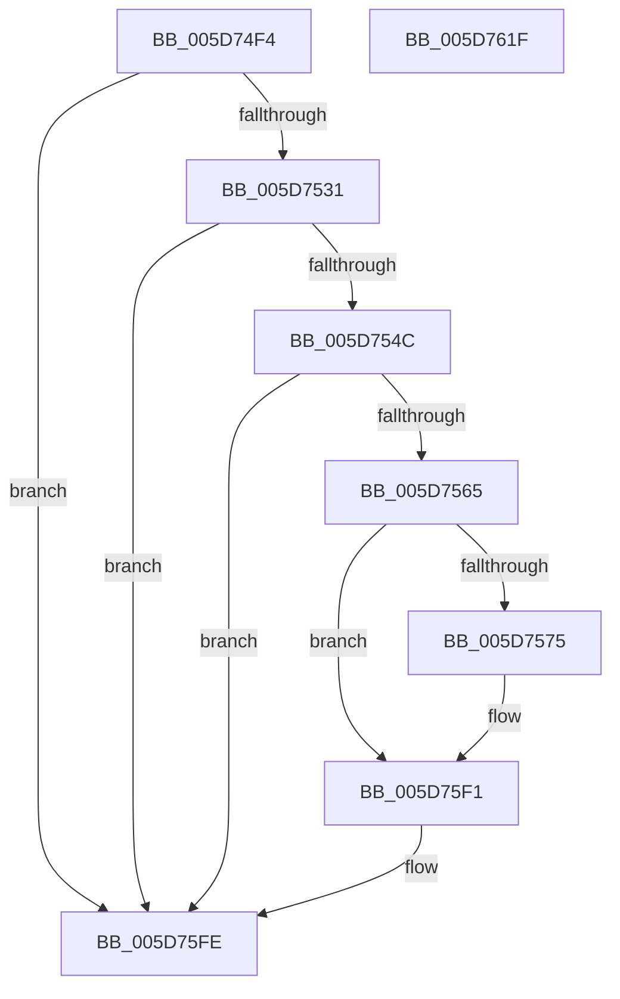

# PopDiagTraceThermalZoneThrottleDurationPerfTrack

- RVA: `0x005D74F4`–`0x005D7620` (길이 `300` bytes)
- VA: `0x00000001405D74F4`
- 실행 섹션: `.text`
- PDB 이름 있음: `예`; PDB Function 태그: `아니요`
- unwind 정보 RVA: `0x000CC9EC`
- 디코드: `67`개 명령, `300/300` bytes 표시
- 미해석 바이트: `0` (있으면 어셈블리에 `.byte`로 보존)

> 이 문서는 커널 이미지의 기계어와 PDB 기호를 분석해 생성했습니다. 4번과 5번은 함수 원형과 자료형을 바이너리 사용 방식에서 추정한 C 해석이며 원본 소스 복구 결과는 아닙니다.

## 1. Dependencies

- 직접 호출 지점: **5**; 고유 호출 대상: **5**
- 직접 호출자로 확인된 함수: **1**
- RIP 상대 이미지 참조: **4**

### Outgoing calls
- `0x005D753F` → [EtwEventEnabled](../39/EtwEventEnabled_function_00392450.md) (function, `0x00392450`)
- `0x005D7554` → [IoGetDeviceAttachmentBaseRefWithTag](../27/IoGetDeviceAttachmentBaseRefWithTag_function_00272788.md) (function, `0x00272788`)
- `0x005D75EC` → [EtwWriteEx](../25/EtwWriteEx_function_0025F0D0.md) (function, `0x0025F0D0`)
- `0x005D75F9` → [ObfDereferenceObjectWithTag](../2F/ObfDereferenceObjectWithTag_function_002F78E0.md) (function, `0x002F78E0`)
- `0x005D7605` → [_security_check_cookie](../6A/_security_check_cookie_function_006AC640.md) (function, `0x006AC640`)

### Direct callers
- [sub_00B3BE18](../../page/B3/Unknown_function_00B3BE18.md) at `0x00B3BFBA`

### Static image references
- `0x005D750D` → RVA `0x00E0A740` (`.data`; read)
- `0x005D7520` → RVA `0x00E67858` (`.data`; read)
- `0x005D7531` → RVA `0x00F0B408` (`.data`; read)
- `0x005D7538` → RVA `0x00022CC8` (`.rdata`; read)

## 2. Other-region calls and transfers

- 다른 실행 섹션으로 향하는 call: **0**
- 별도 외부 분기/꼬리 이동을 확인하지 못했습니다.

## 3. Assembly (complete function range)

```asm
005D74F4  48 89 5C 24 18                  mov qword ptr [rsp + 0x18], rbx
005D74F9  48 89 7C 24 20                  mov qword ptr [rsp + 0x20], rdi
005D74FE  89 4C 24 08                     mov dword ptr [rsp + 8], ecx
005D7502  55                              push rbp
005D7503  48 8B EC                        mov rbp, rsp
005D7506  48 81 EC 80 00 00 00            sub rsp, 0x80
005D750D  48 8B 05 2C 32 83 00            mov rax, qword ptr [rip + 0x83322c]
005D7514  48 33 C4                        xor rax, rsp
005D7517  48 89 45 F8                     mov qword ptr [rbp - 8], rax
005D751B  33 FF                           xor edi, edi
005D751D  48 8B DA                        mov rbx, rdx
005D7520  40 38 3D 31 03 89 00            cmp byte ptr [rip + 0x890331], dil
005D7527  66 89 7D C0                     mov word ptr [rbp - 0x40], di
005D752B  0F 84 CD 00 00 00               je 0x1405d75fe
005D7531  48 8B 0D D0 3E 93 00            mov rcx, qword ptr [rip + 0x933ed0]
005D7538  48 8D 15 89 B7 A4 FF            lea rdx, [rip - 0x5b4877]
005D753F  E8 0C AF DB FF                  call 0x140392450
005D7544  84 C0                           test al, al
005D7546  0F 84 B2 00 00 00               je 0x1405d75fe
005D754C  BA 50 6F 44 67                  mov edx, 0x67446f50
005D7551  48 8B CB                        mov rcx, rbx
005D7554  E8 2F B2 C9 FF                  call 0x140272788
005D7559  48 8B D8                        mov rbx, rax
005D755C  48 85 C0                        test rax, rax
005D755F  0F 84 99 00 00 00               je 0x1405d75fe
005D7565  48 8B 88 38 01 00 00            mov rcx, qword ptr [rax + 0x138]
005D756C  48 8B 41 28                     mov rax, qword ptr [rcx + 0x28]
005D7570  48 85 C0                        test rax, rax
005D7573  74 7C                           je 0x1405d75f1
005D7575  0F B7 88 80 00 00 00            movzx ecx, word ptr [rax + 0x80]
005D757C  48 8D 15 45 B7 A4 FF            lea rdx, [rip - 0x5b48bb]
005D7583  66 D1 E9                        shr cx, 1
005D7586  45 33 C9                        xor r9d, r9d
005D7589  44 0F B7 C1                     movzx r8d, cx
005D758D  48 8D 4D 10                     lea rcx, [rbp + 0x10]
005D7591  48 89 4D C8                     mov qword ptr [rbp - 0x38], rcx
005D7595  48 8D 4D C0                     lea rcx, [rbp - 0x40]
005D7599  66 44 89 45 C0                  mov word ptr [rbp - 0x40], r8w
005D759E  45 03 C0                        add r8d, r8d
005D75A1  48 89 4D D8                     mov qword ptr [rbp - 0x28], rcx
005D75A5  48 8B 0D 5C 3E 93 00            mov rcx, qword ptr [rip + 0x933e5c]
005D75AC  48 C7 45 D0 04 00 00 00         mov qword ptr [rbp - 0x30], 4
005D75B4  48 C7 45 E0 02 00 00 00         mov qword ptr [rbp - 0x20], 2
005D75BC  48 8B 80 88 00 00 00            mov rax, qword ptr [rax + 0x88]
005D75C3  48 89 45 E8                     mov qword ptr [rbp - 0x18], rax
005D75C7  48 8D 45 C8                     lea rax, [rbp - 0x38]
005D75CB  48 89 44 24 38                  mov qword ptr [rsp + 0x38], rax
005D75D0  C7 44 24 30 03 00 00 00         mov dword ptr [rsp + 0x30], 3
005D75D8  44 89 45 F0                     mov dword ptr [rbp - 0x10], r8d
005D75DC  45 33 C0                        xor r8d, r8d
005D75DF  48 89 7C 24 28                  mov qword ptr [rsp + 0x28], rdi
005D75E4  48 89 7C 24 20                  mov qword ptr [rsp + 0x20], rdi
005D75E9  89 7D F4                        mov dword ptr [rbp - 0xc], edi
005D75EC  E8 DF 7A C8 FF                  call 0x14025f0d0
005D75F1  BA 50 6F 44 67                  mov edx, 0x67446f50
005D75F6  48 8B CB                        mov rcx, rbx
005D75F9  E8 E2 02 D2 FF                  call 0x1402f78e0
005D75FE  48 8B 4D F8                     mov rcx, qword ptr [rbp - 8]
005D7602  48 33 CC                        xor rcx, rsp
005D7605  E8 36 50 0D 00                  call 0x1406ac640
005D760A  4C 8D 9C 24 80 00 00 00         lea r11, [rsp + 0x80]
005D7612  49 8B 5B 20                     mov rbx, qword ptr [r11 + 0x20]
005D7616  49 8B 7B 28                     mov rdi, qword ptr [r11 + 0x28]
005D761A  49 8B E3                        mov rsp, r11
005D761D  5D                              pop rbp
005D761E  C3                              ret
005D761F  CC                              int3
```

## 4. C-style interpretation (structured pseudocode)

```c
__int64 __fastcall PopDiagTraceThermalZoneThrottleDurationPerfTrack(int a1, __int64 a2, __int64 a3, int a4)
{
    __int64 result;
    __int64 v_rdi;
    __int64 v_rsp;
    unsigned __int64 v_stack_m10;
    unsigned int v_stack_m14;
    unsigned int v_stack_m18;
    unsigned __int64 v_stack_m20;
    unsigned __int64 v_stack_m28;
    unsigned __int64 v_stack_m30;
    unsigned __int64 v_stack_m38;
    unsigned __int64 v_stack_m40;
    unsigned __int16 v_stack_m48;
    unsigned __int64 v_stack_m50;
    unsigned int v_stack_m58;
    unsigned __int64 v_stack_m60;
    unsigned __int64 v_stack_m68;
    unsigned __int64 v_stack_m8;
    unsigned __int64 v_stack_p18;
    unsigned __int64 v_stack_p20;
    unsigned int v_stack_p8;

    v_stack_p18 = v_rbx;
    v_stack_p20 = v_rdi;
    v_stack_p8 = a1;
    v_rsp = (v_rsp) - (128);
    result = (*(unsigned __int64 *)(v_rip + 8598060)) ^ (v_rsp);
    v_stack_m10 = result;
    v_rdi = 0;
    v_stack_m48 = 0;
    if ((*(unsigned __int8 *)(v_rip + 8979249)) == 0) goto loc_005D75FE;
    result = EtwEventEnabled(*(unsigned __int64 *)(v_rip + 9649872), v_rip - 5982327, a3, a4);
    if ((unsigned __int8)(result) == 0) goto loc_005D75FE;
    result = IoGetDeviceAttachmentBaseRefWithTag(a2, (unsigned int)(0x67446F50ULL), a3, a4);
    if (result == 0) goto loc_005D75FE;
    result = *(unsigned __int64 *)(*(unsigned __int64 *)(result + 312) + 40);
    if (*(unsigned __int64 *)(*(unsigned __int64 *)(result + 312) + 40) != 0) {
        a1 = *(unsigned __int16 *)(*(unsigned __int64 *)(*(unsigned __int64 *)(result + 312) + 40) + 128);
        a2 = v_rip - 5982395;
        a1 = (unsigned __int16)((a1) >> (1));
        a4 = 0;
        a3 = (unsigned __int16)(a1);
        a1 = v_stack_p8;
        v_stack_m40 = a1;
        a1 = v_stack_m48;
        v_stack_m48 = (unsigned __int16)(a3);
        a3 = (unsigned int)((a3) + ((unsigned int)(a3)));
        v_stack_m30 = a1;
        a1 = *(unsigned __int64 *)(v_rip + 9649756);
        v_stack_m38 = 4;
        v_stack_m28 = 2;
        result = *(unsigned __int64 *)(*(unsigned __int64 *)(*(unsigned __int64 *)(result + 312) + 40) + 136);
        v_stack_m20 = result;
        result = v_stack_m40;
        v_stack_m50 = result;
        v_stack_m58 = 3;
        v_stack_m18 = (unsigned int)(a3);
        a3 = 0;
        v_stack_m60 = 0;
        v_stack_m68 = 0;
        v_stack_m14 = 0;
        result = EtwWriteEx(a1, a2, a3, a4);
    }
    result = ObfDereferenceObjectWithTag(result, (unsigned int)(0x67446F50ULL), a3, a4);
loc_005D75FE:
    a1 = (v_stack_m10) ^ (v_rsp);
    result = _security_check_cookie(a1, (unsigned int)(0x67446F50ULL), a3, a4);
    return result;
}
```

## 5. (Beta) C Style

```c
int64_t PopDiagTraceThermalZoneThrottleDurationPerfTrack(int32_t Arg1, int64_t Arg2, int64_t Arg3, int32_t Arg4)
{
    int64_t result;
    int64_t local_rdi;
    int64_t local_rsp;
    uint64_t v_stack_m10;
    uint32_t v_stack_m14;
    uint32_t v_stack_m18;
    uint64_t v_stack_m20;
    uint64_t v_stack_m28;
    uint64_t v_stack_m30;
    uint64_t v_stack_m38;
    uint64_t v_stack_m40;
    uint16_t v_stack_m48;
    uint64_t v_stack_m50;
    uint32_t v_stack_m58;
    uint64_t v_stack_m60;
    uint64_t v_stack_m68;
    uint64_t v_stack_m8;
    uint64_t v_stack_p18;
    uint64_t v_stack_p20;
    uint32_t v_stack_p8;

    v_stack_p18 = local_rbx;
    v_stack_p20 = local_rdi;
    v_stack_p8 = Arg1;
    local_rsp = (local_rsp) - (128);
    result = (*(uint64_t *)(v_rip + 0x83322C)) ^ (local_rsp);
    v_stack_m10 = result;
    local_rdi = 0;
    v_stack_m48 = 0;
    if ((*(uint8_t *)(v_rip + 0x890331)) == 0) goto loc_005D75FE;
    result = EtwEventEnabled(*(uint64_t *)(v_rip + 0x933ED0), v_rip - 5982327, Arg3, Arg4);
    if ((uint8_t)(result) == 0) goto loc_005D75FE;
    result = IoGetDeviceAttachmentBaseRefWithTag(Arg2, (uint32_t)(0x67446F50ULL), Arg3, Arg4);
    if (result == 0) goto loc_005D75FE;
    result = *(uint64_t *)(*(uint64_t *)(result + 0x138) + 0x28);
    if (*(uint64_t *)(*(uint64_t *)(result + 0x138) + 0x28) != 0) {
        Arg1 = *(uint16_t *)(*(uint64_t *)(*(uint64_t *)(result + 0x138) + 0x28) + 0x80);
        Arg2 = v_rip - 5982395;
        Arg1 = (uint16_t)((Arg1) >> (1));
        Arg4 = 0;
        Arg3 = (uint16_t)(Arg1);
        Arg1 = v_stack_p8;
        v_stack_m40 = Arg1;
        Arg1 = v_stack_m48;
        v_stack_m48 = (uint16_t)(Arg3);
        Arg3 = (uint32_t)((Arg3) + ((uint32_t)(Arg3)));
        v_stack_m30 = Arg1;
        Arg1 = *(uint64_t *)(v_rip + 0x933E5C);
        v_stack_m38 = 4;
        v_stack_m28 = 2;
        result = *(uint64_t *)(*(uint64_t *)(*(uint64_t *)(result + 0x138) + 0x28) + 0x88);
        v_stack_m20 = result;
        result = v_stack_m40;
        v_stack_m50 = result;
        v_stack_m58 = 3;
        v_stack_m18 = (uint32_t)(Arg3);
        Arg3 = 0;
        v_stack_m60 = 0;
        v_stack_m68 = 0;
        v_stack_m14 = 0;
        result = EtwWriteEx(Arg1, Arg2, Arg3, Arg4);
    }
    result = ObfDereferenceObjectWithTag(result, (uint32_t)(0x67446F50ULL), Arg3, Arg4);
loc_005D75FE:
    Arg1 = (v_stack_m10) ^ (local_rsp);
    result = _security_check_cookie(Arg1, (uint32_t)(0x67446F50ULL), Arg3, Arg4);
    return result;
}
```

## 6. Execution-region graph

[열기: 2D/3D 그래프와 함수 탐색 컨트롤 패널](../../../control-panel.html?section=text&rva=0x005D74F4&view=graph)

- 2D 그래프는 위에서 아래로 흐르고, 3D 그래프는 빈 공간을 드래그해 회전합니다. Shift+드래그는 이동, 휠은 확대·축소, 함수 노드 선택은 대상 보고서 이동입니다.

### Static fallback


