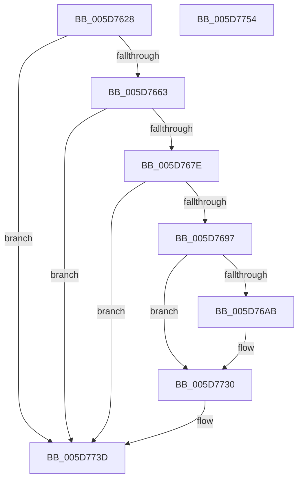

# PopDiagTraceThermalZoneThrottlePerfTrack

- RVA: `0x005D7628`–`0x005D7755` (길이 `301` bytes)
- VA: `0x00000001405D7628`
- 실행 섹션: `.text`
- PDB 이름 있음: `예`; PDB Function 태그: `아니요`
- unwind 정보 RVA: `0x000CC9AC`
- 디코드: `71`개 명령, `301/301` bytes 표시
- 미해석 바이트: `0` (있으면 어셈블리에 `.byte`로 보존)

> 이 문서는 커널 이미지의 기계어와 PDB 기호를 분석해 생성했습니다. 4번과 5번은 함수 원형과 자료형을 바이너리 사용 방식에서 추정한 C 해석이며 원본 소스 복구 결과는 아닙니다.

## 1. Dependencies

- 직접 호출 지점: **5**; 고유 호출 대상: **5**
- 직접 호출자로 확인된 함수: **1**
- RIP 상대 이미지 참조: **4**

### Outgoing calls
- `0x005D7671` → [EtwEventEnabled](../39/EtwEventEnabled_function_00392450.md) (function, `0x00392450`)
- `0x005D7686` → [IoGetDeviceAttachmentBaseRefWithTag](../27/IoGetDeviceAttachmentBaseRefWithTag_function_00272788.md) (function, `0x00272788`)
- `0x005D772B` → [EtwWriteEx](../25/EtwWriteEx_function_0025F0D0.md) (function, `0x0025F0D0`)
- `0x005D7738` → [ObfDereferenceObjectWithTag](../2F/ObfDereferenceObjectWithTag_function_002F78E0.md) (function, `0x002F78E0`)
- `0x005D7744` → [_security_check_cookie](../6A/_security_check_cookie_function_006AC640.md) (function, `0x006AC640`)

### Direct callers
- [PopThermalWorker](../../page/A4/PopThermalWorker_function_00A4E200.md) at `0x00A4E5B0`

### Static image references
- `0x005D763F` → RVA `0x00E0A740` (`.data`; read)
- `0x005D7652` → RVA `0x00E67858` (`.data`; read)
- `0x005D7663` → RVA `0x00F0B408` (`.data`; read)
- `0x005D766A` → RVA `0x00014488` (`.rdata`; read)

## 2. Other-region calls and transfers

- 다른 실행 섹션으로 향하는 call: **0**
- 별도 외부 분기/꼬리 이동을 확인하지 못했습니다.

## 3. Assembly (complete function range)

```asm
005D7628  89 54 24 10                     mov dword ptr [rsp + 0x10], edx
005D762C  89 4C 24 08                     mov dword ptr [rsp + 8], ecx
005D7630  55                              push rbp
005D7631  53                              push rbx
005D7632  57                              push rdi
005D7633  48 8D 6C 24 B9                  lea rbp, [rsp - 0x47]
005D7638  48 81 EC A0 00 00 00            sub rsp, 0xa0
005D763F  48 8B 05 FA 30 83 00            mov rax, qword ptr [rip + 0x8330fa]
005D7646  48 33 C4                        xor rax, rsp
005D7649  48 89 45 37                     mov qword ptr [rbp + 0x37], rax
005D764D  33 FF                           xor edi, edi
005D764F  49 8B D8                        mov rbx, r8
005D7652  40 38 3D FF 01 89 00            cmp byte ptr [rip + 0x8901ff], dil
005D7659  66 89 7D E7                     mov word ptr [rbp - 0x19], di
005D765D  0F 84 DA 00 00 00               je 0x1405d773d
005D7663  48 8B 0D 9E 3D 93 00            mov rcx, qword ptr [rip + 0x933d9e]
005D766A  48 8D 15 17 CE A3 FF            lea rdx, [rip - 0x5c31e9]
005D7671  E8 DA AD DB FF                  call 0x140392450
005D7676  84 C0                           test al, al
005D7678  0F 84 BF 00 00 00               je 0x1405d773d
005D767E  BA 50 6F 44 67                  mov edx, 0x67446f50
005D7683  48 8B CB                        mov rcx, rbx
005D7686  E8 FD B0 C9 FF                  call 0x140272788
005D768B  48 8B D8                        mov rbx, rax
005D768E  48 85 C0                        test rax, rax
005D7691  0F 84 A6 00 00 00               je 0x1405d773d
005D7697  48 8B 88 38 01 00 00            mov rcx, qword ptr [rax + 0x138]
005D769E  48 8B 41 28                     mov rax, qword ptr [rcx + 0x28]
005D76A2  48 85 C0                        test rax, rax
005D76A5  0F 84 85 00 00 00               je 0x1405d7730
005D76AB  0F B7 88 80 00 00 00            movzx ecx, word ptr [rax + 0x80]
005D76B2  44 8D 4F 04                     lea r9d, [rdi + 4]
005D76B6  66 D1 E9                        shr cx, 1
005D76B9  48 8D 15 C8 CD A3 FF            lea rdx, [rip - 0x5c3238]
005D76C0  44 0F B7 C1                     movzx r8d, cx
005D76C4  48 8D 4D 6F                     lea rcx, [rbp + 0x6f]
005D76C8  48 89 4D F7                     mov qword ptr [rbp - 9], rcx
005D76CC  48 8D 4D 67                     lea rcx, [rbp + 0x67]
005D76D0  48 89 4D 07                     mov qword ptr [rbp + 7], rcx
005D76D4  48 8D 4D E7                     lea rcx, [rbp - 0x19]
005D76D8  66 44 89 45 E7                  mov word ptr [rbp - 0x19], r8w
005D76DD  45 03 C0                        add r8d, r8d
005D76E0  48 89 4D 17                     mov qword ptr [rbp + 0x17], rcx
005D76E4  48 8B 0D 1D 3D 93 00            mov rcx, qword ptr [rip + 0x933d1d]
005D76EB  4C 89 4D FF                     mov qword ptr [rbp - 1], r9
005D76EF  4C 89 4D 0F                     mov qword ptr [rbp + 0xf], r9
005D76F3  48 C7 45 1F 02 00 00 00         mov qword ptr [rbp + 0x1f], 2
005D76FB  48 8B 80 88 00 00 00            mov rax, qword ptr [rax + 0x88]
005D7702  48 89 45 27                     mov qword ptr [rbp + 0x27], rax
005D7706  48 8D 45 F7                     lea rax, [rbp - 9]
005D770A  48 89 44 24 38                  mov qword ptr [rsp + 0x38], rax
005D770F  44 89 4C 24 30                  mov dword ptr [rsp + 0x30], r9d
005D7714  45 33 C9                        xor r9d, r9d
005D7717  44 89 45 2F                     mov dword ptr [rbp + 0x2f], r8d
005D771B  45 33 C0                        xor r8d, r8d
005D771E  48 89 7C 24 28                  mov qword ptr [rsp + 0x28], rdi
005D7723  48 89 7C 24 20                  mov qword ptr [rsp + 0x20], rdi
005D7728  89 7D 33                        mov dword ptr [rbp + 0x33], edi
005D772B  E8 A0 79 C8 FF                  call 0x14025f0d0
005D7730  BA 50 6F 44 67                  mov edx, 0x67446f50
005D7735  48 8B CB                        mov rcx, rbx
005D7738  E8 A3 01 D2 FF                  call 0x1402f78e0
005D773D  48 8B 4D 37                     mov rcx, qword ptr [rbp + 0x37]
005D7741  48 33 CC                        xor rcx, rsp
005D7744  E8 F7 4E 0D 00                  call 0x1406ac640
005D7749  48 81 C4 A0 00 00 00            add rsp, 0xa0
005D7750  5F                              pop rdi
005D7751  5B                              pop rbx
005D7752  5D                              pop rbp
005D7753  C3                              ret
005D7754  CC                              int3
```

## 4. C-style interpretation (structured pseudocode)

```c
__int64 __fastcall PopDiagTraceThermalZoneThrottlePerfTrack(int a1, int a2, __int64 a3)
{
    __int64 result;
    __int64 v_rdi;
    __int64 v_rsp;
    unsigned __int64 v_stack_m28;
    unsigned int v_stack_m2C;
    unsigned int v_stack_m30;
    unsigned __int64 v_stack_m38;
    unsigned __int64 v_stack_m40;
    unsigned __int64 v_stack_m48;
    unsigned __int64 v_stack_m50;
    unsigned __int64 v_stack_m58;
    unsigned __int64 v_stack_m5F;
    unsigned __int64 v_stack_m60;
    unsigned __int64 v_stack_m68;
    unsigned __int16 v_stack_m78;
    unsigned __int64 v_stack_m80;
    unsigned int v_stack_m88;
    unsigned __int64 v_stack_m90;
    unsigned __int64 v_stack_m98;
    unsigned int v_stack_p10;
    unsigned int v_stack_p8;

    v_stack_p10 = a2;
    v_stack_p8 = a1;
    v_rsp = (v_rsp) - (160);
    result = (*(unsigned __int64 *)(v_rip + 8597754)) ^ (v_rsp);
    v_stack_m28 = result;
    v_rdi = 0;
    v_stack_m78 = 0;
    if ((*(unsigned __int8 *)(v_rip + 8978943)) == 0) goto loc_005D773D;
    result = EtwEventEnabled(*(unsigned __int64 *)(v_rip + 9649566), v_rip - 6042089, a3, a4);
    if ((unsigned __int8)(result) == 0) goto loc_005D773D;
    result = IoGetDeviceAttachmentBaseRefWithTag(a3, (unsigned int)(0x67446F50ULL), a3, a4);
    if (result == 0) goto loc_005D773D;
    result = *(unsigned __int64 *)(*(unsigned __int64 *)(result + 312) + 40);
    if (*(unsigned __int64 *)(*(unsigned __int64 *)(result + 312) + 40) != 0) {
        a1 = *(unsigned __int16 *)(*(unsigned __int64 *)(*(unsigned __int64 *)(result + 312) + 40) + 128);
        a4 = v_rdi + 4;
        a1 = (unsigned __int16)((a1) >> (1));
        a2 = v_rip - 6042168;
        a3 = (unsigned __int16)(a1);
        a1 = v_stack_p10;
        v_stack_m68 = a1;
        a1 = v_stack_p8;
        v_stack_m58 = a1;
        a1 = v_stack_m78;
        v_stack_m78 = (unsigned __int16)(a3);
        a3 = (unsigned int)((a3) + ((unsigned int)(a3)));
        v_stack_m48 = a1;
        a1 = *(unsigned __int64 *)(v_rip + 9649437);
        v_stack_m60 = a4;
        v_stack_m50 = a4;
        v_stack_m40 = 2;
        result = *(unsigned __int64 *)(*(unsigned __int64 *)(*(unsigned __int64 *)(result + 312) + 40) + 136);
        v_stack_m38 = result;
        result = v_stack_m68;
        v_stack_m80 = result;
        v_stack_m88 = (unsigned int)(a4);
        a4 = 0;
        v_stack_m30 = (unsigned int)(a3);
        a3 = 0;
        v_stack_m90 = 0;
        v_stack_m98 = 0;
        v_stack_m2C = 0;
        result = EtwWriteEx(a1, a2, a3, a4);
    }
    result = ObfDereferenceObjectWithTag(result, (unsigned int)(0x67446F50ULL), a3, a4);
loc_005D773D:
    a1 = (v_stack_m28) ^ (v_rsp);
    result = _security_check_cookie(a1, (unsigned int)(0x67446F50ULL), a3, a4);
    v_rsp = (v_rsp) + (160);
    return result;
}
```

## 5. (Beta) C Style

```c
int64_t PopDiagTraceThermalZoneThrottlePerfTrack(int32_t Arg1, int32_t Arg2, int64_t Arg3)
{
    int64_t result;
    int64_t local_rdi;
    int64_t local_rsp;
    uint64_t v_stack_m28;
    uint32_t v_stack_m2C;
    uint32_t v_stack_m30;
    uint64_t v_stack_m38;
    uint64_t v_stack_m40;
    uint64_t v_stack_m48;
    uint64_t v_stack_m50;
    uint64_t v_stack_m58;
    uint64_t v_stack_m5F;
    uint64_t v_stack_m60;
    uint64_t v_stack_m68;
    uint16_t v_stack_m78;
    uint64_t v_stack_m80;
    uint32_t v_stack_m88;
    uint64_t v_stack_m90;
    uint64_t v_stack_m98;
    uint32_t v_stack_p10;
    uint32_t v_stack_p8;

    v_stack_p10 = Arg2;
    v_stack_p8 = Arg1;
    local_rsp = (local_rsp) - (160);
    result = (*(uint64_t *)(v_rip + 0x8330FA)) ^ (local_rsp);
    v_stack_m28 = result;
    local_rdi = 0;
    v_stack_m78 = 0;
    if ((*(uint8_t *)(v_rip + 0x8901FF)) == 0) goto loc_005D773D;
    result = EtwEventEnabled(*(uint64_t *)(v_rip + 0x933D9E), v_rip - 6042089, Arg3, a4);
    if ((uint8_t)(result) == 0) goto loc_005D773D;
    result = IoGetDeviceAttachmentBaseRefWithTag(Arg3, (uint32_t)(0x67446F50ULL), Arg3, a4);
    if (result == 0) goto loc_005D773D;
    result = *(uint64_t *)(*(uint64_t *)(result + 0x138) + 0x28);
    if (*(uint64_t *)(*(uint64_t *)(result + 0x138) + 0x28) != 0) {
        Arg1 = *(uint16_t *)(*(uint64_t *)(*(uint64_t *)(result + 0x138) + 0x28) + 0x80);
        a4 = local_rdi + 4;
        Arg1 = (uint16_t)((Arg1) >> (1));
        Arg2 = v_rip - 6042168;
        Arg3 = (uint16_t)(Arg1);
        Arg1 = v_stack_p10;
        v_stack_m68 = Arg1;
        Arg1 = v_stack_p8;
        v_stack_m58 = Arg1;
        Arg1 = v_stack_m78;
        v_stack_m78 = (uint16_t)(Arg3);
        Arg3 = (uint32_t)((Arg3) + ((uint32_t)(Arg3)));
        v_stack_m48 = Arg1;
        Arg1 = *(uint64_t *)(v_rip + 0x933D1D);
        v_stack_m60 = a4;
        v_stack_m50 = a4;
        v_stack_m40 = 2;
        result = *(uint64_t *)(*(uint64_t *)(*(uint64_t *)(result + 0x138) + 0x28) + 0x88);
        v_stack_m38 = result;
        result = v_stack_m68;
        v_stack_m80 = result;
        v_stack_m88 = (uint32_t)(a4);
        a4 = 0;
        v_stack_m30 = (uint32_t)(Arg3);
        Arg3 = 0;
        v_stack_m90 = 0;
        v_stack_m98 = 0;
        v_stack_m2C = 0;
        result = EtwWriteEx(Arg1, Arg2, Arg3, a4);
    }
    result = ObfDereferenceObjectWithTag(result, (uint32_t)(0x67446F50ULL), Arg3, a4);
loc_005D773D:
    Arg1 = (v_stack_m28) ^ (local_rsp);
    result = _security_check_cookie(Arg1, (uint32_t)(0x67446F50ULL), Arg3, a4);
    local_rsp = (local_rsp) + (160);
    return result;
}
```

## 6. Execution-region graph

[열기: 2D/3D 그래프와 함수 탐색 컨트롤 패널](../../../control-panel.html?section=text&rva=0x005D7628&view=graph)

- 2D 그래프는 위에서 아래로 흐르고, 3D 그래프는 빈 공간을 드래그해 회전합니다. Shift+드래그는 이동, 휠은 확대·축소, 함수 노드 선택은 대상 보고서 이동입니다.

### Static fallback


