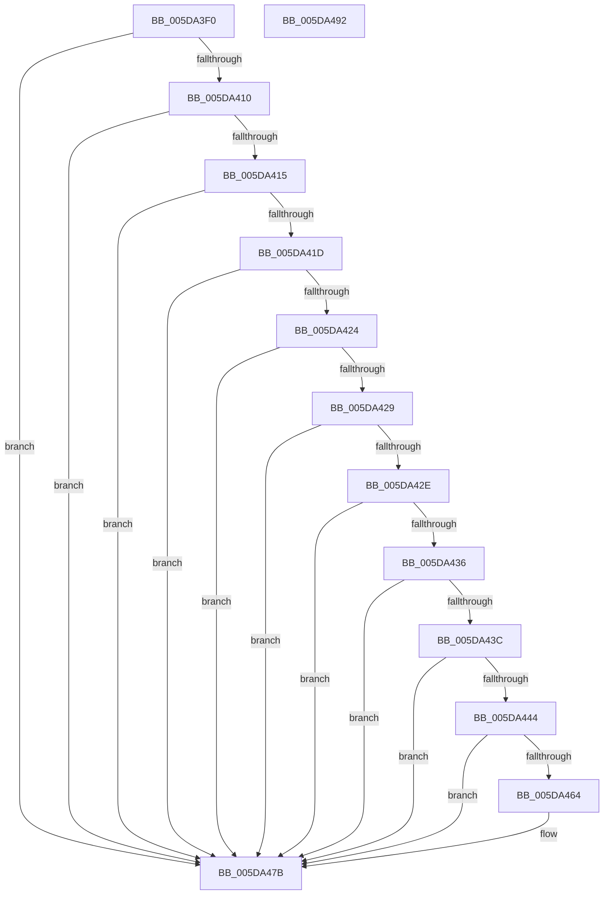

# PopEmModuleAddressMatchCallback

- RVA: `0x005DA3F0`–`0x005DA493` (길이 `163` bytes)
- VA: `0x00000001405DA3F0`
- 실행 섹션: `.text`
- PDB 이름 있음: `예`; PDB Function 태그: `아니요`
- unwind 정보 RVA: `0x00065960`
- 디코드: `51`개 명령, `163/163` bytes 표시
- 미해석 바이트: `0` (있으면 어셈블리에 `.byte`로 보존)

> 이 문서는 커널 이미지의 기계어와 PDB 기호를 분석해 생성했습니다. 4번과 5번은 함수 원형과 자료형을 바이너리 사용 방식에서 추정한 C 해석이며 원본 소스 복구 결과는 아닙니다.

## 1. Dependencies

- 직접 호출 지점: **4**; 고유 호출 대상: **4**
- 직접 호출자로 확인된 함수: **0**
- RIP 상대 이미지 참조: **0**

### Outgoing calls
- `0x005DA449` → [RtlInitAnsiString](../47/RtlInitAnsiString_function_00470F40.md) (function, `0x00470F40`)
- `0x005DA45B` → [RtlAnsiStringToUnicodeString](../../page/90/RtlAnsiStringToUnicodeString_function_0090BEA0.md) (function, `0x0090BEA0`)
- `0x005DA46F` → [RtlEqualUnicodeString](../../page/93/RtlEqualUnicodeString_function_00932A20.md) (function, `0x00932A20`)
- `0x005DA480` → [RtlFreeAnsiString](../../page/9C/RtlFreeAnsiString_function_009C0800.md) (function, `0x009C0800`)

### Direct callers
- 이 함수 시작 RVA로 연결되는 직접 call은 확인되지 않았습니다. 간접 호출은 완전히 역산할 수 없습니다.

### Static image references
- 디코드된 RIP-relative 메모리 참조가 없습니다.

## 2. Other-region calls and transfers

- 다른 실행 섹션으로 향하는 call: **3**
  - `0x005DA45B` → [RtlAnsiStringToUnicodeString](../../page/90/RtlAnsiStringToUnicodeString_function_0090BEA0.md) (`.text` → `PAGE`)
  - `0x005DA46F` → [RtlEqualUnicodeString](../../page/93/RtlEqualUnicodeString_function_00932A20.md) (`.text` → `PAGE`)
  - `0x005DA480` → [RtlFreeAnsiString](../../page/9C/RtlFreeAnsiString_function_009C0800.md) (`.text` → `PAGE`)
- 별도 외부 분기/꼬리 이동을 확인하지 못했습니다.

## 3. Assembly (complete function range)

```asm
005DA3F0  48 89 5C 24 08                  mov qword ptr [rsp + 8], rbx
005DA3F5  57                              push rdi
005DA3F6  48 83 EC 40                     sub rsp, 0x40
005DA3FA  0F 57 C0                        xorps xmm0, xmm0
005DA3FD  BB 01 00 00 00                  mov ebx, 1
005DA402  0F 11 44 24 30                  movups xmmword ptr [rsp + 0x30], xmm0
005DA407  0F 11 44 24 20                  movups xmmword ptr [rsp + 0x20], xmm0
005DA40C  3B D3                           cmp edx, ebx
005DA40E  75 6B                           jne 0x1405da47b
005DA410  48 85 C9                        test rcx, rcx
005DA413  74 66                           je 0x1405da47b
005DA415  48 8B 01                        mov rax, qword ptr [rcx]
005DA418  48 85 C0                        test rax, rax
005DA41B  74 5E                           je 0x1405da47b
005DA41D  83 7C 24 78 00                  cmp dword ptr [rsp + 0x78], 0
005DA422  75 57                           jne 0x1405da47b
005DA424  44 3B CB                        cmp r9d, ebx
005DA427  75 52                           jne 0x1405da47b
005DA429  4D 85 C0                        test r8, r8
005DA42C  74 4D                           je 0x1405da47b
005DA42E  49 8B 10                        mov rdx, qword ptr [r8]
005DA431  48 85 D2                        test rdx, rdx
005DA434  74 45                           je 0x1405da47b
005DA436  83 78 08 00                     cmp dword ptr [rax + 8], 0
005DA43A  74 3F                           je 0x1405da47b
005DA43C  48 8B 38                        mov rdi, qword ptr [rax]
005DA43F  48 85 FF                        test rdi, rdi
005DA442  74 37                           je 0x1405da47b
005DA444  48 8D 4C 24 30                  lea rcx, [rsp + 0x30]
005DA449  E8 F2 6A E9 FF                  call 0x140470f40
005DA44E  44 8A C3                        mov r8b, bl
005DA451  48 8D 54 24 30                  lea rdx, [rsp + 0x30]
005DA456  48 8D 4C 24 20                  lea rcx, [rsp + 0x20]
005DA45B  E8 40 1A 33 00                  call 0x14090bea0
005DA460  85 C0                           test eax, eax
005DA462  78 17                           js 0x1405da47b
005DA464  44 8A C3                        mov r8b, bl
005DA467  48 8D 4C 24 20                  lea rcx, [rsp + 0x20]
005DA46C  48 8B D7                        mov rdx, rdi
005DA46F  E8 AC 85 35 00                  call 0x140932a20
005DA474  F6 D8                           neg al
005DA476  1B DB                           sbb ebx, ebx
005DA478  83 E3 02                        and ebx, 2
005DA47B  48 8D 4C 24 20                  lea rcx, [rsp + 0x20]
005DA480  E8 7B 63 3E 00                  call 0x1409c0800
005DA485  8B C3                           mov eax, ebx
005DA487  48 8B 5C 24 50                  mov rbx, qword ptr [rsp + 0x50]
005DA48C  48 83 C4 40                     add rsp, 0x40
005DA490  5F                              pop rdi
005DA491  C3                              ret
005DA492  CC                              int3
```

## 4. C-style interpretation (structured pseudocode)

```c
__int64 __fastcall PopEmModuleAddressMatchCallback(__int64 a1, int a2, __int64 a3, int a4, __int64 a5, unsigned int a6)
{
    __int64 result;
    __int64 v_rbx;
    __int64 v_rsp;
    unsigned __int64 v_stack_m18;
    unsigned __int64 v_stack_m28;
    unsigned __int64 v_stack_p8;

    v_stack_p8 = v_rbx;
    v_rsp = (v_rsp) - (64);
    v_stack_m18 = v_xmm0;
    v_stack_m28 = v_xmm0;
    if (a2 != 1) goto loc_005DA47B;
    if (a1 == 0) goto loc_005DA47B;
    if (*(unsigned __int64 *)(a1) == 0) goto loc_005DA47B;
    if (a6 != 0) goto loc_005DA47B;
    if (a4 != 1) goto loc_005DA47B;
    if (a3 == 0) goto loc_005DA47B;
    if (*(unsigned __int64 *)(a3) == 0) goto loc_005DA47B;
    if ((*(unsigned int *)(*(unsigned __int64 *)(a1) + 8)) == 0) goto loc_005DA47B;
    if (*(unsigned __int64 *)(*(unsigned __int64 *)(a1)) == 0) goto loc_005DA47B;
    result = RtlInitAnsiString(v_stack_m18, *(unsigned __int64 *)(a3), a3, a4);
    result = RtlAnsiStringToUnicodeString(v_stack_m28, v_stack_m18, 1, a4);
    v_rbx = 1;
    if (!(sign_flag)) {
        a3 = 1;
        a1 = v_stack_m28;
        a2 = *(unsigned __int64 *)(*(unsigned __int64 *)(a1));
        result = RtlEqualUnicodeString(a1, a2, a3, a4);
        result = (unsigned __int8)(-(result));
        v_rbx = (unsigned int)((1) & (2));
    }
    result = RtlFreeAnsiString(v_stack_m28, a2, a3, a4);
    v_rsp = (v_rsp) + (64);
    return (unsigned int)((unsigned int)(v_rbx));
}
```

## 5. (Beta) C Style

```c
int64_t PopEmModuleAddressMatchCallback(int64_t Arg1, int32_t Arg2, int64_t Arg3, int32_t Arg4, uint64_t Arg5, uint32_t Arg6)
{
    int64_t result;
    int64_t local_rbx;
    int64_t local_rsp;
    uint64_t v_stack_m18;
    uint64_t v_stack_m28;
    uint64_t v_stack_p8;

    v_stack_p8 = local_rbx;
    local_rsp = (local_rsp) - (64);
    v_stack_m18 = v_xmm0;
    v_stack_m28 = v_xmm0;
    if (Arg2 != 1) goto loc_005DA47B;
    if (Arg1 == 0) goto loc_005DA47B;
    if (*(uint64_t *)(Arg1) == 0) goto loc_005DA47B;
    if (Arg6 != 0) goto loc_005DA47B;
    if (Arg4 != 1) goto loc_005DA47B;
    if (Arg3 == 0) goto loc_005DA47B;
    if (*(uint64_t *)(Arg3) == 0) goto loc_005DA47B;
    if ((*(uint32_t *)(*(uint64_t *)(Arg1) + 0x8)) == 0) goto loc_005DA47B;
    if (*(uint64_t *)(*(uint64_t *)(Arg1)) == 0) goto loc_005DA47B;
    result = RtlInitAnsiString(v_stack_m18, *(uint64_t *)(Arg3), Arg3, Arg4);
    result = RtlAnsiStringToUnicodeString(v_stack_m28, v_stack_m18, 1, Arg4);
    local_rbx = 1;
    if (!(sign_flag)) {
        Arg3 = 1;
        Arg1 = v_stack_m28;
        Arg2 = *(uint64_t *)(*(uint64_t *)(Arg1));
        result = RtlEqualUnicodeString(Arg1, Arg2, Arg3, Arg4);
        result = (uint8_t)(-(result));
        local_rbx = (uint32_t)((1) & (2));
    }
    result = RtlFreeAnsiString(v_stack_m28, Arg2, Arg3, Arg4);
    local_rsp = (local_rsp) + (64);
    return (uint32_t)((uint32_t)(local_rbx));
}
```

## 6. Execution-region graph

[열기: 2D/3D 그래프와 함수 탐색 컨트롤 패널](../../../control-panel.html?section=text&rva=0x005DA3F0&view=graph)

- 2D 그래프는 위에서 아래로 흐르고, 3D 그래프는 빈 공간을 드래그해 회전합니다. Shift+드래그는 이동, 휠은 확대·축소, 함수 노드 선택은 대상 보고서 이동입니다.

### Static fallback


