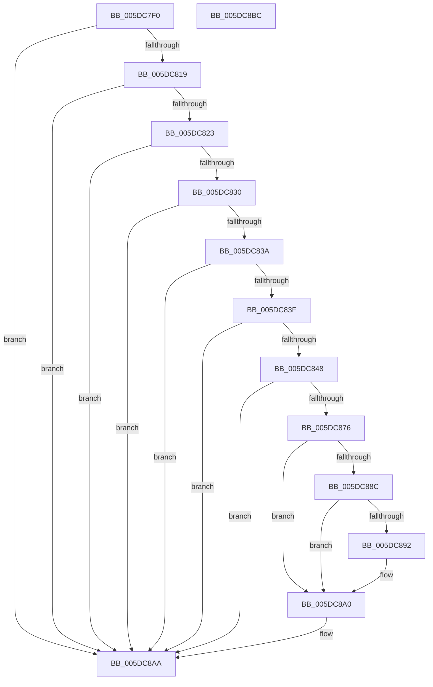

# PopEmUpdateDeviceConstraintCallback

- RVA: `0x005DC7F0`–`0x005DC8BD` (길이 `205` bytes)
- VA: `0x00000001405DC7F0`
- 실행 섹션: `.text`
- PDB 이름 있음: `예`; PDB Function 태그: `아니요`
- unwind 정보 RVA: `0x0007F83C`
- 디코드: `58`개 명령, `205/205` bytes 표시
- 미해석 바이트: `0` (있으면 어셈블리에 `.byte`로 보존)

> 이 문서는 커널 이미지의 기계어와 PDB 기호를 분석해 생성했습니다. 4번과 5번은 함수 원형과 자료형을 바이너리 사용 방식에서 추정한 C 해석이며 원본 소스 복구 결과는 아닙니다.

## 1. Dependencies

- 직접 호출 지점: **4**; 고유 호출 대상: **4**
- 직접 호출자로 확인된 함수: **0**
- RIP 상대 이미지 참조: **0**

### Outgoing calls
- `0x005DC85B` → [RtlInitAnsiString](../47/RtlInitAnsiString_function_00470F40.md) (function, `0x00470F40`)
- `0x005DC86D` → [RtlAnsiStringToUnicodeString](../../page/90/RtlAnsiStringToUnicodeString_function_0090BEA0.md) (function, `0x0090BEA0`)
- `0x005DC883` → [RtlEqualUnicodeString](../../page/93/RtlEqualUnicodeString_function_00932A20.md) (function, `0x00932A20`)
- `0x005DC8A5` → [RtlFreeAnsiString](../../page/9C/RtlFreeAnsiString_function_009C0800.md) (function, `0x009C0800`)

### Direct callers
- 이 함수 시작 RVA로 연결되는 직접 call은 확인되지 않았습니다. 간접 호출은 완전히 역산할 수 없습니다.

### Static image references
- 디코드된 RIP-relative 메모리 참조가 없습니다.

## 2. Other-region calls and transfers

- 다른 실행 섹션으로 향하는 call: **3**
  - `0x005DC86D` → [RtlAnsiStringToUnicodeString](../../page/90/RtlAnsiStringToUnicodeString_function_0090BEA0.md) (`.text` → `PAGE`)
  - `0x005DC883` → [RtlEqualUnicodeString](../../page/93/RtlEqualUnicodeString_function_00932A20.md) (`.text` → `PAGE`)
  - `0x005DC8A5` → [RtlFreeAnsiString](../../page/9C/RtlFreeAnsiString_function_009C0800.md) (`.text` → `PAGE`)
- 별도 외부 분기/꼬리 이동을 확인하지 못했습니다.

## 3. Assembly (complete function range)

```asm
005DC7F0  48 8B C4                        mov rax, rsp
005DC7F3  48 89 58 08                     mov qword ptr [rax + 8], rbx
005DC7F7  48 89 70 10                     mov qword ptr [rax + 0x10], rsi
005DC7FB  57                              push rdi
005DC7FC  48 83 EC 50                     sub rsp, 0x50
005DC800  33 DB                           xor ebx, ebx
005DC802  0F 57 C0                        xorps xmm0, xmm0
005DC805  0F 57 C9                        xorps xmm1, xmm1
005DC808  0F 11 40 D8                     movups xmmword ptr [rax - 0x28], xmm0
005DC80C  0F 11 48 C8                     movups xmmword ptr [rax - 0x38], xmm1
005DC810  4D 85 C0                        test r8, r8
005DC813  0F 84 91 00 00 00               je 0x1405dc8aa
005DC819  41 83 F9 01                     cmp r9d, 1
005DC81D  0F 85 87 00 00 00               jne 0x1405dc8aa
005DC823  48 8B BC 24 80 00 00 00         mov rdi, qword ptr [rsp + 0x80]
005DC82B  48 85 FF                        test rdi, rdi
005DC82E  74 7A                           je 0x1405dc8aa
005DC830  83 BC 24 88 00 00 00 02         cmp dword ptr [rsp + 0x88], 2
005DC838  75 70                           jne 0x1405dc8aa
005DC83A  41 3B D1                        cmp edx, r9d
005DC83D  75 6B                           jne 0x1405dc8aa
005DC83F  48 8B 31                        mov rsi, qword ptr [rcx]
005DC842  83 7E 08 08                     cmp dword ptr [rsi + 8], 8
005DC846  75 62                           jne 0x1405dc8aa
005DC848  48 8B 36                        mov rsi, qword ptr [rsi]
005DC84B  48 8D 48 D8                     lea rcx, [rax - 0x28]
005DC84F  49 8B 10                        mov rdx, qword ptr [r8]
005DC852  0F 10 46 08                     movups xmm0, xmmword ptr [rsi + 8]
005DC856  F3 0F 7F 40 E8                  movdqu xmmword ptr [rax - 0x18], xmm0
005DC85B  E8 E0 46 E9 FF                  call 0x140470f40
005DC860  41 B0 01                        mov r8b, 1
005DC863  48 8D 54 24 30                  lea rdx, [rsp + 0x30]
005DC868  48 8D 4C 24 20                  lea rcx, [rsp + 0x20]
005DC86D  E8 2E F6 32 00                  call 0x14090bea0
005DC872  85 C0                           test eax, eax
005DC874  78 34                           js 0x1405dc8aa
005DC876  41 B0 01                        mov r8b, 1
005DC879  48 8D 54 24 20                  lea rdx, [rsp + 0x20]
005DC87E  48 8D 4C 24 40                  lea rcx, [rsp + 0x40]
005DC883  E8 98 61 35 00                  call 0x140932a20
005DC888  84 C0                           test al, al
005DC88A  74 14                           je 0x1405dc8a0
005DC88C  8B 06                           mov eax, dword ptr [rsi]
005DC88E  3B 07                           cmp eax, dword ptr [rdi]
005DC890  75 0E                           jne 0x1405dc8a0
005DC892  8B 4F 04                        mov ecx, dword ptr [rdi + 4]
005DC895  BB 02 00 00 00                  mov ebx, 2
005DC89A  FF C1                           inc ecx
005DC89C  89 4C 86 18                     mov dword ptr [rsi + rax*4 + 0x18], ecx
005DC8A0  48 8D 4C 24 20                  lea rcx, [rsp + 0x20]
005DC8A5  E8 56 3F 3E 00                  call 0x1409c0800
005DC8AA  48 8B 74 24 68                  mov rsi, qword ptr [rsp + 0x68]
005DC8AF  8B C3                           mov eax, ebx
005DC8B1  48 8B 5C 24 60                  mov rbx, qword ptr [rsp + 0x60]
005DC8B6  48 83 C4 50                     add rsp, 0x50
005DC8BA  5F                              pop rdi
005DC8BB  C3                              ret
005DC8BC  CC                              int3
```

## 4. C-style interpretation (structured pseudocode)

```c
__int64 __fastcall PopEmUpdateDeviceConstraintCallback(__int64 a1, int a2, __int64 a3, int a4, __int64 a5, unsigned int a6)
{
    __int64 result;
    __int64 v_rbx;
    __int64 v_rsp;
    unsigned __int64 v_stack_m18;
    unsigned __int64 v_stack_m28;
    unsigned __int64 v_stack_m38;
    unsigned __int64 v_stack_p10;
    unsigned __int64 v_stack_p8;

    *(unsigned __int64 *)(v_rsp + 8) = v_rbx;
    *(unsigned __int64 *)(v_rsp + 16) = v_rsi;
    v_rsp = (v_rsp) - (80);
    v_rbx = 0;
    *(unsigned __int64 *)(v_rsp - 40) = v_xmm0;
    *(unsigned __int64 *)(v_rsp - 56) = v_xmm1;
    if (a3 == 0) goto loc_005DC8AA;
    if (a4 != 1) goto loc_005DC8AA;
    if (a5 == 0) goto loc_005DC8AA;
    if (a6 != 2) goto loc_005DC8AA;
    if (a2 != a4) goto loc_005DC8AA;
    if ((*(unsigned int *)(*(unsigned __int64 *)(a1) + 8)) != 8) goto loc_005DC8AA;
    *(unsigned __int64 *)(v_rsp - 24) = v_xmm0;
    result = RtlInitAnsiString(v_rsp - 40, *(unsigned __int64 *)(a3), a3, a4);
    result = RtlAnsiStringToUnicodeString(v_stack_m38, v_stack_m28, 1, a4);
    if (sign_flag) goto loc_005DC8AA;
    result = RtlEqualUnicodeString(v_stack_m18, v_stack_m38, 1, a4);
    if ((unsigned __int8)(result) == 0) goto loc_005DC8A0;
    if (((unsigned int)((unsigned int)(*(unsigned int *)(*(unsigned __int64 *)(*(unsigned __int64 *)(a1)))))) == (*(unsigned int *)(a5))) {
        a1 = *(unsigned int *)(a5 + 4);
        v_rbx = 2;
        a1 = (unsigned int)((a1) + 1);
        *(unsigned int *)(*(unsigned __int64 *)(*(unsigned __int64 *)(a1)) + (unsigned int)(*(unsigned int *)(*(unsigned __int64 *)(*(unsigned __int64 *)(a1)))) * 4 + 24) = (unsigned int)(a1);
    }
    result = RtlFreeAnsiString(v_stack_m38, v_stack_m38, 1, a4);
loc_005DC8AA:
    v_rsp = (v_rsp) + (80);
    return (unsigned int)((unsigned int)(v_rbx));
}
```

## 5. (Beta) C Style

```c
int64_t PopEmUpdateDeviceConstraintCallback(void *Arg1, int32_t Arg2, int64_t Arg3, int32_t Arg4, int64_t Arg5, uint32_t Arg6)
{
    uint8_t *arg1 = (uint8_t *)Arg1;

    int64_t result;
    int64_t local_rbx;
    int64_t local_rsp;
    uint64_t v_stack_m18;
    uint64_t v_stack_m28;
    uint64_t v_stack_m38;
    uint64_t v_stack_p10;
    uint64_t v_stack_p8;

    *(uint64_t *)(local_rsp + 0x8) = local_rbx;
    *(uint64_t *)(local_rsp + 0x10) = local_rsi;
    local_rsp = (local_rsp) - (80);
    local_rbx = 0;
    *(uint64_t *)(local_rsp - 0x28) = v_xmm0;
    *(uint64_t *)(local_rsp - 0x38) = v_xmm1;
    if (Arg3 == 0) goto loc_005DC8AA;
    if (Arg4 != 1) goto loc_005DC8AA;
    if (Arg5 == 0) goto loc_005DC8AA;
    if (Arg6 != 2) goto loc_005DC8AA;
    if (Arg2 != Arg4) goto loc_005DC8AA;
    if ((*(uint32_t *)(*(uint64_t *)(arg1) + 0x8)) != 8) goto loc_005DC8AA;
    *(uint64_t *)(local_rsp - 0x18) = v_xmm0;
    result = RtlInitAnsiString(local_rsp - 40, *(uint64_t *)(Arg3), Arg3, Arg4);
    result = RtlAnsiStringToUnicodeString(v_stack_m38, v_stack_m28, 1, Arg4);
    if (sign_flag) goto loc_005DC8AA;
    result = RtlEqualUnicodeString(v_stack_m18, v_stack_m38, 1, Arg4);
    if ((uint8_t)(result) == 0) goto loc_005DC8A0;
    if (((uint32_t)((uint32_t)(*(uint32_t *)(*(uint64_t *)(*(uint64_t *)(arg1)))))) == (*(uint32_t *)(Arg5))) {
        Arg1 = *(uint32_t *)(Arg5 + 0x4);
        local_rbx = 2;
        Arg1 = (uint32_t)((Arg1) + 1);
        *(uint32_t *)(*(uint64_t *)(*(uint64_t *)(arg1)) + (uint32_t)(*(uint32_t *)(*(uint64_t *)(*(uint64_t *)(arg1)))) * 4 + 0x18) = (uint32_t)(Arg1);
    }
    result = RtlFreeAnsiString(v_stack_m38, v_stack_m38, 1, Arg4);
loc_005DC8AA:
    local_rsp = (local_rsp) + (80);
    return (uint32_t)((uint32_t)(local_rbx));
}
```

### 관측된 메모리 오프셋

구조체 형식이 확인되지 않은 접근은 인자 기준의 오프셋으로만 기록했습니다.

| 기준 인자 | 오프셋 표현 | 폭 (bit) | 접근 |
|---|---:|---:|---|
| `Arg1` | `+ 0x0` | `64` | `R` |

## 6. Execution-region graph

[열기: 2D/3D 그래프와 함수 탐색 컨트롤 패널](../../../control-panel.html?section=text&rva=0x005DC7F0&view=graph)

- 2D 그래프는 위에서 아래로 흐르고, 3D 그래프는 빈 공간을 드래그해 회전합니다. Shift+드래그는 이동, 휠은 확대·축소, 함수 노드 선택은 대상 보고서 이동입니다.

### Static fallback


