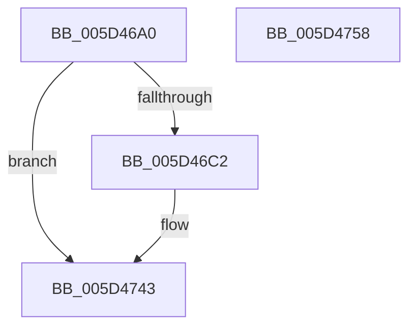

# PopEnsureErratumSubscribed

- RVA: `0x005D46A0`–`0x005D4759` (길이 `185` bytes)
- VA: `0x00000001405D46A0`
- 실행 섹션: `.text`
- PDB 이름 있음: `예`; PDB Function 태그: `아니요`
- unwind 정보 RVA: `0x000A118C`
- 디코드: `46`개 명령, `185/185` bytes 표시
- 미해석 바이트: `0` (있으면 어셈블리에 `.byte`로 보존)

> 이 문서는 커널 이미지의 기계어와 PDB 기호를 분석해 생성했습니다. 4번과 5번은 함수 원형과 자료형을 바이너리 사용 방식에서 추정한 C 해석이며 원본 소스 복구 결과는 아닙니다.

## 1. Dependencies

- 직접 호출 지점: **4**; 고유 호출 대상: **2**
- 직접 호출자로 확인된 함수: **1**
- RIP 상대 이미지 참조: **2**

### Outgoing calls
- `0x005D46EA` → [RtlpComputeCrcInternal](../45/RtlpComputeCrcInternal_function_0045A800.md) (function, `0x0045A800`)
- `0x005D46FE` → [RtlpComputeCrcInternal](../45/RtlpComputeCrcInternal_function_0045A800.md) (function, `0x0045A800`)
- `0x005D4716` → [RtlpComputeCrcInternal](../45/RtlpComputeCrcInternal_function_0045A800.md) (function, `0x0045A800`)
- `0x005D473E` → [ExSubscribeWnfStateChange](../../page/9D/ExSubscribeWnfStateChange_function_009D4BC0.md) (function, `0x009D4BC0`)

### Direct callers
- [PoRegisterPowerSettingCallback](../../page/A8/PoRegisterPowerSettingCallback_function_00A82150.md) at `0x00A823ED`

### Static image references
- `0x005D46C5` → RVA `0x0000B640` (`.rdata`; read)
- `0x005D4723` → RVA `0x005D4760` (`PopErratumUpdateCallback`; read)

## 2. Other-region calls and transfers

- 다른 실행 섹션으로 향하는 call: **1**
  - `0x005D473E` → [ExSubscribeWnfStateChange](../../page/9D/ExSubscribeWnfStateChange_function_009D4BC0.md) (`.text` → `PAGE`)
- 별도 외부 분기/꼬리 이동을 확인하지 못했습니다.

## 3. Assembly (complete function range)

```asm
005D46A0  4C 8B DC                        mov r11, rsp
005D46A3  49 89 5B 10                     mov qword ptr [r11 + 0x10], rbx
005D46A7  49 89 6B 18                     mov qword ptr [r11 + 0x18], rbp
005D46AB  49 89 73 20                     mov qword ptr [r11 + 0x20], rsi
005D46AF  57                              push rdi
005D46B0  48 83 EC 30                     sub rsp, 0x30
005D46B4  48 83 79 08 00                  cmp qword ptr [rcx + 8], 0
005D46B9  48 8B F9                        mov rdi, rcx
005D46BC  0F 85 81 00 00 00               jne 0x1405d4743
005D46C2  48 8B 19                        mov rbx, qword ptr [rcx]
005D46C5  4C 8D 0D 74 6F A3 FF            lea r9, [rip - 0x5c908c]
005D46CC  45 33 C0                        xor r8d, r8d
005D46CF  49 8D 4B 08                     lea rcx, [r11 + 8]
005D46D3  48 B8 14 00 00 00 80 F7 FF FF   movabs rax, 0xfffff78000000014
005D46DD  41 8D 68 08                     lea ebp, [r8 + 8]
005D46E1  48 8B 00                        mov rax, qword ptr [rax]
005D46E4  8B D5                           mov edx, ebp
005D46E6  49 89 43 08                     mov qword ptr [r11 + 8], rax
005D46EA  E8 11 61 E8 FF                  call 0x14045a800
005D46EF  4C 8D 0D 4A 6F A3 FF            lea r9, [rip - 0x5c90b6]
005D46F6  4C 8B C0                        mov r8, rax
005D46F9  8B D5                           mov edx, ebp
005D46FB  48 8B CB                        mov rcx, rbx
005D46FE  E8 FD 60 E8 FF                  call 0x14045a800
005D4703  4C 8D 0D 36 6F A3 FF            lea r9, [rip - 0x5c90ca]
005D470A  48 89 47 10                     mov qword ptr [rdi + 0x10], rax
005D470E  4C 8B C0                        mov r8, rax
005D4711  8B D5                           mov edx, ebp
005D4713  48 8B CB                        mov rcx, rbx
005D4716  E8 E5 60 E8 FF                  call 0x14045a800
005D471B  48 89 47 18                     mov qword ptr [rdi + 0x18], rax
005D471F  44 8D 45 F9                     lea r8d, [rbp - 7]
005D4723  48 8D 05 36 00 00 00            lea rax, [rip + 0x36]
005D472A  48 89 7C 24 28                  mov qword ptr [rsp + 0x28], rdi
005D472F  45 33 C9                        xor r9d, r9d
005D4732  48 89 44 24 20                  mov qword ptr [rsp + 0x20], rax
005D4737  48 8B D3                        mov rdx, rbx
005D473A  48 8D 4F 08                     lea rcx, [rdi + 8]
005D473E  E8 7D 04 40 00                  call 0x1409d4bc0
005D4743  48 8B 5C 24 48                  mov rbx, qword ptr [rsp + 0x48]
005D4748  48 8B 6C 24 50                  mov rbp, qword ptr [rsp + 0x50]
005D474D  48 8B 74 24 58                  mov rsi, qword ptr [rsp + 0x58]
005D4752  48 83 C4 30                     add rsp, 0x30
005D4756  5F                              pop rdi
005D4757  C3                              ret
005D4758  CC                              int3
```

## 4. C-style interpretation (structured pseudocode)

```c
__int64 __fastcall PopEnsureErratumSubscribed(__int64 a1, __int64 a2, int a3)
{
    __int64 result;
    __int64 v_rbp;
    __int64 v_rbx;
    __int64 v_rsp;
    unsigned __int64 v_stack_m10;
    unsigned __int64 v_stack_m18;
    unsigned __int64 v_stack_p10;
    unsigned __int64 v_stack_p18;
    unsigned __int64 v_stack_p20;

    *(unsigned __int64 *)(v_rsp + 16) = v_rbx;
    *(unsigned __int64 *)(v_rsp + 24) = v_rbp;
    *(unsigned __int64 *)(v_rsp + 32) = v_rsi;
    v_rsp = (v_rsp) - (48);
    if ((*(unsigned __int64 *)(a1 + 8)) == 0) {
        v_rbx = *(unsigned __int64 *)(a1);
        a4 = v_rip - 6066316;
        a3 = 0;
        a1 = v_rsp + 8;
        v_rbp = a3 + 8;
        result = *(unsigned __int64 *)(result);
        a2 = (unsigned int)(v_rbp);
        *(unsigned __int64 *)(v_rsp + 8) = result;
        result = RtlpComputeCrcInternal(a1, a2, a3, a4);
        a4 = v_rip - 6066358;
        a3 = result;
        a2 = (unsigned int)(v_rbp);
        a1 = v_rbx;
        result = RtlpComputeCrcInternal(a1, a2, a3, a4);
        a4 = v_rip - 6066378;
        *(unsigned __int64 *)(a1 + 16) = result;
        a3 = result;
        a2 = (unsigned int)(v_rbp);
        a1 = v_rbx;
        result = RtlpComputeCrcInternal(a1, a2, a3, a4);
        *(unsigned __int64 *)(a1 + 24) = result;
        a3 = v_rbp - 7;
        result = v_rip + 54;
        v_stack_m10 = a1;
        a4 = 0;
        v_stack_m18 = result;
        a2 = v_rbx;
        a1 = a1 + 8;
        result = ExSubscribeWnfStateChange(a1, a2, a3, a4);
    }
    v_rsp = (v_rsp) + (48);
    return result;
}
```

## 5. (Beta) C Style

```c
int64_t PopEnsureErratumSubscribed(void *Arg1, int64_t Arg2, int32_t Arg3)
{
    uint8_t *arg1 = (uint8_t *)Arg1;

    int64_t result;
    int64_t local_rbp;
    int64_t local_rbx;
    int64_t local_rsp;
    uint64_t v_stack_m10;
    uint64_t v_stack_m18;
    uint64_t v_stack_p10;
    uint64_t v_stack_p18;
    uint64_t v_stack_p20;

    *(uint64_t *)(local_rsp + 0x10) = local_rbx;
    *(uint64_t *)(local_rsp + 0x18) = local_rbp;
    *(uint64_t *)(local_rsp + 0x20) = local_rsi;
    local_rsp = (local_rsp) - (48);
    if ((*(uint64_t *)(arg1 + 0x8)) == 0) {
        local_rbx = *(uint64_t *)(arg1);
        a4 = v_rip - 6066316;
        Arg3 = 0;
        Arg1 = local_rsp + 8;
        local_rbp = Arg3 + 8;
        result = *(uint64_t *)(result);
        Arg2 = (uint32_t)(local_rbp);
        *(uint64_t *)(local_rsp + 0x8) = result;
        result = RtlpComputeCrcInternal(Arg1, Arg2, Arg3, a4);
        a4 = v_rip - 6066358;
        Arg3 = result;
        Arg2 = (uint32_t)(local_rbp);
        Arg1 = local_rbx;
        result = RtlpComputeCrcInternal(Arg1, Arg2, Arg3, a4);
        a4 = v_rip - 6066378;
        *(uint64_t *)(arg1 + 0x10) = result;
        Arg3 = result;
        Arg2 = (uint32_t)(local_rbp);
        Arg1 = local_rbx;
        result = RtlpComputeCrcInternal(Arg1, Arg2, Arg3, a4);
        *(uint64_t *)(arg1 + 0x18) = result;
        Arg3 = local_rbp - 7;
        result = v_rip + 54;
        v_stack_m10 = Arg1;
        a4 = 0;
        v_stack_m18 = result;
        Arg2 = local_rbx;
        Arg1 = Arg1 + 8;
        result = ExSubscribeWnfStateChange(Arg1, Arg2, Arg3, a4);
    }
    local_rsp = (local_rsp) + (48);
    return result;
}
```

### 관측된 메모리 오프셋

구조체 형식이 확인되지 않은 접근은 인자 기준의 오프셋으로만 기록했습니다.

| 기준 인자 | 오프셋 표현 | 폭 (bit) | 접근 |
|---|---:|---:|---|
| `Arg1` | `+ 0x0` | `64` | `R` |
| `Arg1` | `+ 0x8` | `64` | `R` |
| `Arg1` | `+ 0x10` | `64` | `W` |
| `Arg1` | `+ 0x18` | `64` | `W` |

## 6. Execution-region graph

[열기: 2D/3D 그래프와 함수 탐색 컨트롤 패널](../../../control-panel.html?section=text&rva=0x005D46A0&view=graph)

- 2D 그래프는 위에서 아래로 흐르고, 3D 그래프는 빈 공간을 드래그해 회전합니다. Shift+드래그는 이동, 휠은 확대·축소, 함수 노드 선택은 대상 보고서 이동입니다.

### Static fallback


