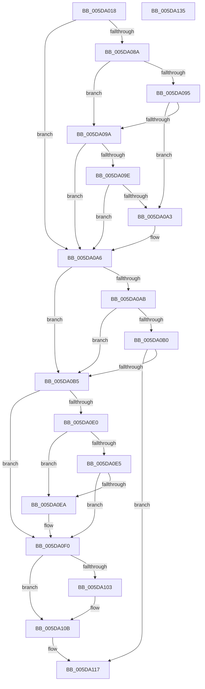

# PopEsUpdateState

- RVA: `0x005DA018`–`0x005DA136` (길이 `286` bytes)
- VA: `0x00000001405DA018`
- 실행 섹션: `.text`
- PDB 이름 있음: `예`; PDB Function 태그: `아니요`
- unwind 정보 RVA: `0x0007BBB4`
- 디코드: `84`개 명령, `286/286` bytes 표시
- 미해석 바이트: `0` (있으면 어셈블리에 `.byte`로 보존)

> 이 문서는 커널 이미지의 기계어와 PDB 기호를 분석해 생성했습니다. 4번과 5번은 함수 원형과 자료형을 바이너리 사용 방식에서 추정한 C 해석이며 원본 소스 복구 결과는 아닙니다.

## 1. Dependencies

- 직접 호출 지점: **7**; 고유 호출 대상: **7**
- 직접 호출자로 확인된 함수: **1**
- RIP 상대 이미지 참조: **8**

### Outgoing calls
- `0x005DA052` → [PopCurrentPowerState](../../page/A3/PopCurrentPowerState_function_00A356D8.md) (function, `0x00A356D8`)
- `0x005DA06E` → [PopEsEvaluateNextStateV2](../../page/AB/PopEsEvaluateNextStateV2_function_00AB414C.md) (function, `0x00AB414C`)
- `0x005DA0BA` → [PopEsSnapTelemetry](../../page/70/PopEsSnapTelemetry_function_00700BC0.md) (function, `0x00700BC0`)
- `0x005DA0C6` → [KeAcquireSpinLockRaiseToDpc](../20/KeAcquireSpinLockRaiseToDpc_function_00208470.md) (function, `0x00208470`)
- `0x005DA0F9` → [KeReleaseSpinLock](../39/KeReleaseSpinLock_function_00392BA0.md) (function, `0x00392BA0`)
- `0x005DA106` → [PopEsPublishStateV2](../../page/76/PopEsPublishStateV2_function_00769908.md) (function, `0x00769908`)
- `0x005DA112` → [PopDiagTraceEsState](PopDiagTraceEsState_function_005D65CC.md) (function, `0x005D65CC`)

### Direct callers
- [PopEsWorker](../../page/AC/PopEsWorker_function_00AC6EE0.md) at `0x00AC6F94`

### Static image references
- `0x005DA057` → RVA `0x00E67A08` (`.data`; read)
- `0x005DA062` → RVA `0x00E67A2C` (`.data`; read)
- `0x005DA0BF` → RVA `0x00F0CA58` (`.data`; read)
- `0x005DA0CB` → RVA `0x00F0C740` (`.data`; read)
- `0x005DA0D1` → RVA `0x00E67A08` (`.data`; write)
- `0x005DA0D8` → RVA `0x00E67A2C` (`.data`; write)
- `0x005DA0EA` → RVA `0x00F0C768` (`.data`; read/write)
- `0x005DA10B` → RVA `0x00E67A28` (`.data`; read)

## 2. Other-region calls and transfers

- 다른 실행 섹션으로 향하는 call: **4**
  - `0x005DA052` → [PopCurrentPowerState](../../page/A3/PopCurrentPowerState_function_00A356D8.md) (`.text` → `PAGE`)
  - `0x005DA06E` → [PopEsEvaluateNextStateV2](../../page/AB/PopEsEvaluateNextStateV2_function_00AB414C.md) (`.text` → `PAGE`)
  - `0x005DA0BA` → [PopEsSnapTelemetry](../../page/70/PopEsSnapTelemetry_function_00700BC0.md) (`.text` → `PAGE`)
  - `0x005DA106` → [PopEsPublishStateV2](../../page/76/PopEsPublishStateV2_function_00769908.md) (`.text` → `PAGE`)
- 별도 외부 분기/꼬리 이동을 확인하지 못했습니다.

## 3. Assembly (complete function range)

```asm
005DA018  48 8B C4                        mov rax, rsp
005DA01B  48 89 58 10                     mov qword ptr [rax + 0x10], rbx
005DA01F  48 89 68 18                     mov qword ptr [rax + 0x18], rbp
005DA023  48 89 70 20                     mov qword ptr [rax + 0x20], rsi
005DA027  57                              push rdi
005DA028  41 54                           push r12
005DA02A  41 55                           push r13
005DA02C  41 56                           push r14
005DA02E  41 57                           push r15
005DA030  48 83 EC 40                     sub rsp, 0x40
005DA034  33 ED                           xor ebp, ebp
005DA036  0F 57 C0                        xorps xmm0, xmm0
005DA039  44 8A E1                        mov r12b, cl
005DA03C  89 68 08                        mov dword ptr [rax + 8], ebp
005DA03F  48 8D 48 B8                     lea rcx, [rax - 0x48]
005DA043  40 8A FD                        mov dil, bpl
005DA046  0F 11 40 B8                     movups xmmword ptr [rax - 0x48], xmm0
005DA04A  44 8D 7D 01                     lea r15d, [rbp + 1]
005DA04E  0F 11 40 C8                     movups xmmword ptr [rax - 0x38], xmm0
005DA052  E8 81 B6 45 00                  call 0x140a356d8
005DA057  8B 1D AB D9 88 00               mov ebx, dword ptr [rip + 0x88d9ab]
005DA05D  48 8D 54 24 70                  lea rdx, [rsp + 0x70]
005DA062  44 8B 35 C3 D9 88 00            mov r14d, dword ptr [rip + 0x88d9c3]
005DA069  48 8D 4C 24 20                  lea rcx, [rsp + 0x20]
005DA06E  E8 D9 A0 4D 00                  call 0x140ab414c
005DA073  44 8B 6C 24 70                  mov r13d, dword ptr [rsp + 0x70]
005DA078  8B F0                           mov esi, eax
005DA07A  44 3B EB                        cmp r13d, ebx
005DA07D  41 8B C7                        mov eax, r15d
005DA080  0F 45 E8                        cmovne ebp, eax
005DA083  33 DB                           xor ebx, ebx
005DA085  41 3B F6                        cmp esi, r14d
005DA088  74 1C                           je 0x1405da0a6
005DA08A  40 8A F8                        mov dil, al
005DA08D  41 8D 47 7F                     lea eax, [r15 + 0x7f]
005DA091  3B F0                           cmp esi, eax
005DA093  75 05                           jne 0x1405da09a
005DA095  45 85 F6                        test r14d, r14d
005DA098  74 09                           je 0x1405da0a3
005DA09A  85 F6                           test esi, esi
005DA09C  75 08                           jne 0x1405da0a6
005DA09E  44 3B F0                        cmp r14d, eax
005DA0A1  75 03                           jne 0x1405da0a6
005DA0A3  44 8A FB                        mov r15b, bl
005DA0A6  45 84 E4                        test r12b, r12b
005DA0A9  75 0A                           jne 0x1405da0b5
005DA0AB  40 84 FF                        test dil, dil
005DA0AE  75 05                           jne 0x1405da0b5
005DA0B0  40 84 ED                        test bpl, bpl
005DA0B3  74 62                           je 0x1405da117
005DA0B5  48 8D 4C 24 20                  lea rcx, [rsp + 0x20]
005DA0BA  E8 01 6B 12 00                  call 0x140700bc0
005DA0BF  48 8D 0D 92 29 93 00            lea rcx, [rip + 0x932992]
005DA0C6  E8 A5 E3 C2 FF                  call 0x140208470
005DA0CB  38 1D 6F 26 93 00               cmp byte ptr [rip + 0x93266f], bl
005DA0D1  44 89 2D 30 D9 88 00            mov dword ptr [rip + 0x88d930], r13d
005DA0D8  89 35 4E D9 88 00               mov dword ptr [rip + 0x88d94e], esi
005DA0DE  74 10                           je 0x1405da0f0
005DA0E0  40 84 FF                        test dil, dil
005DA0E3  75 05                           jne 0x1405da0ea
005DA0E5  40 84 ED                        test bpl, bpl
005DA0E8  74 06                           je 0x1405da0f0
005DA0EA  FF 05 78 26 93 00               inc dword ptr [rip + 0x932678]
005DA0F0  8A D0                           mov dl, al
005DA0F2  48 8D 0D 5F 29 93 00            lea rcx, [rip + 0x93295f]
005DA0F9  E8 A2 8A DB FF                  call 0x140392ba0
005DA0FE  40 84 FF                        test dil, dil
005DA101  74 08                           je 0x1405da10b
005DA103  41 8A CF                        mov cl, r15b
005DA106  E8 FD F7 18 00                  call 0x140769908
005DA10B  48 8D 0D 16 D9 88 00            lea rcx, [rip + 0x88d916]
005DA112  E8 B5 C4 FF FF                  call 0x1405d65cc
005DA117  4C 8D 5C 24 40                  lea r11, [rsp + 0x40]
005DA11C  49 8B 5B 38                     mov rbx, qword ptr [r11 + 0x38]
005DA120  49 8B 6B 40                     mov rbp, qword ptr [r11 + 0x40]
005DA124  49 8B 73 48                     mov rsi, qword ptr [r11 + 0x48]
005DA128  49 8B E3                        mov rsp, r11
005DA12B  41 5F                           pop r15
005DA12D  41 5E                           pop r14
005DA12F  41 5D                           pop r13
005DA131  41 5C                           pop r12
005DA133  5F                              pop rdi
005DA134  C3                              ret
005DA135  CC                              int3
```

## 4. C-style interpretation (structured pseudocode)

```c
__int64 __fastcall PopEsUpdateState(unsigned __int8 a1)
{
    __int64 result;
    __int64 v_r15;
    __int64 v_rbp;
    __int64 v_rbx;
    __int64 v_rsp;
    unsigned __int64 v_stack_m28;
    unsigned __int64 v_stack_m48;
    unsigned __int64 v_stack_p8;

    *(unsigned __int64 *)(v_rsp + 16) = v_rbx;
    *(unsigned __int64 *)(v_rsp + 24) = v_rbp;
    *(unsigned __int64 *)(v_rsp + 32) = v_rsi;
    v_rsp = (v_rsp) - (64);
    v_rbp = 0;
    *(unsigned int *)(v_rsp + 8) = 0;
    *(unsigned __int64 *)(v_rsp - 72) = v_xmm0;
    *(unsigned __int64 *)(v_rsp - 56) = v_xmm0;
    result = PopCurrentPowerState(v_rsp - 72, a2, a3, a4);
    result = PopEsEvaluateNextStateV2(v_stack_m48, v_stack_p8, a3, a4);
    if (((unsigned int)((unsigned int)(v_stack_p8))) != ((unsigned int)((unsigned int)(*(unsigned int *)(v_rip + 8968619))))) { v_rbp = (unsigned int)((unsigned int)((unsigned int)(v_rbp + 1))); }
    v_rbx = 0;
    if (((unsigned int)((unsigned int)((unsigned int)(result)))) == ((unsigned int)((unsigned int)(*(unsigned int *)(v_rip + 8968643))))) goto loc_005DA0A6;
    if (((unsigned int)((unsigned int)((unsigned int)(result)))) != ((unsigned int)(v_rbp + 1 + 127))) goto loc_005DA09A;
    if ((unsigned int)((unsigned int)(*(unsigned int *)(v_rip + 8968643))) == 0) goto loc_005DA0A3;
loc_005DA09A:
    if ((unsigned int)((unsigned int)((unsigned int)(result))) != 0) goto loc_005DA0A6;
    v_r15 = v_rbp + 1;
    if (((unsigned int)((unsigned int)(*(unsigned int *)(v_rip + 8968643)))) == ((unsigned int)(v_rbp + 1 + 127))) {
        v_r15 = 0;
    }
    if (a1 != 0) goto loc_005DA0B5;
    if ((unsigned __int8)((unsigned __int8)((unsigned int)((unsigned int)(v_rbp + 1)))) != 0) goto loc_005DA0B5;
    if ((unsigned __int8)(v_rbp) == 0) goto loc_005DA117;
loc_005DA0B5:
    result = PopEsSnapTelemetry(v_stack_m48, v_stack_p8, a3, a4);
    result = KeAcquireSpinLockRaiseToDpc(v_rip + 9644434, v_stack_p8, a3, a4);
    *(unsigned int *)(v_rip + 8968496) = (unsigned int)((unsigned int)(v_stack_p8));
    *(unsigned int *)(v_rip + 8968526) = (unsigned int)((unsigned int)((unsigned int)(result)));
    if ((*(unsigned __int8 *)(v_rip + 9643631)) == 0) goto loc_005DA0F0;
    if ((unsigned __int8)((unsigned __int8)((unsigned int)((unsigned int)(v_rbp + 1)))) != 0) goto loc_005DA0EA;
    if ((unsigned __int8)(v_rbp) != 0) {
    }
    result = KeReleaseSpinLock(v_rip + 9644383, (unsigned __int8)(result), a3, a4);
    if ((unsigned __int8)((unsigned __int8)((unsigned int)((unsigned int)(v_rbp + 1)))) != 0) {
        a1 = (unsigned __int8)(v_r15);
        result = PopEsPublishStateV2(a1, (unsigned __int8)(result), a3, a4);
    }
    result = PopDiagTraceEsState(v_rip + 8968470, (unsigned __int8)(result), a3, a4);
loc_005DA117:
    return result;
}
```

## 5. (Beta) C Style

```c
int64_t PopEsUpdateState(uint8_t Arg1)
{
    int64_t result;
    int64_t local_r15;
    int64_t local_rbp;
    int64_t local_rbx;
    int64_t local_rsp;
    uint64_t v_stack_m28;
    uint64_t v_stack_m48;
    uint64_t v_stack_p8;

    *(uint64_t *)(local_rsp + 0x10) = local_rbx;
    *(uint64_t *)(local_rsp + 0x18) = local_rbp;
    *(uint64_t *)(local_rsp + 0x20) = local_rsi;
    local_rsp = (local_rsp) - (64);
    local_rbp = 0;
    *(uint32_t *)(local_rsp + 0x8) = 0;
    *(uint64_t *)(local_rsp - 0x48) = v_xmm0;
    *(uint64_t *)(local_rsp - 0x38) = v_xmm0;
    result = PopCurrentPowerState(local_rsp - 72, a2, a3, a4);
    result = PopEsEvaluateNextStateV2(v_stack_m48, v_stack_p8, a3, a4);
    if (((uint32_t)((uint32_t)(v_stack_p8))) != ((uint32_t)((uint32_t)(*(uint32_t *)(v_rip + 0x88D9AB))))) { local_rbp = (uint32_t)((uint32_t)((uint32_t)(local_rbp + 1))); }
    local_rbx = 0;
    if (((uint32_t)((uint32_t)((uint32_t)(result)))) == ((uint32_t)((uint32_t)(*(uint32_t *)(v_rip + 0x88D9C3))))) goto loc_005DA0A6;
    if (((uint32_t)((uint32_t)((uint32_t)(result)))) != ((uint32_t)(local_rbp + 1 + 127))) goto loc_005DA09A;
    if ((uint32_t)((uint32_t)(*(uint32_t *)(v_rip + 0x88D9C3))) == 0) goto loc_005DA0A3;
loc_005DA09A:
    if ((uint32_t)((uint32_t)((uint32_t)(result))) != 0) goto loc_005DA0A6;
    local_r15 = local_rbp + 1;
    if (((uint32_t)((uint32_t)(*(uint32_t *)(v_rip + 0x88D9C3)))) == ((uint32_t)(local_rbp + 1 + 127))) {
        local_r15 = 0;
    }
    if (Arg1 != 0) goto loc_005DA0B5;
    if ((uint8_t)((uint8_t)((uint32_t)((uint32_t)(local_rbp + 1)))) != 0) goto loc_005DA0B5;
    if ((uint8_t)(local_rbp) == 0) goto loc_005DA117;
loc_005DA0B5:
    result = PopEsSnapTelemetry(v_stack_m48, v_stack_p8, a3, a4);
    result = KeAcquireSpinLockRaiseToDpc(v_rip + 9644434, v_stack_p8, a3, a4);
    *(uint32_t *)(v_rip + 0x88D930) = (uint32_t)((uint32_t)(v_stack_p8));
    *(uint32_t *)(v_rip + 0x88D94E) = (uint32_t)((uint32_t)((uint32_t)(result)));
    if ((*(uint8_t *)(v_rip + 0x93266F)) == 0) goto loc_005DA0F0;
    if ((uint8_t)((uint8_t)((uint32_t)((uint32_t)(local_rbp + 1)))) != 0) goto loc_005DA0EA;
    if ((uint8_t)(local_rbp) != 0) {
    }
    result = KeReleaseSpinLock(v_rip + 9644383, (uint8_t)(result), a3, a4);
    if ((uint8_t)((uint8_t)((uint32_t)((uint32_t)(local_rbp + 1)))) != 0) {
        Arg1 = (uint8_t)(local_r15);
        result = PopEsPublishStateV2(Arg1, (uint8_t)(result), a3, a4);
    }
    result = PopDiagTraceEsState(v_rip + 8968470, (uint8_t)(result), a3, a4);
loc_005DA117:
    return result;
}
```

## 6. Execution-region graph

[열기: 2D/3D 그래프와 함수 탐색 컨트롤 패널](../../../control-panel.html?section=text&rva=0x005DA018&view=graph)

- 2D 그래프는 위에서 아래로 흐르고, 3D 그래프는 빈 공간을 드래그해 회전합니다. Shift+드래그는 이동, 휠은 확대·축소, 함수 노드 선택은 대상 보고서 이동입니다.

### Static fallback


