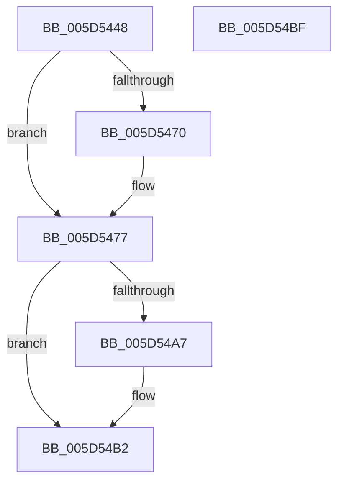

# PopFireThermalWmiEvent

- RVA: `0x005D5448`–`0x005D54C0` (길이 `120` bytes)
- VA: `0x00000001405D5448`
- 실행 섹션: `.text`
- PDB 이름 있음: `예`; PDB Function 태그: `아니요`
- unwind 정보 RVA: `0x00064C80`
- 디코드: `29`개 명령, `120/120` bytes 표시
- 미해석 바이트: `0` (있으면 어셈블리에 `.byte`로 보존)

> 이 문서는 커널 이미지의 기계어와 PDB 기호를 분석해 생성했습니다. 4번과 5번은 함수 원형과 자료형을 바이너리 사용 방식에서 추정한 C 해석이며 원본 소스 복구 결과는 아닙니다.

## 1. Dependencies

- 직접 호출 지점: **3**; 고유 호출 대상: **3**
- 직접 호출자로 확인된 함수: **1**
- RIP 상대 이미지 참조: **2**

### Outgoing calls
- `0x005D5472` → [KiRaiseIrqlProcessIrqlFlags](../4F/KiRaiseIrqlProcessIrqlFlags_function_004F56FC.md) (function, `0x004F56FC`)
- `0x005D5499` → [PpmFireWmiEvent](PpmFireWmiEvent_function_005D9678.md) (function, `0x005D9678`)
- `0x005D54AD` → [KiLowerIrqlProcessIrqlFlags](../4F/KiLowerIrqlProcessIrqlFlags_function_004F5698.md) (function, `0x004F5698`)

### Direct callers
- [PopThermalWorker](../../page/A4/PopThermalWorker_function_00A4E200.md) at `0x00A4E56A`

### Static image references
- `0x005D5467` → RVA `0x00FC6D20` (`ALMOSTRO`; read)
- `0x005D548C` → RVA `0x00024CA8` (`.rdata`; read)

## 2. Other-region calls and transfers

- 다른 실행 섹션으로 향하는 call: **0**
- 별도 외부 분기/꼬리 이동을 확인하지 못했습니다.

## 3. Assembly (complete function range)

```asm
005D5448  40 53                           push rbx
005D544A  48 83 EC 30                     sub rsp, 0x30
005D544E  0F 57 C0                        xorps xmm0, xmm0
005D5451  0F 11 44 24 20                  movups xmmword ptr [rsp + 0x20], xmm0
005D5456  88 4C 24 20                     mov byte ptr [rsp + 0x20], cl
005D545A  44 0F 20 C3                     mov rbx, cr8
005D545E  BA 02 00 00 00                  mov edx, 2
005D5463  44 0F 22 C2                     mov cr8, rdx
005D5467  83 3D B2 18 9F 00 00            cmp dword ptr [rip + 0x9f18b2], 0
005D546E  74 07                           je 0x1405d5477
005D5470  8A CB                           mov cl, bl
005D5472  E8 85 02 F2 FF                  call 0x1404f56fc
005D5477  65 48 8B 0C 25 20 00 00 00      mov rcx, qword ptr gs:[0x20]
005D5480  4C 8D 4C 24 20                  lea r9, [rsp + 0x20]
005D5485  48 81 C1 28 89 00 00            add rcx, 0x8928
005D548C  48 8D 15 15 F8 A4 FF            lea rdx, [rip - 0x5b07eb]
005D5493  41 B8 10 00 00 00               mov r8d, 0x10
005D5499  E8 DA 41 00 00                  call 0x1405d9678
005D549E  83 3D 7B 18 9F 00 00            cmp dword ptr [rip + 0x9f187b], 0
005D54A5  74 0B                           je 0x1405d54b2
005D54A7  44 0F 20 C1                     mov rcx, cr8
005D54AB  8A D3                           mov dl, bl
005D54AD  E8 E6 01 F2 FF                  call 0x1404f5698
005D54B2  0F B6 C3                        movzx eax, bl
005D54B5  44 0F 22 C0                     mov cr8, rax
005D54B9  48 83 C4 30                     add rsp, 0x30
005D54BD  5B                              pop rbx
005D54BE  C3                              ret
005D54BF  CC                              int3
```

## 4. C-style interpretation (structured pseudocode)

```c
__int64 __fastcall PopFireThermalWmiEvent(unsigned __int8 a1)
{
    __int64 result;
    __int64 v_rsp;
    unsigned __int64 v_stack_m18;

    v_rsp = (v_rsp) - (48);
    v_stack_m18 = v_xmm0;
    v_stack_m18 = a1;
    if ((*(unsigned int *)(v_rip + 10426546)) != 0) {
        a1 = (unsigned __int8)(v_cr8);
        result = KiRaiseIrqlProcessIrqlFlags(a1, 2, a3, a4);
    }
    a1 = (*(unsigned __int64 *)(gs_base + (0 + 32))) + (0x8928ULL);
    result = PpmFireWmiEvent(a1, v_rip - 5965803, 16, v_stack_m18);
    if ((*(unsigned int *)(v_rip + 10426491)) != 0) {
        a1 = 2;
        a2 = (unsigned __int8)(v_cr8);
        result = KiLowerIrqlProcessIrqlFlags(a1, a2, 16, v_stack_m18);
    }
    v_rsp = (v_rsp) + (48);
    return (unsigned __int8)(v_cr8);
}
```

## 5. (Beta) C Style

```c
int64_t PopFireThermalWmiEvent(uint8_t Arg1)
{
    int64_t result;
    int64_t local_rsp;
    uint64_t v_stack_m18;

    local_rsp = (local_rsp) - (48);
    v_stack_m18 = v_xmm0;
    v_stack_m18 = Arg1;
    if ((*(uint32_t *)(v_rip + 0x9F18B2)) != 0) {
        Arg1 = (uint8_t)(v_cr8);
        result = KiRaiseIrqlProcessIrqlFlags(Arg1, 2, a3, a4);
    }
    Arg1 = (*(uint64_t *)(gs_base + (0 + 0x20))) + (0x8928ULL);
    result = PpmFireWmiEvent(Arg1, v_rip - 5965803, 16, v_stack_m18);
    if ((*(uint32_t *)(v_rip + 0x9F187B)) != 0) {
        Arg1 = 2;
        a2 = (uint8_t)(v_cr8);
        result = KiLowerIrqlProcessIrqlFlags(Arg1, a2, 16, v_stack_m18);
    }
    local_rsp = (local_rsp) + (48);
    return (uint8_t)(v_cr8);
}
```

## 6. Execution-region graph

[열기: 2D/3D 그래프와 함수 탐색 컨트롤 패널](../../../control-panel.html?section=text&rva=0x005D5448&view=graph)

- 2D 그래프는 위에서 아래로 흐르고, 3D 그래프는 빈 공간을 드래그해 회전합니다. Shift+드래그는 이동, 휠은 확대·축소, 함수 노드 선택은 대상 보고서 이동입니다.

### Static fallback


