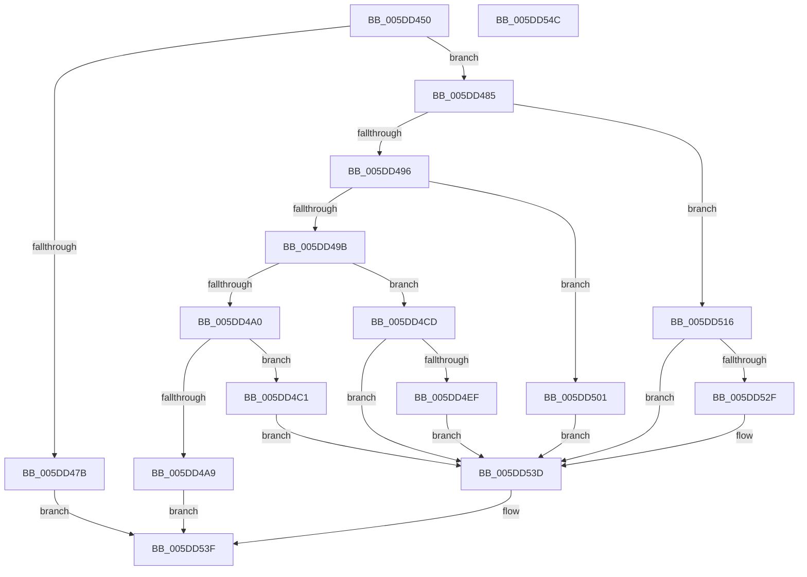

# PopFxAcpiDispatchNotification

- RVA: `0x005DD450`–`0x005DD54D` (길이 `253` bytes)
- VA: `0x00000001405DD450`
- 실행 섹션: `.text`
- PDB 이름 있음: `예`; PDB Function 태그: `아니요`
- unwind 정보 RVA: `0x000C3C24`
- 디코드: `82`개 명령, `253/253` bytes 표시
- 미해석 바이트: `0` (있으면 어셈블리에 `.byte`로 보존)

> 이 문서는 커널 이미지의 기계어와 PDB 기호를 분석해 생성했습니다. 4번과 5번은 함수 원형과 자료형을 바이너리 사용 방식에서 추정한 C 해석이며 원본 소스 복구 결과는 아닙니다.

## 1. Dependencies

- 직접 호출 지점: **6**; 고유 호출 대상: **6**
- 직접 호출자로 확인된 함수: **1**
- RIP 상대 이미지 참조: **0**

### Outgoing calls
- `0x005DD472` → [PopFxAcpiValidateParameters](../4C/PopFxAcpiValidateParameters_function_004CB824.md) (function, `0x004CB824`)
- `0x005DD4B5` → [PopFxAcpiForwardNotification](PopFxAcpiForwardNotification_function_005DD554.md) (function, `0x005DD554`)
- `0x005DD4C4` → [PopFxAcpiUnregisterDevice](PopFxAcpiUnregisterDevice_function_005DD830.md) (function, `0x005DD830`)
- `0x005DD4E4` → [PopFxAcpiRegisterDevice](PopFxAcpiRegisterDevice_function_005DD724.md) (function, `0x005DD724`)
- `0x005DD50D` → [PopPluginAcpiNotificationStrict](../5E/PopPluginAcpiNotificationStrict_function_005E1DC4.md) (function, `0x005E1DC4`)
- `0x005DD524` → [PopFxAcpiPrepareDevice](PopFxAcpiPrepareDevice_function_005DD5F4.md) (function, `0x005DD5F4`)

### Direct callers
- [PoFxPlatformRequestHandler](../4D/PoFxPlatformRequestHandler_function_004D3D00.md) at `0x004D3D33`

### Static image references
- 디코드된 RIP-relative 메모리 참조가 없습니다.

## 2. Other-region calls and transfers

- 다른 실행 섹션으로 향하는 call: **0**
- 별도 외부 분기/꼬리 이동을 확인하지 못했습니다.

## 3. Assembly (complete function range)

```asm
005DD450  40 55                           push rbp
005DD452  53                              push rbx
005DD453  57                              push rdi
005DD454  48 8B EC                        mov rbp, rsp
005DD457  48 83 EC 40                     sub rsp, 0x40
005DD45B  33 DB                           xor ebx, ebx
005DD45D  48 8B F9                        mov rdi, rcx
005DD460  48 89 5D F0                     mov qword ptr [rbp - 0x10], rbx
005DD464  48 89 5D 30                     mov qword ptr [rbp + 0x30], rbx
005DD468  48 89 5D 38                     mov qword ptr [rbp + 0x38], rbx
005DD46C  88 5D 28                        mov byte ptr [rbp + 0x28], bl
005DD46F  88 5D 20                        mov byte ptr [rbp + 0x20], bl
005DD472  E8 AD E3 EE FF                  call 0x1404cb824
005DD477  84 C0                           test al, al
005DD479  75 0A                           jne 0x1405dd485
005DD47B  B9 01 00 00 C0                  mov ecx, 0xc0000001
005DD480  E9 BA 00 00 00                  jmp 0x1405dd53f
005DD485  8B 17                           mov edx, dword ptr [rdi]
005DD487  8B C2                           mov eax, edx
005DD489  4C 8B 57 10                     mov r10, qword ptr [rdi + 0x10]
005DD48D  83 E8 01                        sub eax, 1
005DD490  0F 84 80 00 00 00               je 0x1405dd516
005DD496  83 E8 01                        sub eax, 1
005DD499  74 66                           je 0x1405dd501
005DD49B  83 E8 01                        sub eax, 1
005DD49E  74 2D                           je 0x1405dd4cd
005DD4A0  48 8B 4F 08                     mov rcx, qword ptr [rdi + 8]
005DD4A4  83 F8 01                        cmp eax, 1
005DD4A7  74 18                           je 0x1405dd4c1
005DD4A9  48 8D 45 20                     lea rax, [rbp + 0x20]
005DD4AD  4D 8B C2                        mov r8, r10
005DD4B0  48 89 44 24 20                  mov qword ptr [rsp + 0x20], rax
005DD4B5  E8 9A 00 00 00                  call 0x1405dd554
005DD4BA  8A 5D 20                        mov bl, byte ptr [rbp + 0x20]
005DD4BD  8B C8                           mov ecx, eax
005DD4BF  EB 7E                           jmp 0x1405dd53f
005DD4C1  49 8B D2                        mov rdx, r10
005DD4C4  E8 67 03 00 00                  call 0x1405dd830
005DD4C9  8B C8                           mov ecx, eax
005DD4CB  EB 70                           jmp 0x1405dd53d
005DD4CD  49 8B 0A                        mov rcx, qword ptr [r10]
005DD4D0  48 8D 45 38                     lea rax, [rbp + 0x38]
005DD4D4  48 8B 57 28                     mov rdx, qword ptr [rdi + 0x28]
005DD4D8  4C 8D 4D 30                     lea r9, [rbp + 0x30]
005DD4DC  4D 8B C2                        mov r8, r10
005DD4DF  48 89 44 24 20                  mov qword ptr [rsp + 0x20], rax
005DD4E4  E8 3B 02 00 00                  call 0x1405dd724
005DD4E9  8B C8                           mov ecx, eax
005DD4EB  85 C0                           test eax, eax
005DD4ED  78 4E                           js 0x1405dd53d
005DD4EF  48 8B 45 30                     mov rax, qword ptr [rbp + 0x30]
005DD4F3  48 89 47 30                     mov qword ptr [rdi + 0x30], rax
005DD4F7  48 8B 45 38                     mov rax, qword ptr [rbp + 0x38]
005DD4FB  48 89 47 38                     mov qword ptr [rdi + 0x38], rax
005DD4FF  EB 3C                           jmp 0x1405dd53d
005DD501  48 8B 4F 28                     mov rcx, qword ptr [rdi + 0x28]
005DD505  4D 8B C2                        mov r8, r10
005DD508  BA 02 00 00 00                  mov edx, 2
005DD50D  E8 B2 48 00 00                  call 0x1405e1dc4
005DD512  8B CB                           mov ecx, ebx
005DD514  EB 27                           jmp 0x1405dd53d
005DD516  49 8B 0A                        mov rcx, qword ptr [r10]
005DD519  4C 8D 4D 28                     lea r9, [rbp + 0x28]
005DD51D  4C 8D 45 F0                     lea r8, [rbp - 0x10]
005DD521  49 8B D2                        mov rdx, r10
005DD524  E8 CB 00 00 00                  call 0x1405dd5f4
005DD529  8B C8                           mov ecx, eax
005DD52B  85 C0                           test eax, eax
005DD52D  78 0E                           js 0x1405dd53d
005DD52F  48 8B 45 F0                     mov rax, qword ptr [rbp - 0x10]
005DD533  48 89 47 28                     mov qword ptr [rdi + 0x28], rax
005DD537  8A 45 28                        mov al, byte ptr [rbp + 0x28]
005DD53A  88 47 30                        mov byte ptr [rdi + 0x30], al
005DD53D  B3 01                           mov bl, 1
005DD53F  88 5F 20                        mov byte ptr [rdi + 0x20], bl
005DD542  8B C1                           mov eax, ecx
005DD544  48 83 C4 40                     add rsp, 0x40
005DD548  5F                              pop rdi
005DD549  5B                              pop rbx
005DD54A  5D                              pop rbp
005DD54B  C3                              ret
005DD54C  CC                              int3
```

## 4. C-style interpretation (structured pseudocode)

```c
__int64 __fastcall PopFxAcpiDispatchNotification(__int64 a1)
{
    __int64 result;
    __int64 v_rbx;
    __int64 v_rsp;
    unsigned __int64 v_stack_m28;
    unsigned __int64 v_stack_m38;
    unsigned __int8 v_stack_p10;
    unsigned __int64 v_stack_p18;
    unsigned __int64 v_stack_p20;
    unsigned __int8 v_stack_p8;

    v_rsp = (v_rsp) - (64);
    v_rbx = 0;
    v_stack_m28 = 0;
    v_stack_p18 = 0;
    v_stack_p20 = 0;
    v_stack_p10 = 0;
    v_stack_p8 = 0;
    result = PopFxAcpiValidateParameters(a1, a2, a3, a4);
    if ((unsigned __int8)(result) != 0) goto loc_005DD485;
    goto loc_005DD53F;
loc_005DD485:
    result = (unsigned int)(((unsigned int)((unsigned int)((unsigned int)(*(unsigned int *)(a1))))) - (1));
    if (condition_is_equal) goto loc_005DD516;
    result = (unsigned int)((result) - (1));
    if (condition_is_equal) goto loc_005DD501;
    result = (unsigned int)((result) - (1));
    if (condition_is_equal) goto loc_005DD4CD;
    if (((unsigned int)(result)) == 1) goto loc_005DD4C1;
    v_stack_m38 = v_stack_p8;
    result = PopFxAcpiForwardNotification(*(unsigned __int64 *)(a1 + 8), (unsigned int)(*(unsigned int *)(a1)), *(unsigned __int64 *)(a1 + 16), a4);
    goto loc_005DD53F;
loc_005DD4C1:
    result = PopFxAcpiUnregisterDevice((unsigned int)((unsigned int)(result)), *(unsigned __int64 *)(a1 + 16), *(unsigned __int64 *)(a1 + 16), a4);
    goto loc_005DD53D;
loc_005DD4CD:
    v_stack_m38 = v_stack_p20;
    result = PopFxAcpiRegisterDevice(*(unsigned __int64 *)(*(unsigned __int64 *)(a1 + 16)), *(unsigned __int64 *)(a1 + 40), *(unsigned __int64 *)(a1 + 16), v_stack_p18);
    if (sign_flag) goto loc_005DD53D;
    *(unsigned __int64 *)(a1 + 48) = v_stack_p18;
    *(unsigned __int64 *)(a1 + 56) = v_stack_p20;
    goto loc_005DD53D;
loc_005DD501:
    result = PopPluginAcpiNotificationStrict(*(unsigned __int64 *)(a1 + 40), 2, *(unsigned __int64 *)(a1 + 16), v_stack_p18);
    goto loc_005DD53D;
loc_005DD516:
    result = PopFxAcpiPrepareDevice(*(unsigned __int64 *)(*(unsigned __int64 *)(a1 + 16)), *(unsigned __int64 *)(a1 + 16), v_stack_m28, v_stack_p10);
    if (!(sign_flag)) {
        result = v_stack_m28;
        *(unsigned __int64 *)(a1 + 40) = result;
        result = v_stack_p10;
        *(unsigned __int8 *)(a1 + 48) = (unsigned __int8)(result);
    }
loc_005DD53F:
    *(unsigned __int8 *)(a1 + 32) = 1;
    v_rsp = (v_rsp) + (64);
    return (unsigned int)((unsigned int)((unsigned int)((unsigned int)(result))));
}
```

## 5. (Beta) C Style

```c
int64_t PopFxAcpiDispatchNotification(void *Arg1)
{
    uint8_t *arg1 = (uint8_t *)Arg1;

    int64_t result;
    int64_t local_rbx;
    int64_t local_rsp;
    uint64_t v_stack_m28;
    uint64_t v_stack_m38;
    uint8_t v_stack_p10;
    uint64_t v_stack_p18;
    uint64_t v_stack_p20;
    uint8_t v_stack_p8;

    local_rsp = (local_rsp) - (64);
    local_rbx = 0;
    v_stack_m28 = 0;
    v_stack_p18 = 0;
    v_stack_p20 = 0;
    v_stack_p10 = 0;
    v_stack_p8 = 0;
    result = PopFxAcpiValidateParameters(Arg1, a2, a3, a4);
    if ((uint8_t)(result) != 0) goto loc_005DD485;
    goto loc_005DD53F;
loc_005DD485:
    result = (uint32_t)(((uint32_t)((uint32_t)((uint32_t)(*(uint32_t *)(arg1))))) - (1));
    if (condition_is_equal) goto loc_005DD516;
    result = (uint32_t)((result) - (1));
    if (condition_is_equal) goto loc_005DD501;
    result = (uint32_t)((result) - (1));
    if (condition_is_equal) goto loc_005DD4CD;
    if (((uint32_t)(result)) == 1) goto loc_005DD4C1;
    v_stack_m38 = v_stack_p8;
    result = PopFxAcpiForwardNotification(*(uint64_t *)(arg1 + 0x8), (uint32_t)(*(uint32_t *)(arg1)), *(uint64_t *)(arg1 + 0x10), a4);
    goto loc_005DD53F;
loc_005DD4C1:
    result = PopFxAcpiUnregisterDevice((uint32_t)((uint32_t)(result)), *(uint64_t *)(arg1 + 0x10), *(uint64_t *)(arg1 + 0x10), a4);
    goto loc_005DD53D;
loc_005DD4CD:
    v_stack_m38 = v_stack_p20;
    result = PopFxAcpiRegisterDevice(*(uint64_t *)(*(uint64_t *)(arg1 + 0x10)), *(uint64_t *)(arg1 + 0x28), *(uint64_t *)(arg1 + 0x10), v_stack_p18);
    if (sign_flag) goto loc_005DD53D;
    *(uint64_t *)(arg1 + 0x30) = v_stack_p18;
    *(uint64_t *)(arg1 + 0x38) = v_stack_p20;
    goto loc_005DD53D;
loc_005DD501:
    result = PopPluginAcpiNotificationStrict(*(uint64_t *)(arg1 + 0x28), 2, *(uint64_t *)(arg1 + 0x10), v_stack_p18);
    goto loc_005DD53D;
loc_005DD516:
    result = PopFxAcpiPrepareDevice(*(uint64_t *)(*(uint64_t *)(arg1 + 0x10)), *(uint64_t *)(arg1 + 0x10), v_stack_m28, v_stack_p10);
    if (!(sign_flag)) {
        result = v_stack_m28;
        *(uint64_t *)(arg1 + 0x28) = result;
        result = v_stack_p10;
        *(uint8_t *)(arg1 + 0x30) = (uint8_t)(result);
    }
loc_005DD53F:
    *(uint8_t *)(arg1 + 0x20) = 1;
    local_rsp = (local_rsp) + (64);
    return (uint32_t)((uint32_t)((uint32_t)((uint32_t)(result))));
}
```

### 관측된 메모리 오프셋

구조체 형식이 확인되지 않은 접근은 인자 기준의 오프셋으로만 기록했습니다.

| 기준 인자 | 오프셋 표현 | 폭 (bit) | 접근 |
|---|---:|---:|---|
| `Arg1` | `+ 0x0` | `32` | `R` |
| `Arg1` | `+ 0x8` | `64` | `R` |
| `Arg1` | `+ 0x10` | `64` | `R` |
| `Arg1` | `+ 0x20` | `8` | `W` |
| `Arg1` | `+ 0x28` | `64` | `R` |
| `Arg1` | `+ 0x28` | `64` | `W` |
| `Arg1` | `+ 0x30` | `8` | `W` |
| `Arg1` | `+ 0x30` | `64` | `W` |
| `Arg1` | `+ 0x38` | `64` | `W` |

## 6. Execution-region graph

[열기: 2D/3D 그래프와 함수 탐색 컨트롤 패널](../../../control-panel.html?section=text&rva=0x005DD450&view=graph)

- 2D 그래프는 위에서 아래로 흐르고, 3D 그래프는 빈 공간을 드래그해 회전합니다. Shift+드래그는 이동, 휠은 확대·축소, 함수 노드 선택은 대상 보고서 이동입니다.

### Static fallback


