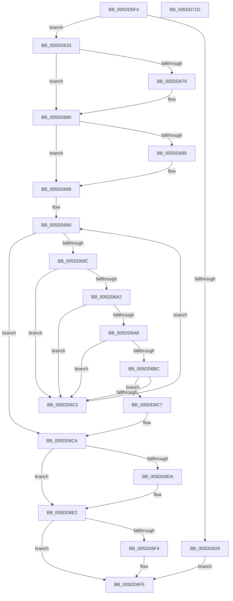

# PopFxAcpiPrepareDevice

- RVA: `0x005DD5F4`–`0x005DD71E` (길이 `298` bytes)
- VA: `0x00000001405DD5F4`
- 실행 섹션: `.text`
- PDB 이름 있음: `예`; PDB Function 태그: `아니요`
- unwind 정보 RVA: `0x0008C20C`
- 디코드: `86`개 명령, `298/298` bytes 표시
- 미해석 바이트: `0` (있으면 어셈블리에 `.byte`로 보존)

> 이 문서는 커널 이미지의 기계어와 PDB 기호를 분석해 생성했습니다. 4번과 5번은 함수 원형과 자료형을 바이너리 사용 방식에서 추정한 C 해석이며 원본 소스 복구 결과는 아닙니다.

## 1. Dependencies

- 직접 호출 지점: **7**; 고유 호출 대상: **7**
- 직접 호출자로 확인된 함수: **1**
- RIP 상대 이미지 참조: **2**

### Outgoing calls
- `0x005DD61B` → [PopFxFindAcpiDeviceByUniqueId](../4C/PopFxFindAcpiDeviceByUniqueId_function_004C5C30.md) (function, `0x004C5C30`)
- `0x005DD656` → [KeAbPreAcquire](../21/KeAbPreAcquire_function_00210230.md) (function, `0x00210230`)
- `0x005DD67B` → [ExfAcquirePushLockSharedEx](../21/ExfAcquirePushLockSharedEx_function_0021044C.md) (function, `0x0021044C`)
- `0x005DD6B3` → [PopPluginAcpiNotificationStrict](../5E/PopPluginAcpiNotificationStrict_function_005E1DC4.md) (function, `0x005E1DC4`)
- `0x005DD6DD` → [ExfReleasePushLockShared](../26/ExfReleasePushLockShared_function_00263440.md) (function, `0x00263440`)
- `0x005DD6E5` → [KeAbPostRelease](../2E/KeAbPostRelease_function_002E1600.md) (function, `0x002E1600`)
- `0x005DD6EA` → [KeLeaveCriticalRegion](../25/KeLeaveCriticalRegion_function_0025D8B0.md) (function, `0x0025D8B0`)

### Direct callers
- [PopFxAcpiDispatchNotification](PopFxAcpiDispatchNotification_function_005DD450.md) at `0x005DD524`

### Static image references
- `0x005DD63C` → RVA `0x00F0E428` (`.data`; read)
- `0x005DD689` → RVA `0x00F0E410` (`.data`; read)

## 2. Other-region calls and transfers

- 다른 실행 섹션으로 향하는 call: **0**
- 별도 외부 분기/꼬리 이동을 확인하지 못했습니다.

## 3. Assembly (complete function range)

```asm
005DD5F4  48 89 5C 24 08                  mov qword ptr [rsp + 8], rbx
005DD5F9  48 89 6C 24 10                  mov qword ptr [rsp + 0x10], rbp
005DD5FE  48 89 74 24 18                  mov qword ptr [rsp + 0x18], rsi
005DD603  57                              push rdi
005DD604  41 54                           push r12
005DD606  41 55                           push r13
005DD608  41 56                           push r14
005DD60A  41 57                           push r15
005DD60C  48 83 EC 30                     sub rsp, 0x30
005DD610  48 8B EA                        mov rbp, rdx
005DD613  4D 8B F1                        mov r14, r9
005DD616  33 D2                           xor edx, edx
005DD618  4D 8B F8                        mov r15, r8
005DD61B  E8 10 86 EE FF                  call 0x1404c5c30
005DD620  45 33 E4                        xor r12d, r12d
005DD623  8B F8                           mov edi, eax
005DD625  85 C0                           test eax, eax
005DD627  78 0A                           js 0x1405dd633
005DD629  BF 01 00 00 C0                  mov edi, 0xc0000001
005DD62E  E9 CB 00 00 00                  jmp 0x1405dd6fe
005DD633  65 48 8B 04 25 88 01 00 00      mov rax, qword ptr gs:[0x188]
005DD63C  4C 8D 2D E5 0D 93 00            lea r13, [rip + 0x930de5]
005DD643  45 33 C0                        xor r8d, r8d
005DD646  33 D2                           xor edx, edx
005DD648  49 8B CD                        mov rcx, r13
005DD64B  49 8B F4                        mov rsi, r12
005DD64E  66 FF 88 E4 01 00 00            dec word ptr [rax + 0x1e4]
005DD655  90                              nop
005DD656  E8 D5 2B C3 FF                  call 0x140210230
005DD65B  48 8B D8                        mov rbx, rax
005DD65E  B9 11 00 00 00                  mov ecx, 0x11
005DD663  33 C0                           xor eax, eax
005DD665  F0 48 0F B1 0D BA 0D 93 00      lock cmpxchg qword ptr [rip + 0x930dba], rcx
005DD66E  74 10                           je 0x1405dd680
005DD670  4D 8B CD                        mov r9, r13
005DD673  4C 8B C3                        mov r8, rbx
005DD676  33 D2                           xor edx, edx
005DD678  49 8B CD                        mov rcx, r13
005DD67B  E8 CC 2D C3 FF                  call 0x14021044c
005DD680  48 85 DB                        test rbx, rbx
005DD683  74 04                           je 0x1405dd689
005DD685  C6 43 0A 01                     mov byte ptr [rbx + 0xa], 1
005DD689  48 8B 1D 80 0D 93 00            mov rbx, qword ptr [rip + 0x930d80]
005DD690  48 8D 05 79 0D 93 00            lea rax, [rip + 0x930d79]
005DD697  48 3B D8                        cmp rbx, rax
005DD69A  74 2E                           je 0x1405dd6ca
005DD69C  83 7B 10 03                     cmp dword ptr [rbx + 0x10], 3
005DD6A0  72 20                           jb 0x1405dd6c2
005DD6A2  4C 39 63 70                     cmp qword ptr [rbx + 0x70], r12
005DD6A6  74 1A                           je 0x1405dd6c2
005DD6A8  4C 8B C5                        mov r8, rbp
005DD6AB  BA 01 00 00 00                  mov edx, 1
005DD6B0  48 8B CB                        mov rcx, rbx
005DD6B3  E8 0C 47 00 00                  call 0x1405e1dc4
005DD6B8  84 C0                           test al, al
005DD6BA  74 06                           je 0x1405dd6c2
005DD6BC  44 38 65 0C                     cmp byte ptr [rbp + 0xc], r12b
005DD6C0  75 05                           jne 0x1405dd6c7
005DD6C2  48 8B 1B                        mov rbx, qword ptr [rbx]
005DD6C5  EB C9                           jmp 0x1405dd690
005DD6C7  48 8B F3                        mov rsi, rbx
005DD6CA  B8 11 00 00 00                  mov eax, 0x11
005DD6CF  F0 4C 0F B1 25 50 0D 93 00      lock cmpxchg qword ptr [rip + 0x930d50], r12
005DD6D8  74 08                           je 0x1405dd6e2
005DD6DA  49 8B CD                        mov rcx, r13
005DD6DD  E8 5E 5D C8 FF                  call 0x140263440
005DD6E2  49 8B CD                        mov rcx, r13
005DD6E5  E8 16 3F D0 FF                  call 0x1402e1600
005DD6EA  E8 C1 01 C8 FF                  call 0x14025d8b0
005DD6EF  48 85 F6                        test rsi, rsi
005DD6F2  74 0A                           je 0x1405dd6fe
005DD6F4  49 89 37                        mov qword ptr [r15], rsi
005DD6F7  41 8B FC                        mov edi, r12d
005DD6FA  41 C6 06 01                     mov byte ptr [r14], 1
005DD6FE  48 8B 5C 24 60                  mov rbx, qword ptr [rsp + 0x60]
005DD703  8B C7                           mov eax, edi
005DD705  48 8B 6C 24 68                  mov rbp, qword ptr [rsp + 0x68]
005DD70A  48 8B 74 24 70                  mov rsi, qword ptr [rsp + 0x70]
005DD70F  48 83 C4 30                     add rsp, 0x30
005DD713  41 5F                           pop r15
005DD715  41 5E                           pop r14
005DD717  41 5D                           pop r13
005DD719  41 5C                           pop r12
005DD71B  5F                              pop rdi
005DD71C  C3                              ret
005DD71D  CC                              int3
```

## 4. C-style interpretation (structured pseudocode)

```c
__int64 __fastcall PopFxAcpiPrepareDevice(__int64 a1, __int64 a2, __int64 a3, __int64 a4)
{
    __int64 result;
    __int64 v_r12;
    __int64 v_rdi;
    __int64 v_rsp;
    unsigned __int64 v_stack_p10;
    unsigned __int64 v_stack_p18;
    unsigned __int64 v_stack_p8;

    v_stack_p8 = v_rbx;
    v_stack_p10 = v_rbp;
    v_stack_p18 = v_rsi;
    v_rsp = (v_rsp) - (48);
    a2 = 0;
    result = PopFxFindAcpiDeviceByUniqueId(a1, a2, a3, a4);
    v_r12 = 0;
    if (sign_flag) goto loc_005DD633;
    goto loc_005DD6FE;
loc_005DD633:
    a3 = 0;
    a2 = 0;
    result = KeAbPreAcquire(v_rip + 9637349, a2, a3, a4);
    result = 0;
    if (!(condition_is_equal)) {
        a4 = v_rip + 9637349;
        a3 = 0;
        a2 = 0;
        a1 = v_rip + 9637349;
        result = ExfAcquirePushLockSharedEx(a1, a2, a3, a4);
    }
    if (result != 0) {
        *(unsigned __int8 *)(result + 10) = 1;
    }
loc_005DD690:
    if ((*(unsigned __int64 *)(v_rip + 9637248)) == (v_rip + 9637241)) goto loc_005DD6CA;
    if ((*(unsigned int *)(*(unsigned __int64 *)(v_rip + 9637248) + 16)) < 3) goto loc_005DD6C2;
    if ((*(unsigned __int64 *)(*(unsigned __int64 *)(v_rip + 9637248) + 112)) == 0) goto loc_005DD6C2;
    result = PopPluginAcpiNotificationStrict(*(unsigned __int64 *)(v_rip + 9637248), 1, 0, a4);
    if ((unsigned __int8)(result) == 0) goto loc_005DD6C2;
    if ((*(unsigned __int8 *)(a2 + 12)) != 0) goto loc_005DD6C7;
loc_005DD6C2:
    goto loc_005DD690;
loc_005DD6C7:
loc_005DD6CA:
    result = 17;
    if ((*(unsigned __int8 *)(a2 + 12)) != 0) {
        a1 = v_rip + 9637349;
        result = ExfReleasePushLockShared(a1, 1, 0, a4);
    }
    result = KeAbPostRelease(v_rip + 9637349, 1, 0, a4);
    result = KeLeaveCriticalRegion(v_rip + 9637349, 1, 0, a4);
    v_rdi = (unsigned int)(0xC0000001ULL);
    if (*(unsigned __int64 *)(*(unsigned __int64 *)(v_rip + 9637248)) != 0) {
        *(unsigned __int64 *)(a3) = *(unsigned __int64 *)(*(unsigned __int64 *)(v_rip + 9637248));
        v_rdi = 0;
        *(unsigned __int8 *)(a4) = 1;
    }
    v_rsp = (v_rsp) + (48);
    return (unsigned int)((unsigned int)(v_rdi));
}
```

## 5. (Beta) C Style

```c
int64_t PopFxAcpiPrepareDevice(int64_t Arg1, void *Arg2, void *Arg3, void *Arg4)
{
    uint8_t *arg2 = (uint8_t *)Arg2;
    uint8_t *arg3 = (uint8_t *)Arg3;
    uint8_t *arg4 = (uint8_t *)Arg4;

    int64_t result;
    int64_t local_r12;
    int64_t local_rdi;
    int64_t local_rsp;
    uint64_t v_stack_p10;
    uint64_t v_stack_p18;
    uint64_t v_stack_p8;

    v_stack_p8 = local_rbx;
    v_stack_p10 = local_rbp;
    v_stack_p18 = local_rsi;
    local_rsp = (local_rsp) - (48);
    Arg2 = 0;
    result = PopFxFindAcpiDeviceByUniqueId(Arg1, Arg2, Arg3, Arg4);
    local_r12 = 0;
    if (sign_flag) goto loc_005DD633;
    goto loc_005DD6FE;
loc_005DD633:
    Arg3 = 0;
    Arg2 = 0;
    result = KeAbPreAcquire(v_rip + 9637349, Arg2, Arg3, Arg4);
    result = 0;
    if (!(condition_is_equal)) {
        Arg4 = v_rip + 9637349;
        Arg3 = 0;
        Arg2 = 0;
        Arg1 = v_rip + 9637349;
        result = ExfAcquirePushLockSharedEx(Arg1, Arg2, Arg3, Arg4);
    }
    if (result != 0) {
        *(uint8_t *)(result + 0xA) = 1;
    }
loc_005DD690:
    if ((*(uint64_t *)(v_rip + 0x930D80)) == (v_rip + 9637241)) goto loc_005DD6CA;
    if ((*(uint32_t *)(*(uint64_t *)(v_rip + 0x930D80) + 0x10)) < 3) goto loc_005DD6C2;
    if ((*(uint64_t *)(*(uint64_t *)(v_rip + 0x930D80) + 0x70)) == 0) goto loc_005DD6C2;
    result = PopPluginAcpiNotificationStrict(*(uint64_t *)(v_rip + 0x930D80), 1, 0, Arg4);
    if ((uint8_t)(result) == 0) goto loc_005DD6C2;
    if ((*(uint8_t *)(arg2 + 0xC)) != 0) goto loc_005DD6C7;
loc_005DD6C2:
    goto loc_005DD690;
loc_005DD6C7:
loc_005DD6CA:
    result = 17;
    if ((*(uint8_t *)(arg2 + 0xC)) != 0) {
        Arg1 = v_rip + 9637349;
        result = ExfReleasePushLockShared(Arg1, 1, 0, Arg4);
    }
    result = KeAbPostRelease(v_rip + 9637349, 1, 0, Arg4);
    result = KeLeaveCriticalRegion(v_rip + 9637349, 1, 0, Arg4);
    local_rdi = (uint32_t)(0xC0000001ULL);
    if (*(uint64_t *)(*(uint64_t *)(v_rip + 0x930D80)) != 0) {
        *(uint64_t *)(arg3) = *(uint64_t *)(*(uint64_t *)(v_rip + 0x930D80));
        local_rdi = 0;
        *(uint8_t *)(arg4) = 1;
    }
    local_rsp = (local_rsp) + (48);
    return (uint32_t)((uint32_t)(local_rdi));
}
```

### 관측된 메모리 오프셋

구조체 형식이 확인되지 않은 접근은 인자 기준의 오프셋으로만 기록했습니다.

| 기준 인자 | 오프셋 표현 | 폭 (bit) | 접근 |
|---|---:|---:|---|
| `Arg2` | `+ 0xC` | `8` | `R` |
| `Arg3` | `+ 0x0` | `64` | `W` |
| `Arg4` | `+ 0x0` | `8` | `W` |

## 6. Execution-region graph

[열기: 2D/3D 그래프와 함수 탐색 컨트롤 패널](../../../control-panel.html?section=text&rva=0x005DD5F4&view=graph)

- 2D 그래프는 위에서 아래로 흐르고, 3D 그래프는 빈 공간을 드래그해 회전합니다. Shift+드래그는 이동, 휠은 확대·축소, 함수 노드 선택은 대상 보고서 이동입니다.

### Static fallback


