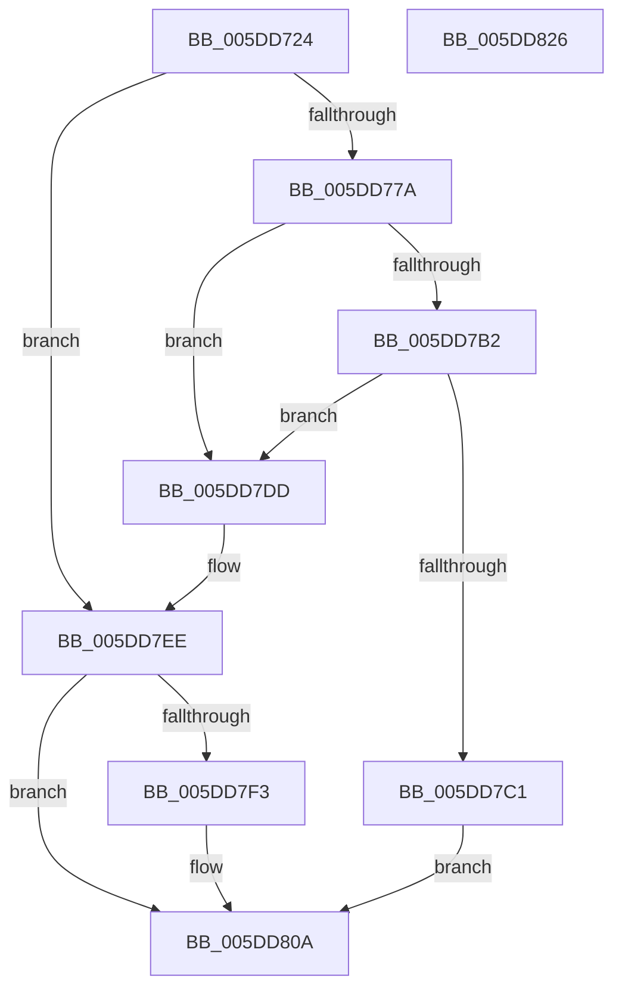

# PopFxAcpiRegisterDevice

- RVA: `0x005DD724`–`0x005DD827` (길이 `259` bytes)
- VA: `0x00000001405DD724`
- 실행 섹션: `.text`
- PDB 이름 있음: `예`; PDB Function 태그: `아니요`
- unwind 정보 RVA: `0x000991EC`
- 디코드: `73`개 명령, `259/259` bytes 표시
- 미해석 바이트: `0` (있으면 어셈블리에 `.byte`로 보존)

> 이 문서는 커널 이미지의 기계어와 PDB 기호를 분석해 생성했습니다. 4번과 5번은 함수 원형과 자료형을 바이너리 사용 방식에서 추정한 C 해석이며 원본 소스 복구 결과는 아닙니다.

## 1. Dependencies

- 직접 호출 지점: **4**; 고유 호출 대상: **4**
- 직접 호출자로 확인된 함수: **1**
- RIP 상대 이미지 참조: **0**

### Outgoing calls
- `0x005DD76B` → [PopFxCreateDeviceCommon](PopFxCreateDeviceCommon_function_005D2424.md) (function, `0x005D2424`)
- `0x005DD7A6` → [PopPluginAcpiNotificationStrict](../5E/PopPluginAcpiNotificationStrict_function_005E1DC4.md) (function, `0x005E1DC4`)
- `0x005DD7B5` → [PopFxInsertAcpiDevice](PopFxInsertAcpiDevice_function_005D2C08.md) (function, `0x005D2C08`)
- `0x005DD805` → [PopFxDestroyDeviceCommon](../4F/PopFxDestroyDeviceCommon_function_004FC26C.md) (function, `0x004FC26C`)

### Direct callers
- [PopFxAcpiDispatchNotification](PopFxAcpiDispatchNotification_function_005DD450.md) at `0x005DD4E4`

### Static image references
- 디코드된 RIP-relative 메모리 참조가 없습니다.

## 2. Other-region calls and transfers

- 다른 실행 섹션으로 향하는 call: **0**
- 별도 외부 분기/꼬리 이동을 확인하지 못했습니다.

## 3. Assembly (complete function range)

```asm
005DD724  4C 8B DC                        mov r11, rsp
005DD727  49 89 5B 08                     mov qword ptr [r11 + 8], rbx
005DD72B  49 89 73 10                     mov qword ptr [r11 + 0x10], rsi
005DD72F  49 89 7B 18                     mov qword ptr [r11 + 0x18], rdi
005DD733  55                              push rbp
005DD734  41 56                           push r14
005DD736  41 57                           push r15
005DD738  48 8B EC                        mov rbp, rsp
005DD73B  48 83 EC 60                     sub rsp, 0x60
005DD73F  33 C0                           xor eax, eax
005DD741  0F 57 C0                        xorps xmm0, xmm0
005DD744  48 21 45 D0                     and qword ptr [rbp - 0x30], rax
005DD748  49 8B F1                        mov rsi, r9
005DD74B  48 89 45 F8                     mov qword ptr [rbp - 8], rax
005DD74F  41 B9 04 00 00 00               mov r9d, 4
005DD755  48 8D 45 D0                     lea rax, [rbp - 0x30]
005DD759  4D 8B F0                        mov r14, r8
005DD75C  49 89 43 A8                     mov qword ptr [r11 - 0x58], rax
005DD760  4C 8B FA                        mov r15, rdx
005DD763  0F 11 45 D8                     movups xmmword ptr [rbp - 0x28], xmm0
005DD767  0F 11 45 E8                     movups xmmword ptr [rbp - 0x18], xmm0
005DD76B  E8 B4 4C FF FF                  call 0x1405d2424
005DD770  48 8B 5D D0                     mov rbx, qword ptr [rbp - 0x30]
005DD774  8B F8                           mov edi, eax
005DD776  85 C0                           test eax, eax
005DD778  78 74                           js 0x1405dd7ee
005DD77A  41 0F 10 06                     movups xmm0, xmmword ptr [r14]
005DD77E  4C 8D 45 D8                     lea r8, [rbp - 0x28]
005DD782  BA 03 00 00 00                  mov edx, 3
005DD787  41 0F 10 4E 10                  movups xmm1, xmmword ptr [r14 + 0x10]
005DD78C  49 8B CF                        mov rcx, r15
005DD78F  0F 11 45 D8                     movups xmmword ptr [rbp - 0x28], xmm0
005DD793  F2 41 0F 10 46 20               movsd xmm0, qword ptr [r14 + 0x20]
005DD799  0F 11 4D E8                     movups xmmword ptr [rbp - 0x18], xmm1
005DD79D  48 89 5D E8                     mov qword ptr [rbp - 0x18], rbx
005DD7A1  F2 0F 11 45 F8                  movsd qword ptr [rbp - 8], xmm0
005DD7A6  E8 19 46 00 00                  call 0x1405e1dc4
005DD7AB  48 83 7D F0 00                  cmp qword ptr [rbp - 0x10], 0
005DD7B0  74 2B                           je 0x1405dd7dd
005DD7B2  4C 8B C3                        mov r8, rbx
005DD7B5  E8 4E 54 FF FF                  call 0x1405d2c08
005DD7BA  48 83 7D F0 00                  cmp qword ptr [rbp - 0x10], 0
005DD7BF  74 1C                           je 0x1405dd7dd
005DD7C1  48 8B 4D 40                     mov rcx, qword ptr [rbp + 0x40]
005DD7C5  4C 89 7B 50                     mov qword ptr [rbx + 0x50], r15
005DD7C9  48 8B 45 F0                     mov rax, qword ptr [rbp - 0x10]
005DD7CD  48 89 43 58                     mov qword ptr [rbx + 0x58], rax
005DD7D1  48 8B 45 F0                     mov rax, qword ptr [rbp - 0x10]
005DD7D5  48 89 01                        mov qword ptr [rcx], rax
005DD7D8  48 89 1E                        mov qword ptr [rsi], rbx
005DD7DB  EB 2D                           jmp 0x1405dd80a
005DD7DD  48 8B 45 40                     mov rax, qword ptr [rbp + 0x40]
005DD7E1  BF 01 00 00 C0                  mov edi, 0xc0000001
005DD7E6  48 83 26 00                     and qword ptr [rsi], 0
005DD7EA  48 83 20 00                     and qword ptr [rax], 0
005DD7EE  48 85 DB                        test rbx, rbx
005DD7F1  74 17                           je 0x1405dd80a
005DD7F3  48 83 63 50 00                  and qword ptr [rbx + 0x50], 0
005DD7F8  BA 02 00 00 00                  mov edx, 2
005DD7FD  48 83 63 58 00                  and qword ptr [rbx + 0x58], 0
005DD802  48 8B CB                        mov rcx, rbx
005DD805  E8 62 EA F1 FF                  call 0x1404fc26c
005DD80A  4C 8D 5C 24 60                  lea r11, [rsp + 0x60]
005DD80F  8B C7                           mov eax, edi
005DD811  49 8B 5B 20                     mov rbx, qword ptr [r11 + 0x20]
005DD815  49 8B 73 28                     mov rsi, qword ptr [r11 + 0x28]
005DD819  49 8B 7B 30                     mov rdi, qword ptr [r11 + 0x30]
005DD81D  49 8B E3                        mov rsp, r11
005DD820  41 5F                           pop r15
005DD822  41 5E                           pop r14
005DD824  5D                              pop rbp
005DD825  C3                              ret
005DD826  CC                              int3
```

## 4. C-style interpretation (structured pseudocode)

```c
__int64 __fastcall PopFxAcpiRegisterDevice(__int64 a1, __int64 a2, __int64 a3, __int64 a4, __int64 a5)
{
    __int64 result;
    __int64 v_rsp;
    unsigned __int64 v_stack_m18;
    unsigned __int64 v_stack_m20;
    unsigned __int64 v_stack_m28;
    unsigned __int64 v_stack_m30;
    unsigned __int64 v_stack_m40;
    unsigned __int64 v_stack_m48;

    *(unsigned __int64 *)(v_rsp + 8) = v_rbx;
    *(unsigned __int64 *)(v_rsp + 16) = v_rsi;
    *(unsigned __int64 *)(v_rsp + 24) = v_rdi;
    v_rsp = (v_rsp) - (96);
    result = 0;
    v_stack_m20 = 0;
    *(unsigned __int64 *)(v_rsp - 88) = v_stack_m48;
    v_stack_m40 = v_xmm0;
    v_stack_m30 = v_xmm0;
    result = PopFxCreateDeviceCommon(a1, a2, a3, 4);
    if (sign_flag) goto loc_005DD7EE;
    v_stack_m40 = v_xmm0;
    v_stack_m30 = v_xmm1;
    v_stack_m30 = v_stack_m48;
    v_stack_m20 = v_xmm0;
    result = PopPluginAcpiNotificationStrict(a2, 3, v_stack_m40, 4);
    if (v_stack_m28 == 0) goto loc_005DD7DD;
    result = PopFxInsertAcpiDevice(a2, 3, v_stack_m48, 4);
    if (v_stack_m28 == 0) goto loc_005DD7DD;
    *(unsigned __int64 *)(v_stack_m48 + 80) = a2;
    *(unsigned __int64 *)(v_stack_m48 + 88) = v_stack_m28;
    *(unsigned __int64 *)(a5) = v_stack_m28;
    *(unsigned __int64 *)(a4) = v_stack_m48;
    goto loc_005DD80A;
loc_005DD7DD:
loc_005DD7EE:
    result = a5;
    if (v_stack_m48 != 0) {
        a2 = 2;
        a1 = v_stack_m48;
        result = PopFxDestroyDeviceCommon(a1, a2, v_stack_m48, 4);
    }
    return (unsigned int)((unsigned int)((unsigned int)(0xC0000001ULL)));
}
```

## 5. (Beta) C Style

```c
int64_t PopFxAcpiRegisterDevice(int64_t Arg1, int64_t Arg2, void *Arg3, void *Arg4, void *Arg5)
{
    uint8_t *arg3 = (uint8_t *)Arg3;
    uint8_t *arg4 = (uint8_t *)Arg4;
    uint8_t *arg5 = (uint8_t *)Arg5;

    int64_t result;
    int64_t local_rsp;
    uint64_t v_stack_m18;
    uint64_t v_stack_m20;
    uint64_t v_stack_m28;
    uint64_t v_stack_m30;
    uint64_t v_stack_m40;
    uint64_t v_stack_m48;

    *(uint64_t *)(local_rsp + 0x8) = local_rbx;
    *(uint64_t *)(local_rsp + 0x10) = local_rsi;
    *(uint64_t *)(local_rsp + 0x18) = local_rdi;
    local_rsp = (local_rsp) - (96);
    result = 0;
    v_stack_m20 = 0;
    *(uint64_t *)(local_rsp - 0x58) = v_stack_m48;
    v_stack_m40 = v_xmm0;
    v_stack_m30 = v_xmm0;
    result = PopFxCreateDeviceCommon(Arg1, Arg2, Arg3, 4);
    if (sign_flag) goto loc_005DD7EE;
    v_stack_m40 = v_xmm0;
    v_stack_m30 = v_xmm1;
    v_stack_m30 = v_stack_m48;
    v_stack_m20 = v_xmm0;
    result = PopPluginAcpiNotificationStrict(Arg2, 3, v_stack_m40, 4);
    if (v_stack_m28 == 0) goto loc_005DD7DD;
    result = PopFxInsertAcpiDevice(Arg2, 3, v_stack_m48, 4);
    if (v_stack_m28 == 0) goto loc_005DD7DD;
    *(uint64_t *)(v_stack_m48 + 0x50) = Arg2;
    *(uint64_t *)(v_stack_m48 + 0x58) = v_stack_m28;
    *(uint64_t *)(arg5) = v_stack_m28;
    *(uint64_t *)(arg4) = v_stack_m48;
    goto loc_005DD80A;
loc_005DD7DD:
loc_005DD7EE:
    result = Arg5;
    if (v_stack_m48 != 0) {
        Arg2 = 2;
        Arg1 = v_stack_m48;
        result = PopFxDestroyDeviceCommon(Arg1, Arg2, v_stack_m48, 4);
    }
    return (uint32_t)((uint32_t)((uint32_t)(0xC0000001ULL)));
}
```

### 관측된 메모리 오프셋

구조체 형식이 확인되지 않은 접근은 인자 기준의 오프셋으로만 기록했습니다.

| 기준 인자 | 오프셋 표현 | 폭 (bit) | 접근 |
|---|---:|---:|---|
| `Arg3` | `+ 0x0` | `128` | `R` |
| `Arg3` | `+ 0x10` | `128` | `R` |
| `Arg3` | `+ 0x20` | `64` | `R` |
| `Arg4` | `+ 0x0` | `64` | `R/W` |
| `Arg4` | `+ 0x0` | `64` | `W` |
| `Arg5` | `+ 0x0` | `64` | `R/W` |
| `Arg5` | `+ 0x0` | `64` | `W` |

## 6. Execution-region graph

[열기: 2D/3D 그래프와 함수 탐색 컨트롤 패널](../../../control-panel.html?section=text&rva=0x005DD724&view=graph)

- 2D 그래프는 위에서 아래로 흐르고, 3D 그래프는 빈 공간을 드래그해 회전합니다. Shift+드래그는 이동, 휠은 확대·축소, 함수 노드 선택은 대상 보고서 이동입니다.

### Static fallback


