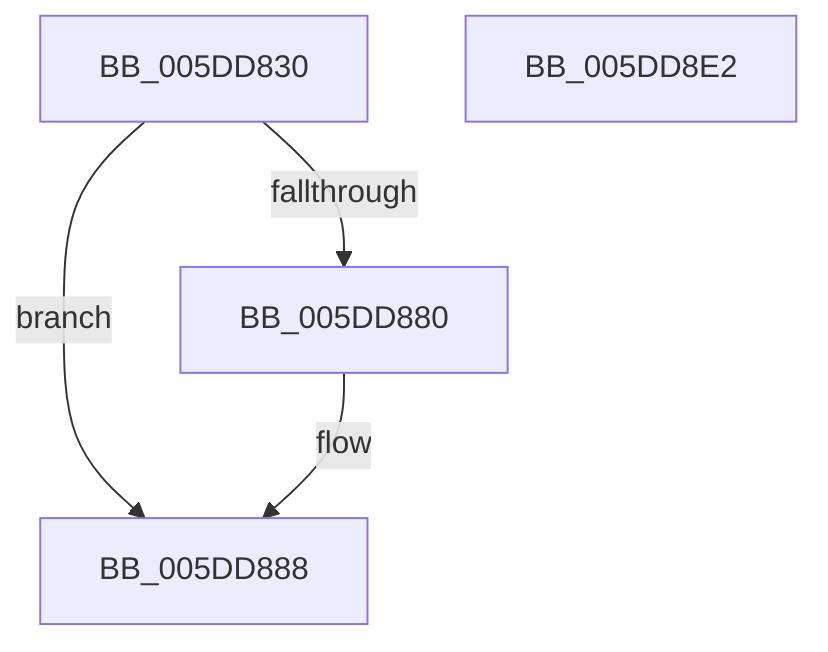

# PopFxAcpiUnregisterDevice

- RVA: `0x005DD830`–`0x005DD8E3` (길이 `179` bytes)
- VA: `0x00000001405DD830`
- 실행 섹션: `.text`
- PDB 이름 있음: `예`; PDB Function 태그: `아니요`
- unwind 정보 RVA: `0x00066400`
- 디코드: `43`개 명령, `179/179` bytes 표시
- 미해석 바이트: `0` (있으면 어셈블리에 `.byte`로 보존)

> 이 문서는 커널 이미지의 기계어와 PDB 기호를 분석해 생성했습니다. 4번과 5번은 함수 원형과 자료형을 바이너리 사용 방식에서 추정한 C 해석이며 원본 소스 복구 결과는 아닙니다.

## 1. Dependencies

- 직접 호출 지점: **5**; 고유 호출 대상: **5**
- 직접 호출자로 확인된 함수: **1**
- RIP 상대 이미지 참조: **1**

### Outgoing calls
- `0x005DD86D` → [IoAcquireRemoveLockEx](../43/IoAcquireRemoveLockEx_function_00433420.md) (function, `0x00433420`)
- `0x005DD883` → [PopFxRemoveAcpiDevice](PopFxRemoveAcpiDevice_function_005D3468.md) (function, `0x005D3468`)
- `0x005DD896` → [IoReleaseRemoveLockAndWaitEx](../4B/IoReleaseRemoveLockAndWaitEx_function_004B17B0.md) (function, `0x004B17B0`)
- `0x005DD8A7` → [PopPluginAcpiNotificationStrict](../5E/PopPluginAcpiNotificationStrict_function_005E1DC4.md) (function, `0x005E1DC4`)
- `0x005DD8C6` → [PopFxDestroyDeviceCommon](../4F/PopFxDestroyDeviceCommon_function_004FC26C.md) (function, `0x004FC26C`)

### Direct callers
- [PopFxAcpiDispatchNotification](PopFxAcpiDispatchNotification_function_005DD450.md) at `0x005DD4C4`

### Static image references
- `0x005DD855` → RVA `0x006C7800` (` ?? ::FNODOBFM::`string'`; read)

## 2. Other-region calls and transfers

- 다른 실행 섹션으로 향하는 call: **0**
- 별도 외부 분기/꼬리 이동을 확인하지 못했습니다.

## 3. Assembly (complete function range)

```asm
005DD830  48 8B C4                        mov rax, rsp
005DD833  48 89 58 08                     mov qword ptr [rax + 8], rbx
005DD837  48 89 68 10                     mov qword ptr [rax + 0x10], rbp
005DD83B  48 89 70 18                     mov qword ptr [rax + 0x18], rsi
005DD83F  57                              push rdi
005DD840  48 83 EC 30                     sub rsp, 0x30
005DD844  48 8D B9 38 01 00 00            lea rdi, [rcx + 0x138]
005DD84B  C7 40 E8 20 00 00 00            mov dword ptr [rax - 0x18], 0x20
005DD852  48 8B F2                        mov rsi, rdx
005DD855  4C 8D 05 A4 9F 0E 00            lea r8, [rip + 0xe9fa4]
005DD85C  48 8B D9                        mov rbx, rcx
005DD85F  41 B9 01 00 00 00               mov r9d, 1
005DD865  48 8B CF                        mov rcx, rdi
005DD868  BA 50 6F 46 72                  mov edx, 0x72466f50
005DD86D  E8 AE 5B E5 FF                  call 0x140433420
005DD872  4C 8D 8B C8 00 00 00            lea r9, [rbx + 0xc8]
005DD879  8B E8                           mov ebp, eax
005DD87B  4D 39 09                        cmp qword ptr [r9], r9
005DD87E  74 08                           je 0x1405dd888
005DD880  48 8B D3                        mov rdx, rbx
005DD883  E8 E0 5B FF FF                  call 0x1405d3468
005DD888  BA 50 6F 46 72                  mov edx, 0x72466f50
005DD88D  41 B8 20 00 00 00               mov r8d, 0x20
005DD893  48 8B CF                        mov rcx, rdi
005DD896  E8 15 3F ED FF                  call 0x1404b17b0
005DD89B  48 8B 4B 50                     mov rcx, qword ptr [rbx + 0x50]
005DD89F  4C 8B C6                        mov r8, rsi
005DD8A2  BA 04 00 00 00                  mov edx, 4
005DD8A7  E8 18 45 00 00                  call 0x1405e1dc4
005DD8AC  F0 83 A3 60 03 00 00 FB         lock and dword ptr [rbx + 0x360], 0xfffffffb
005DD8B4  48 83 63 50 00                  and qword ptr [rbx + 0x50], 0
005DD8B9  BA 02 00 00 00                  mov edx, 2
005DD8BE  48 83 63 58 00                  and qword ptr [rbx + 0x58], 0
005DD8C3  48 8B CB                        mov rcx, rbx
005DD8C6  E8 A1 E9 F1 FF                  call 0x1404fc26c
005DD8CB  48 8B 5C 24 40                  mov rbx, qword ptr [rsp + 0x40]
005DD8D0  8B C5                           mov eax, ebp
005DD8D2  48 8B 6C 24 48                  mov rbp, qword ptr [rsp + 0x48]
005DD8D7  48 8B 74 24 50                  mov rsi, qword ptr [rsp + 0x50]
005DD8DC  48 83 C4 30                     add rsp, 0x30
005DD8E0  5F                              pop rdi
005DD8E1  C3                              ret
005DD8E2  CC                              int3
```

## 4. C-style interpretation (structured pseudocode)

```c
__int64 __fastcall PopFxAcpiUnregisterDevice(__int64 a1, __int64 a2)
{
    __int64 result;
    __int64 v_rsp;
    unsigned __int64 v_stack_p10;
    unsigned __int64 v_stack_p18;
    unsigned __int64 v_stack_p8;

    *(unsigned __int64 *)(v_rsp + 8) = v_rbx;
    *(unsigned __int64 *)(v_rsp + 16) = v_rbp;
    *(unsigned __int64 *)(v_rsp + 24) = v_rsi;
    v_rsp = (v_rsp) - (48);
    *(unsigned int *)(v_rsp - 24) = 32;
    result = IoAcquireRemoveLockEx(a1 + 312, (unsigned int)(0x72466F50ULL), v_rip + 958372, 1);
    if ((*(unsigned __int64 *)(a1 + 200)) != (a1 + 200)) {
        a2 = a1;
        result = PopFxRemoveAcpiDevice(a1 + 312, a2, v_rip + 958372, a1 + 200);
    }
    result = IoReleaseRemoveLockAndWaitEx(a1 + 312, (unsigned int)(0x72466F50ULL), 32, a1 + 200);
    result = PopPluginAcpiNotificationStrict(*(unsigned __int64 *)(a1 + 80), 4, a2, a1 + 200);
    result = PopFxDestroyDeviceCommon(a1, 2, a2, a1 + 200);
    v_rsp = (v_rsp) + (48);
    return (unsigned int)((unsigned int)((unsigned int)((unsigned int)(result))));
}
```

## 5. (Beta) C Style

```c
int64_t PopFxAcpiUnregisterDevice(void *Arg1, int64_t Arg2)
{
    uint8_t *arg1 = (uint8_t *)Arg1;

    int64_t result;
    int64_t local_rsp;
    uint64_t v_stack_p10;
    uint64_t v_stack_p18;
    uint64_t v_stack_p8;

    *(uint64_t *)(local_rsp + 0x8) = local_rbx;
    *(uint64_t *)(local_rsp + 0x10) = local_rbp;
    *(uint64_t *)(local_rsp + 0x18) = local_rsi;
    local_rsp = (local_rsp) - (48);
    *(uint32_t *)(local_rsp - 0x18) = 32;
    result = IoAcquireRemoveLockEx(Arg1 + 312, (uint32_t)(0x72466F50ULL), v_rip + 958372, 1);
    if ((*(uint64_t *)(arg1 + 0xC8)) != (Arg1 + 200)) {
        Arg2 = Arg1;
        result = PopFxRemoveAcpiDevice(Arg1 + 312, Arg2, v_rip + 958372, Arg1 + 200);
    }
    result = IoReleaseRemoveLockAndWaitEx(Arg1 + 312, (uint32_t)(0x72466F50ULL), 32, Arg1 + 200);
    result = PopPluginAcpiNotificationStrict(*(uint64_t *)(arg1 + 0x50), 4, Arg2, Arg1 + 200);
    result = PopFxDestroyDeviceCommon(Arg1, 2, Arg2, Arg1 + 200);
    local_rsp = (local_rsp) + (48);
    return (uint32_t)((uint32_t)((uint32_t)((uint32_t)(result))));
}
```

### 관측된 메모리 오프셋

구조체 형식이 확인되지 않은 접근은 인자 기준의 오프셋으로만 기록했습니다.

| 기준 인자 | 오프셋 표현 | 폭 (bit) | 접근 |
|---|---:|---:|---|
| `Arg1` | `+ 0x0` | `64` | `R` |
| `Arg1` | `+ 0x50` | `64` | `R` |
| `Arg1` | `+ 0x50` | `64` | `R/W` |
| `Arg1` | `+ 0x58` | `64` | `R/W` |
| `Arg1` | `+ 0xC8` | `64` | `R` |
| `Arg1` | `+ 0x138` | `64` | `R` |
| `Arg1` | `+ 0x360` | `32` | `R/W` |

## 6. Execution-region graph

[열기: 2D/3D 그래프와 함수 탐색 컨트롤 패널](../../../control-panel.html?section=text&rva=0x005DD830&view=graph)

- 2D 그래프는 위에서 아래로 흐르고, 3D 그래프는 빈 공간을 드래그해 회전합니다. Shift+드래그는 이동, 휠은 확대·축소, 함수 노드 선택은 대상 보고서 이동입니다.

### Static fallback


