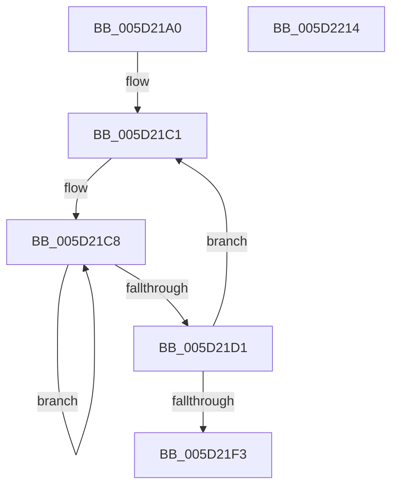

# PopFxComponentPerfWork

- RVA: `0x005D21A0`–`0x005D2215` (길이 `117` bytes)
- VA: `0x00000001405D21A0`
- 실행 섹션: `.text`
- PDB 이름 있음: `예`; PDB Function 태그: `아니요`
- unwind 정보 RVA: `0x0005C954`
- 디코드: `35`개 명령, `117/117` bytes 표시
- 미해석 바이트: `0` (있으면 어셈블리에 `.byte`로 보존)

> 이 문서는 커널 이미지의 기계어와 PDB 기호를 분석해 생성했습니다. 4번과 5번은 함수 원형과 자료형을 바이너리 사용 방식에서 추정한 C 해석이며 원본 소스 복구 결과는 아닙니다.

## 1. Dependencies

- 직접 호출 지점: **2**; 고유 호출 대상: **2**
- 직접 호출자로 확인된 함수: **0**
- RIP 상대 이미지 참조: **0**

### Outgoing calls
- `0x005D21E1` → [PopFxCompleteComponentPerfState](../4C/PopFxCompleteComponentPerfState_function_004C1750.md) (function, `0x004C1750`)
- `0x005D21FA` → [PopFxDereferenceDevice](../27/PopFxDereferenceDevice_function_0027038C.md) (function, `0x0027038C`)

### Direct callers
- 이 함수 시작 RVA로 연결되는 직접 call은 확인되지 않았습니다. 간접 호출은 완전히 역산할 수 없습니다.

### Static image references
- 디코드된 RIP-relative 메모리 참조가 없습니다.

## 2. Other-region calls and transfers

- 다른 실행 섹션으로 향하는 call: **0**
- 별도 외부 분기/꼬리 이동을 확인하지 못했습니다.

## 3. Assembly (complete function range)

```asm
005D21A0  48 89 5C 24 08                  mov qword ptr [rsp + 8], rbx
005D21A5  48 89 6C 24 10                  mov qword ptr [rsp + 0x10], rbp
005D21AA  48 89 74 24 18                  mov qword ptr [rsp + 0x18], rsi
005D21AF  57                              push rdi
005D21B0  48 83 EC 20                     sub rsp, 0x20
005D21B4  48 8B 39                        mov rdi, qword ptr [rcx]
005D21B7  48 8B D9                        mov rbx, rcx
005D21BA  8B 77 10                        mov esi, dword ptr [rdi + 0x10]
005D21BD  48 8B 6F 50                     mov rbp, qword ptr [rdi + 0x50]
005D21C1  0F 0D 4B 28                     prefetchw byte ptr [rbx + 0x28]
005D21C5  8B 43 28                        mov eax, dword ptr [rbx + 0x28]
005D21C8  8B C8                           mov ecx, eax
005D21CA  F0 0F B1 4B 28                  lock cmpxchg dword ptr [rbx + 0x28], ecx
005D21CF  75 F7                           jne 0x1405d21c8
005D21D1  C1 E8 1E                        shr eax, 0x1e
005D21D4  4C 8B C3                        mov r8, rbx
005D21D7  24 01                           and al, 1
005D21D9  8B D6                           mov edx, esi
005D21DB  44 8A C8                        mov r9b, al
005D21DE  48 8B CD                        mov rcx, rbp
005D21E1  E8 6A F5 EE FF                  call 0x1404c1750
005D21E6  83 C8 FF                        or eax, 0xffffffff
005D21E9  F0 0F C1 43 78                  lock xadd dword ptr [rbx + 0x78], eax
005D21EE  83 F8 01                        cmp eax, 1
005D21F1  75 CE                           jne 0x1405d21c1
005D21F3  48 8B 4F 50                     mov rcx, qword ptr [rdi + 0x50]
005D21F7  8D 50 03                        lea edx, [rax + 3]
005D21FA  E8 8D E1 C9 FF                  call 0x14027038c
005D21FF  48 8B 5C 24 30                  mov rbx, qword ptr [rsp + 0x30]
005D2204  48 8B 6C 24 38                  mov rbp, qword ptr [rsp + 0x38]
005D2209  48 8B 74 24 40                  mov rsi, qword ptr [rsp + 0x40]
005D220E  48 83 C4 20                     add rsp, 0x20
005D2212  5F                              pop rdi
005D2213  C3                              ret
005D2214  CC                              int3
```

## 4. C-style interpretation (structured pseudocode)

```c
__int64 __fastcall PopFxComponentPerfWork(__int64 a1)
{
    __int64 result;
    __int64 v_rsp;
    unsigned __int64 v_stack_p10;
    unsigned __int64 v_stack_p18;
    unsigned __int64 v_stack_p8;

    v_stack_p8 = v_rbx;
    v_stack_p10 = v_rbp;
    v_stack_p18 = v_rsi;
    v_rsp = (v_rsp) - (32);
loc_005D21C1:
loc_005D21C8:
    if (condition_is_not_equal) goto loc_005D21C8;
    result = (unsigned int)(((unsigned int)(*(unsigned int *)(a1 + 40))) >> (30));
    result = (unsigned __int8)((result) & (1));
    result = PopFxCompleteComponentPerfState(*(unsigned __int64 *)(*(unsigned __int64 *)(a1) + 80), (unsigned int)((unsigned int)((unsigned int)(*(unsigned int *)(*(unsigned __int64 *)(a1) + 16)))), a1, (unsigned __int8)(result));
    result = (unsigned int)((result) | (0xFFFFFFFFULL));
    if (((unsigned int)(result)) != 1) goto loc_005D21C1;
    result = PopFxDereferenceDevice(*(unsigned __int64 *)(*(unsigned __int64 *)(a1) + 80), result + 3, a1, (unsigned __int8)(result));
    v_rsp = (v_rsp) + (32);
    return result;
}
```

## 5. (Beta) C Style

```c
int64_t PopFxComponentPerfWork(void *Arg1)
{
    uint8_t *arg1 = (uint8_t *)Arg1;

    int64_t result;
    int64_t local_rsp;
    uint64_t v_stack_p10;
    uint64_t v_stack_p18;
    uint64_t v_stack_p8;

    v_stack_p8 = local_rbx;
    v_stack_p10 = local_rbp;
    v_stack_p18 = local_rsi;
    local_rsp = (local_rsp) - (32);
loc_005D21C1:
loc_005D21C8:
    if (condition_is_not_equal) goto loc_005D21C8;
    result = (uint32_t)(((uint32_t)(*(uint32_t *)(arg1 + 0x28))) >> (30));
    result = (uint8_t)((result) & (1));
    result = PopFxCompleteComponentPerfState(*(uint64_t *)(*(uint64_t *)(arg1) + 0x50), (uint32_t)((uint32_t)((uint32_t)(*(uint32_t *)(*(uint64_t *)(arg1) + 0x10)))), Arg1, (uint8_t)(result));
    result = (uint32_t)((result) | (0xFFFFFFFFULL));
    if (((uint32_t)(result)) != 1) goto loc_005D21C1;
    result = PopFxDereferenceDevice(*(uint64_t *)(*(uint64_t *)(arg1) + 0x50), result + 3, Arg1, (uint8_t)(result));
    local_rsp = (local_rsp) + (32);
    return result;
}
```

### 관측된 메모리 오프셋

구조체 형식이 확인되지 않은 접근은 인자 기준의 오프셋으로만 기록했습니다.

| 기준 인자 | 오프셋 표현 | 폭 (bit) | 접근 |
|---|---:|---:|---|
| `Arg1` | `+ 0x0` | `64` | `R` |
| `Arg1` | `+ 0x28` | `8` | `R` |
| `Arg1` | `+ 0x28` | `32` | `R` |
| `Arg1` | `+ 0x78` | `32` | `R/W` |

## 6. Execution-region graph

[열기: 2D/3D 그래프와 함수 탐색 컨트롤 패널](../../../control-panel.html?section=text&rva=0x005D21A0&view=graph)

- 2D 그래프는 위에서 아래로 흐르고, 3D 그래프는 빈 공간을 드래그해 회전합니다. Shift+드래그는 이동, 휠은 확대·축소, 함수 노드 선택은 대상 보고서 이동입니다.

### Static fallback


