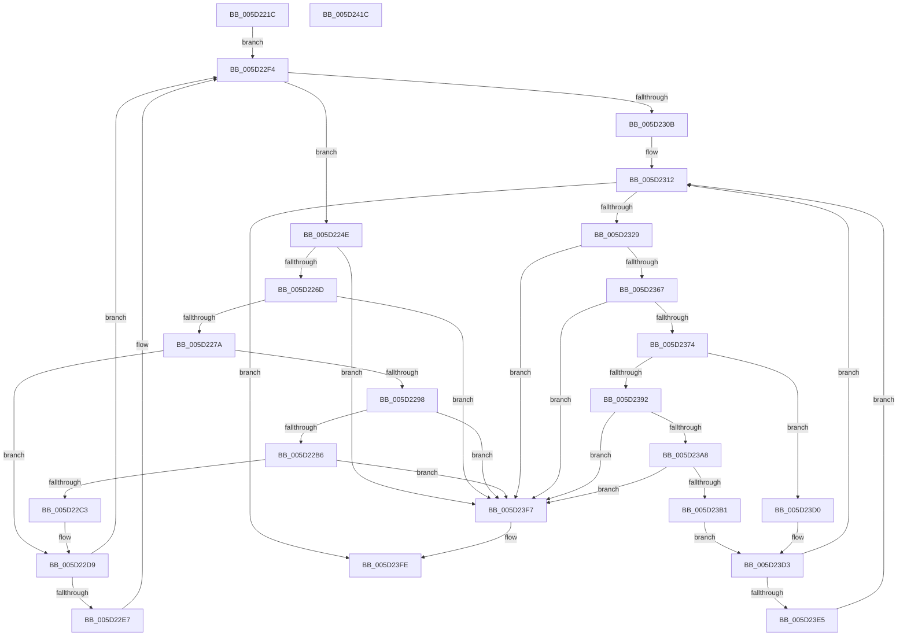

# PopFxComponentRelationsCleanup

- RVA: `0x005D221C`–`0x005D241D` (길이 `513` bytes)
- VA: `0x00000001405D221C`
- 실행 섹션: `.text`
- PDB 이름 있음: `예`; PDB Function 태그: `아니요`
- unwind 정보 RVA: `0x000701D4`
- 디코드: `134`개 명령, `513/513` bytes 표시
- 미해석 바이트: `0` (있으면 어셈블리에 `.byte`로 보존)

> 이 문서는 커널 이미지의 기계어와 PDB 기호를 분석해 생성했습니다. 4번과 5번은 함수 원형과 자료형을 바이너리 사용 방식에서 추정한 C 해석이며 원본 소스 복구 결과는 아닙니다.

## 1. Dependencies

- 직접 호출 지점: **13**; 고유 호출 대상: **8**
- 직접 호출자로 확인된 함수: **1**
- RIP 상대 이미지 참조: **0**

### Outgoing calls
- `0x005D2241` → [KeAcquireSpinLockRaiseToDpc](../20/KeAcquireSpinLockRaiseToDpc_function_00208470.md) (function, `0x00208470`)
- `0x005D228F` → [KxTryToAcquireSpinLock](../46/KxTryToAcquireSpinLock_function_0046BE18.md) (function, `0x0046BE18`)
- `0x005D22D1` → [KxReleaseSpinLock](../20/KxReleaseSpinLock_function_00206670.md) (function, `0x00206670`)
- `0x005D22DD` → [KxReleaseSpinLock](../20/KxReleaseSpinLock_function_00206670.md) (function, `0x00206670`)
- `0x005D22EF` → [ExFreePoolWithTag](../../poolcode/B8/ExFreePoolWithTag_function_00B82870.md) (function, `0x00B82870`)
- `0x005D22FE` → [PopFxNextComponentChildRelationSafe](../45/PopFxNextComponentChildRelationSafe_function_00450C70.md) (function, `0x00450C70`)
- `0x005D231C` → [PopFxNextParentRelationSafe](../26/PopFxNextParentRelationSafe_function_0026EAC0.md) (function, `0x0026EAC0`)
- `0x005D2340` → [PopFxIdleComponent](../2C/PopFxIdleComponent_function_002C01D8.md) (function, `0x002C01D8`)
- `0x005D2389` → [KxTryToAcquireSpinLock](../46/KxTryToAcquireSpinLock_function_0046BE18.md) (function, `0x0046BE18`)
- `0x005D23C6` → [KxReleaseSpinLock](../20/KxReleaseSpinLock_function_00206670.md) (function, `0x00206670`)
- `0x005D23D7` → [KxReleaseSpinLock](../20/KxReleaseSpinLock_function_00206670.md) (function, `0x00206670`)
- `0x005D23ED` → [ExFreePoolWithTag](../../poolcode/B8/ExFreePoolWithTag_function_00B82870.md) (function, `0x00B82870`)
- `0x005D2404` → [KeReleaseSpinLock](../39/KeReleaseSpinLock_function_00392BA0.md) (function, `0x00392BA0`)

### Direct callers
- [PopFxUnregisterDevice](../../page/A8/PopFxUnregisterDevice_function_00A8AE84.md) at `0x00A8AFCF`

### Static image references
- 디코드된 RIP-relative 메모리 참조가 없습니다.

## 2. Other-region calls and transfers

- 다른 실행 섹션으로 향하는 call: **2**
  - `0x005D22EF` → [ExFreePoolWithTag](../../poolcode/B8/ExFreePoolWithTag_function_00B82870.md) (`.text` → `POOLCODE`)
  - `0x005D23ED` → [ExFreePoolWithTag](../../poolcode/B8/ExFreePoolWithTag_function_00B82870.md) (`.text` → `POOLCODE`)
- 별도 외부 분기/꼬리 이동을 확인하지 못했습니다.

## 3. Assembly (complete function range)

```asm
005D221C  48 89 5C 24 10                  mov qword ptr [rsp + 0x10], rbx
005D2221  48 89 6C 24 18                  mov qword ptr [rsp + 0x18], rbp
005D2226  56                              push rsi
005D2227  57                              push rdi
005D2228  41 56                           push r14
005D222A  48 83 EC 20                     sub rsp, 0x20
005D222E  48 83 64 24 40 00               and qword ptr [rsp + 0x40], 0
005D2234  48 8D A9 80 00 00 00            lea rbp, [rcx + 0x80]
005D223B  48 8B F9                        mov rdi, rcx
005D223E  48 8B CD                        mov rcx, rbp
005D2241  E8 2A 62 C3 FF                  call 0x140208470
005D2246  44 8A F0                        mov r14b, al
005D2249  E9 A6 00 00 00                  jmp 0x1405d22f4
005D224E  48 8B 5C 24 40                  mov rbx, qword ptr [rsp + 0x40]
005D2253  83 63 10 FB                     and dword ptr [rbx + 0x10], 0xfffffffb
005D2257  48 8D 43 20                     lea rax, [rbx + 0x20]
005D225B  48 83 63 18 00                  and qword ptr [rbx + 0x18], 0
005D2260  48 8B 10                        mov rdx, qword ptr [rax]
005D2263  48 39 42 08                     cmp qword ptr [rdx + 8], rax
005D2267  0F 85 8A 01 00 00               jne 0x1405d23f7
005D226D  48 8B 48 08                     mov rcx, qword ptr [rax + 8]
005D2271  48 39 01                        cmp qword ptr [rcx], rax
005D2274  0F 85 7D 01 00 00               jne 0x1405d23f7
005D227A  48 89 11                        mov qword ptr [rcx], rdx
005D227D  40 32 F6                        xor sil, sil
005D2280  48 89 4A 08                     mov qword ptr [rdx + 8], rcx
005D2284  48 89 40 08                     mov qword ptr [rax + 8], rax
005D2288  48 89 00                        mov qword ptr [rax], rax
005D228B  48 8B 4B 30                     mov rcx, qword ptr [rbx + 0x30]
005D228F  E8 84 9B E9 FF                  call 0x14046be18
005D2294  84 C0                           test al, al
005D2296  74 41                           je 0x1405d22d9
005D2298  83 63 10 F7                     and dword ptr [rbx + 0x10], 0xfffffff7
005D229C  48 8D 43 38                     lea rax, [rbx + 0x38]
005D22A0  48 8B 4B 30                     mov rcx, qword ptr [rbx + 0x30]
005D22A4  48 83 63 30 00                  and qword ptr [rbx + 0x30], 0
005D22A9  4C 8B 00                        mov r8, qword ptr [rax]
005D22AC  49 39 40 08                     cmp qword ptr [r8 + 8], rax
005D22B0  0F 85 41 01 00 00               jne 0x1405d23f7
005D22B6  48 8B 50 08                     mov rdx, qword ptr [rax + 8]
005D22BA  48 39 02                        cmp qword ptr [rdx], rax
005D22BD  0F 85 34 01 00 00               jne 0x1405d23f7
005D22C3  4C 89 02                        mov qword ptr [rdx], r8
005D22C6  49 89 50 08                     mov qword ptr [r8 + 8], rdx
005D22CA  48 89 40 08                     mov qword ptr [rax + 8], rax
005D22CE  48 89 00                        mov qword ptr [rax], rax
005D22D1  E8 9A 43 C3 FF                  call 0x140206670
005D22D6  40 B6 01                        mov sil, 1
005D22D9  48 8D 4B 08                     lea rcx, [rbx + 8]
005D22DD  E8 8E 43 C3 FF                  call 0x140206670
005D22E2  40 84 F6                        test sil, sil
005D22E5  74 0D                           je 0x1405d22f4
005D22E7  BA 50 46 58 4D                  mov edx, 0x4d584650
005D22EC  48 8B CB                        mov rcx, rbx
005D22EF  E8 7C 05 5B 00                  call 0x140b82870
005D22F4  4C 8D 44 24 40                  lea r8, [rsp + 0x40]
005D22F9  33 D2                           xor edx, edx
005D22FB  48 8B CF                        mov rcx, rdi
005D22FE  E8 6D E9 E7 FF                  call 0x140450c70
005D2303  84 C0                           test al, al
005D2305  0F 85 43 FF FF FF               jne 0x1405d224e
005D230B  48 8D B7 C8 01 00 00            lea rsi, [rdi + 0x1c8]
005D2312  4C 8D 44 24 40                  lea r8, [rsp + 0x40]
005D2317  33 D2                           xor edx, edx
005D2319  48 8B CE                        mov rcx, rsi
005D231C  E8 9F C7 C9 FF                  call 0x14026eac0
005D2321  84 C0                           test al, al
005D2323  0F 84 D5 00 00 00               je 0x1405d23fe
005D2329  48 8B 5C 24 40                  mov rbx, qword ptr [rsp + 0x40]
005D232E  45 33 C9                        xor r9d, r9d
005D2331  48 8B 7B 18                     mov rdi, qword ptr [rbx + 0x18]
005D2335  45 8D 41 02                     lea r8d, [r9 + 2]
005D2339  8B 57 10                        mov edx, dword ptr [rdi + 0x10]
005D233C  48 8B 4F 50                     mov rcx, qword ptr [rdi + 0x50]
005D2340  E8 93 DE CE FF                  call 0x1402c01d8
005D2345  8B 43 10                        mov eax, dword ptr [rbx + 0x10]
005D2348  83 E0 FD                        and eax, 0xfffffffd
005D234B  83 E0 F7                        and eax, 0xfffffff7
005D234E  89 43 10                        mov dword ptr [rbx + 0x10], eax
005D2351  48 8D 43 38                     lea rax, [rbx + 0x38]
005D2355  48 83 63 30 00                  and qword ptr [rbx + 0x30], 0
005D235A  48 8B 10                        mov rdx, qword ptr [rax]
005D235D  48 39 42 08                     cmp qword ptr [rdx + 8], rax
005D2361  0F 85 90 00 00 00               jne 0x1405d23f7
005D2367  48 8B 48 08                     mov rcx, qword ptr [rax + 8]
005D236B  48 39 01                        cmp qword ptr [rcx], rax
005D236E  0F 85 83 00 00 00               jne 0x1405d23f7
005D2374  48 89 11                        mov qword ptr [rcx], rdx
005D2377  48 89 4A 08                     mov qword ptr [rdx + 8], rcx
005D237B  48 8D 8F 80 00 00 00            lea rcx, [rdi + 0x80]
005D2382  48 89 40 08                     mov qword ptr [rax + 8], rax
005D2386  48 89 00                        mov qword ptr [rax], rax
005D2389  E8 8A 9A E9 FF                  call 0x14046be18
005D238E  84 C0                           test al, al
005D2390  74 3E                           je 0x1405d23d0
005D2392  83 63 10 FB                     and dword ptr [rbx + 0x10], 0xfffffffb
005D2396  48 8D 43 20                     lea rax, [rbx + 0x20]
005D239A  48 83 63 18 00                  and qword ptr [rbx + 0x18], 0
005D239F  4C 8B 00                        mov r8, qword ptr [rax]
005D23A2  49 39 40 08                     cmp qword ptr [r8 + 8], rax
005D23A6  75 4F                           jne 0x1405d23f7
005D23A8  48 8B 50 08                     mov rdx, qword ptr [rax + 8]
005D23AC  48 39 02                        cmp qword ptr [rdx], rax
005D23AF  75 46                           jne 0x1405d23f7
005D23B1  4C 89 02                        mov qword ptr [rdx], r8
005D23B4  48 8D 8F 80 00 00 00            lea rcx, [rdi + 0x80]
005D23BB  49 89 50 08                     mov qword ptr [r8 + 8], rdx
005D23BF  48 89 40 08                     mov qword ptr [rax + 8], rax
005D23C3  48 89 00                        mov qword ptr [rax], rax
005D23C6  E8 A5 42 C3 FF                  call 0x140206670
005D23CB  40 B7 01                        mov dil, 1
005D23CE  EB 03                           jmp 0x1405d23d3
005D23D0  40 32 FF                        xor dil, dil
005D23D3  48 8D 4B 08                     lea rcx, [rbx + 8]
005D23D7  E8 94 42 C3 FF                  call 0x140206670
005D23DC  40 84 FF                        test dil, dil
005D23DF  0F 84 2D FF FF FF               je 0x1405d2312
005D23E5  BA 50 46 58 4D                  mov edx, 0x4d584650
005D23EA  48 8B CB                        mov rcx, rbx
005D23ED  E8 7E 04 5B 00                  call 0x140b82870
005D23F2  E9 1B FF FF FF                  jmp 0x1405d2312
005D23F7  B9 03 00 00 00                  mov ecx, 3
005D23FC  CD 29                           int 0x29
005D23FE  41 8A D6                        mov dl, r14b
005D2401  48 8B CD                        mov rcx, rbp
005D2404  E8 97 07 DC FF                  call 0x140392ba0
005D2409  48 8B 5C 24 48                  mov rbx, qword ptr [rsp + 0x48]
005D240E  48 8B 6C 24 50                  mov rbp, qword ptr [rsp + 0x50]
005D2413  48 83 C4 20                     add rsp, 0x20
005D2417  41 5E                           pop r14
005D2419  5F                              pop rdi
005D241A  5E                              pop rsi
005D241B  C3                              ret
005D241C  CC                              int3
```

## 4. C-style interpretation (structured pseudocode)

```c
__int64 __fastcall PopFxComponentRelationsCleanup(__int64 a1, __int64 a2, __int64 a3, int a4)
{
    __int64 result;
    __int64 v_rdi;
    __int64 v_rsi;
    __int64 v_rsp;
    unsigned __int64 v_stack_p10;
    unsigned __int64 v_stack_p18;
    unsigned __int64 v_stack_p8;

    v_stack_p10 = v_rbx;
    v_stack_p18 = v_rbp;
    v_rsp = (v_rsp) - (32);
    result = KeAcquireSpinLockRaiseToDpc(a1 + 128, a2, a3, a4);
    goto loc_005D22F4;
loc_005D224E:
    if ((*(unsigned __int64 *)(*(unsigned __int64 *)(v_stack_p8 + 32) + 8)) != (v_stack_p8 + 32)) goto loc_005D23F7;
    if ((*(unsigned __int64 *)(*(unsigned __int64 *)(v_stack_p8 + 32 + 8))) != (v_stack_p8 + 32)) goto loc_005D23F7;
    *(unsigned __int64 *)(*(unsigned __int64 *)(v_stack_p8 + 32 + 8)) = *(unsigned __int64 *)(v_stack_p8 + 32);
    v_rsi = 0;
    *(unsigned __int64 *)(*(unsigned __int64 *)(v_stack_p8 + 32) + 8) = *(unsigned __int64 *)(v_stack_p8 + 32 + 8);
    *(unsigned __int64 *)(v_stack_p8 + 32 + 8) = v_stack_p8 + 32;
    *(unsigned __int64 *)(v_stack_p8 + 32) = v_stack_p8 + 32;
    result = KxTryToAcquireSpinLock(*(unsigned __int64 *)(v_stack_p8 + 48), *(unsigned __int64 *)(v_stack_p8 + 32), a3, a4);
    if ((unsigned __int8)(result) == 0) goto loc_005D22D9;
    if ((*(unsigned __int64 *)(*(unsigned __int64 *)(v_stack_p8 + 56) + 8)) != (v_stack_p8 + 56)) goto loc_005D23F7;
    if ((*(unsigned __int64 *)(*(unsigned __int64 *)(v_stack_p8 + 56 + 8))) != (v_stack_p8 + 56)) goto loc_005D23F7;
    *(unsigned __int64 *)(*(unsigned __int64 *)(v_stack_p8 + 56 + 8)) = *(unsigned __int64 *)(v_stack_p8 + 56);
    *(unsigned __int64 *)(*(unsigned __int64 *)(v_stack_p8 + 56) + 8) = *(unsigned __int64 *)(v_stack_p8 + 56 + 8);
    *(unsigned __int64 *)(v_stack_p8 + 56 + 8) = v_stack_p8 + 56;
    *(unsigned __int64 *)(v_stack_p8 + 56) = v_stack_p8 + 56;
    result = KxReleaseSpinLock(*(unsigned __int64 *)(v_stack_p8 + 48), *(unsigned __int64 *)(v_stack_p8 + 56 + 8), *(unsigned __int64 *)(v_stack_p8 + 56), a4);
loc_005D22D9:
    result = KxReleaseSpinLock(v_stack_p8 + 8, *(unsigned __int64 *)(v_stack_p8 + 56 + 8), *(unsigned __int64 *)(v_stack_p8 + 56), a4);
    if (1 != 0) {
        a2 = 0x4D584650ULL;
        a1 = v_stack_p8;
        result = ExFreePoolWithTag(a1, a2, *(unsigned __int64 *)(v_stack_p8 + 56), a4);
    }
    a2 = 0;
    result = PopFxNextComponentChildRelationSafe(a1, a2, v_stack_p8, a4);
    if ((unsigned __int8)(result) != 0) goto loc_005D224E;
loc_005D2312:
    a2 = 0;
    result = PopFxNextParentRelationSafe(a1 + 456, a2, v_stack_p8, a4);
    if ((unsigned __int8)(result) == 0) goto loc_005D23FE;
    a4 = 0;
    result = PopFxIdleComponent(*(unsigned __int64 *)(*(unsigned __int64 *)(v_stack_p8 + 24) + 80), (unsigned int)(*(unsigned int *)(*(unsigned __int64 *)(v_stack_p8 + 24) + 16)), a4 + 2, a4);
    result = (unsigned int)(((unsigned int)(*(unsigned int *)(v_stack_p8 + 16))) & (0xFFFFFFFDULL));
    result = (unsigned int)((result) & (0xFFFFFFF7ULL));
    *(unsigned int *)(v_stack_p8 + 16) = (unsigned int)(result);
    if ((*(unsigned __int64 *)(*(unsigned __int64 *)(v_stack_p8 + 56) + 8)) != (v_stack_p8 + 56)) goto loc_005D23F7;
    if ((*(unsigned __int64 *)(*(unsigned __int64 *)(v_stack_p8 + 56 + 8))) != (v_stack_p8 + 56)) goto loc_005D23F7;
    *(unsigned __int64 *)(*(unsigned __int64 *)(v_stack_p8 + 56 + 8)) = *(unsigned __int64 *)(v_stack_p8 + 56);
    *(unsigned __int64 *)(*(unsigned __int64 *)(v_stack_p8 + 56) + 8) = *(unsigned __int64 *)(v_stack_p8 + 56 + 8);
    *(unsigned __int64 *)(v_stack_p8 + 56 + 8) = v_stack_p8 + 56;
    *(unsigned __int64 *)(v_stack_p8 + 56) = v_stack_p8 + 56;
    result = KxTryToAcquireSpinLock(*(unsigned __int64 *)(v_stack_p8 + 24) + 128, *(unsigned __int64 *)(v_stack_p8 + 56), a4 + 2, a4);
    if ((unsigned __int8)(result) == 0) goto loc_005D23D0;
    if ((*(unsigned __int64 *)(*(unsigned __int64 *)(v_stack_p8 + 32) + 8)) != (v_stack_p8 + 32)) goto loc_005D23F7;
    if ((*(unsigned __int64 *)(*(unsigned __int64 *)(v_stack_p8 + 32 + 8))) != (v_stack_p8 + 32)) goto loc_005D23F7;
    *(unsigned __int64 *)(*(unsigned __int64 *)(v_stack_p8 + 32 + 8)) = *(unsigned __int64 *)(v_stack_p8 + 32);
    *(unsigned __int64 *)(*(unsigned __int64 *)(v_stack_p8 + 32) + 8) = *(unsigned __int64 *)(v_stack_p8 + 32 + 8);
    *(unsigned __int64 *)(v_stack_p8 + 32 + 8) = v_stack_p8 + 32;
    *(unsigned __int64 *)(v_stack_p8 + 32) = v_stack_p8 + 32;
    result = KxReleaseSpinLock(*(unsigned __int64 *)(v_stack_p8 + 24) + 128, *(unsigned __int64 *)(v_stack_p8 + 32 + 8), *(unsigned __int64 *)(v_stack_p8 + 32), a4);
    goto loc_005D23D3;
loc_005D23D0:
    v_rdi = 0;
loc_005D23D3:
    result = KxReleaseSpinLock(v_stack_p8 + 8, *(unsigned __int64 *)(v_stack_p8 + 32 + 8), *(unsigned __int64 *)(v_stack_p8 + 32), a4);
    if (0 == 0) goto loc_005D2312;
    result = ExFreePoolWithTag(v_stack_p8, (unsigned int)(0x4D584650ULL), *(unsigned __int64 *)(v_stack_p8 + 32), a4);
    goto loc_005D2312;
loc_005D23F7:
loc_005D23FE:
    result = KeReleaseSpinLock(a1 + 128, (unsigned __int8)((unsigned __int8)(result)), *(unsigned __int64 *)(v_stack_p8 + 32), a4);
    v_rsp = (v_rsp) + (32);
    return result;
}
```

## 5. (Beta) C Style

```c
int64_t PopFxComponentRelationsCleanup(void *Arg1, int64_t Arg2, int64_t Arg3, int32_t Arg4)
{
    uint8_t *arg1 = (uint8_t *)Arg1;

    int64_t result;
    int64_t local_rdi;
    int64_t local_rsi;
    int64_t local_rsp;
    uint64_t v_stack_p10;
    uint64_t v_stack_p18;
    uint64_t v_stack_p8;

    v_stack_p10 = local_rbx;
    v_stack_p18 = local_rbp;
    local_rsp = (local_rsp) - (32);
    result = KeAcquireSpinLockRaiseToDpc(Arg1 + 128, Arg2, Arg3, Arg4);
    goto loc_005D22F4;
loc_005D224E:
    if ((*(uint64_t *)(*(uint64_t *)(v_stack_p8 + 0x20) + 0x8)) != (v_stack_p8 + 32)) goto loc_005D23F7;
    if ((*(uint64_t *)(*(uint64_t *)(v_stack_p8 + 0x20 + 0x8))) != (v_stack_p8 + 32)) goto loc_005D23F7;
    *(uint64_t *)(*(uint64_t *)(v_stack_p8 + 0x20 + 0x8)) = *(uint64_t *)(v_stack_p8 + 0x20);
    local_rsi = 0;
    *(uint64_t *)(*(uint64_t *)(v_stack_p8 + 0x20) + 0x8) = *(uint64_t *)(v_stack_p8 + 0x20 + 0x8);
    *(uint64_t *)(v_stack_p8 + 0x20 + 0x8) = v_stack_p8 + 32;
    *(uint64_t *)(v_stack_p8 + 0x20) = v_stack_p8 + 32;
    result = KxTryToAcquireSpinLock(*(uint64_t *)(v_stack_p8 + 0x30), *(uint64_t *)(v_stack_p8 + 0x20), Arg3, Arg4);
    if ((uint8_t)(result) == 0) goto loc_005D22D9;
    if ((*(uint64_t *)(*(uint64_t *)(v_stack_p8 + 0x38) + 0x8)) != (v_stack_p8 + 56)) goto loc_005D23F7;
    if ((*(uint64_t *)(*(uint64_t *)(v_stack_p8 + 0x38 + 0x8))) != (v_stack_p8 + 56)) goto loc_005D23F7;
    *(uint64_t *)(*(uint64_t *)(v_stack_p8 + 0x38 + 0x8)) = *(uint64_t *)(v_stack_p8 + 0x38);
    *(uint64_t *)(*(uint64_t *)(v_stack_p8 + 0x38) + 0x8) = *(uint64_t *)(v_stack_p8 + 0x38 + 0x8);
    *(uint64_t *)(v_stack_p8 + 0x38 + 0x8) = v_stack_p8 + 56;
    *(uint64_t *)(v_stack_p8 + 0x38) = v_stack_p8 + 56;
    result = KxReleaseSpinLock(*(uint64_t *)(v_stack_p8 + 0x30), *(uint64_t *)(v_stack_p8 + 0x38 + 0x8), *(uint64_t *)(v_stack_p8 + 0x38), Arg4);
loc_005D22D9:
    result = KxReleaseSpinLock(v_stack_p8 + 8, *(uint64_t *)(v_stack_p8 + 0x38 + 0x8), *(uint64_t *)(v_stack_p8 + 0x38), Arg4);
    if (1 != 0) {
        Arg2 = 0x4D584650ULL;
        Arg1 = v_stack_p8;
        result = ExFreePoolWithTag(Arg1, Arg2, *(uint64_t *)(v_stack_p8 + 0x38), Arg4);
    }
    Arg2 = 0;
    result = PopFxNextComponentChildRelationSafe(Arg1, Arg2, v_stack_p8, Arg4);
    if ((uint8_t)(result) != 0) goto loc_005D224E;
loc_005D2312:
    Arg2 = 0;
    result = PopFxNextParentRelationSafe(Arg1 + 456, Arg2, v_stack_p8, Arg4);
    if ((uint8_t)(result) == 0) goto loc_005D23FE;
    Arg4 = 0;
    result = PopFxIdleComponent(*(uint64_t *)(*(uint64_t *)(v_stack_p8 + 0x18) + 0x50), (uint32_t)(*(uint32_t *)(*(uint64_t *)(v_stack_p8 + 0x18) + 0x10)), Arg4 + 2, Arg4);
    result = (uint32_t)(((uint32_t)(*(uint32_t *)(v_stack_p8 + 0x10))) & (0xFFFFFFFDULL));
    result = (uint32_t)((result) & (0xFFFFFFF7ULL));
    *(uint32_t *)(v_stack_p8 + 0x10) = (uint32_t)(result);
    if ((*(uint64_t *)(*(uint64_t *)(v_stack_p8 + 0x38) + 0x8)) != (v_stack_p8 + 56)) goto loc_005D23F7;
    if ((*(uint64_t *)(*(uint64_t *)(v_stack_p8 + 0x38 + 0x8))) != (v_stack_p8 + 56)) goto loc_005D23F7;
    *(uint64_t *)(*(uint64_t *)(v_stack_p8 + 0x38 + 0x8)) = *(uint64_t *)(v_stack_p8 + 0x38);
    *(uint64_t *)(*(uint64_t *)(v_stack_p8 + 0x38) + 0x8) = *(uint64_t *)(v_stack_p8 + 0x38 + 0x8);
    *(uint64_t *)(v_stack_p8 + 0x38 + 0x8) = v_stack_p8 + 56;
    *(uint64_t *)(v_stack_p8 + 0x38) = v_stack_p8 + 56;
    result = KxTryToAcquireSpinLock(*(uint64_t *)(v_stack_p8 + 0x18) + 128, *(uint64_t *)(v_stack_p8 + 0x38), Arg4 + 2, Arg4);
    if ((uint8_t)(result) == 0) goto loc_005D23D0;
    if ((*(uint64_t *)(*(uint64_t *)(v_stack_p8 + 0x20) + 0x8)) != (v_stack_p8 + 32)) goto loc_005D23F7;
    if ((*(uint64_t *)(*(uint64_t *)(v_stack_p8 + 0x20 + 0x8))) != (v_stack_p8 + 32)) goto loc_005D23F7;
    *(uint64_t *)(*(uint64_t *)(v_stack_p8 + 0x20 + 0x8)) = *(uint64_t *)(v_stack_p8 + 0x20);
    *(uint64_t *)(*(uint64_t *)(v_stack_p8 + 0x20) + 0x8) = *(uint64_t *)(v_stack_p8 + 0x20 + 0x8);
    *(uint64_t *)(v_stack_p8 + 0x20 + 0x8) = v_stack_p8 + 32;
    *(uint64_t *)(v_stack_p8 + 0x20) = v_stack_p8 + 32;
    result = KxReleaseSpinLock(*(uint64_t *)(v_stack_p8 + 0x18) + 128, *(uint64_t *)(v_stack_p8 + 0x20 + 0x8), *(uint64_t *)(v_stack_p8 + 0x20), Arg4);
    goto loc_005D23D3;
loc_005D23D0:
    local_rdi = 0;
loc_005D23D3:
    result = KxReleaseSpinLock(v_stack_p8 + 8, *(uint64_t *)(v_stack_p8 + 0x20 + 0x8), *(uint64_t *)(v_stack_p8 + 0x20), Arg4);
    if (0 == 0) goto loc_005D2312;
    result = ExFreePoolWithTag(v_stack_p8, (uint32_t)(0x4D584650ULL), *(uint64_t *)(v_stack_p8 + 0x20), Arg4);
    goto loc_005D2312;
loc_005D23F7:
loc_005D23FE:
    result = KeReleaseSpinLock(Arg1 + 128, (uint8_t)((uint8_t)(result)), *(uint64_t *)(v_stack_p8 + 0x20), Arg4);
    local_rsp = (local_rsp) + (32);
    return result;
}
```

### 관측된 메모리 오프셋

구조체 형식이 확인되지 않은 접근은 인자 기준의 오프셋으로만 기록했습니다.

| 기준 인자 | 오프셋 표현 | 폭 (bit) | 접근 |
|---|---:|---:|---|
| `Arg1` | `+ 0x80` | `64` | `R` |
| `Arg1` | `+ 0x1C8` | `64` | `R` |

## 6. Execution-region graph

[열기: 2D/3D 그래프와 함수 탐색 컨트롤 패널](../../../control-panel.html?section=text&rva=0x005D221C&view=graph)

- 2D 그래프는 위에서 아래로 흐르고, 3D 그래프는 빈 공간을 드래그해 회전합니다. Shift+드래그는 이동, 휠은 확대·축소, 함수 노드 선택은 대상 보고서 이동입니다.

### Static fallback


