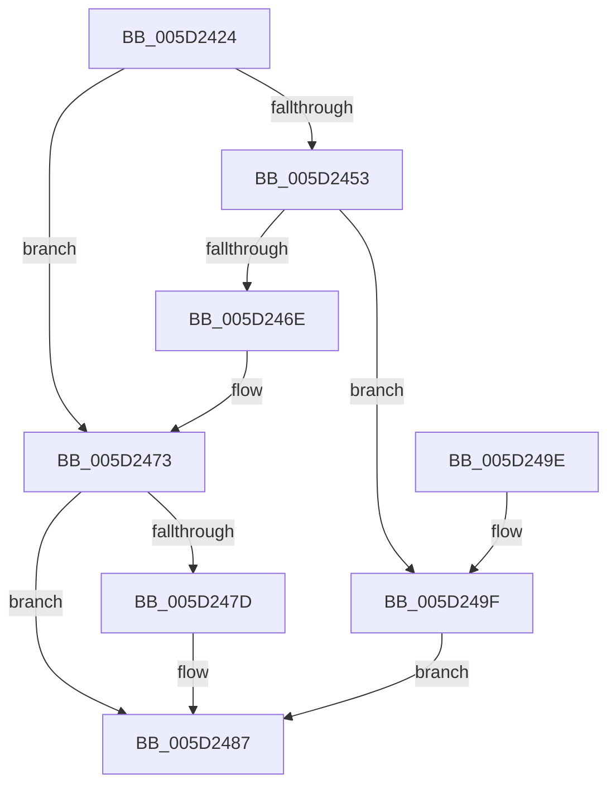

# PopFxCreateDeviceCommon

- RVA: `0x005D2424`–`0x005D2659` (길이 `565` bytes)
- VA: `0x00000001405D2424`
- 실행 섹션: `.text`
- PDB 이름 있음: `예`; PDB Function 태그: `아니요`
- unwind 정보 RVA: `0x000CC138`
- 디코드: `112`개 명령, `565/565` bytes 표시
- 미해석 바이트: `0` (있으면 어셈블리에 `.byte`로 보존)

> 이 문서는 커널 이미지의 기계어와 PDB 기호를 분석해 생성했습니다. 4번과 5번은 함수 원형과 자료형을 바이너리 사용 방식에서 추정한 C 해석이며 원본 소스 복구 결과는 아닙니다.

## 1. Dependencies

- 직접 호출 지점: **4**; 고유 호출 대상: **4**
- 직접 호출자로 확인된 함수: **2**
- RIP 상대 이미지 참조: **5**

### Outgoing calls
- `0x005D2446` → [PopFxDuplicateUniqueId](PopFxDuplicateUniqueId_function_005D29F0.md) (function, `0x005D29F0`)
- `0x005D2461` → [ExAllocatePool2](../../poolcode/B8/ExAllocatePool2_function_00B820F0.md) (function, `0x00B820F0`)
- `0x005D2482` → [ExFreePoolWithTag](../../poolcode/B8/ExFreePoolWithTag_function_00B82870.md) (function, `0x00B82870`)
- `0x005D262E` → [IoInitializeRemoveLockEx](../4C/IoInitializeRemoveLockEx_function_004C8F10.md) (function, `0x004C8F10`)

### Direct callers
- [PopFxAcpiRegisterDevice](PopFxAcpiRegisterDevice_function_005DD724.md) at `0x005DD76B`
- [PopFxRegisterDeviceWorker](../../page/75/PopFxRegisterDeviceWorker_function_00759E20.md) at `0x0075A07B`

### Static image references
- `0x005D2523` → RVA `0x00492B80` (`PopFxIdleTimeoutDpcRoutine`; read)
- `0x005D2545` → RVA `0x005D27B0` (`PopFxDeviceWork`; read)
- `0x005D2572` → RVA `0x0026D980` (`PopFxHandleReportDevicePoweredOn`; read)
- `0x005D258E` → RVA `0x004C4020` (`PopFxDirectedPowerTransitionWorker`; read)
- `0x005D25D1` → RVA `0x005D2820` (`PopFxDirectedWorkOrderWatchdog`; read)

## 2. Other-region calls and transfers

- 다른 실행 섹션으로 향하는 call: **2**
  - `0x005D2461` → [ExAllocatePool2](../../poolcode/B8/ExAllocatePool2_function_00B820F0.md) (`.text` → `POOLCODE`)
  - `0x005D2482` → [ExFreePoolWithTag](../../poolcode/B8/ExFreePoolWithTag_function_00B82870.md) (`.text` → `POOLCODE`)
- 별도 외부 분기/꼬리 이동을 확인하지 못했습니다.

## 3. Assembly (complete function range)

```asm
005D2424  48 8B C4                        mov rax, rsp
005D2427  48 89 58 08                     mov qword ptr [rax + 8], rbx
005D242B  48 89 68 10                     mov qword ptr [rax + 0x10], rbp
005D242F  48 89 70 18                     mov qword ptr [rax + 0x18], rsi
005D2433  57                              push rdi
005D2434  48 83 EC 40                     sub rsp, 0x40
005D2438  0F 57 C0                        xorps xmm0, xmm0
005D243B  48 8D 50 E8                     lea rdx, [rax - 0x18]
005D243F  0F 11 40 E8                     movups xmmword ptr [rax - 0x18], xmm0
005D2443  41 8B F1                        mov esi, r9d
005D2446  E8 A5 05 00 00                  call 0x1405d29f0
005D244B  33 ED                           xor ebp, ebp
005D244D  8B F8                           mov edi, eax
005D244F  85 C0                           test eax, eax
005D2451  78 20                           js 0x1405d2473
005D2453  BA 28 05 00 00                  mov edx, 0x528
005D2458  8D 4D 40                        lea ecx, [rbp + 0x40]
005D245B  41 B8 50 46 58 4D               mov r8d, 0x4d584650
005D2461  E8 8A FC 5A 00                  call 0x140b820f0
005D2466  48 8B D8                        mov rbx, rax
005D2469  48 85 C0                        test rax, rax
005D246C  75 31                           jne 0x1405d249f
005D246E  BF 9A 00 00 C0                  mov edi, 0xc000009a
005D2473  48 8B 4C 24 38                  mov rcx, qword ptr [rsp + 0x38]
005D2478  48 85 C9                        test rcx, rcx
005D247B  74 0A                           je 0x1405d2487
005D247D  BA 50 46 58 4D                  mov edx, 0x4d584650
005D2482  E8 E9 03 5B 00                  call 0x140b82870
005D2487  48 8B 5C 24 50                  mov rbx, qword ptr [rsp + 0x50]
005D248C  8B C7                           mov eax, edi
005D248E  48 8B 6C 24 58                  mov rbp, qword ptr [rsp + 0x58]
005D2493  48 8B 74 24 60                  mov rsi, qword ptr [rsp + 0x60]
005D2498  48 83 C4 40                     add rsp, 0x40
005D249C  5F                              pop rdi
005D249D  C3                              ret
005D249E  CC                              int3
005D249F  0F 10 44 24 30                  movups xmm0, xmmword ptr [rsp + 0x30]
005D24A4  48 8D 8B C0 03 00 00            lea rcx, [rbx + 0x3c0]
005D24AB  C7 44 24 20 20 00 00 00         mov dword ptr [rsp + 0x20], 0x20
005D24B3  45 33 C9                        xor r9d, r9d
005D24B6  45 33 C0                        xor r8d, r8d
005D24B9  F3 0F 7F 80 D8 00 00 00         movdqu xmmword ptr [rax + 0xd8], xmm0
005D24C1  48 89 58 08                     mov qword ptr [rax + 8], rbx
005D24C5  BA 50 46 58 4D                  mov edx, 0x4d584650
005D24CA  48 89 18                        mov qword ptr [rax], rbx
005D24CD  48 05 C8 00 00 00               add rax, 0xc8
005D24D3  48 89 40 08                     mov qword ptr [rax + 8], rax
005D24D7  48 89 00                        mov qword ptr [rax], rax
005D24DA  48 8D 83 68 02 00 00            lea rax, [rbx + 0x268]
005D24E1  66 89 AB 60 02 00 00            mov word ptr [rbx + 0x260], bp
005D24E8  C6 83 62 02 00 00 06            mov byte ptr [rbx + 0x262], 6
005D24EF  C7 83 64 02 00 00 01 00 00 00   mov dword ptr [rbx + 0x264], 1
005D24F9  48 89 40 08                     mov qword ptr [rax + 8], rax
005D24FD  48 89 00                        mov qword ptr [rax], rax
005D2500  48 8D 83 A0 01 00 00            lea rax, [rbx + 0x1a0]
005D2507  48 89 AB 90 01 00 00            mov qword ptr [rbx + 0x190], rbp
005D250E  48 89 AB 98 01 00 00            mov qword ptr [rbx + 0x198], rbp
005D2515  C6 83 98 01 00 00 09            mov byte ptr [rbx + 0x198], 9
005D251C  48 89 40 08                     mov qword ptr [rax + 8], rax
005D2520  48 89 00                        mov qword ptr [rax], rax
005D2523  48 8D 05 56 06 EC FF            lea rax, [rip - 0x13f9aa]
005D252A  48 89 AB B0 01 00 00            mov qword ptr [rbx + 0x1b0], rbp
005D2531  89 AB D4 01 00 00               mov dword ptr [rbx + 0x1d4], ebp
005D2537  66 89 AB D0 01 00 00            mov word ptr [rbx + 0x1d0], bp
005D253E  48 89 83 F0 01 00 00            mov qword ptr [rbx + 0x1f0], rax
005D2545  48 8D 05 64 02 00 00            lea rax, [rip + 0x264]
005D254C  C7 83 D8 01 00 00 13 01 00 00   mov dword ptr [rbx + 0x1d8], 0x113
005D2556  48 89 9B F8 01 00 00            mov qword ptr [rbx + 0x1f8], rbx
005D255D  48 89 AB 10 02 00 00            mov qword ptr [rbx + 0x210], rbp
005D2564  48 89 AB E8 01 00 00            mov qword ptr [rbx + 0x1e8], rbp
005D256B  48 89 83 68 01 00 00            mov qword ptr [rbx + 0x168], rax
005D2572  48 8D 05 07 B4 C9 FF            lea rax, [rip - 0x364bf9]
005D2579  48 89 9B 70 01 00 00            mov qword ptr [rbx + 0x170], rbx
005D2580  48 89 AB 58 01 00 00            mov qword ptr [rbx + 0x158], rbp
005D2587  48 89 83 F0 04 00 00            mov qword ptr [rbx + 0x4f0], rax
005D258E  48 8D 05 8B 1A EF FF            lea rax, [rip - 0x10e575]
005D2595  48 89 9B F8 04 00 00            mov qword ptr [rbx + 0x4f8], rbx
005D259C  48 89 AB E0 04 00 00            mov qword ptr [rbx + 0x4e0], rbp
005D25A3  48 89 AB A8 04 00 00            mov qword ptr [rbx + 0x4a8], rbp
005D25AA  48 89 41 10                     mov qword ptr [rcx + 0x10], rax
005D25AE  48 8D 83 10 04 00 00            lea rax, [rbx + 0x410]
005D25B5  48 89 59 18                     mov qword ptr [rcx + 0x18], rbx
005D25B9  48 89 29                        mov qword ptr [rcx], rbp
005D25BC  48 89 AB 08 04 00 00            mov qword ptr [rbx + 0x408], rbp
005D25C3  C6 83 08 04 00 00 08            mov byte ptr [rbx + 0x408], 8
005D25CA  48 89 40 08                     mov qword ptr [rax + 8], rax
005D25CE  48 89 00                        mov qword ptr [rax], rax
005D25D1  48 8D 05 48 02 00 00            lea rax, [rip + 0x248]
005D25D8  48 89 AB 20 04 00 00            mov qword ptr [rbx + 0x420], rbp
005D25DF  89 AB 44 04 00 00               mov dword ptr [rbx + 0x444], ebp
005D25E5  66 89 AB 40 04 00 00            mov word ptr [rbx + 0x440], bp
005D25EC  48 89 83 60 04 00 00            mov qword ptr [rbx + 0x460], rax
005D25F3  48 8D 83 F8 03 00 00            lea rax, [rbx + 0x3f8]
005D25FA  48 89 83 68 04 00 00            mov qword ptr [rbx + 0x468], rax
005D2601  C7 83 48 04 00 00 13 01 00 00   mov dword ptr [rbx + 0x448], 0x113
005D260B  48 89 AB 80 04 00 00            mov qword ptr [rbx + 0x480], rbp
005D2612  48 89 AB 58 04 00 00            mov qword ptr [rbx + 0x458], rbp
005D2619  48 89 8B 88 04 00 00            mov qword ptr [rbx + 0x488], rcx
005D2620  48 8D 8B 38 01 00 00            lea rcx, [rbx + 0x138]
005D2627  48 89 83 F0 03 00 00            mov qword ptr [rbx + 0x3f0], rax
005D262E  E8 DD 68 EF FF                  call 0x1404c8f10
005D2633  40 8A C6                        mov al, sil
005D2636  24 04                           and al, 4
005D2638  F6 D8                           neg al
005D263A  48 8B 44 24 70                  mov rax, qword ptr [rsp + 0x70]
005D263F  1B C9                           sbb ecx, ecx
005D2641  F7 D9                           neg ecx
005D2643  FF C1                           inc ecx
005D2645  89 8B E8 00 00 00               mov dword ptr [rbx + 0xe8], ecx
005D264B  89 B3 60 03 00 00               mov dword ptr [rbx + 0x360], esi
005D2651  48 89 18                        mov qword ptr [rax], rbx
005D2654  E9 2E FE FF FF                  jmp 0x1405d2487
```

## 4. C-style interpretation (structured pseudocode)

```c
__int64 __fastcall PopFxCreateDeviceCommon(__int64 a1, __int64 a2, __int64 a3, int a4, __int64 a5)
{
    __int64 result;
    __int64 v_rbp;
    __int64 v_rsp;
    unsigned __int64 v_stack_m10;
    unsigned __int64 v_stack_p10;
    unsigned __int64 v_stack_p18;
    unsigned int v_stack_p20;
    unsigned __int64 v_stack_p30;
    unsigned __int64 v_stack_p8;

    *(unsigned __int64 *)(v_rsp + 8) = v_rbx;
    *(unsigned __int64 *)(v_rsp + 16) = v_rbp;
    *(unsigned __int64 *)(v_rsp + 24) = v_rsi;
    v_rsp = (v_rsp) - (64);
    *(unsigned __int64 *)(v_rsp - 24) = v_xmm0;
    result = PopFxDuplicateUniqueId(a1, v_rsp - 24, a3, a4);
    v_rbp = 0;
    if (sign_flag) goto loc_005D2473;
    result = ExAllocatePool2(v_rbp + 64, (unsigned int)(0x528ULL), (unsigned int)(0x4D584650ULL), a4);
    if (result != 0) goto loc_005D249F;
loc_005D2473:
    if (v_stack_m10 != 0) {
        a2 = 0x4D584650ULL;
        result = ExFreePoolWithTag(v_stack_m10, a2, (unsigned int)(0x4D584650ULL), a4);
    }
    v_rsp = (v_rsp) + (64);
    return (unsigned int)((unsigned int)((unsigned int)(0xC000009AULL)));
loc_005D249F:
    v_stack_p20 = 32;
    a4 = 0;
    a3 = 0;
    *(unsigned __int64 *)((unsigned int)((unsigned int)((unsigned int)(0xC000009AULL))) + 216) = v_xmm0;
    *(unsigned __int64 *)((unsigned int)((unsigned int)((unsigned int)(0xC000009AULL))) + 8) = v_stack_p8;
    *(unsigned __int64 *)((unsigned int)((unsigned int)((unsigned int)(0xC000009AULL)))) = v_stack_p8;
    result = ((unsigned int)((unsigned int)((unsigned int)(0xC000009AULL)))) + (200);
    *(unsigned __int64 *)(result + 8) = result;
    *(unsigned __int64 *)(result) = result;
    *(unsigned __int16 *)(v_stack_p8 + 608) = (unsigned __int16)(v_stack_p10);
    *(unsigned __int8 *)(v_stack_p8 + 610) = 6;
    *(unsigned int *)(v_stack_p8 + 612) = 1;
    *(unsigned __int64 *)(v_stack_p8 + 616 + 8) = v_stack_p8 + 616;
    *(unsigned __int64 *)(v_stack_p8 + 616) = v_stack_p8 + 616;
    *(unsigned __int64 *)(v_stack_p8 + 400) = v_stack_p10;
    *(unsigned __int64 *)(v_stack_p8 + 408) = v_stack_p10;
    *(unsigned __int8 *)(v_stack_p8 + 408) = 9;
    *(unsigned __int64 *)(v_stack_p8 + 416 + 8) = v_stack_p8 + 416;
    *(unsigned __int64 *)(v_stack_p8 + 416) = v_stack_p8 + 416;
    *(unsigned __int64 *)(v_stack_p8 + 432) = v_stack_p10;
    *(unsigned int *)(v_stack_p8 + 468) = (unsigned int)(v_stack_p10);
    *(unsigned __int16 *)(v_stack_p8 + 464) = (unsigned __int16)(v_stack_p10);
    *(unsigned __int64 *)(v_stack_p8 + 496) = v_rip - 1309098;
    *(unsigned int *)(v_stack_p8 + 472) = 275;
    *(unsigned __int64 *)(v_stack_p8 + 504) = v_stack_p8;
    *(unsigned __int64 *)(v_stack_p8 + 528) = v_stack_p10;
    *(unsigned __int64 *)(v_stack_p8 + 488) = v_stack_p10;
    *(unsigned __int64 *)(v_stack_p8 + 360) = v_rip + 612;
    *(unsigned __int64 *)(v_stack_p8 + 368) = v_stack_p8;
    *(unsigned __int64 *)(v_stack_p8 + 344) = v_stack_p10;
    *(unsigned __int64 *)(v_stack_p8 + 1264) = v_rip - 3558393;
    *(unsigned __int64 *)(v_stack_p8 + 1272) = v_stack_p8;
    *(unsigned __int64 *)(v_stack_p8 + 1248) = v_stack_p10;
    *(unsigned __int64 *)(v_stack_p8 + 1192) = v_stack_p10;
    *(unsigned __int64 *)(v_stack_p8 + 960 + 16) = v_rip - 1107317;
    *(unsigned __int64 *)(v_stack_p8 + 960 + 24) = v_stack_p8;
    *(unsigned __int64 *)(v_stack_p8 + 960) = v_stack_p10;
    *(unsigned __int64 *)(v_stack_p8 + 1032) = v_stack_p10;
    *(unsigned __int8 *)(v_stack_p8 + 1032) = 8;
    *(unsigned __int64 *)(v_stack_p8 + 1040 + 8) = v_stack_p8 + 1040;
    *(unsigned __int64 *)(v_stack_p8 + 1040) = v_stack_p8 + 1040;
    *(unsigned __int64 *)(v_stack_p8 + 1056) = v_stack_p10;
    *(unsigned int *)(v_stack_p8 + 1092) = (unsigned int)(v_stack_p10);
    *(unsigned __int16 *)(v_stack_p8 + 1088) = (unsigned __int16)(v_stack_p10);
    *(unsigned __int64 *)(v_stack_p8 + 1120) = v_rip + 584;
    *(unsigned __int64 *)(v_stack_p8 + 1128) = v_stack_p8 + 1016;
    *(unsigned int *)(v_stack_p8 + 1096) = 275;
    *(unsigned __int64 *)(v_stack_p8 + 1152) = v_stack_p10;
    *(unsigned __int64 *)(v_stack_p8 + 1112) = v_stack_p10;
    *(unsigned __int64 *)(v_stack_p8 + 1160) = v_stack_p8 + 960;
    *(unsigned __int64 *)(v_stack_p8 + 1008) = v_stack_p8 + 1016;
    result = IoInitializeRemoveLockEx(v_stack_p8 + 312, (unsigned int)(0x4D584650ULL), a3, a4);
    result = (unsigned __int8)(((unsigned __int8)(v_stack_p18)) & (4));
    result = (unsigned __int8)(-(result));
    a1 = (unsigned int)(-(v_stack_p8 + 312));
    a1 = (unsigned int)((a1) + 1);
    *(unsigned int *)(v_stack_p8 + 232) = (unsigned int)(a1);
    *(unsigned int *)(v_stack_p8 + 864) = (unsigned int)(v_stack_p18);
    *(unsigned __int64 *)(a5) = v_stack_p8;
    goto loc_005D2487;
}
```

## 5. (Beta) C Style

```c
int64_t PopFxCreateDeviceCommon(int64_t Arg1, int64_t Arg2, int64_t Arg3, int32_t Arg4, void *Arg5)
{
    uint8_t *arg5 = (uint8_t *)Arg5;

    int64_t result;
    int64_t local_rbp;
    int64_t local_rsp;
    uint64_t v_stack_m10;
    uint64_t v_stack_p10;
    uint64_t v_stack_p18;
    uint32_t v_stack_p20;
    uint64_t v_stack_p30;
    uint64_t v_stack_p8;

    *(uint64_t *)(local_rsp + 0x8) = local_rbx;
    *(uint64_t *)(local_rsp + 0x10) = local_rbp;
    *(uint64_t *)(local_rsp + 0x18) = local_rsi;
    local_rsp = (local_rsp) - (64);
    *(uint64_t *)(local_rsp - 0x18) = v_xmm0;
    result = PopFxDuplicateUniqueId(Arg1, local_rsp - 24, Arg3, Arg4);
    local_rbp = 0;
    if (sign_flag) goto loc_005D2473;
    result = ExAllocatePool2(local_rbp + 64, (uint32_t)(0x528ULL), (uint32_t)(0x4D584650ULL), Arg4);
    if (result != 0) goto loc_005D249F;
loc_005D2473:
    if (v_stack_m10 != 0) {
        Arg2 = 0x4D584650ULL;
        result = ExFreePoolWithTag(v_stack_m10, Arg2, (uint32_t)(0x4D584650ULL), Arg4);
    }
    local_rsp = (local_rsp) + (64);
    return (uint32_t)((uint32_t)((uint32_t)(0xC000009AULL)));
loc_005D249F:
    v_stack_p20 = 32;
    Arg4 = 0;
    Arg3 = 0;
    *(uint64_t *)((uint32_t)((uint32_t)((uint32_t)(0xC000009AULL))) + 0xD8) = v_xmm0;
    *(uint64_t *)((uint32_t)((uint32_t)((uint32_t)(0xC000009AULL))) + 0x8) = v_stack_p8;
    *(uint64_t *)((uint32_t)((uint32_t)((uint32_t)(0xC000009AULL)))) = v_stack_p8;
    result = ((uint32_t)((uint32_t)((uint32_t)(0xC000009AULL)))) + (200);
    *(uint64_t *)(result + 0x8) = result;
    *(uint64_t *)(result) = result;
    *(uint16_t *)(v_stack_p8 + 0x260) = (uint16_t)(v_stack_p10);
    *(uint8_t *)(v_stack_p8 + 0x262) = 6;
    *(uint32_t *)(v_stack_p8 + 0x264) = 1;
    *(uint64_t *)(v_stack_p8 + 0x268 + 0x8) = v_stack_p8 + 616;
    *(uint64_t *)(v_stack_p8 + 0x268) = v_stack_p8 + 616;
    *(uint64_t *)(v_stack_p8 + 0x190) = v_stack_p10;
    *(uint64_t *)(v_stack_p8 + 0x198) = v_stack_p10;
    *(uint8_t *)(v_stack_p8 + 0x198) = 9;
    *(uint64_t *)(v_stack_p8 + 0x1A0 + 0x8) = v_stack_p8 + 416;
    *(uint64_t *)(v_stack_p8 + 0x1A0) = v_stack_p8 + 416;
    *(uint64_t *)(v_stack_p8 + 0x1B0) = v_stack_p10;
    *(uint32_t *)(v_stack_p8 + 0x1D4) = (uint32_t)(v_stack_p10);
    *(uint16_t *)(v_stack_p8 + 0x1D0) = (uint16_t)(v_stack_p10);
    *(uint64_t *)(v_stack_p8 + 0x1F0) = v_rip - 1309098;
    *(uint32_t *)(v_stack_p8 + 0x1D8) = 275;
    *(uint64_t *)(v_stack_p8 + 0x1F8) = v_stack_p8;
    *(uint64_t *)(v_stack_p8 + 0x210) = v_stack_p10;
    *(uint64_t *)(v_stack_p8 + 0x1E8) = v_stack_p10;
    *(uint64_t *)(v_stack_p8 + 0x168) = v_rip + 612;
    *(uint64_t *)(v_stack_p8 + 0x170) = v_stack_p8;
    *(uint64_t *)(v_stack_p8 + 0x158) = v_stack_p10;
    *(uint64_t *)(v_stack_p8 + 0x4F0) = v_rip - 3558393;
    *(uint64_t *)(v_stack_p8 + 0x4F8) = v_stack_p8;
    *(uint64_t *)(v_stack_p8 + 0x4E0) = v_stack_p10;
    *(uint64_t *)(v_stack_p8 + 0x4A8) = v_stack_p10;
    *(uint64_t *)(v_stack_p8 + 0x3C0 + 0x10) = v_rip - 1107317;
    *(uint64_t *)(v_stack_p8 + 0x3C0 + 0x18) = v_stack_p8;
    *(uint64_t *)(v_stack_p8 + 0x3C0) = v_stack_p10;
    *(uint64_t *)(v_stack_p8 + 0x408) = v_stack_p10;
    *(uint8_t *)(v_stack_p8 + 0x408) = 8;
    *(uint64_t *)(v_stack_p8 + 0x410 + 0x8) = v_stack_p8 + 1040;
    *(uint64_t *)(v_stack_p8 + 0x410) = v_stack_p8 + 1040;
    *(uint64_t *)(v_stack_p8 + 0x420) = v_stack_p10;
    *(uint32_t *)(v_stack_p8 + 0x444) = (uint32_t)(v_stack_p10);
    *(uint16_t *)(v_stack_p8 + 0x440) = (uint16_t)(v_stack_p10);
    *(uint64_t *)(v_stack_p8 + 0x460) = v_rip + 584;
    *(uint64_t *)(v_stack_p8 + 0x468) = v_stack_p8 + 1016;
    *(uint32_t *)(v_stack_p8 + 0x448) = 275;
    *(uint64_t *)(v_stack_p8 + 0x480) = v_stack_p10;
    *(uint64_t *)(v_stack_p8 + 0x458) = v_stack_p10;
    *(uint64_t *)(v_stack_p8 + 0x488) = v_stack_p8 + 960;
    *(uint64_t *)(v_stack_p8 + 0x3F0) = v_stack_p8 + 1016;
    result = IoInitializeRemoveLockEx(v_stack_p8 + 312, (uint32_t)(0x4D584650ULL), Arg3, Arg4);
    result = (uint8_t)(((uint8_t)(v_stack_p18)) & (4));
    result = (uint8_t)(-(result));
    Arg1 = (uint32_t)(-(v_stack_p8 + 312));
    Arg1 = (uint32_t)((Arg1) + 1);
    *(uint32_t *)(v_stack_p8 + 0xE8) = (uint32_t)(Arg1);
    *(uint32_t *)(v_stack_p8 + 0x360) = (uint32_t)(v_stack_p18);
    *(uint64_t *)(arg5) = v_stack_p8;
    goto loc_005D2487;
}
```

### 관측된 메모리 오프셋

구조체 형식이 확인되지 않은 접근은 인자 기준의 오프셋으로만 기록했습니다.

| 기준 인자 | 오프셋 표현 | 폭 (bit) | 접근 |
|---|---:|---:|---|
| `Arg5` | `+ 0x0` | `64` | `W` |

## 6. Execution-region graph

[열기: 2D/3D 그래프와 함수 탐색 컨트롤 패널](../../../control-panel.html?section=text&rva=0x005D2424&view=graph)

- 2D 그래프는 위에서 아래로 흐르고, 3D 그래프는 빈 공간을 드래그해 회전합니다. Shift+드래그는 이동, 휠은 확대·축소, 함수 노드 선택은 대상 보고서 이동입니다.

### Static fallback


