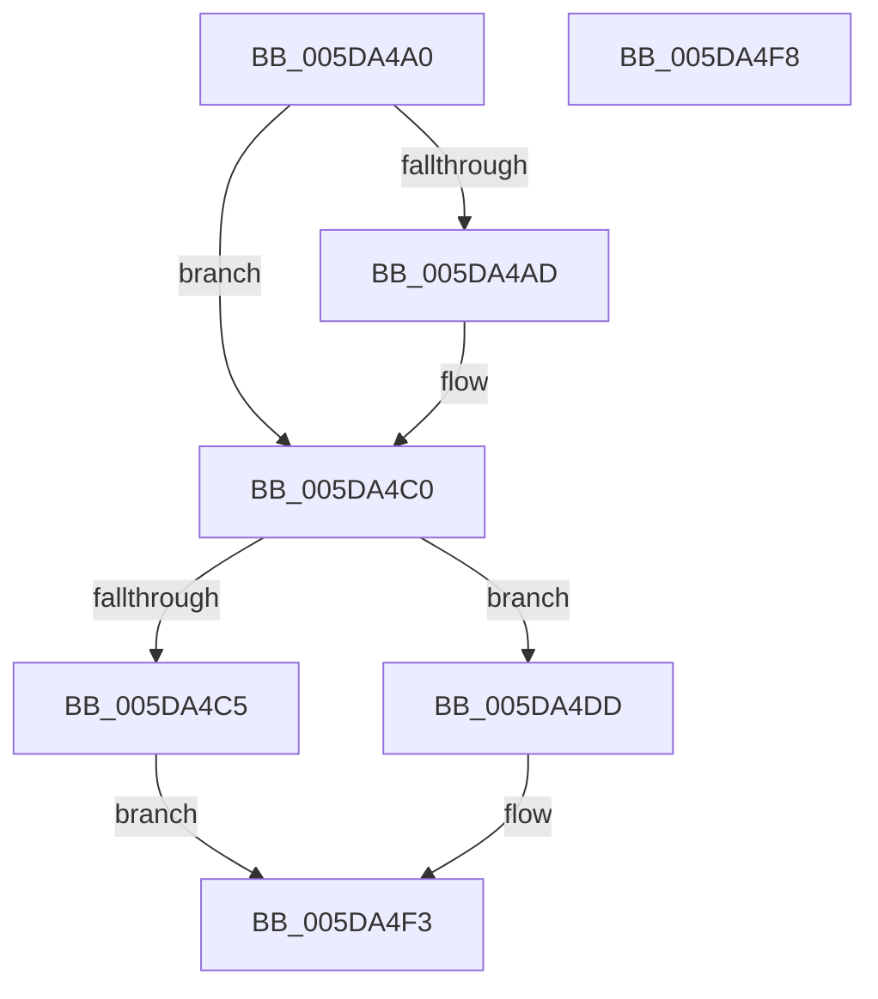

# PopFxDebuggerPowerCriticalTransitionCallback

- RVA: `0x005DA4A0`–`0x005DA4F9` (길이 `89` bytes)
- VA: `0x00000001405DA4A0`
- 실행 섹션: `.text`
- PDB 이름 있음: `예`; PDB Function 태그: `아니요`
- unwind 정보 RVA: `0x0005C788`
- 디코드: `25`개 명령, `89/89` bytes 표시
- 미해석 바이트: `0` (있으면 어셈블리에 `.byte`로 보존)

> 이 문서는 커널 이미지의 기계어와 PDB 기호를 분석해 생성했습니다. 4번과 5번은 함수 원형과 자료형을 바이너리 사용 방식에서 추정한 C 해석이며 원본 소스 복구 결과는 아닙니다.

## 1. Dependencies

- 직접 호출 지점: **5**; 고유 호출 대상: **3**
- 직접 호출자로 확인된 함수: **0**
- RIP 상대 이미지 참조: **1**

### Outgoing calls
- `0x005DA4BA` → [PopFxBugCheck](../2B/PopFxBugCheck_function_002BFC6C.md) (function, `0x002BFC6C`)
- `0x005DA4CA` → [KdCallPowerHandlers](../5B/KdCallPowerHandlers_function_005B083C.md) (function, `0x005B083C`)
- `0x005DA4D6` → [KdPowerTransitionEx](../4D/KdPowerTransitionEx_function_004D9150.md) (function, `0x004D9150`)
- `0x005DA4E4` → [KdPowerTransitionEx](../4D/KdPowerTransitionEx_function_004D9150.md) (function, `0x004D9150`)
- `0x005DA4EE` → [KdCallPowerHandlers](../5B/KdCallPowerHandlers_function_005B083C.md) (function, `0x005B083C`)

### Direct callers
- 이 함수 시작 RVA로 연결되는 직접 call은 확인되지 않았습니다. 간접 호출은 완전히 역산할 수 없습니다.

### Static image references
- `0x005DA4A4` → RVA `0x00FC6BA4` (`ALMOSTRO`; read)

## 2. Other-region calls and transfers

- 다른 실행 섹션으로 향하는 call: **0**
- 별도 외부 분기/꼬리 이동을 확인하지 못했습니다.

## 3. Assembly (complete function range)

```asm
005DA4A0  48 83 EC 28                     sub rsp, 0x28
005DA4A4  80 3D F9 C6 9E 00 00            cmp byte ptr [rip + 0x9ec6f9], 0
005DA4AB  74 13                           je 0x1405da4c0
005DA4AD  45 33 C9                        xor r9d, r9d
005DA4B0  45 33 C0                        xor r8d, r8d
005DA4B3  33 D2                           xor edx, edx
005DA4B5  B9 1E 06 00 00                  mov ecx, 0x61e
005DA4BA  E8 AD 57 CE FF                  call 0x1402bfc6c
005DA4BF  CC                              int3
005DA4C0  45 84 C0                        test r8b, r8b
005DA4C3  74 18                           je 0x1405da4dd
005DA4C5  B9 01 00 00 00                  mov ecx, 1
005DA4CA  E8 6D 63 FD FF                  call 0x1405b083c
005DA4CF  B2 01                           mov dl, 1
005DA4D1  B9 01 00 00 80                  mov ecx, 0x80000001
005DA4D6  E8 75 EC EF FF                  call 0x1404d9150
005DA4DB  EB 16                           jmp 0x1405da4f3
005DA4DD  B2 01                           mov dl, 1
005DA4DF  B9 04 00 00 80                  mov ecx, 0x80000004
005DA4E4  E8 67 EC EF FF                  call 0x1404d9150
005DA4E9  B9 04 00 00 00                  mov ecx, 4
005DA4EE  E8 49 63 FD FF                  call 0x1405b083c
005DA4F3  48 83 C4 28                     add rsp, 0x28
005DA4F7  C3                              ret
005DA4F8  CC                              int3
```

## 4. C-style interpretation (structured pseudocode)

```c
__int64 __fastcall PopFxDebuggerPowerCriticalTransitionCallback(__int64 a1, int a2, int a3, int a4)
{
    __int64 result;
    __int64 v_rsp;

    v_rsp = (v_rsp) - (40);
    if ((*(unsigned __int8 *)(v_rip + 10405625)) != 0) {
        a4 = 0;
        a3 = 0;
        a2 = 0;
        a1 = 0x61EULL;
        result = PopFxBugCheck(a1, a2, a3, a4);
    }
    if (0 == 0) goto loc_005DA4DD;
    result = KdCallPowerHandlers(1, a2, a3, a4);
    result = KdPowerTransitionEx((unsigned int)(0x80000001ULL), 1, a3, a4);
    goto loc_005DA4F3;
loc_005DA4DD:
    result = KdPowerTransitionEx((unsigned int)(0x80000004ULL), 1, a3, a4);
    result = KdCallPowerHandlers(4, 1, a3, a4);
loc_005DA4F3:
    v_rsp = (v_rsp) + (40);
    return result;
}
```

## 5. (Beta) C Style

```c
int64_t PopFxDebuggerPowerCriticalTransitionCallback(int64_t Arg1, int32_t Arg2, int32_t Arg3, int32_t Arg4)
{
    int64_t result;
    int64_t local_rsp;

    local_rsp = (local_rsp) - (40);
    if ((*(uint8_t *)(v_rip + 0x9EC6F9)) != 0) {
        Arg4 = 0;
        Arg3 = 0;
        Arg2 = 0;
        Arg1 = 0x61EULL;
        result = PopFxBugCheck(Arg1, Arg2, Arg3, Arg4);
    }
    if (0 == 0) goto loc_005DA4DD;
    result = KdCallPowerHandlers(1, Arg2, Arg3, Arg4);
    result = KdPowerTransitionEx((uint32_t)(0x80000001ULL), 1, Arg3, Arg4);
    goto loc_005DA4F3;
loc_005DA4DD:
    result = KdPowerTransitionEx((uint32_t)(0x80000004ULL), 1, Arg3, Arg4);
    result = KdCallPowerHandlers(4, 1, Arg3, Arg4);
loc_005DA4F3:
    local_rsp = (local_rsp) + (40);
    return result;
}
```

## 6. Execution-region graph

[열기: 2D/3D 그래프와 함수 탐색 컨트롤 패널](../../../control-panel.html?section=text&rva=0x005DA4A0&view=graph)

- 2D 그래프는 위에서 아래로 흐르고, 3D 그래프는 빈 공간을 드래그해 회전합니다. Shift+드래그는 이동, 휠은 확대·축소, 함수 노드 선택은 대상 보고서 이동입니다.

### Static fallback


