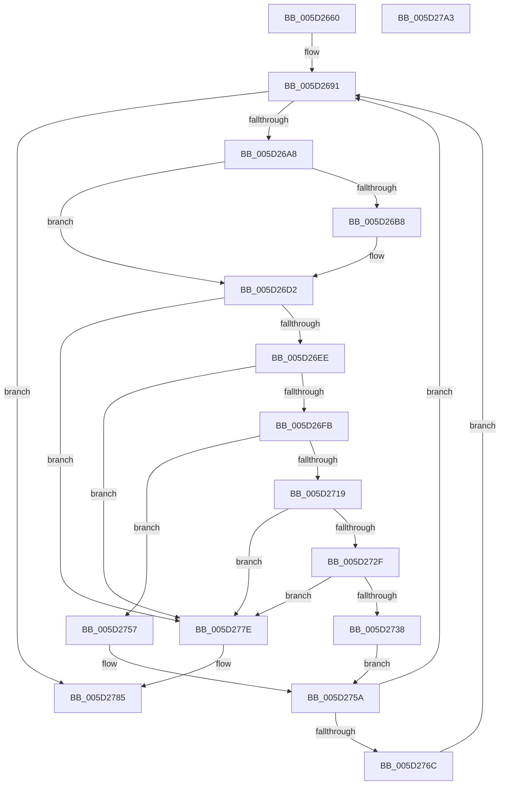

# PopFxDeviceRelationsCleanup

- RVA: `0x005D2660`–`0x005D27A4` (길이 `324` bytes)
- VA: `0x00000001405D2660`
- 실행 섹션: `.text`
- PDB 이름 있음: `예`; PDB Function 태그: `아니요`
- unwind 정보 RVA: `0x000701D4`
- 디코드: `87`개 명령, `324/324` bytes 표시
- 미해석 바이트: `0` (있으면 어셈블리에 `.byte`로 보존)

> 이 문서는 커널 이미지의 기계어와 PDB 기호를 분석해 생성했습니다. 4번과 5번은 함수 원형과 자료형을 바이너리 사용 방식에서 추정한 C 해석이며 원본 소스 복구 결과는 아닙니다.

## 1. Dependencies

- 직접 호출 지점: **8**; 고유 호출 대상: **7**
- 직접 호출자로 확인된 함수: **1**
- RIP 상대 이미지 참조: **0**

### Outgoing calls
- `0x005D2689` → [KeAcquireSpinLockRaiseToDpc](../20/KeAcquireSpinLockRaiseToDpc_function_00208470.md) (function, `0x00208470`)
- `0x005D269B` → [PopFxNextParentRelationSafe](../26/PopFxNextParentRelationSafe_function_0026EAC0.md) (function, `0x0026EAC0`)
- `0x005D26C6` → [PopFxIdleComponent](../2C/PopFxIdleComponent_function_002C01D8.md) (function, `0x002C01D8`)
- `0x005D2710` → [KxTryToAcquireSpinLock](../46/KxTryToAcquireSpinLock_function_0046BE18.md) (function, `0x0046BE18`)
- `0x005D274D` → [KxReleaseSpinLock](../20/KxReleaseSpinLock_function_00206670.md) (function, `0x00206670`)
- `0x005D275E` → [KxReleaseSpinLock](../20/KxReleaseSpinLock_function_00206670.md) (function, `0x00206670`)
- `0x005D2774` → [ExFreePoolWithTag](../../poolcode/B8/ExFreePoolWithTag_function_00B82870.md) (function, `0x00B82870`)
- `0x005D278B` → [KeReleaseSpinLock](../39/KeReleaseSpinLock_function_00392BA0.md) (function, `0x00392BA0`)

### Direct callers
- [PopFxUnregisterDevice](../../page/A8/PopFxUnregisterDevice_function_00A8AE84.md) at `0x00A8AFB3`

### Static image references
- 디코드된 RIP-relative 메모리 참조가 없습니다.

## 2. Other-region calls and transfers

- 다른 실행 섹션으로 향하는 call: **1**
  - `0x005D2774` → [ExFreePoolWithTag](../../poolcode/B8/ExFreePoolWithTag_function_00B82870.md) (`.text` → `POOLCODE`)
- 별도 외부 분기/꼬리 이동을 확인하지 못했습니다.

## 3. Assembly (complete function range)

```asm
005D2660  48 89 5C 24 10                  mov qword ptr [rsp + 0x10], rbx
005D2665  48 89 6C 24 18                  mov qword ptr [rsp + 0x18], rbp
005D266A  56                              push rsi
005D266B  57                              push rdi
005D266C  41 56                           push r14
005D266E  48 83 EC 20                     sub rsp, 0x20
005D2672  48 83 64 24 40 00               and qword ptr [rsp + 0x40], 0
005D2678  48 8D B1 00 05 00 00            lea rsi, [rcx + 0x500]
005D267F  4C 8D B1 18 05 00 00            lea r14, [rcx + 0x518]
005D2686  48 8B CE                        mov rcx, rsi
005D2689  E8 E2 5D C3 FF                  call 0x140208470
005D268E  40 8A E8                        mov bpl, al
005D2691  4C 8D 44 24 40                  lea r8, [rsp + 0x40]
005D2696  33 D2                           xor edx, edx
005D2698  49 8B CE                        mov rcx, r14
005D269B  E8 20 C4 C9 FF                  call 0x14026eac0
005D26A0  84 C0                           test al, al
005D26A2  0F 84 DD 00 00 00               je 0x1405d2785
005D26A8  48 8B 5C 24 40                  mov rbx, qword ptr [rsp + 0x40]
005D26AD  8B 43 10                        mov eax, dword ptr [rbx + 0x10]
005D26B0  48 8B 7B 18                     mov rdi, qword ptr [rbx + 0x18]
005D26B4  A8 02                           test al, 2
005D26B6  74 1A                           je 0x1405d26d2
005D26B8  8B 57 10                        mov edx, dword ptr [rdi + 0x10]
005D26BB  45 33 C9                        xor r9d, r9d
005D26BE  48 8B 4F 50                     mov rcx, qword ptr [rdi + 0x50]
005D26C2  45 8D 41 02                     lea r8d, [r9 + 2]
005D26C6  E8 0D DB CE FF                  call 0x1402c01d8
005D26CB  83 63 10 FD                     and dword ptr [rbx + 0x10], 0xfffffffd
005D26CF  8B 43 10                        mov eax, dword ptr [rbx + 0x10]
005D26D2  83 E0 F7                        and eax, 0xfffffff7
005D26D5  89 43 10                        mov dword ptr [rbx + 0x10], eax
005D26D8  48 8D 43 38                     lea rax, [rbx + 0x38]
005D26DC  48 83 63 30 00                  and qword ptr [rbx + 0x30], 0
005D26E1  48 8B 10                        mov rdx, qword ptr [rax]
005D26E4  48 39 42 08                     cmp qword ptr [rdx + 8], rax
005D26E8  0F 85 90 00 00 00               jne 0x1405d277e
005D26EE  48 8B 48 08                     mov rcx, qword ptr [rax + 8]
005D26F2  48 39 01                        cmp qword ptr [rcx], rax
005D26F5  0F 85 83 00 00 00               jne 0x1405d277e
005D26FB  48 89 11                        mov qword ptr [rcx], rdx
005D26FE  48 89 4A 08                     mov qword ptr [rdx + 8], rcx
005D2702  48 8D 8F 80 00 00 00            lea rcx, [rdi + 0x80]
005D2709  48 89 40 08                     mov qword ptr [rax + 8], rax
005D270D  48 89 00                        mov qword ptr [rax], rax
005D2710  E8 03 97 E9 FF                  call 0x14046be18
005D2715  84 C0                           test al, al
005D2717  74 3E                           je 0x1405d2757
005D2719  83 63 10 FB                     and dword ptr [rbx + 0x10], 0xfffffffb
005D271D  48 8D 43 20                     lea rax, [rbx + 0x20]
005D2721  48 83 63 18 00                  and qword ptr [rbx + 0x18], 0
005D2726  4C 8B 00                        mov r8, qword ptr [rax]
005D2729  49 39 40 08                     cmp qword ptr [r8 + 8], rax
005D272D  75 4F                           jne 0x1405d277e
005D272F  48 8B 50 08                     mov rdx, qword ptr [rax + 8]
005D2733  48 39 02                        cmp qword ptr [rdx], rax
005D2736  75 46                           jne 0x1405d277e
005D2738  4C 89 02                        mov qword ptr [rdx], r8
005D273B  48 8D 8F 80 00 00 00            lea rcx, [rdi + 0x80]
005D2742  49 89 50 08                     mov qword ptr [r8 + 8], rdx
005D2746  48 89 40 08                     mov qword ptr [rax + 8], rax
005D274A  48 89 00                        mov qword ptr [rax], rax
005D274D  E8 1E 3F C3 FF                  call 0x140206670
005D2752  40 B7 01                        mov dil, 1
005D2755  EB 03                           jmp 0x1405d275a
005D2757  40 32 FF                        xor dil, dil
005D275A  48 8D 4B 08                     lea rcx, [rbx + 8]
005D275E  E8 0D 3F C3 FF                  call 0x140206670
005D2763  40 84 FF                        test dil, dil
005D2766  0F 84 25 FF FF FF               je 0x1405d2691
005D276C  BA 50 46 58 4D                  mov edx, 0x4d584650
005D2771  48 8B CB                        mov rcx, rbx
005D2774  E8 F7 00 5B 00                  call 0x140b82870
005D2779  E9 13 FF FF FF                  jmp 0x1405d2691
005D277E  B9 03 00 00 00                  mov ecx, 3
005D2783  CD 29                           int 0x29
005D2785  40 8A D5                        mov dl, bpl
005D2788  48 8B CE                        mov rcx, rsi
005D278B  E8 10 04 DC FF                  call 0x140392ba0
005D2790  48 8B 5C 24 48                  mov rbx, qword ptr [rsp + 0x48]
005D2795  48 8B 6C 24 50                  mov rbp, qword ptr [rsp + 0x50]
005D279A  48 83 C4 20                     add rsp, 0x20
005D279E  41 5E                           pop r14
005D27A0  5F                              pop rdi
005D27A1  5E                              pop rsi
005D27A2  C3                              ret
005D27A3  CC                              int3
```

## 4. C-style interpretation (structured pseudocode)

```c
__int64 __fastcall PopFxDeviceRelationsCleanup(__int64 a1, int a2, __int64 a3, int a4)
{
    __int64 result;
    __int64 v_rdi;
    __int64 v_rsp;
    unsigned __int64 v_stack_p10;
    unsigned __int64 v_stack_p18;
    unsigned __int64 v_stack_p8;

    v_stack_p10 = v_rbx;
    v_stack_p18 = v_rbp;
    v_rsp = (v_rsp) - (32);
    result = KeAcquireSpinLockRaiseToDpc(a1 + 1280, a2, a3, a4);
loc_005D2691:
    a2 = 0;
    result = PopFxNextParentRelationSafe(a1 + 1304, a2, v_stack_p8, a4);
    if ((unsigned __int8)(result) == 0) goto loc_005D2785;
    result = (unsigned int)(*(unsigned int *)(v_stack_p8 + 16));
    if ((((unsigned __int8)((unsigned int)(*(unsigned int *)(v_stack_p8 + 16)))) & (2)) != 0) {
        a2 = *(unsigned int *)(*(unsigned __int64 *)(v_stack_p8 + 24) + 16);
        a4 = 0;
        a1 = *(unsigned __int64 *)(*(unsigned __int64 *)(v_stack_p8 + 24) + 80);
        a3 = a4 + 2;
        result = PopFxIdleComponent(a1, a2, a3, a4);
        result = *(unsigned int *)(v_stack_p8 + 16);
    }
    result = (unsigned int)((result) & (0xFFFFFFF7ULL));
    *(unsigned int *)(v_stack_p8 + 16) = (unsigned int)(result);
    if ((*(unsigned __int64 *)(*(unsigned __int64 *)(v_stack_p8 + 56) + 8)) != (v_stack_p8 + 56)) goto loc_005D277E;
    if ((*(unsigned __int64 *)(*(unsigned __int64 *)(v_stack_p8 + 56 + 8))) != (v_stack_p8 + 56)) goto loc_005D277E;
    *(unsigned __int64 *)(*(unsigned __int64 *)(v_stack_p8 + 56 + 8)) = *(unsigned __int64 *)(v_stack_p8 + 56);
    *(unsigned __int64 *)(*(unsigned __int64 *)(v_stack_p8 + 56) + 8) = *(unsigned __int64 *)(v_stack_p8 + 56 + 8);
    *(unsigned __int64 *)(v_stack_p8 + 56 + 8) = v_stack_p8 + 56;
    *(unsigned __int64 *)(v_stack_p8 + 56) = v_stack_p8 + 56;
    result = KxTryToAcquireSpinLock(*(unsigned __int64 *)(v_stack_p8 + 24) + 128, *(unsigned __int64 *)(v_stack_p8 + 56), a3, a4);
    if ((unsigned __int8)(result) == 0) goto loc_005D2757;
    if ((*(unsigned __int64 *)(*(unsigned __int64 *)(v_stack_p8 + 32) + 8)) != (v_stack_p8 + 32)) goto loc_005D277E;
    if ((*(unsigned __int64 *)(*(unsigned __int64 *)(v_stack_p8 + 32 + 8))) != (v_stack_p8 + 32)) goto loc_005D277E;
    *(unsigned __int64 *)(*(unsigned __int64 *)(v_stack_p8 + 32 + 8)) = *(unsigned __int64 *)(v_stack_p8 + 32);
    *(unsigned __int64 *)(*(unsigned __int64 *)(v_stack_p8 + 32) + 8) = *(unsigned __int64 *)(v_stack_p8 + 32 + 8);
    *(unsigned __int64 *)(v_stack_p8 + 32 + 8) = v_stack_p8 + 32;
    *(unsigned __int64 *)(v_stack_p8 + 32) = v_stack_p8 + 32;
    result = KxReleaseSpinLock(*(unsigned __int64 *)(v_stack_p8 + 24) + 128, *(unsigned __int64 *)(v_stack_p8 + 32 + 8), *(unsigned __int64 *)(v_stack_p8 + 32), a4);
    goto loc_005D275A;
loc_005D2757:
    v_rdi = 0;
loc_005D275A:
    result = KxReleaseSpinLock(v_stack_p8 + 8, *(unsigned __int64 *)(v_stack_p8 + 32 + 8), *(unsigned __int64 *)(v_stack_p8 + 32), a4);
    if (0 == 0) goto loc_005D2691;
    result = ExFreePoolWithTag(v_stack_p8, (unsigned int)(0x4D584650ULL), *(unsigned __int64 *)(v_stack_p8 + 32), a4);
    goto loc_005D2691;
loc_005D277E:
loc_005D2785:
    result = KeReleaseSpinLock(a1 + 1280, (unsigned __int8)((unsigned __int8)(result)), *(unsigned __int64 *)(v_stack_p8 + 32), a4);
    v_rsp = (v_rsp) + (32);
    return result;
}
```

## 5. (Beta) C Style

```c
int64_t PopFxDeviceRelationsCleanup(void *Arg1, int32_t Arg2, int64_t Arg3, int32_t Arg4)
{
    uint8_t *arg1 = (uint8_t *)Arg1;

    int64_t result;
    int64_t local_rdi;
    int64_t local_rsp;
    uint64_t v_stack_p10;
    uint64_t v_stack_p18;
    uint64_t v_stack_p8;

    v_stack_p10 = local_rbx;
    v_stack_p18 = local_rbp;
    local_rsp = (local_rsp) - (32);
    result = KeAcquireSpinLockRaiseToDpc(Arg1 + 1280, Arg2, Arg3, Arg4);
loc_005D2691:
    Arg2 = 0;
    result = PopFxNextParentRelationSafe(Arg1 + 1304, Arg2, v_stack_p8, Arg4);
    if ((uint8_t)(result) == 0) goto loc_005D2785;
    result = (uint32_t)(*(uint32_t *)(v_stack_p8 + 0x10));
    if ((((uint8_t)((uint32_t)(*(uint32_t *)(v_stack_p8 + 0x10)))) & (2)) != 0) {
        Arg2 = *(uint32_t *)(*(uint64_t *)(v_stack_p8 + 0x18) + 0x10);
        Arg4 = 0;
        Arg1 = *(uint64_t *)(*(uint64_t *)(v_stack_p8 + 0x18) + 0x50);
        Arg3 = Arg4 + 2;
        result = PopFxIdleComponent(Arg1, Arg2, Arg3, Arg4);
        result = *(uint32_t *)(v_stack_p8 + 0x10);
    }
    result = (uint32_t)((result) & (0xFFFFFFF7ULL));
    *(uint32_t *)(v_stack_p8 + 0x10) = (uint32_t)(result);
    if ((*(uint64_t *)(*(uint64_t *)(v_stack_p8 + 0x38) + 0x8)) != (v_stack_p8 + 56)) goto loc_005D277E;
    if ((*(uint64_t *)(*(uint64_t *)(v_stack_p8 + 0x38 + 0x8))) != (v_stack_p8 + 56)) goto loc_005D277E;
    *(uint64_t *)(*(uint64_t *)(v_stack_p8 + 0x38 + 0x8)) = *(uint64_t *)(v_stack_p8 + 0x38);
    *(uint64_t *)(*(uint64_t *)(v_stack_p8 + 0x38) + 0x8) = *(uint64_t *)(v_stack_p8 + 0x38 + 0x8);
    *(uint64_t *)(v_stack_p8 + 0x38 + 0x8) = v_stack_p8 + 56;
    *(uint64_t *)(v_stack_p8 + 0x38) = v_stack_p8 + 56;
    result = KxTryToAcquireSpinLock(*(uint64_t *)(v_stack_p8 + 0x18) + 128, *(uint64_t *)(v_stack_p8 + 0x38), Arg3, Arg4);
    if ((uint8_t)(result) == 0) goto loc_005D2757;
    if ((*(uint64_t *)(*(uint64_t *)(v_stack_p8 + 0x20) + 0x8)) != (v_stack_p8 + 32)) goto loc_005D277E;
    if ((*(uint64_t *)(*(uint64_t *)(v_stack_p8 + 0x20 + 0x8))) != (v_stack_p8 + 32)) goto loc_005D277E;
    *(uint64_t *)(*(uint64_t *)(v_stack_p8 + 0x20 + 0x8)) = *(uint64_t *)(v_stack_p8 + 0x20);
    *(uint64_t *)(*(uint64_t *)(v_stack_p8 + 0x20) + 0x8) = *(uint64_t *)(v_stack_p8 + 0x20 + 0x8);
    *(uint64_t *)(v_stack_p8 + 0x20 + 0x8) = v_stack_p8 + 32;
    *(uint64_t *)(v_stack_p8 + 0x20) = v_stack_p8 + 32;
    result = KxReleaseSpinLock(*(uint64_t *)(v_stack_p8 + 0x18) + 128, *(uint64_t *)(v_stack_p8 + 0x20 + 0x8), *(uint64_t *)(v_stack_p8 + 0x20), Arg4);
    goto loc_005D275A;
loc_005D2757:
    local_rdi = 0;
loc_005D275A:
    result = KxReleaseSpinLock(v_stack_p8 + 8, *(uint64_t *)(v_stack_p8 + 0x20 + 0x8), *(uint64_t *)(v_stack_p8 + 0x20), Arg4);
    if (0 == 0) goto loc_005D2691;
    result = ExFreePoolWithTag(v_stack_p8, (uint32_t)(0x4D584650ULL), *(uint64_t *)(v_stack_p8 + 0x20), Arg4);
    goto loc_005D2691;
loc_005D277E:
loc_005D2785:
    result = KeReleaseSpinLock(Arg1 + 1280, (uint8_t)((uint8_t)(result)), *(uint64_t *)(v_stack_p8 + 0x20), Arg4);
    local_rsp = (local_rsp) + (32);
    return result;
}
```

### 관측된 메모리 오프셋

구조체 형식이 확인되지 않은 접근은 인자 기준의 오프셋으로만 기록했습니다.

| 기준 인자 | 오프셋 표현 | 폭 (bit) | 접근 |
|---|---:|---:|---|
| `Arg1` | `+ 0x500` | `64` | `R` |
| `Arg1` | `+ 0x518` | `64` | `R` |

## 6. Execution-region graph

[열기: 2D/3D 그래프와 함수 탐색 컨트롤 패널](../../../control-panel.html?section=text&rva=0x005D2660&view=graph)

- 2D 그래프는 위에서 아래로 흐르고, 3D 그래프는 빈 공간을 드래그해 회전합니다. Shift+드래그는 이동, 휠은 확대·축소, 함수 노드 선택은 대상 보고서 이동입니다.

### Static fallback


