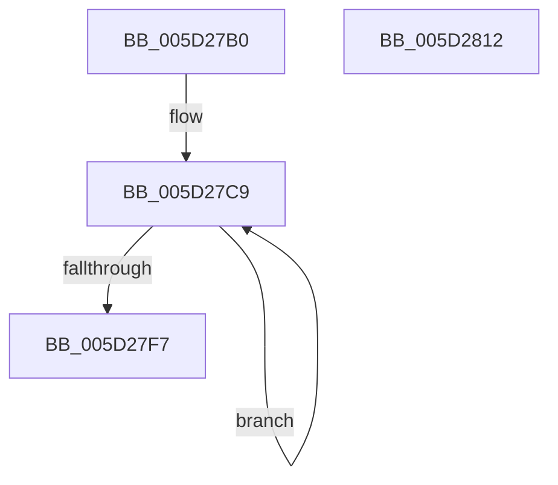

# PopFxDeviceWork

- RVA: `0x005D27B0`–`0x005D2813` (길이 `99` bytes)
- VA: `0x00000001405D27B0`
- 실행 섹션: `.text`
- PDB 이름 있음: `예`; PDB Function 태그: `아니요`
- unwind 정보 RVA: `0x00060BC4`
- 디코드: `28`개 명령, `99/99` bytes 표시
- 미해석 바이트: `0` (있으면 어셈블리에 `.byte`로 보존)

> 이 문서는 커널 이미지의 기계어와 PDB 기호를 분석해 생성했습니다. 4번과 5번은 함수 원형과 자료형을 바이너리 사용 방식에서 추정한 C 해석이며 원본 소스 복구 결과는 아닙니다.

## 1. Dependencies

- 직접 호출 지점: **4**; 고유 호출 대상: **4**
- 직접 호출자로 확인된 함수: **0**
- RIP 상대 이미지 참조: **0**

### Outgoing calls
- `0x005D27CC` → [KeAcquireSpinLockRaiseToDpc](../20/KeAcquireSpinLockRaiseToDpc_function_00208470.md) (function, `0x00208470`)
- `0x005D27D8` → [PopFxDeliverDevicePowerRequired](../49/PopFxDeliverDevicePowerRequired_function_00492C4C.md) (function, `0x00492C4C`)
- `0x005D27E2` → [KeReleaseSpinLock](../39/KeReleaseSpinLock_function_00392BA0.md) (function, `0x00392BA0`)
- `0x005D27FD` → [PopFxDereferenceDevice](../27/PopFxDereferenceDevice_function_0027038C.md) (function, `0x0027038C`)

### Direct callers
- 이 함수 시작 RVA로 연결되는 직접 call은 확인되지 않았습니다. 간접 호출은 완전히 역산할 수 없습니다.

### Static image references
- 디코드된 RIP-relative 메모리 참조가 없습니다.

## 2. Other-region calls and transfers

- 다른 실행 섹션으로 향하는 call: **0**
- 별도 외부 분기/꼬리 이동을 확인하지 못했습니다.

## 3. Assembly (complete function range)

```asm
005D27B0  48 89 5C 24 08                  mov qword ptr [rsp + 8], rbx
005D27B5  48 89 74 24 10                  mov qword ptr [rsp + 0x10], rsi
005D27BA  57                              push rdi
005D27BB  48 83 EC 20                     sub rsp, 0x20
005D27BF  48 8B F9                        mov rdi, rcx
005D27C2  48 8D B1 90 01 00 00            lea rsi, [rcx + 0x190]
005D27C9  48 8B CE                        mov rcx, rsi
005D27CC  E8 9F 5C C3 FF                  call 0x140208470
005D27D1  33 D2                           xor edx, edx
005D27D3  48 8B CF                        mov rcx, rdi
005D27D6  8A D8                           mov bl, al
005D27D8  E8 6F 04 EC FF                  call 0x140492c4c
005D27DD  8A D3                           mov dl, bl
005D27DF  48 8B CE                        mov rcx, rsi
005D27E2  E8 B9 03 DC FF                  call 0x140392ba0
005D27E7  83 C8 FF                        or eax, 0xffffffff
005D27EA  F0 0F C1 87 78 01 00 00         lock xadd dword ptr [rdi + 0x178], eax
005D27F2  83 F8 01                        cmp eax, 1
005D27F5  75 D2                           jne 0x1405d27c9
005D27F7  8D 50 03                        lea edx, [rax + 3]
005D27FA  48 8B CF                        mov rcx, rdi
005D27FD  E8 8A DB C9 FF                  call 0x14027038c
005D2802  48 8B 5C 24 30                  mov rbx, qword ptr [rsp + 0x30]
005D2807  48 8B 74 24 38                  mov rsi, qword ptr [rsp + 0x38]
005D280C  48 83 C4 20                     add rsp, 0x20
005D2810  5F                              pop rdi
005D2811  C3                              ret
005D2812  CC                              int3
```

## 4. C-style interpretation (structured pseudocode)

```c
__int64 __fastcall PopFxDeviceWork(__int64 a1, int a2)
{
    __int64 result;
    __int64 v_rsp;
    unsigned __int64 v_stack_p10;
    unsigned __int64 v_stack_p8;

    v_stack_p8 = v_rbx;
    v_stack_p10 = v_rsi;
    v_rsp = (v_rsp) - (32);
loc_005D27C9:
    result = KeAcquireSpinLockRaiseToDpc(a1 + 400, a2, a3, a4);
    a2 = 0;
    result = PopFxDeliverDevicePowerRequired(a1, a2, a3, a4);
    result = KeReleaseSpinLock(a1 + 400, (unsigned __int8)((unsigned __int8)(result)), a3, a4);
    result = (unsigned int)((result) | (0xFFFFFFFFULL));
    if (((unsigned int)(result)) != 1) goto loc_005D27C9;
    result = PopFxDereferenceDevice(a1, result + 3, a3, a4);
    v_rsp = (v_rsp) + (32);
    return result;
}
```

## 5. (Beta) C Style

```c
int64_t PopFxDeviceWork(void *Arg1, int32_t Arg2)
{
    uint8_t *arg1 = (uint8_t *)Arg1;

    int64_t result;
    int64_t local_rsp;
    uint64_t v_stack_p10;
    uint64_t v_stack_p8;

    v_stack_p8 = local_rbx;
    v_stack_p10 = local_rsi;
    local_rsp = (local_rsp) - (32);
loc_005D27C9:
    result = KeAcquireSpinLockRaiseToDpc(Arg1 + 400, Arg2, a3, a4);
    Arg2 = 0;
    result = PopFxDeliverDevicePowerRequired(Arg1, Arg2, a3, a4);
    result = KeReleaseSpinLock(Arg1 + 400, (uint8_t)((uint8_t)(result)), a3, a4);
    result = (uint32_t)((result) | (0xFFFFFFFFULL));
    if (((uint32_t)(result)) != 1) goto loc_005D27C9;
    result = PopFxDereferenceDevice(Arg1, result + 3, a3, a4);
    local_rsp = (local_rsp) + (32);
    return result;
}
```

### 관측된 메모리 오프셋

구조체 형식이 확인되지 않은 접근은 인자 기준의 오프셋으로만 기록했습니다.

| 기준 인자 | 오프셋 표현 | 폭 (bit) | 접근 |
|---|---:|---:|---|
| `Arg1` | `+ 0x178` | `32` | `R/W` |
| `Arg1` | `+ 0x190` | `64` | `R` |

## 6. Execution-region graph

[열기: 2D/3D 그래프와 함수 탐색 컨트롤 패널](../../../control-panel.html?section=text&rva=0x005D27B0&view=graph)

- 2D 그래프는 위에서 아래로 흐르고, 3D 그래프는 빈 공간을 드래그해 회전합니다. Shift+드래그는 이동, 휠은 확대·축소, 함수 노드 선택은 대상 보고서 이동입니다.

### Static fallback


