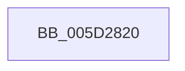

# PopFxDirectedWorkOrderWatchdog

- RVA: `0x005D2820`–`0x005D28C9` (길이 `169` bytes)
- VA: `0x00000001405D2820`
- 실행 섹션: `.text`
- PDB 이름 있음: `예`; PDB Function 태그: `아니요`
- unwind 정보 RVA: `0x000CC0F4`
- 디코드: `36`개 명령, `169/169` bytes 표시
- 미해석 바이트: `0` (있으면 어셈블리에 `.byte`로 보존)

> 이 문서는 커널 이미지의 기계어와 PDB 기호를 분석해 생성했습니다. 4번과 5번은 함수 원형과 자료형을 바이너리 사용 방식에서 추정한 C 해석이며 원본 소스 복구 결과는 아닙니다.

## 1. Dependencies

- 직접 호출 지점: **2**; 고유 호출 대상: **2**
- 직접 호출자로 확인된 함수: **0**
- RIP 상대 이미지 참조: **4**

### Outgoing calls
- `0x005D283B` → [PopInternalSaveStackToDumpFile](../5C/PopInternalSaveStackToDumpFile_function_005CE6F0.md) (function, `0x005CE6F0`)
- `0x005D28C3` → [KeBugCheckEx](../4F/KeBugCheckEx_function_004FD660.md) (function, `0x004FD660`)

### Direct callers
- 이 함수 시작 RVA로 연결되는 직접 call은 확인되지 않았습니다. 간접 호출은 완전히 역산할 수 없습니다.

### Static image references
- `0x005D2844` → RVA `0x00F0CA40` (`.data`; read)
- `0x005D285B` → RVA `0x00F091F0` (`.data`; read)
- `0x005D2872` → RVA `0x00EFAAB8` (`.data`; read)
- `0x005D287D` → RVA `0x00EFAAB0` (`.data`; read)

## 2. Other-region calls and transfers

- 다른 실행 섹션으로 향하는 call: **0**
- 별도 외부 분기/꼬리 이동을 확인하지 못했습니다.

## 3. Assembly (complete function range)

```asm
005D2820  48 89 5C 24 08                  mov qword ptr [rsp + 8], rbx
005D2825  55                              push rbp
005D2826  48 8B EC                        mov rbp, rsp
005D2829  48 81 EC 80 00 00 00            sub rsp, 0x80
005D2830  48 8D 9A 08 FC FF FF            lea rbx, [rdx - 0x3f8]
005D2837  48 8B 4B 60                     mov rcx, qword ptr [rbx + 0x60]
005D283B  E8 B0 BE FF FF                  call 0x1405ce6f0
005D2840  83 65 B4 00                     and dword ptr [rbp - 0x4c], 0
005D2844  48 8D 05 F5 A1 93 00            lea rax, [rip + 0x93a1f5]
005D284B  83 65 DC 00                     and dword ptr [rbp - 0x24], 0
005D284F  4C 8B CB                        mov r9, rbx
005D2852  48 89 45 B8                     mov qword ptr [rbp - 0x48], rax
005D2856  BA 05 00 00 00                  mov edx, 5
005D285B  48 8D 05 8E 69 93 00            lea rax, [rip + 0x93698e]
005D2862  C7 45 B0 05 80 01 00            mov dword ptr [rbp - 0x50], 0x18005
005D2869  48 89 45 C0                     mov qword ptr [rbp - 0x40], rax
005D286D  B9 9F 00 00 00                  mov ecx, 0x9f
005D2872  48 8B 05 3F 82 92 00            mov rax, qword ptr [rip + 0x92823f]
005D2879  48 89 45 C8                     mov qword ptr [rbp - 0x38], rax
005D287D  48 8B 05 2C 82 92 00            mov rax, qword ptr [rip + 0x92822c]
005D2884  48 89 45 D0                     mov qword ptr [rbp - 0x30], rax
005D2888  8B 43 20                        mov eax, dword ptr [rbx + 0x20]
005D288B  89 45 F0                        mov dword ptr [rbp - 0x10], eax
005D288E  8B 83 B0 04 00 00               mov eax, dword ptr [rbx + 0x4b0]
005D2894  4C 8B 43 60                     mov r8, qword ptr [rbx + 0x60]
005D2898  89 45 F4                        mov dword ptr [rbp - 0xc], eax
005D289B  8B 83 BC 03 00 00               mov eax, dword ptr [rbx + 0x3bc]
005D28A1  89 45 D8                        mov dword ptr [rbp - 0x28], eax
005D28A4  48 8B 83 98 04 00 00            mov rax, qword ptr [rbx + 0x498]
005D28AB  48 89 45 E0                     mov qword ptr [rbp - 0x20], rax
005D28AF  48 8B 83 A0 04 00 00            mov rax, qword ptr [rbx + 0x4a0]
005D28B6  48 89 45 E8                     mov qword ptr [rbp - 0x18], rax
005D28BA  48 8D 45 B0                     lea rax, [rbp - 0x50]
005D28BE  48 89 44 24 20                  mov qword ptr [rsp + 0x20], rax
005D28C3  E8 98 AD F2 FF                  call 0x1404fd660
005D28C8  CC                              int3
```

## 4. C-style interpretation (structured pseudocode)

```c
__int64 __fastcall PopFxDirectedWorkOrderWatchdog(__int64 a1, __int64 a2)
{
    __int64 result;
    __int64 v_rsp;
    unsigned int v_stack_m14;
    unsigned int v_stack_m18;
    unsigned __int64 v_stack_m20;
    unsigned __int64 v_stack_m28;
    unsigned int v_stack_m2C;
    unsigned int v_stack_m30;
    unsigned __int64 v_stack_m38;
    unsigned __int64 v_stack_m40;
    unsigned __int64 v_stack_m48;
    unsigned __int64 v_stack_m50;
    unsigned int v_stack_m54;
    unsigned int v_stack_m58;
    unsigned __int64 v_stack_m68;
    unsigned __int64 v_stack_p8;

    v_stack_p8 = v_rbx;
    v_rsp = (v_rsp) - (128);
    result = PopInternalSaveStackToDumpFile(*(unsigned __int64 *)(a2 - 1016 + 96), a2, a3, a4);
    v_stack_m50 = v_rip + 9675253;
    v_stack_m58 = 0x18005ULL;
    v_stack_m48 = v_rip + 9660814;
    v_stack_m40 = *(unsigned __int64 *)(v_rip + 9601599);
    v_stack_m38 = *(unsigned __int64 *)(v_rip + 9601580);
    v_stack_m18 = (unsigned int)((unsigned int)(*(unsigned int *)(a2 - 1016 + 32)));
    v_stack_m14 = (unsigned int)((unsigned int)(*(unsigned int *)(a2 - 1016 + 1200)));
    v_stack_m30 = (unsigned int)((unsigned int)(*(unsigned int *)(a2 - 1016 + 956)));
    v_stack_m28 = *(unsigned __int64 *)(a2 - 1016 + 1176);
    v_stack_m20 = *(unsigned __int64 *)(a2 - 1016 + 1184);
    v_stack_m68 = v_stack_m58;
    result = KeBugCheckEx(159, 5, *(unsigned __int64 *)(a2 - 1016 + 96), a2 - 1016);
    return result;
}
```

## 5. (Beta) C Style

```c
int64_t PopFxDirectedWorkOrderWatchdog(int64_t Arg1, void *Arg2)
{
    uint8_t *arg2 = (uint8_t *)Arg2;

    int64_t result;
    int64_t local_rsp;
    uint32_t v_stack_m14;
    uint32_t v_stack_m18;
    uint64_t v_stack_m20;
    uint64_t v_stack_m28;
    uint32_t v_stack_m2C;
    uint32_t v_stack_m30;
    uint64_t v_stack_m38;
    uint64_t v_stack_m40;
    uint64_t v_stack_m48;
    uint64_t v_stack_m50;
    uint32_t v_stack_m54;
    uint32_t v_stack_m58;
    uint64_t v_stack_m68;
    uint64_t v_stack_p8;

    v_stack_p8 = local_rbx;
    local_rsp = (local_rsp) - (128);
    result = PopInternalSaveStackToDumpFile(*(uint64_t *)(arg2 - 0x3F8 + 0x60), Arg2, a3, a4);
    v_stack_m50 = v_rip + 9675253;
    v_stack_m58 = 0x18005ULL;
    v_stack_m48 = v_rip + 9660814;
    v_stack_m40 = *(uint64_t *)(v_rip + 0x92823F);
    v_stack_m38 = *(uint64_t *)(v_rip + 0x92822C);
    v_stack_m18 = (uint32_t)((uint32_t)(*(uint32_t *)(arg2 - 0x3F8 + 0x20)));
    v_stack_m14 = (uint32_t)((uint32_t)(*(uint32_t *)(arg2 - 0x3F8 + 0x4B0)));
    v_stack_m30 = (uint32_t)((uint32_t)(*(uint32_t *)(arg2 - 0x3F8 + 0x3BC)));
    v_stack_m28 = *(uint64_t *)(arg2 - 0x3F8 + 0x498);
    v_stack_m20 = *(uint64_t *)(arg2 - 0x3F8 + 0x4A0);
    v_stack_m68 = v_stack_m58;
    result = KeBugCheckEx(159, 5, *(uint64_t *)(arg2 - 0x3F8 + 0x60), Arg2 - 1016);
    return result;
}
```

### 관측된 메모리 오프셋

구조체 형식이 확인되지 않은 접근은 인자 기준의 오프셋으로만 기록했습니다.

| 기준 인자 | 오프셋 표현 | 폭 (bit) | 접근 |
|---|---:|---:|---|
| `Arg2` | `- 0x3F8` | `64` | `R` |
| `Arg2` | `+ 0x20` | `32` | `R` |
| `Arg2` | `+ 0x60` | `64` | `R` |
| `Arg2` | `+ 0x3BC` | `32` | `R` |
| `Arg2` | `+ 0x498` | `64` | `R` |
| `Arg2` | `+ 0x4A0` | `64` | `R` |
| `Arg2` | `+ 0x4B0` | `32` | `R` |

## 6. Execution-region graph

[열기: 2D/3D 그래프와 함수 탐색 컨트롤 패널](../../../control-panel.html?section=text&rva=0x005D2820&view=graph)

- 2D 그래프는 위에서 아래로 흐르고, 3D 그래프는 빈 공간을 드래그해 회전합니다. Shift+드래그는 이동, 휠은 확대·축소, 함수 노드 선택은 대상 보고서 이동입니다.

### Static fallback


