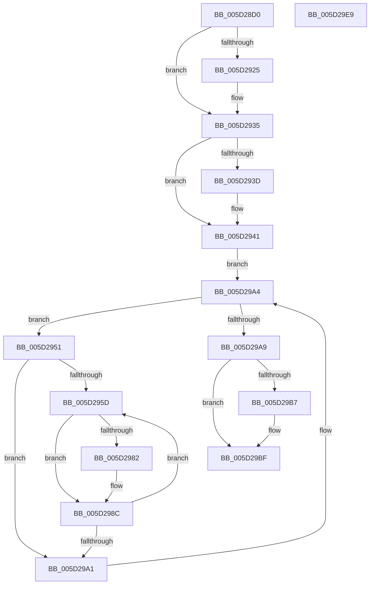

# PopFxDisableBasicAccountingWorker

- RVA: `0x005D28D0`–`0x005D29EA` (길이 `282` bytes)
- VA: `0x00000001405D28D0`
- 실행 섹션: `.text`
- PDB 이름 있음: `예`; PDB Function 태그: `아니요`
- unwind 정보 RVA: `0x000B0E24`
- 디코드: `77`개 명령, `282/282` bytes 표시
- 미해석 바이트: `0` (있으면 어셈블리에 `.byte`로 보존)

> 이 문서는 커널 이미지의 기계어와 PDB 기호를 분석해 생성했습니다. 4번과 5번은 함수 원형과 자료형을 바이너리 사용 방식에서 추정한 C 해석이며 원본 소스 복구 결과는 아닙니다.

## 1. Dependencies

- 직접 호출 지점: **8**; 고유 호출 대상: **8**
- 직접 호출자로 확인된 함수: **0**
- RIP 상대 이미지 참조: **2**

### Outgoing calls
- `0x005D290C` → [KeAbPreAcquire](../21/KeAbPreAcquire_function_00210230.md) (function, `0x00210230`)
- `0x005D2930` → [ExfAcquirePushLockSharedEx](../21/ExfAcquirePushLockSharedEx_function_0021044C.md) (function, `0x0021044C`)
- `0x005D2974` → [KeAcquireSpinLockRaiseToDpc](../20/KeAcquireSpinLockRaiseToDpc_function_00208470.md) (function, `0x00208470`)
- `0x005D2987` → [PopFxReinitializeAccountingInstance](../4B/PopFxReinitializeAccountingInstance_function_004B0960.md) (function, `0x004B0960`)
- `0x005D2992` → [KeReleaseSpinLock](../39/KeReleaseSpinLock_function_00392BA0.md) (function, `0x00392BA0`)
- `0x005D29BA` → [ExfReleasePushLockShared](../26/ExfReleasePushLockShared_function_00263440.md) (function, `0x00263440`)
- `0x005D29C2` → [KeAbPostRelease](../2E/KeAbPostRelease_function_002E1600.md) (function, `0x002E1600`)
- `0x005D29C7` → [KeLeaveCriticalRegion](../25/KeLeaveCriticalRegion_function_0025D8B0.md) (function, `0x0025D8B0`)

### Direct callers
- 이 함수 시작 RVA로 연결되는 직접 call은 확인되지 않았습니다. 간접 호출은 완전히 역산할 수 없습니다.

### Static image references
- `0x005D28F5` → RVA `0x00F0E408` (`.data`; read)
- `0x005D2941` → RVA `0x00F0E3F0` (`.data`; read)

## 2. Other-region calls and transfers

- 다른 실행 섹션으로 향하는 call: **0**
- 별도 외부 분기/꼬리 이동을 확인하지 못했습니다.

## 3. Assembly (complete function range)

```asm
005D28D0  48 89 5C 24 08                  mov qword ptr [rsp + 8], rbx
005D28D5  48 89 6C 24 18                  mov qword ptr [rsp + 0x18], rbp
005D28DA  48 89 74 24 20                  mov qword ptr [rsp + 0x20], rsi
005D28DF  57                              push rdi
005D28E0  41 54                           push r12
005D28E2  41 55                           push r13
005D28E4  41 56                           push r14
005D28E6  41 57                           push r15
005D28E8  48 83 EC 20                     sub rsp, 0x20
005D28EC  65 48 8B 04 25 88 01 00 00      mov rax, qword ptr gs:[0x188]
005D28F5  4C 8D 35 0C BB 93 00            lea r14, [rip + 0x93bb0c]
005D28FC  45 33 C0                        xor r8d, r8d
005D28FF  33 D2                           xor edx, edx
005D2901  49 8B CE                        mov rcx, r14
005D2904  66 FF 88 E4 01 00 00            dec word ptr [rax + 0x1e4]
005D290B  90                              nop
005D290C  E8 1F D9 C3 FF                  call 0x140210230
005D2911  48 8B D8                        mov rbx, rax
005D2914  33 C0                           xor eax, eax
005D2916  44 8D 68 11                     lea r13d, [rax + 0x11]
005D291A  F0 4C 0F B1 2D E5 BA 93 00      lock cmpxchg qword ptr [rip + 0x93bae5], r13
005D2923  74 10                           je 0x1405d2935
005D2925  4D 8B CE                        mov r9, r14
005D2928  4C 8B C3                        mov r8, rbx
005D292B  33 D2                           xor edx, edx
005D292D  49 8B CE                        mov rcx, r14
005D2930  E8 17 DB C3 FF                  call 0x14021044c
005D2935  45 33 FF                        xor r15d, r15d
005D2938  48 85 DB                        test rbx, rbx
005D293B  74 04                           je 0x1405d2941
005D293D  C6 43 0A 01                     mov byte ptr [rbx + 0xa], 1
005D2941  48 8B 1D A8 BA 93 00            mov rbx, qword ptr [rip + 0x93baa8]
005D2948  4C 8D 25 A1 BA 93 00            lea r12, [rip + 0x93baa1]
005D294F  EB 53                           jmp 0x1405d29a4
005D2951  41 8B F7                        mov esi, r15d
005D2954  44 39 BB 64 03 00 00            cmp dword ptr [rbx + 0x364], r15d
005D295B  76 44                           jbe 0x1405d29a1
005D295D  48 8B 83 68 03 00 00            mov rax, qword ptr [rbx + 0x368]
005D2964  8B CE                           mov ecx, esi
005D2966  48 8B 3C C8                     mov rdi, qword ptr [rax + rcx*8]
005D296A  48 81 C7 C8 00 00 00            add rdi, 0xc8
005D2971  48 8B CF                        mov rcx, rdi
005D2974  E8 F7 5A C3 FF                  call 0x140208470
005D2979  83 7F 10 01                     cmp dword ptr [rdi + 0x10], 1
005D297D  40 8A E8                        mov bpl, al
005D2980  75 0A                           jne 0x1405d298c
005D2982  33 D2                           xor edx, edx
005D2984  48 8B CF                        mov rcx, rdi
005D2987  E8 D4 DF ED FF                  call 0x1404b0960
005D298C  40 8A D5                        mov dl, bpl
005D298F  48 8B CF                        mov rcx, rdi
005D2992  E8 09 02 DC FF                  call 0x140392ba0
005D2997  FF C6                           inc esi
005D2999  3B B3 64 03 00 00               cmp esi, dword ptr [rbx + 0x364]
005D299F  72 BC                           jb 0x1405d295d
005D29A1  48 8B 1B                        mov rbx, qword ptr [rbx]
005D29A4  49 3B DC                        cmp rbx, r12
005D29A7  75 A8                           jne 0x1405d2951
005D29A9  49 8B C5                        mov rax, r13
005D29AC  F0 4C 0F B1 3D 53 BA 93 00      lock cmpxchg qword ptr [rip + 0x93ba53], r15
005D29B5  74 08                           je 0x1405d29bf
005D29B7  49 8B CE                        mov rcx, r14
005D29BA  E8 81 0A C9 FF                  call 0x140263440
005D29BF  49 8B CE                        mov rcx, r14
005D29C2  E8 39 EC D0 FF                  call 0x1402e1600
005D29C7  E8 E4 AE C8 FF                  call 0x14025d8b0
005D29CC  48 8B 5C 24 50                  mov rbx, qword ptr [rsp + 0x50]
005D29D1  48 8B 6C 24 60                  mov rbp, qword ptr [rsp + 0x60]
005D29D6  48 8B 74 24 68                  mov rsi, qword ptr [rsp + 0x68]
005D29DB  48 83 C4 20                     add rsp, 0x20
005D29DF  41 5F                           pop r15
005D29E1  41 5E                           pop r14
005D29E3  41 5D                           pop r13
005D29E5  41 5C                           pop r12
005D29E7  5F                              pop rdi
005D29E8  C3                              ret
005D29E9  CC                              int3
```

## 4. C-style interpretation (structured pseudocode)

```c
__int64 __fastcall PopFxDisableBasicAccountingWorker(__int64 a1, int a2, int a3)
{
    __int64 result;
    __int64 v_r15;
    __int64 v_rdi;
    __int64 v_rsi;
    __int64 v_rsp;
    unsigned __int64 v_stack_p18;
    unsigned __int64 v_stack_p20;
    unsigned __int64 v_stack_p8;

    v_stack_p8 = v_rbx;
    v_stack_p18 = v_rbp;
    v_stack_p20 = v_rsi;
    v_rsp = (v_rsp) - (32);
    a3 = 0;
    a2 = 0;
    result = KeAbPreAcquire(v_rip + 9681676, a2, a3, a4);
    result = 0;
    if (!(condition_is_equal)) {
        a4 = v_rip + 9681676;
        a3 = 0;
        a2 = 0;
        a1 = v_rip + 9681676;
        result = ExfAcquirePushLockSharedEx(a1, a2, a3, a4);
    }
    v_r15 = 0;
    if (result != 0) {
        *(unsigned __int8 *)(result + 10) = 1;
    }
    goto loc_005D29A4;
loc_005D2951:
    if ((*(unsigned int *)(*(unsigned __int64 *)(v_rip + 9681576) + 868)) <= 0) goto loc_005D29A1;
loc_005D295D:
    v_rdi = (*(unsigned __int64 *)(*(unsigned __int64 *)(*(unsigned __int64 *)(v_rip + 9681576) + 872) + 0 * 8)) + (200);
    result = KeAcquireSpinLockRaiseToDpc(v_rdi, a2, a3, a4);
    if ((*(unsigned int *)(v_rdi + 16)) == 1) {
        a2 = 0;
        a1 = v_rdi;
        result = PopFxReinitializeAccountingInstance(a1, a2, a3, a4);
    }
    result = KeReleaseSpinLock(v_rdi, (unsigned __int8)((unsigned __int8)(result)), a3, a4);
    v_rsi = (unsigned int)((0) + 1);
    if (((unsigned int)(v_rsi)) < (*(unsigned int *)(*(unsigned __int64 *)(v_rip + 9681576) + 868))) goto loc_005D295D;
loc_005D29A1:
loc_005D29A4:
    if ((*(unsigned __int64 *)(*(unsigned __int64 *)(v_rip + 9681576))) != (v_rip + 9681569)) goto loc_005D2951;
    result = result + 17;
    if ((*(unsigned __int64 *)(*(unsigned __int64 *)(v_rip + 9681576))) != (v_rip + 9681569)) {
        a1 = v_rip + 9681676;
        result = ExfReleasePushLockShared(a1, (unsigned __int8)((unsigned __int8)(result)), a3, a4);
    }
    result = KeAbPostRelease(v_rip + 9681676, (unsigned __int8)((unsigned __int8)(result)), a3, a4);
    result = KeLeaveCriticalRegion(v_rip + 9681676, (unsigned __int8)((unsigned __int8)(result)), a3, a4);
    v_rsp = (v_rsp) + (32);
    return result;
}
```

## 5. (Beta) C Style

```c
int64_t PopFxDisableBasicAccountingWorker(int64_t Arg1, int32_t Arg2, int32_t Arg3)
{
    int64_t result;
    int64_t local_r15;
    int64_t local_rdi;
    int64_t local_rsi;
    int64_t local_rsp;
    uint64_t v_stack_p18;
    uint64_t v_stack_p20;
    uint64_t v_stack_p8;

    v_stack_p8 = local_rbx;
    v_stack_p18 = local_rbp;
    v_stack_p20 = local_rsi;
    local_rsp = (local_rsp) - (32);
    Arg3 = 0;
    Arg2 = 0;
    result = KeAbPreAcquire(v_rip + 9681676, Arg2, Arg3, a4);
    result = 0;
    if (!(condition_is_equal)) {
        a4 = v_rip + 9681676;
        Arg3 = 0;
        Arg2 = 0;
        Arg1 = v_rip + 9681676;
        result = ExfAcquirePushLockSharedEx(Arg1, Arg2, Arg3, a4);
    }
    local_r15 = 0;
    if (result != 0) {
        *(uint8_t *)(result + 0xA) = 1;
    }
    goto loc_005D29A4;
loc_005D2951:
    if ((*(uint32_t *)(*(uint64_t *)(v_rip + 0x93BAA8) + 0x364)) <= 0) goto loc_005D29A1;
loc_005D295D:
    local_rdi = (*(uint64_t *)(*(uint64_t *)(*(uint64_t *)(v_rip + 0x93BAA8) + 0x368) + 0x0 * 8)) + (200);
    result = KeAcquireSpinLockRaiseToDpc(local_rdi, Arg2, Arg3, a4);
    if ((*(uint32_t *)(local_rdi + 0x10)) == 1) {
        Arg2 = 0;
        Arg1 = local_rdi;
        result = PopFxReinitializeAccountingInstance(Arg1, Arg2, Arg3, a4);
    }
    result = KeReleaseSpinLock(local_rdi, (uint8_t)((uint8_t)(result)), Arg3, a4);
    local_rsi = (uint32_t)((0) + 1);
    if (((uint32_t)(local_rsi)) < (*(uint32_t *)(*(uint64_t *)(v_rip + 0x93BAA8) + 0x364))) goto loc_005D295D;
loc_005D29A1:
loc_005D29A4:
    if ((*(uint64_t *)(*(uint64_t *)(v_rip + 0x93BAA8))) != (v_rip + 9681569)) goto loc_005D2951;
    result = result + 17;
    if ((*(uint64_t *)(*(uint64_t *)(v_rip + 0x93BAA8))) != (v_rip + 9681569)) {
        Arg1 = v_rip + 9681676;
        result = ExfReleasePushLockShared(Arg1, (uint8_t)((uint8_t)(result)), Arg3, a4);
    }
    result = KeAbPostRelease(v_rip + 9681676, (uint8_t)((uint8_t)(result)), Arg3, a4);
    result = KeLeaveCriticalRegion(v_rip + 9681676, (uint8_t)((uint8_t)(result)), Arg3, a4);
    local_rsp = (local_rsp) + (32);
    return result;
}
```

## 6. Execution-region graph

[열기: 2D/3D 그래프와 함수 탐색 컨트롤 패널](../../../control-panel.html?section=text&rva=0x005D28D0&view=graph)

- 2D 그래프는 위에서 아래로 흐르고, 3D 그래프는 빈 공간을 드래그해 회전합니다. Shift+드래그는 이동, 휠은 확대·축소, 함수 노드 선택은 대상 보고서 이동입니다.

### Static fallback


