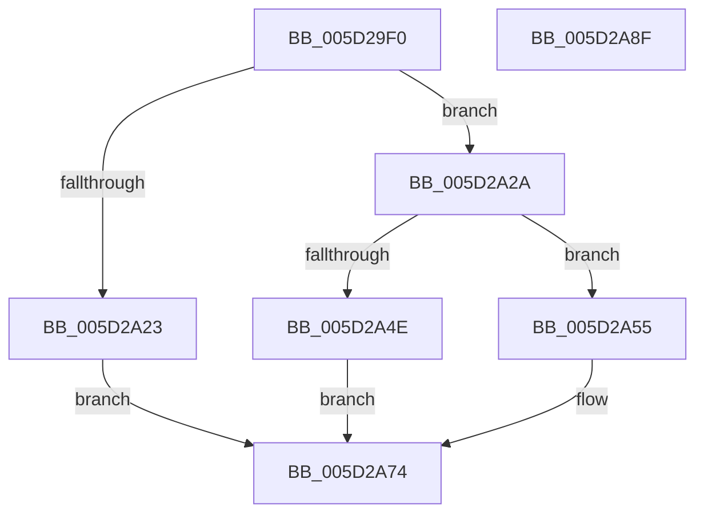

# PopFxDuplicateUniqueId

- RVA: `0x005D29F0`–`0x005D2A90` (길이 `160` bytes)
- VA: `0x00000001405D29F0`
- 실행 섹션: `.text`
- PDB 이름 있음: `예`; PDB Function 태그: `아니요`
- unwind 정보 RVA: `0x00060300`
- 디코드: `47`개 명령, `160/160` bytes 표시
- 미해석 바이트: `0` (있으면 어셈블리에 `.byte`로 보존)

> 이 문서는 커널 이미지의 기계어와 PDB 기호를 분석해 생성했습니다. 4번과 5번은 함수 원형과 자료형을 바이너리 사용 방식에서 추정한 C 해석이며 원본 소스 복구 결과는 아닙니다.

## 1. Dependencies

- 직접 호출 지점: **2**; 고유 호출 대상: **2**
- 직접 호출자로 확인된 함수: **1**
- RIP 상대 이미지 참조: **0**

### Outgoing calls
- `0x005D2A3F` → [ExAllocatePool2](../../poolcode/B8/ExAllocatePool2_function_00B820F0.md) (function, `0x00B820F0`)
- `0x005D2A5F` → [memcpy](../6C/memcpy_function_006C6840.md) (function, `0x006C6840`)

### Direct callers
- [PopFxCreateDeviceCommon](PopFxCreateDeviceCommon_function_005D2424.md) at `0x005D2446`

### Static image references
- 디코드된 RIP-relative 메모리 참조가 없습니다.

## 2. Other-region calls and transfers

- 다른 실행 섹션으로 향하는 call: **1**
  - `0x005D2A3F` → [ExAllocatePool2](../../poolcode/B8/ExAllocatePool2_function_00B820F0.md) (`.text` → `POOLCODE`)
- 별도 외부 분기/꼬리 이동을 확인하지 못했습니다.

## 3. Assembly (complete function range)

```asm
005D29F0  48 89 5C 24 08                  mov qword ptr [rsp + 8], rbx
005D29F5  48 89 6C 24 10                  mov qword ptr [rsp + 0x10], rbp
005D29FA  48 89 74 24 18                  mov qword ptr [rsp + 0x18], rsi
005D29FF  57                              push rdi
005D2A00  41 56                           push r14
005D2A02  41 57                           push r15
005D2A04  48 83 EC 20                     sub rsp, 0x20
005D2A08  0F B7 31                        movzx esi, word ptr [rcx]
005D2A0B  48 8B F9                        mov rdi, rcx
005D2A0E  B9 02 00 00 00                  mov ecx, 2
005D2A13  4C 8B F2                        mov r14, rdx
005D2A16  0F B7 47 02                     movzx eax, word ptr [rdi + 2]
005D2A1A  4C 8D 04 31                     lea r8, [rcx + rsi]
005D2A1E  49 3B C0                        cmp rax, r8
005D2A21  73 07                           jae 0x1405d2a2a
005D2A23  BB 0D 00 00 C0                  mov ebx, 0xc000000d
005D2A28  EB 4A                           jmp 0x1405d2a74
005D2A2A  66 03 F1                        add si, cx
005D2A2D  41 B8 50 46 58 4D               mov r8d, 0x4d584650
005D2A33  44 0F B7 FE                     movzx r15d, si
005D2A37  B9 40 00 00 00                  mov ecx, 0x40
005D2A3C  41 8B D7                        mov edx, r15d
005D2A3F  E8 AC F6 5A 00                  call 0x140b820f0
005D2A44  33 DB                           xor ebx, ebx
005D2A46  48 8B E8                        mov rbp, rax
005D2A49  48 85 C0                        test rax, rax
005D2A4C  75 07                           jne 0x1405d2a55
005D2A4E  BB 9A 00 00 C0                  mov ebx, 0xc000009a
005D2A53  EB 1F                           jmp 0x1405d2a74
005D2A55  48 8B 57 08                     mov rdx, qword ptr [rdi + 8]
005D2A59  4D 8B C7                        mov r8, r15
005D2A5C  48 8B CD                        mov rcx, rbp
005D2A5F  E8 DC 3D 0F 00                  call 0x1406c6840
005D2A64  0F B7 0F                        movzx ecx, word ptr [rdi]
005D2A67  66 41 89 0E                     mov word ptr [r14], cx
005D2A6B  49 89 6E 08                     mov qword ptr [r14 + 8], rbp
005D2A6F  66 41 89 76 02                  mov word ptr [r14 + 2], si
005D2A74  48 8B 6C 24 48                  mov rbp, qword ptr [rsp + 0x48]
005D2A79  8B C3                           mov eax, ebx
005D2A7B  48 8B 5C 24 40                  mov rbx, qword ptr [rsp + 0x40]
005D2A80  48 8B 74 24 50                  mov rsi, qword ptr [rsp + 0x50]
005D2A85  48 83 C4 20                     add rsp, 0x20
005D2A89  41 5F                           pop r15
005D2A8B  41 5E                           pop r14
005D2A8D  5F                              pop rdi
005D2A8E  C3                              ret
005D2A8F  CC                              int3
```

## 4. C-style interpretation (structured pseudocode)

```c
__int64 __fastcall PopFxDuplicateUniqueId(__int64 a1, __int64 a2)
{
    __int64 result;
    __int64 v_rbx;
    __int64 v_rsi;
    __int64 v_rsp;
    unsigned __int64 v_stack_p10;
    unsigned __int64 v_stack_p18;
    unsigned __int64 v_stack_p8;

    v_stack_p8 = v_rbx;
    v_stack_p10 = v_rbp;
    v_stack_p18 = v_rsi;
    v_rsp = (v_rsp) - (32);
    if ((*(unsigned __int16 *)(a1 + 2)) >= (2 + *(unsigned __int16 *)(a1) * 1)) goto loc_005D2A2A;
    goto loc_005D2A74;
loc_005D2A2A:
    v_rsi = (unsigned __int16)((*(unsigned __int16 *)(a1)) + (2));
    result = ExAllocatePool2(64, (unsigned int)((unsigned int)((unsigned __int16)(v_rsi))), (unsigned int)(0x4D584650ULL), a4);
    v_rbx = 0;
    if (result != 0) goto loc_005D2A55;
    goto loc_005D2A74;
loc_005D2A55:
    result = memcpy(result, *(unsigned __int64 *)(a1 + 8), (unsigned __int16)(v_rsi), a4);
    *(unsigned __int16 *)(a2) = (unsigned __int16)(*(unsigned __int16 *)(a1));
    *(unsigned __int64 *)(a2 + 8) = result;
    *(unsigned __int16 *)(a2 + 2) = (unsigned __int16)(v_rsi);
loc_005D2A74:
    v_rsp = (v_rsp) + (32);
    return (unsigned int)((unsigned int)((unsigned int)(0xC000009AULL)));
}
```

## 5. (Beta) C Style

```c
int64_t PopFxDuplicateUniqueId(void *Arg1, void *Arg2)
{
    uint8_t *arg1 = (uint8_t *)Arg1;
    uint8_t *arg2 = (uint8_t *)Arg2;

    int64_t result;
    int64_t local_rbx;
    int64_t local_rsi;
    int64_t local_rsp;
    uint64_t v_stack_p10;
    uint64_t v_stack_p18;
    uint64_t v_stack_p8;

    v_stack_p8 = local_rbx;
    v_stack_p10 = local_rbp;
    v_stack_p18 = local_rsi;
    local_rsp = (local_rsp) - (32);
    if ((*(uint16_t *)(arg1 + 0x2)) >= (2 + *(uint16_t *)(arg1) * 1)) goto loc_005D2A2A;
    goto loc_005D2A74;
loc_005D2A2A:
    local_rsi = (uint16_t)((*(uint16_t *)(arg1)) + (2));
    result = ExAllocatePool2(64, (uint32_t)((uint32_t)((uint16_t)(local_rsi))), (uint32_t)(0x4D584650ULL), a4);
    local_rbx = 0;
    if (result != 0) goto loc_005D2A55;
    goto loc_005D2A74;
loc_005D2A55:
    result = memcpy(result, *(uint64_t *)(arg1 + 0x8), (uint16_t)(local_rsi), a4);
    *(uint16_t *)(arg2) = (uint16_t)(*(uint16_t *)(arg1));
    *(uint64_t *)(arg2 + 0x8) = result;
    *(uint16_t *)(arg2 + 0x2) = (uint16_t)(local_rsi);
loc_005D2A74:
    local_rsp = (local_rsp) + (32);
    return (uint32_t)((uint32_t)((uint32_t)(0xC000009AULL)));
}
```

### 관측된 메모리 오프셋

구조체 형식이 확인되지 않은 접근은 인자 기준의 오프셋으로만 기록했습니다.

| 기준 인자 | 오프셋 표현 | 폭 (bit) | 접근 |
|---|---:|---:|---|
| `Arg1` | `+ 0x0` | `16` | `R` |
| `Arg1` | `+ 0x2` | `16` | `R` |
| `Arg1` | `+ 0x8` | `64` | `R` |
| `Arg2` | `+ 0x0` | `16` | `W` |
| `Arg2` | `+ 0x2` | `16` | `W` |
| `Arg2` | `+ 0x8` | `64` | `W` |

## 6. Execution-region graph

[열기: 2D/3D 그래프와 함수 탐색 컨트롤 패널](../../../control-panel.html?section=text&rva=0x005D29F0&view=graph)

- 2D 그래프는 위에서 아래로 흐르고, 3D 그래프는 빈 공간을 드래그해 회전합니다. Shift+드래그는 이동, 휠은 확대·축소, 함수 노드 선택은 대상 보고서 이동입니다.

### Static fallback


