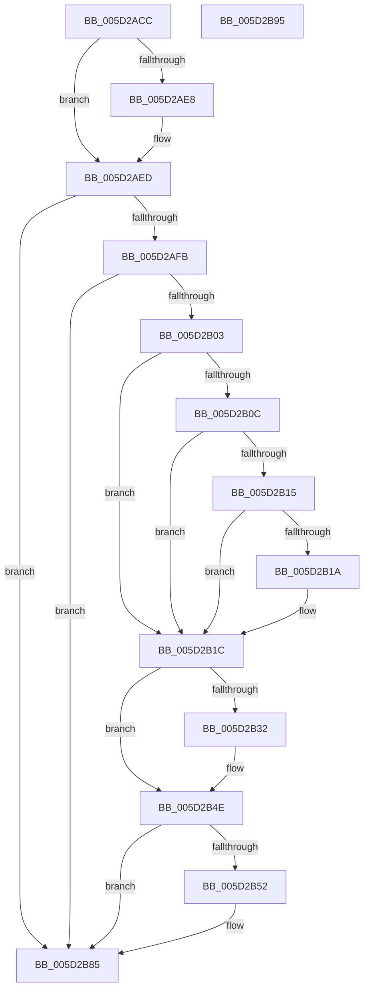

# PopFxEnforceDirectedPowerTransition

- RVA: `0x005D2ACC`–`0x005D2B96` (길이 `202` bytes)
- VA: `0x00000001405D2ACC`
- 실행 섹션: `.text`
- PDB 이름 있음: `예`; PDB Function 태그: `아니요`
- unwind 정보 RVA: `0x0008A4C8`
- 디코드: `52`개 명령, `202/202` bytes 표시
- 미해석 바이트: `0` (있으면 어셈블리에 `.byte`로 보존)

> 이 문서는 커널 이미지의 기계어와 PDB 기호를 분석해 생성했습니다. 4번과 5번은 함수 원형과 자료형을 바이너리 사용 방식에서 추정한 C 해석이며 원본 소스 복구 결과는 아닙니다.

## 1. Dependencies

- 직접 호출 지점: **3**; 고유 호출 대상: **3**
- 직접 호출자로 확인된 함수: **1**
- RIP 상대 이미지 참조: **4**

### Outgoing calls
- `0x005D2AE8` → [PopDirectedDripsDiagTraceDfxPowerStateFailure](PopDirectedDripsDiagTraceDfxPowerStateFailure_function_005DD2B4.md) (function, `0x005DD2B4`)
- `0x005D2B48` → [KeBugCheckEx](../4F/KeBugCheckEx_function_004FD660.md) (function, `0x004FD660`)
- `0x005D2B80` → [DbgkWerCaptureLiveKernelDump](../../page/AC/DbgkWerCaptureLiveKernelDump_function_00AC1E90.md) (function, `0x00AC1E90`)

### Direct callers
- [PopFxCompleteDirectedPowerTransition](../4F/PopFxCompleteDirectedPowerTransition_function_004FB330.md) at `0x004FB446`

### Static image references
- `0x005D2AED` → RVA `0x00E0B3B8` (`.data`; read)
- `0x005D2B03` → RVA `0x00F475F8` (`.data`; read)
- `0x005D2B0C` → RVA `0x00F475DC` (`.data`; read)
- `0x005D2B5F` → RVA `0x006CBEB0` (` ?? ::FNODOBFM::`string'`; read)

## 2. Other-region calls and transfers

- 다른 실행 섹션으로 향하는 call: **1**
  - `0x005D2B80` → [DbgkWerCaptureLiveKernelDump](../../page/AC/DbgkWerCaptureLiveKernelDump_function_00AC1E90.md) (`.text` → `PAGE`)
- 별도 외부 분기/꼬리 이동을 확인하지 못했습니다.

## 3. Assembly (complete function range)

```asm
005D2ACC  48 89 5C 24 08                  mov qword ptr [rsp + 8], rbx
005D2AD1  48 89 74 24 10                  mov qword ptr [rsp + 0x10], rsi
005D2AD6  57                              push rdi
005D2AD7  48 83 EC 50                     sub rsp, 0x50
005D2ADB  41 0F B6 F0                     movzx esi, r8b
005D2ADF  8B FA                           mov edi, edx
005D2AE1  48 8B D9                        mov rbx, rcx
005D2AE4  85 D2                           test edx, edx
005D2AE6  79 05                           jns 0x1405d2aed
005D2AE8  E8 C7 A7 00 00                  call 0x1405dd2b4
005D2AED  8B 05 C5 88 83 00               mov eax, dword ptr [rip + 0x8388c5]
005D2AF3  85 C0                           test eax, eax
005D2AF5  0F 84 8A 00 00 00               je 0x1405d2b85
005D2AFB  85 FF                           test edi, edi
005D2AFD  0F 89 82 00 00 00               jns 0x1405d2b85
005D2B03  80 3D EE 4A 97 00 00            cmp byte ptr [rip + 0x974aee], 0
005D2B0A  74 10                           je 0x1405d2b1c
005D2B0C  80 3D C9 4A 97 00 00            cmp byte ptr [rip + 0x974ac9], 0
005D2B13  75 07                           jne 0x1405d2b1c
005D2B15  83 F8 03                        cmp eax, 3
005D2B18  75 02                           jne 0x1405d2b1c
005D2B1A  CD 2C                           int 0x2c
005D2B1C  48 8B 43 30                     mov rax, qword ptr [rbx + 0x30]
005D2B20  8B 88 F8 02 00 00               mov ecx, dword ptr [rax + 0x2f8]
005D2B26  83 E1 40                        and ecx, 0x40
005D2B29  83 3D 88 88 83 00 02            cmp dword ptr [rip + 0x838888], 2
005D2B30  75 1C                           jne 0x1405d2b4e
005D2B32  48 83 64 24 20 00               and qword ptr [rsp + 0x20], 0
005D2B38  4C 8B CE                        mov r9, rsi
005D2B3B  4C 8B C3                        mov r8, rbx
005D2B3E  BA 06 00 00 00                  mov edx, 6
005D2B43  B9 9F 00 00 00                  mov ecx, 0x9f
005D2B48  E8 13 AB F2 FF                  call 0x1404fd660
005D2B4D  CC                              int3
005D2B4E  85 C9                           test ecx, ecx
005D2B50  75 33                           jne 0x1405d2b85
005D2B52  21 4C 24 40                     and dword ptr [rsp + 0x40], ecx
005D2B56  4C 8B CE                        mov r9, rsi
005D2B59  48 83 64 24 38 00               and qword ptr [rsp + 0x38], 0
005D2B5F  48 8D 0D 4A 93 0F 00            lea rcx, [rip + 0xf934a]
005D2B66  48 83 64 24 30 00               and qword ptr [rsp + 0x30], 0
005D2B6C  4C 8B C3                        mov r8, rbx
005D2B6F  48 83 64 24 28 00               and qword ptr [rsp + 0x28], 0
005D2B75  BA A9 01 00 00                  mov edx, 0x1a9
005D2B7A  48 83 64 24 20 00               and qword ptr [rsp + 0x20], 0
005D2B80  E8 0B F3 4E 00                  call 0x140ac1e90
005D2B85  48 8B 5C 24 60                  mov rbx, qword ptr [rsp + 0x60]
005D2B8A  48 8B 74 24 68                  mov rsi, qword ptr [rsp + 0x68]
005D2B8F  48 83 C4 50                     add rsp, 0x50
005D2B93  5F                              pop rdi
005D2B94  C3                              ret
005D2B95  CC                              int3
```

## 4. C-style interpretation (structured pseudocode)

```c
__int64 __fastcall PopFxEnforceDirectedPowerTransition(__int64 a1, int a2, unsigned __int8 a3)
{
    __int64 result;
    __int64 v_rsp;
    unsigned int v_stack_m18;
    unsigned __int64 v_stack_m20;
    unsigned __int64 v_stack_m28;
    unsigned __int64 v_stack_m30;
    unsigned __int64 v_stack_m38;
    unsigned __int64 v_stack_p10;
    unsigned __int64 v_stack_p8;

    v_stack_p8 = v_rbx;
    v_stack_p10 = v_rsi;
    v_rsp = (v_rsp) - (80);
    if (sign_flag) {
        result = PopDirectedDripsDiagTraceDfxPowerStateFailure(a1, a2, a3, a4);
    }
    if ((unsigned int)((unsigned int)(*(unsigned int *)(v_rip + 8620229))) == 0) goto loc_005D2B85;
    if (!sign_flag) goto loc_005D2B85;
    if ((*(unsigned __int8 *)(v_rip + 9915118)) == 0) goto loc_005D2B1C;
    if ((*(unsigned __int8 *)(v_rip + 9915081)) != 0) goto loc_005D2B1C;
    if (((unsigned int)((unsigned int)(*(unsigned int *)(v_rip + 8620229)))) == 3) {
    }
    a1 = (unsigned int)(((unsigned int)(*(unsigned int *)(*(unsigned __int64 *)(a1 + 48) + 760))) & (64));
    result = *(unsigned __int64 *)(a1 + 48);
    if ((*(unsigned int *)(v_rip + 8620168)) == 2) {
        a4 = a3;
        a3 = a1;
        a2 = 6;
        a1 = 159;
        result = KeBugCheckEx(a1, a2, a3, a4);
    }
    if ((unsigned int)(a1) == 0) {
        a4 = a3;
        a1 = v_rip + 1020746;
        a3 = a1;
        a2 = 425;
        result = DbgkWerCaptureLiveKernelDump(a1, a2, a3, a4);
    }
    v_rsp = (v_rsp) + (80);
    return result;
}
```

## 5. (Beta) C Style

```c
int64_t PopFxEnforceDirectedPowerTransition(void *Arg1, int32_t Arg2, uint8_t Arg3)
{
    uint8_t *arg1 = (uint8_t *)Arg1;

    int64_t result;
    int64_t local_rsp;
    uint32_t v_stack_m18;
    uint64_t v_stack_m20;
    uint64_t v_stack_m28;
    uint64_t v_stack_m30;
    uint64_t v_stack_m38;
    uint64_t v_stack_p10;
    uint64_t v_stack_p8;

    v_stack_p8 = local_rbx;
    v_stack_p10 = local_rsi;
    local_rsp = (local_rsp) - (80);
    if (sign_flag) {
        result = PopDirectedDripsDiagTraceDfxPowerStateFailure(Arg1, Arg2, Arg3, a4);
    }
    if ((uint32_t)((uint32_t)(*(uint32_t *)(v_rip + 0x8388C5))) == 0) goto loc_005D2B85;
    if (!sign_flag) goto loc_005D2B85;
    if ((*(uint8_t *)(v_rip + 0x974AEE)) == 0) goto loc_005D2B1C;
    if ((*(uint8_t *)(v_rip + 0x974AC9)) != 0) goto loc_005D2B1C;
    if (((uint32_t)((uint32_t)(*(uint32_t *)(v_rip + 0x8388C5)))) == 3) {
    }
    Arg1 = (uint32_t)(((uint32_t)(*(uint32_t *)(*(uint64_t *)(arg1 + 0x30) + 0x2F8))) & (64));
    result = *(uint64_t *)(arg1 + 0x30);
    if ((*(uint32_t *)(v_rip + 0x838888)) == 2) {
        a4 = Arg3;
        Arg3 = Arg1;
        Arg2 = 6;
        Arg1 = 159;
        result = KeBugCheckEx(Arg1, Arg2, Arg3, a4);
    }
    if ((uint32_t)(Arg1) == 0) {
        a4 = Arg3;
        Arg1 = v_rip + 1020746;
        Arg3 = Arg1;
        Arg2 = 425;
        result = DbgkWerCaptureLiveKernelDump(Arg1, Arg2, Arg3, a4);
    }
    local_rsp = (local_rsp) + (80);
    return result;
}
```

### 관측된 메모리 오프셋

구조체 형식이 확인되지 않은 접근은 인자 기준의 오프셋으로만 기록했습니다.

| 기준 인자 | 오프셋 표현 | 폭 (bit) | 접근 |
|---|---:|---:|---|
| `Arg1` | `+ 0x30` | `64` | `R` |

## 6. Execution-region graph

[열기: 2D/3D 그래프와 함수 탐색 컨트롤 패널](../../../control-panel.html?section=text&rva=0x005D2ACC&view=graph)

- 2D 그래프는 위에서 아래로 흐르고, 3D 그래프는 빈 공간을 드래그해 회전합니다. Shift+드래그는 이동, 휠은 확대·축소, 함수 노드 선택은 대상 보고서 이동입니다.

### Static fallback


