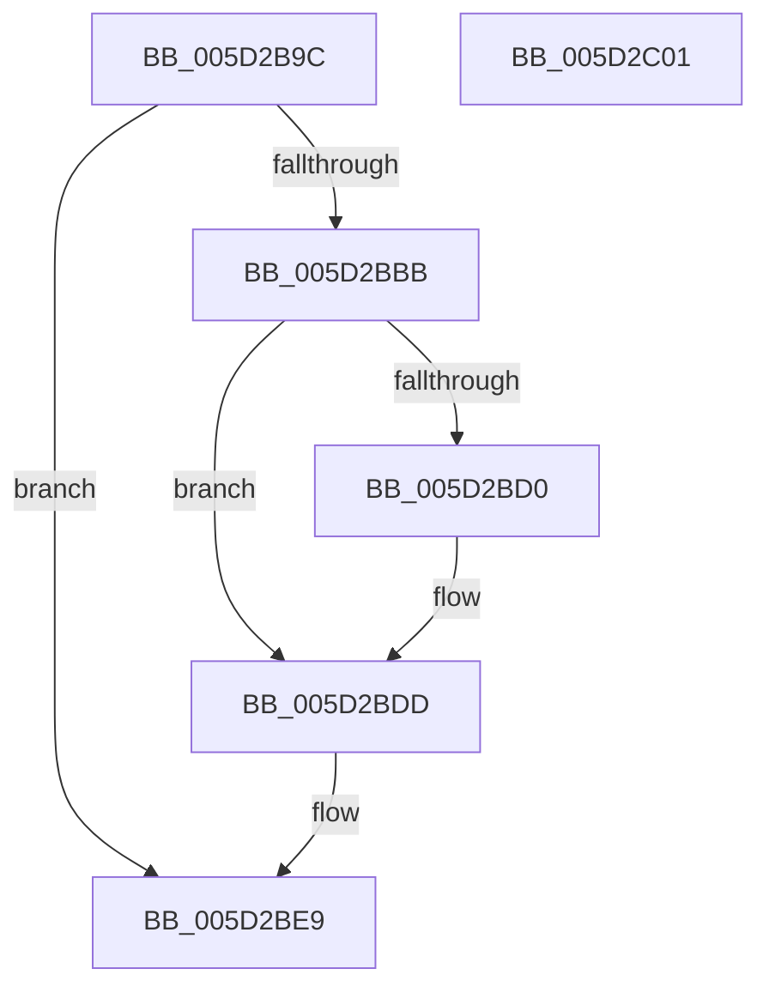

# PopFxGetParentFxDevice

- RVA: `0x005D2B9C`–`0x005D2C02` (길이 `102` bytes)
- VA: `0x00000001405D2B9C`
- 실행 섹션: `.text`
- PDB 이름 있음: `예`; PDB Function 태그: `아니요`
- unwind 정보 RVA: `0x0005C954`
- 디코드: `29`개 명령, `102/102` bytes 표시
- 미해석 바이트: `0` (있으면 어셈블리에 `.byte`로 보존)

> 이 문서는 커널 이미지의 기계어와 PDB 기호를 분석해 생성했습니다. 4번과 5번은 함수 원형과 자료형을 바이너리 사용 방식에서 추정한 C 해석이며 원본 소스 복구 결과는 아닙니다.

## 1. Dependencies

- 직접 호출 지점: **3**; 고유 호출 대상: **3**
- 직접 호출자로 확인된 함수: **1**
- RIP 상대 이미지 참조: **0**

### Outgoing calls
- `0x005D2BBF` → [ExAcquireSpinLockExclusive](../24/ExAcquireSpinLockExclusive_function_00248690.md) (function, `0x00248690`)
- `0x005D2BD8` → [PopFxReferenceDevice](../2B/PopFxReferenceDevice_function_002BFD9C.md) (function, `0x002BFD9C`)
- `0x005D2BE4` → [ExReleaseSpinLockExclusive](../2C/ExReleaseSpinLockExclusive_function_002C0EF0.md) (function, `0x002C0EF0`)

### Direct callers
- [PopFxRegisterDevice](../../page/75/PopFxRegisterDevice_function_00759B80.md) at `0x00759C32`

### Static image references
- 디코드된 RIP-relative 메모리 참조가 없습니다.

## 2. Other-region calls and transfers

- 다른 실행 섹션으로 향하는 call: **0**
- 별도 외부 분기/꼬리 이동을 확인하지 못했습니다.

## 3. Assembly (complete function range)

```asm
005D2B9C  48 89 5C 24 08                  mov qword ptr [rsp + 8], rbx
005D2BA1  48 89 6C 24 10                  mov qword ptr [rsp + 0x10], rbp
005D2BA6  48 89 74 24 18                  mov qword ptr [rsp + 0x18], rsi
005D2BAB  57                              push rdi
005D2BAC  48 83 EC 20                     sub rsp, 0x20
005D2BB0  48 8B 79 10                     mov rdi, qword ptr [rcx + 0x10]
005D2BB4  33 DB                           xor ebx, ebx
005D2BB6  48 85 FF                        test rdi, rdi
005D2BB9  74 2E                           je 0x1405d2be9
005D2BBB  48 8D 4F 58                     lea rcx, [rdi + 0x58]
005D2BBF  E8 CC 5A C7 FF                  call 0x140248690
005D2BC4  48 8B 5F 50                     mov rbx, qword ptr [rdi + 0x50]
005D2BC8  40 8A E8                        mov bpl, al
005D2BCB  48 85 DB                        test rbx, rbx
005D2BCE  74 0D                           je 0x1405d2bdd
005D2BD0  BA 06 00 00 00                  mov edx, 6
005D2BD5  48 8B CB                        mov rcx, rbx
005D2BD8  E8 BF D1 CE FF                  call 0x1402bfd9c
005D2BDD  40 8A D5                        mov dl, bpl
005D2BE0  48 8D 4F 58                     lea rcx, [rdi + 0x58]
005D2BE4  E8 07 E3 CE FF                  call 0x1402c0ef0
005D2BE9  48 8B 6C 24 38                  mov rbp, qword ptr [rsp + 0x38]
005D2BEE  48 8B C3                        mov rax, rbx
005D2BF1  48 8B 5C 24 30                  mov rbx, qword ptr [rsp + 0x30]
005D2BF6  48 8B 74 24 40                  mov rsi, qword ptr [rsp + 0x40]
005D2BFB  48 83 C4 20                     add rsp, 0x20
005D2BFF  5F                              pop rdi
005D2C00  C3                              ret
005D2C01  CC                              int3
```

## 4. C-style interpretation (structured pseudocode)

```c
__int64 __fastcall PopFxGetParentFxDevice(__int64 a1)
{
    __int64 result;
    __int64 v_rbx;
    __int64 v_rsp;
    unsigned __int64 v_stack_p10;
    unsigned __int64 v_stack_p18;
    unsigned __int64 v_stack_p8;

    v_stack_p8 = v_rbx;
    v_stack_p10 = v_rbp;
    v_stack_p18 = v_rsi;
    v_rsp = (v_rsp) - (32);
    v_rbx = 0;
    if (*(unsigned __int64 *)(a1 + 16) == 0) goto loc_005D2BE9;
    result = ExAcquireSpinLockExclusive(*(unsigned __int64 *)(a1 + 16) + 88, a2, a3, a4);
    if (*(unsigned __int64 *)(*(unsigned __int64 *)(a1 + 16) + 80) != 0) {
        a2 = 6;
        a1 = *(unsigned __int64 *)(*(unsigned __int64 *)(a1 + 16) + 80);
        result = PopFxReferenceDevice(a1, a2, a3, a4);
    }
    result = ExReleaseSpinLockExclusive(*(unsigned __int64 *)(a1 + 16) + 88, (unsigned __int8)((unsigned __int8)(result)), a3, a4);
loc_005D2BE9:
    v_rsp = (v_rsp) + (32);
    return *(unsigned __int64 *)(*(unsigned __int64 *)(a1 + 16) + 80);
}
```

## 5. (Beta) C Style

```c
int64_t PopFxGetParentFxDevice(void *Arg1)
{
    uint8_t *arg1 = (uint8_t *)Arg1;

    int64_t result;
    int64_t local_rbx;
    int64_t local_rsp;
    uint64_t v_stack_p10;
    uint64_t v_stack_p18;
    uint64_t v_stack_p8;

    v_stack_p8 = local_rbx;
    v_stack_p10 = local_rbp;
    v_stack_p18 = local_rsi;
    local_rsp = (local_rsp) - (32);
    local_rbx = 0;
    if (*(uint64_t *)(arg1 + 0x10) == 0) goto loc_005D2BE9;
    result = ExAcquireSpinLockExclusive(*(uint64_t *)(arg1 + 0x10) + 88, a2, a3, a4);
    if (*(uint64_t *)(*(uint64_t *)(arg1 + 0x10) + 0x50) != 0) {
        a2 = 6;
        Arg1 = *(uint64_t *)(*(uint64_t *)(arg1 + 0x10) + 0x50);
        result = PopFxReferenceDevice(Arg1, a2, a3, a4);
    }
    result = ExReleaseSpinLockExclusive(*(uint64_t *)(arg1 + 0x10) + 88, (uint8_t)((uint8_t)(result)), a3, a4);
loc_005D2BE9:
    local_rsp = (local_rsp) + (32);
    return *(uint64_t *)(*(uint64_t *)(arg1 + 0x10) + 0x50);
}
```

### 관측된 메모리 오프셋

구조체 형식이 확인되지 않은 접근은 인자 기준의 오프셋으로만 기록했습니다.

| 기준 인자 | 오프셋 표현 | 폭 (bit) | 접근 |
|---|---:|---:|---|
| `Arg1` | `+ 0x10` | `64` | `R` |

## 6. Execution-region graph

[열기: 2D/3D 그래프와 함수 탐색 컨트롤 패널](../../../control-panel.html?section=text&rva=0x005D2B9C&view=graph)

- 2D 그래프는 위에서 아래로 흐르고, 3D 그래프는 빈 공간을 드래그해 회전합니다. Shift+드래그는 이동, 휠은 확대·축소, 함수 노드 선택은 대상 보고서 이동입니다.

### Static fallback


