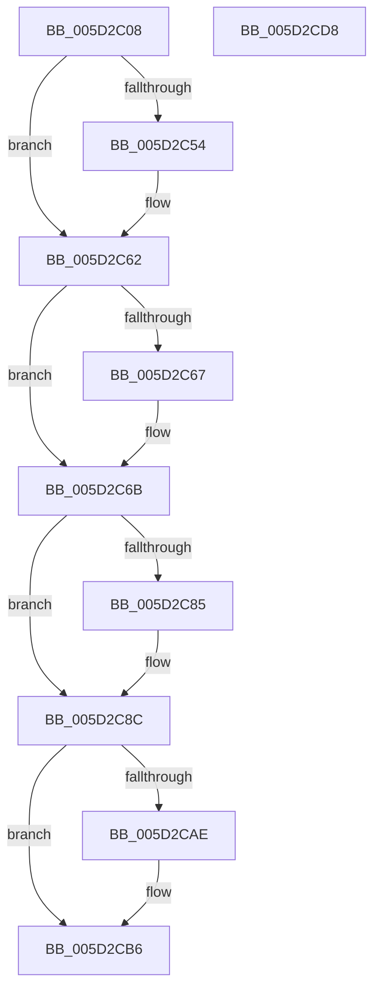

# PopFxInsertAcpiDevice

- RVA: `0x005D2C08`–`0x005D2CD9` (길이 `209` bytes)
- VA: `0x00000001405D2C08`
- 실행 섹션: `.text`
- PDB 이름 있음: `예`; PDB Function 태그: `아니요`
- unwind 정보 RVA: `0x0005C954`
- 디코드: `52`개 명령, `209/209` bytes 표시
- 미해석 바이트: `0` (있으면 어셈블리에 `.byte`로 보존)

> 이 문서는 커널 이미지의 기계어와 PDB 기호를 분석해 생성했습니다. 4번과 5번은 함수 원형과 자료형을 바이너리 사용 방식에서 추정한 C 해석이며 원본 소스 복구 결과는 아닙니다.

## 1. Dependencies

- 직접 호출 지점: **5**; 고유 호출 대상: **5**
- 직접 호출자로 확인된 함수: **1**
- RIP 상대 이미지 참조: **5**

### Outgoing calls
- `0x005D2C43` → [KeAbPreAcquire](../21/KeAbPreAcquire_function_00210230.md) (function, `0x00210230`)
- `0x005D2C5D` → [ExfAcquirePushLockExclusiveEx](../20/ExfAcquirePushLockExclusiveEx_function_0020FC90.md) (function, `0x0020FC90`)
- `0x005D2CB1` → [ExfTryToWakePushLock](../26/ExfTryToWakePushLock_function_00265DD0.md) (function, `0x00265DD0`)
- `0x005D2CB9` → [KeAbPostRelease](../2E/KeAbPostRelease_function_002E1600.md) (function, `0x002E1600`)
- `0x005D2CBE` → [KeLeaveCriticalRegion](../25/KeLeaveCriticalRegion_function_0025D8B0.md) (function, `0x0025D8B0`)

### Direct callers
- [PopFxAcpiRegisterDevice](PopFxAcpiRegisterDevice_function_005DD724.md) at `0x005DD7B5`

### Static image references
- `0x005D2C25` → RVA `0x00F0E408` (`.data`; read)
- `0x005D2C6B` → RVA `0x00F0E3E8` (`.data`; read)
- `0x005D2C72` → RVA `0x00F0E3E0` (`.data`; read)
- `0x005D2C96` → RVA `0x00F0E3E8` (`.data`; write)
- `0x005D2C9D` → RVA `0x00F0E408` (`.data`; read/write)

## 2. Other-region calls and transfers

- 다른 실행 섹션으로 향하는 call: **0**
- 별도 외부 분기/꼬리 이동을 확인하지 못했습니다.

## 3. Assembly (complete function range)

```asm
005D2C08  48 89 5C 24 08                  mov qword ptr [rsp + 8], rbx
005D2C0D  48 89 6C 24 10                  mov qword ptr [rsp + 0x10], rbp
005D2C12  48 89 74 24 18                  mov qword ptr [rsp + 0x18], rsi
005D2C17  57                              push rdi
005D2C18  48 83 EC 20                     sub rsp, 0x20
005D2C1C  65 48 8B 04 25 88 01 00 00      mov rax, qword ptr gs:[0x188]
005D2C25  48 8D 2D DC B7 93 00            lea rbp, [rip + 0x93b7dc]
005D2C2C  49 8B F0                        mov rsi, r8
005D2C2F  48 83 CB FF                     or rbx, 0xffffffffffffffff
005D2C33  45 33 C0                        xor r8d, r8d
005D2C36  33 D2                           xor edx, edx
005D2C38  48 8B CD                        mov rcx, rbp
005D2C3B  66 01 98 E4 01 00 00            add word ptr [rax + 0x1e4], bx
005D2C42  90                              nop
005D2C43  E8 E8 D5 C3 FF                  call 0x140210230
005D2C48  F0 48 0F BA 6D 00 00            lock bts qword ptr [rbp], 0
005D2C4F  48 8B F8                        mov rdi, rax
005D2C52  73 0E                           jae 0x1405d2c62
005D2C54  4C 8B C5                        mov r8, rbp
005D2C57  48 8B D0                        mov rdx, rax
005D2C5A  48 8B CD                        mov rcx, rbp
005D2C5D  E8 2E D0 C3 FF                  call 0x14020fc90
005D2C62  48 85 FF                        test rdi, rdi
005D2C65  74 04                           je 0x1405d2c6b
005D2C67  C6 47 0A 01                     mov byte ptr [rdi + 0xa], 1
005D2C6B  48 8B 0D 76 B7 93 00            mov rcx, qword ptr [rip + 0x93b776]
005D2C72  48 8D 15 67 B7 93 00            lea rdx, [rip + 0x93b767]
005D2C79  48 8D 86 C8 00 00 00            lea rax, [rsi + 0xc8]
005D2C80  48 39 11                        cmp qword ptr [rcx], rdx
005D2C83  74 07                           je 0x1405d2c8c
005D2C85  B9 03 00 00 00                  mov ecx, 3
005D2C8A  CD 29                           int 0x29
005D2C8C  48 89 10                        mov qword ptr [rax], rdx
005D2C8F  48 89 48 08                     mov qword ptr [rax + 8], rcx
005D2C93  48 89 01                        mov qword ptr [rcx], rax
005D2C96  48 89 05 4B B7 93 00            mov qword ptr [rip + 0x93b74b], rax
005D2C9D  F0 48 0F C1 1D 62 B7 93 00      lock xadd qword ptr [rip + 0x93b762], rbx
005D2CA6  80 E3 06                        and bl, 6
005D2CA9  80 FB 02                        cmp bl, 2
005D2CAC  75 08                           jne 0x1405d2cb6
005D2CAE  48 8B CD                        mov rcx, rbp
005D2CB1  E8 1A 31 C9 FF                  call 0x140265dd0
005D2CB6  48 8B CD                        mov rcx, rbp
005D2CB9  E8 42 E9 D0 FF                  call 0x1402e1600
005D2CBE  E8 ED AB C8 FF                  call 0x14025d8b0
005D2CC3  48 8B 5C 24 30                  mov rbx, qword ptr [rsp + 0x30]
005D2CC8  48 8B 6C 24 38                  mov rbp, qword ptr [rsp + 0x38]
005D2CCD  48 8B 74 24 40                  mov rsi, qword ptr [rsp + 0x40]
005D2CD2  48 83 C4 20                     add rsp, 0x20
005D2CD6  5F                              pop rdi
005D2CD7  C3                              ret
005D2CD8  CC                              int3
```

## 4. C-style interpretation (structured pseudocode)

```c
__int64 __fastcall PopFxInsertAcpiDevice(__int64 a1, int a2, __int64 a3)
{
    __int64 result;
    __int64 v_rbx;
    __int64 v_rsp;
    unsigned __int64 v_stack_p10;
    unsigned __int64 v_stack_p18;
    unsigned __int64 v_stack_p8;

    v_stack_p8 = v_rbx;
    v_stack_p10 = v_rbp;
    v_stack_p18 = v_rsi;
    v_rsp = (v_rsp) - (32);
    v_rbx = (v_rbx) | (-1);
    a3 = 0;
    a2 = 0;
    result = KeAbPreAcquire(v_rip + 9680860, a2, a3, a4);
    if (!(condition_is_above_or_equal)) {
        a3 = v_rip + 9680860;
        a2 = result;
        a1 = v_rip + 9680860;
        result = ExfAcquirePushLockExclusiveEx(a1, a2, a3, a4);
    }
    if (result != 0) {
        *(unsigned __int8 *)(result + 10) = 1;
    }
    if ((*(unsigned __int64 *)(*(unsigned __int64 *)(v_rip + 9680758))) != (v_rip + 9680743)) {
        a1 = 3;
    }
    *(unsigned __int64 *)(a3 + 200) = v_rip + 9680743;
    *(unsigned __int64 *)(a3 + 200 + 8) = a1;
    *(unsigned __int64 *)(a1) = a3 + 200;
    *(unsigned __int64 *)(v_rip + 9680715) = a3 + 200;
    v_rbx = (unsigned __int8)((v_rbx) & (6));
    result = a3 + 200;
    if (((unsigned __int8)(v_rbx)) == 2) {
        a1 = v_rip + 9680860;
        result = ExfTryToWakePushLock(a1, v_rip + 9680743, a3, a4);
    }
    result = KeAbPostRelease(v_rip + 9680860, v_rip + 9680743, a3, a4);
    result = KeLeaveCriticalRegion(v_rip + 9680860, v_rip + 9680743, a3, a4);
    v_rsp = (v_rsp) + (32);
    return result;
}
```

## 5. (Beta) C Style

```c
int64_t PopFxInsertAcpiDevice(int64_t Arg1, int32_t Arg2, void *Arg3)
{
    uint8_t *arg3 = (uint8_t *)Arg3;

    int64_t result;
    int64_t local_rbx;
    int64_t local_rsp;
    uint64_t v_stack_p10;
    uint64_t v_stack_p18;
    uint64_t v_stack_p8;

    v_stack_p8 = local_rbx;
    v_stack_p10 = local_rbp;
    v_stack_p18 = local_rsi;
    local_rsp = (local_rsp) - (32);
    local_rbx = (local_rbx) | (-1);
    Arg3 = 0;
    Arg2 = 0;
    result = KeAbPreAcquire(v_rip + 9680860, Arg2, Arg3, a4);
    if (!(condition_is_above_or_equal)) {
        Arg3 = v_rip + 9680860;
        Arg2 = result;
        Arg1 = v_rip + 9680860;
        result = ExfAcquirePushLockExclusiveEx(Arg1, Arg2, Arg3, a4);
    }
    if (result != 0) {
        *(uint8_t *)(result + 0xA) = 1;
    }
    if ((*(uint64_t *)(*(uint64_t *)(v_rip + 0x93B776))) != (v_rip + 9680743)) {
        Arg1 = 3;
    }
    *(uint64_t *)(arg3 + 0xC8) = v_rip + 9680743;
    *(uint64_t *)(arg3 + 0xC8 + 0x8) = Arg1;
    *(void **)(Arg1) = Arg3 + 200;
    *(void **)(v_rip + 0x93B74B) = Arg3 + 200;
    local_rbx = (uint8_t)((local_rbx) & (6));
    result = Arg3 + 200;
    if (((uint8_t)(local_rbx)) == 2) {
        Arg1 = v_rip + 9680860;
        result = ExfTryToWakePushLock(Arg1, v_rip + 9680743, Arg3, a4);
    }
    result = KeAbPostRelease(v_rip + 9680860, v_rip + 9680743, Arg3, a4);
    result = KeLeaveCriticalRegion(v_rip + 9680860, v_rip + 9680743, Arg3, a4);
    local_rsp = (local_rsp) + (32);
    return result;
}
```

### 관측된 메모리 오프셋

구조체 형식이 확인되지 않은 접근은 인자 기준의 오프셋으로만 기록했습니다.

| 기준 인자 | 오프셋 표현 | 폭 (bit) | 접근 |
|---|---:|---:|---|
| `Arg3` | `+ 0x0` | `64` | `W` |
| `Arg3` | `+ 0x8` | `64` | `W` |
| `Arg3` | `+ 0xC8` | `64` | `R` |

## 6. Execution-region graph

[열기: 2D/3D 그래프와 함수 탐색 컨트롤 패널](../../../control-panel.html?section=text&rva=0x005D2C08&view=graph)

- 2D 그래프는 위에서 아래로 흐르고, 3D 그래프는 빈 공간을 드래그해 회전합니다. Shift+드래그는 이동, 휠은 확대·축소, 함수 노드 선택은 대상 보고서 이동입니다.

### Static fallback


