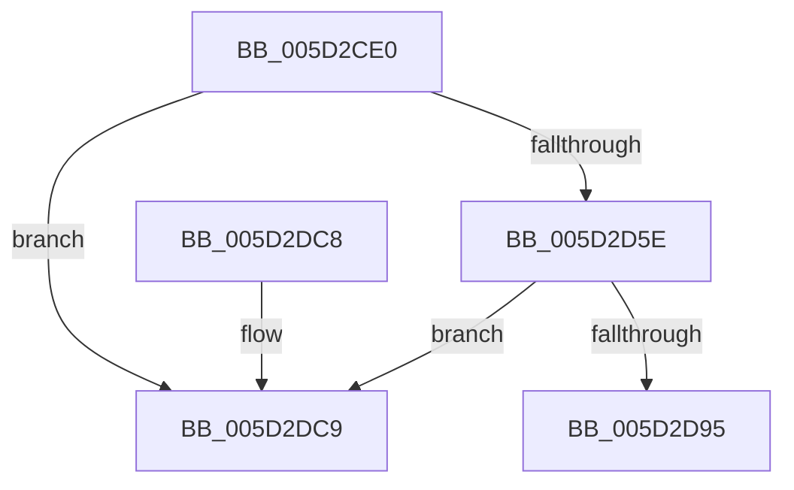

# PopFxInsertDeviceRelation

- RVA: `0x005D2CE0`–`0x005D2DD0` (길이 `240` bytes)
- VA: `0x00000001405D2CE0`
- 실행 섹션: `.text`
- PDB 이름 있음: `예`; PDB Function 태그: `아니요`
- unwind 정보 RVA: `0x0006B020`
- 디코드: `64`개 명령, `240/240` bytes 표시
- 미해석 바이트: `0` (있으면 어셈블리에 `.byte`로 보존)

> 이 문서는 커널 이미지의 기계어와 PDB 기호를 분석해 생성했습니다. 4번과 5번은 함수 원형과 자료형을 바이너리 사용 방식에서 추정한 C 해석이며 원본 소스 복구 결과는 아닙니다.

## 1. Dependencies

- 직접 호출 지점: **4**; 고유 호출 대상: **2**
- 직접 호출자로 확인된 함수: **2**
- RIP 상대 이미지 참조: **0**

### Outgoing calls
- `0x005D2D49` → [KeAcquireSpinLockRaiseToDpc](../20/KeAcquireSpinLockRaiseToDpc_function_00208470.md) (function, `0x00208470`)
- `0x005D2D71` → [KeReleaseSpinLock](../39/KeReleaseSpinLock_function_00392BA0.md) (function, `0x00392BA0`)
- `0x005D2D80` → [KeAcquireSpinLockRaiseToDpc](../20/KeAcquireSpinLockRaiseToDpc_function_00208470.md) (function, `0x00208470`)
- `0x005D2DA8` → [KeReleaseSpinLock](../39/KeReleaseSpinLock_function_00392BA0.md) (function, `0x00392BA0`)

### Direct callers
- [PoFxAddDeviceRelation](PoFxAddDeviceRelation_function_005D1850.md) at `0x005D19B0`
- [PopFxRegisterDevice](../../page/75/PopFxRegisterDevice_function_00759B80.md) at `0x00759D72`

### Static image references
- 디코드된 RIP-relative 메모리 참조가 없습니다.

## 2. Other-region calls and transfers

- 다른 실행 섹션으로 향하는 call: **0**
- 별도 외부 분기/꼬리 이동을 확인하지 못했습니다.

## 3. Assembly (complete function range)

```asm
005D2CE0  48 8B C4                        mov rax, rsp
005D2CE3  48 89 58 08                     mov qword ptr [rax + 8], rbx
005D2CE7  48 89 68 10                     mov qword ptr [rax + 0x10], rbp
005D2CEB  48 89 70 18                     mov qword ptr [rax + 0x18], rsi
005D2CEF  48 89 78 20                     mov qword ptr [rax + 0x20], rdi
005D2CF3  41 56                           push r14
005D2CF5  48 83 EC 20                     sub rsp, 0x20
005D2CF9  41 83 21 00                     and dword ptr [r9], 0
005D2CFD  49 8D 79 20                     lea rdi, [r9 + 0x20]
005D2D01  49 83 61 08 00                  and qword ptr [r9 + 8], 0
005D2D06  49 8D 71 38                     lea rsi, [r9 + 0x38]
005D2D0A  48 89 7F 08                     mov qword ptr [rdi + 8], rdi
005D2D0E  4C 8D B2 00 05 00 00            lea r14, [rdx + 0x500]
005D2D15  48 89 3F                        mov qword ptr [rdi], rdi
005D2D18  48 8B E9                        mov rbp, rcx
005D2D1B  48 89 76 08                     mov qword ptr [rsi + 8], rsi
005D2D1F  48 8B DA                        mov rbx, rdx
005D2D22  48 89 36                        mov qword ptr [rsi], rsi
005D2D25  41 8B 41 10                     mov eax, dword ptr [r9 + 0x10]
005D2D29  41 C1 E0 04                     shl r8d, 4
005D2D2D  83 C8 0E                        or eax, 0xe
005D2D30  44 33 C0                        xor r8d, eax
005D2D33  49 89 49 18                     mov qword ptr [r9 + 0x18], rcx
005D2D37  41 83 E0 30                     and r8d, 0x30
005D2D3B  4D 89 71 30                     mov qword ptr [r9 + 0x30], r14
005D2D3F  44 33 C0                        xor r8d, eax
005D2D42  49 8B CE                        mov rcx, r14
005D2D45  45 89 41 10                     mov dword ptr [r9 + 0x10], r8d
005D2D49  E8 22 57 C3 FF                  call 0x140208470
005D2D4E  48 81 C3 18 05 00 00            add rbx, 0x518
005D2D55  48 8B 53 08                     mov rdx, qword ptr [rbx + 8]
005D2D59  48 39 1A                        cmp qword ptr [rdx], rbx
005D2D5C  75 6B                           jne 0x1405d2dc9
005D2D5E  48 89 56 08                     mov qword ptr [rsi + 8], rdx
005D2D62  49 8B CE                        mov rcx, r14
005D2D65  48 89 1E                        mov qword ptr [rsi], rbx
005D2D68  48 89 32                        mov qword ptr [rdx], rsi
005D2D6B  8A D0                           mov dl, al
005D2D6D  48 89 73 08                     mov qword ptr [rbx + 8], rsi
005D2D71  E8 2A FE DB FF                  call 0x140392ba0
005D2D76  48 8D 9D 80 00 00 00            lea rbx, [rbp + 0x80]
005D2D7D  48 8B CB                        mov rcx, rbx
005D2D80  E8 EB 56 C3 FF                  call 0x140208470
005D2D85  48 8D 95 B8 01 00 00            lea rdx, [rbp + 0x1b8]
005D2D8C  4C 8B 42 08                     mov r8, qword ptr [rdx + 8]
005D2D90  49 39 10                        cmp qword ptr [r8], rdx
005D2D93  75 34                           jne 0x1405d2dc9
005D2D95  48 89 17                        mov qword ptr [rdi], rdx
005D2D98  48 8B CB                        mov rcx, rbx
005D2D9B  4C 89 47 08                     mov qword ptr [rdi + 8], r8
005D2D9F  49 89 38                        mov qword ptr [r8], rdi
005D2DA2  48 89 7A 08                     mov qword ptr [rdx + 8], rdi
005D2DA6  8A D0                           mov dl, al
005D2DA8  E8 F3 FD DB FF                  call 0x140392ba0
005D2DAD  48 8B 5C 24 30                  mov rbx, qword ptr [rsp + 0x30]
005D2DB2  48 8B 6C 24 38                  mov rbp, qword ptr [rsp + 0x38]
005D2DB7  48 8B 74 24 40                  mov rsi, qword ptr [rsp + 0x40]
005D2DBC  48 8B 7C 24 48                  mov rdi, qword ptr [rsp + 0x48]
005D2DC1  48 83 C4 20                     add rsp, 0x20
005D2DC5  41 5E                           pop r14
005D2DC7  C3                              ret
005D2DC8  CC                              int3
005D2DC9  B9 03 00 00 00                  mov ecx, 3
005D2DCE  CD 29                           int 0x29
```

## 4. C-style interpretation (structured pseudocode)

```c
__int64 __fastcall PopFxInsertDeviceRelation(__int64 a1, __int64 a2, int a3, __int64 a4)
{
    __int64 result;
    __int64 v_rbx;
    __int64 v_rsp;
    unsigned __int64 v_stack_p10;
    unsigned __int64 v_stack_p18;
    unsigned __int64 v_stack_p20;
    unsigned __int64 v_stack_p8;

    *(unsigned __int64 *)(v_rsp + 8) = v_rbx;
    *(unsigned __int64 *)(v_rsp + 16) = v_rbp;
    *(unsigned __int64 *)(v_rsp + 24) = v_rsi;
    *(unsigned __int64 *)(v_rsp + 32) = v_rdi;
    v_rsp = (v_rsp) - (32);
    *(unsigned __int64 *)(a4 + 32 + 8) = a4 + 32;
    *(unsigned __int64 *)(a4 + 32) = a4 + 32;
    *(unsigned __int64 *)(a4 + 56 + 8) = a4 + 56;
    *(unsigned __int64 *)(a4 + 56) = a4 + 56;
    a3 = (unsigned int)((a3) << (4));
    result = (unsigned int)(((unsigned int)(*(unsigned int *)(a4 + 16))) | (14));
    a3 = (unsigned int)((a3) ^ ((unsigned int)(result)));
    *(unsigned __int64 *)(a4 + 24) = a1;
    a3 = (unsigned int)((a3) & (48));
    *(unsigned __int64 *)(a4 + 48) = a2 + 1280;
    a3 = (unsigned int)((a3) ^ ((unsigned int)(result)));
    *(unsigned int *)(a4 + 16) = a3;
    result = KeAcquireSpinLockRaiseToDpc(a2 + 1280, a2, a3, a4);
    v_rbx = (a2) + (0x518ULL);
    if ((*(unsigned __int64 *)(*(unsigned __int64 *)(v_rbx + 8))) != v_rbx) goto loc_005D2DC9;
    *(unsigned __int64 *)(a4 + 56 + 8) = *(unsigned __int64 *)(v_rbx + 8);
    *(unsigned __int64 *)(a4 + 56) = v_rbx;
    *(unsigned __int64 *)(*(unsigned __int64 *)(v_rbx + 8)) = a4 + 56;
    *(unsigned __int64 *)(v_rbx + 8) = a4 + 56;
    result = KeReleaseSpinLock(a2 + 1280, (unsigned __int8)(result), a3, a4);
    result = KeAcquireSpinLockRaiseToDpc(a1 + 128, (unsigned __int8)(result), a3, a4);
    if ((*(unsigned __int64 *)(*(unsigned __int64 *)(a1 + 440 + 8))) != (a1 + 440)) goto loc_005D2DC9;
    *(unsigned __int64 *)(a4 + 32) = a1 + 440;
    *(unsigned __int64 *)(a4 + 32 + 8) = *(unsigned __int64 *)(a1 + 440 + 8);
    *(unsigned __int64 *)(*(unsigned __int64 *)(a1 + 440 + 8)) = a4 + 32;
    *(unsigned __int64 *)(a1 + 440 + 8) = a4 + 32;
    result = KeReleaseSpinLock(a1 + 128, (unsigned __int8)(result), *(unsigned __int64 *)(a1 + 440 + 8), a4);
    v_rsp = (v_rsp) + (32);
    return result;
loc_005D2DC9:
    return result;
}
```

## 5. (Beta) C Style

```c
int64_t PopFxInsertDeviceRelation(void *Arg1, void *Arg2, int32_t Arg3, void *Arg4)
{
    uint8_t *arg1 = (uint8_t *)Arg1;
    uint8_t *arg2 = (uint8_t *)Arg2;
    uint8_t *arg4 = (uint8_t *)Arg4;

    int64_t result;
    int64_t local_rbx;
    int64_t local_rsp;
    uint64_t v_stack_p10;
    uint64_t v_stack_p18;
    uint64_t v_stack_p20;
    uint64_t v_stack_p8;

    *(uint64_t *)(local_rsp + 0x8) = local_rbx;
    *(uint64_t *)(local_rsp + 0x10) = local_rbp;
    *(uint64_t *)(local_rsp + 0x18) = local_rsi;
    *(uint64_t *)(local_rsp + 0x20) = local_rdi;
    local_rsp = (local_rsp) - (32);
    *(void **)(arg4 + 0x20 + 0x8) = Arg4 + 32;
    *(void **)(arg4 + 0x20) = Arg4 + 32;
    *(void **)(arg4 + 0x38 + 0x8) = Arg4 + 56;
    *(void **)(arg4 + 0x38) = Arg4 + 56;
    Arg3 = (uint32_t)((Arg3) << (4));
    result = (uint32_t)(((uint32_t)(*(uint32_t *)(arg4 + 0x10))) | (14));
    Arg3 = (uint32_t)((Arg3) ^ ((uint32_t)(result)));
    *(void **)(arg4 + 0x18) = Arg1;
    Arg3 = (uint32_t)((Arg3) & (48));
    *(void **)(arg4 + 0x30) = Arg2 + 1280;
    Arg3 = (uint32_t)((Arg3) ^ ((uint32_t)(result)));
    *(uint32_t *)(arg4 + 0x10) = Arg3;
    result = KeAcquireSpinLockRaiseToDpc(Arg2 + 1280, Arg2, Arg3, Arg4);
    local_rbx = (Arg2) + (0x518ULL);
    if ((*(uint64_t *)(*(uint64_t *)(local_rbx + 0x8))) != local_rbx) goto loc_005D2DC9;
    *(uint64_t *)(arg4 + 0x38 + 0x8) = *(uint64_t *)(local_rbx + 0x8);
    *(uint64_t *)(arg4 + 0x38) = local_rbx;
    *(void **)(*(uint64_t *)(local_rbx + 0x8)) = Arg4 + 56;
    *(void **)(local_rbx + 0x8) = Arg4 + 56;
    result = KeReleaseSpinLock(Arg2 + 1280, (uint8_t)(result), Arg3, Arg4);
    result = KeAcquireSpinLockRaiseToDpc(Arg1 + 128, (uint8_t)(result), Arg3, Arg4);
    if ((*(uint64_t *)(*(uint64_t *)(arg1 + 0x1B8 + 0x8))) != (Arg1 + 440)) goto loc_005D2DC9;
    *(void **)(arg4 + 0x20) = Arg1 + 440;
    *(uint64_t *)(arg4 + 0x20 + 0x8) = *(uint64_t *)(arg1 + 0x1B8 + 0x8);
    *(void **)(*(uint64_t *)(arg1 + 0x1B8 + 0x8)) = Arg4 + 32;
    *(void **)(arg1 + 0x1B8 + 0x8) = Arg4 + 32;
    result = KeReleaseSpinLock(Arg1 + 128, (uint8_t)(result), *(uint64_t *)(arg1 + 0x1B8 + 0x8), Arg4);
    local_rsp = (local_rsp) + (32);
    return result;
loc_005D2DC9:
    return result;
}
```

### 관측된 메모리 오프셋

구조체 형식이 확인되지 않은 접근은 인자 기준의 오프셋으로만 기록했습니다.

| 기준 인자 | 오프셋 표현 | 폭 (bit) | 접근 |
|---|---:|---:|---|
| `Arg1` | `+ 0x8` | `64` | `R` |
| `Arg1` | `+ 0x8` | `64` | `W` |
| `Arg1` | `+ 0x80` | `64` | `R` |
| `Arg1` | `+ 0x1B8` | `64` | `R` |
| `Arg2` | `+ 0x8` | `64` | `R` |
| `Arg2` | `+ 0x8` | `64` | `W` |
| `Arg2` | `+ 0x500` | `64` | `R` |
| `Arg4` | `+ 0x0` | `32` | `R/W` |
| `Arg4` | `+ 0x0` | `64` | `W` |
| `Arg4` | `+ 0x8` | `64` | `R/W` |
| `Arg4` | `+ 0x8` | `64` | `W` |
| `Arg4` | `+ 0x10` | `32` | `R` |
| `Arg4` | `+ 0x10` | `32` | `W` |
| `Arg4` | `+ 0x18` | `64` | `W` |
| `Arg4` | `+ 0x20` | `64` | `R` |
| `Arg4` | `+ 0x30` | `64` | `W` |
| `Arg4` | `+ 0x38` | `64` | `R` |

## 6. Execution-region graph

[열기: 2D/3D 그래프와 함수 탐색 컨트롤 패널](../../../control-panel.html?section=text&rva=0x005D2CE0&view=graph)

- 2D 그래프는 위에서 아래로 흐르고, 3D 그래프는 빈 공간을 드래그해 회전합니다. Shift+드래그는 이동, 휠은 확대·축소, 함수 노드 선택은 대상 보고서 이동입니다.

### Static fallback


